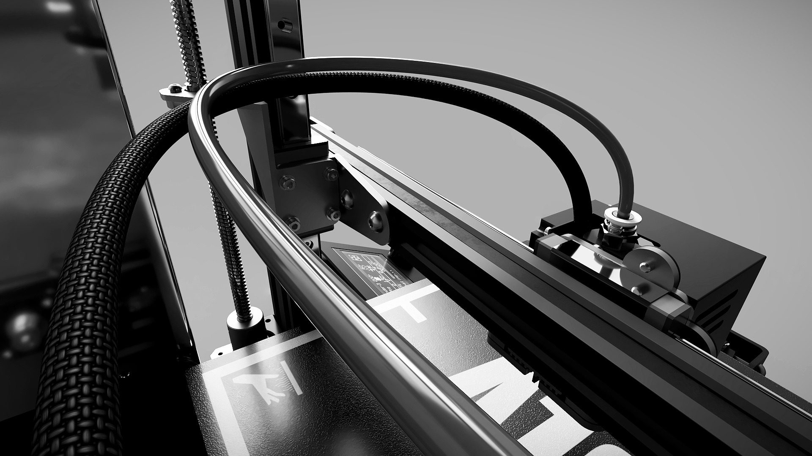

# About me

> *Design with your heart, make with your mind, and share with those who taught you...*

My story is very simple. Many years ago I gained my 3D knowledge from the old community forums. Every single comment and thread was gold to me and to others, building the basics of what we all have today.

Making each BLV 3D printer project was really hard and took 300+ hours. It wasn't easy, especially with a lovely wife, two wonderful little kids and a day job that has nothing to do with 3D printing. But this "thing" is my therapy... I think. It heals my soul and gave me back the passion I thought was lost.

I really don't mind sharing my work. 11 years ago the FDM 3D printer patent expired, and sharing experience is the base of everything we have now. Imagine if we had none of it, and everyone kept their findings and work to themselves.

I hope this gives you an idea of what I believe in, my friends...

Sincerely yours, <b>Ben Levi</b>

If you'd like to support my work, a [small donation](https://www.paypal.com/paypalme/BenBLV) is greatly appreciated.

[:material-heart: Donate](https://www.paypal.com/paypalme/BenBLV){ .md-button .md-button--primary }
