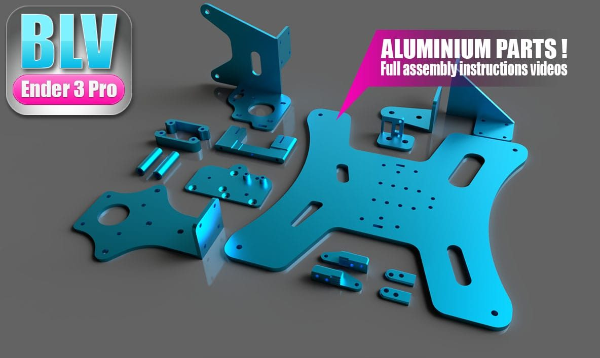
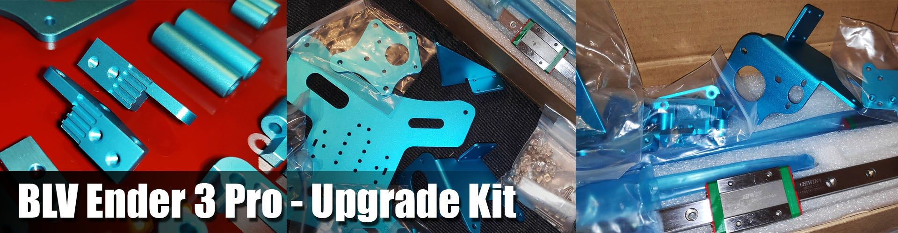
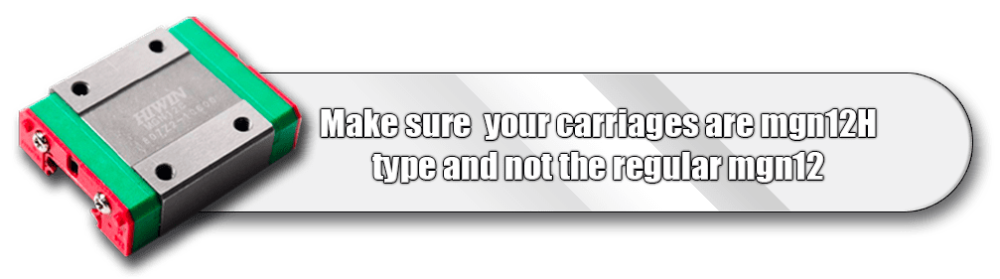
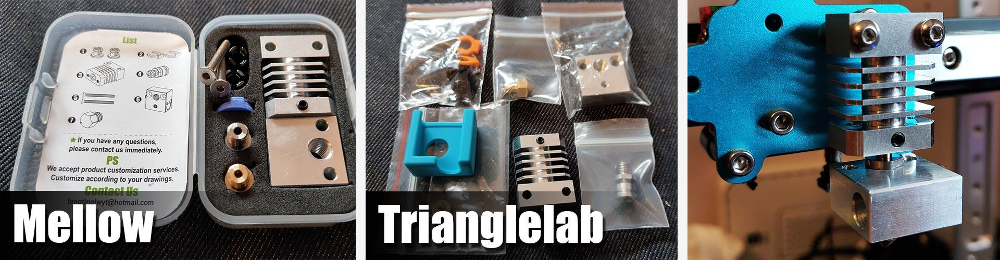
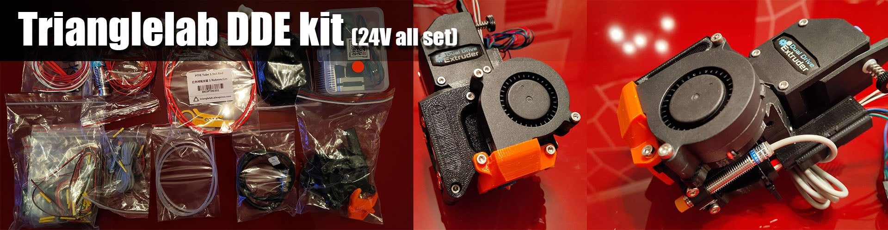
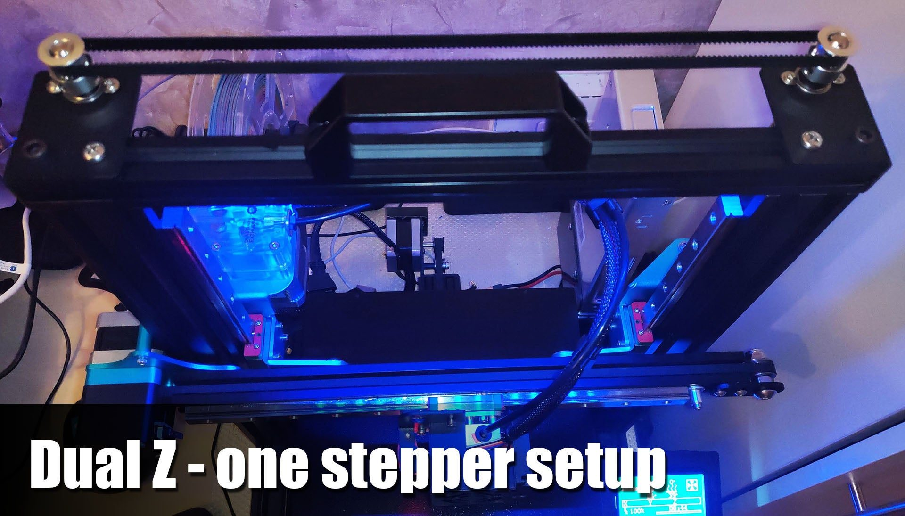
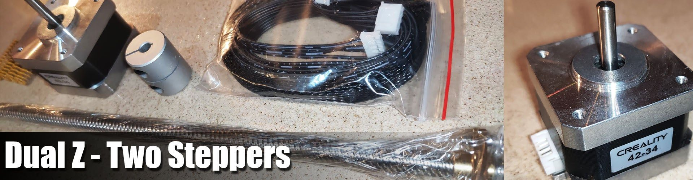

# Bill of materials

## Aluminum parts

!!! info "The kit is no longer sold"
    The BLV Ender 3 Pro aluminum kit (all the CNC parts, screws and belts) is no longer available. The drawings are in the [project files](download:BLV-Ender-3-Pro-Upgrade.zip), and the full screw list is below.

## General

- 1 × set of BLV Ender 3 Pro aluminum parts
    - For the regular Ender 3 (**not the Pro**), the parts can be used without the Y axis.
- 1 × [SKR Mini E3 v1.2 board](https://s.click.aliexpress.com/e/_AXmVBT), a recommended upgrade ([installation guide](https://www.youtube.com/watch?v=VxCBDyvFSgA))
- 1 × [BLTouch auto-leveling sensor](http://s.click.aliexpress.com/e/qBBPL8Yo) / [original BLTouch with bracket](https://s.click.aliexpress.com/e/_Afq0W5)
- 1 × [transparent BMG extruder](https://s.click.aliexpress.com/e/_A3OmVx) / [Orbiter V2 HQ](https://s.click.aliexpress.com/e/_Aru69x) / [Trianglelab BMG](https://s.click.aliexpress.com/e/_99fl7j) / [DriveKit](https://www.aliexpress.com/item/32904209624.html)
- Filament sensor:
    - SKR smart filament sensor, works very well with an SKR board only ([why](extras.md#smart-filament-sensor))
    - [Simple switch filament sensor](http://s.click.aliexpress.com/e/sdxvnjU8)
- 1 × [heated bed insulation sticker 235 × 235](http://s.click.aliexpress.com/e/oRLzRr3w), goes under the bed
- 1 × [high quality PTFE tube](http://s.click.aliexpress.com/e/c0Bjxidi) to replace the stock tube
- 1 × [4 pcs anti-vibration pads](http://s.click.aliexpress.com/e/kmCfLBuU) under the printer
- 1 × 5V LED strip. Choose 1 m, 60 LEDs, IP30 non-waterproof. It is slim and can be cut to fit.
- 1 × high quality aluminium handle, 90 mm aluminum alloy option
- 1 × [yellow strong Creality CR-10 bed springs](http://s.click.aliexpress.com/e/YFNHPjE) to replace the stock springs
- 1 × high quality silicone sock for the hotend block as a spare
- 1 × [22AWG wire, 4/5 wires, 5 m](http://s.click.aliexpress.com/e/btaHHrm0) for the LEDs
- 1 × Energetic powder coated PEI sheet / Trianglelab powder coated PEI sheet
- [SKR touch LCD screen for the Ender 3 Pro](http://s.click.aliexpress.com/e/k6bTgdas), optional

!!! note "Using the original Z endstop?"
    If you use the original Z endstop instead of a BLTouch or another leveling sensor, use [this adapter for the Z endstop](https://www.thingiverse.com/thing:4058533).

## Rails

- 4 × [MGN12H carriage + 300 mm rails](http://s.click.aliexpress.com/e/b4ZT5JAu) (use the frame calculator for other Z sizes)

Two options:

- [Lower cost RDBB rails](http://s.click.aliexpress.com/e/b4ZT5JAu), about $14.6 each when the guide was written.
- HIWIN rails, the highest quality option. They are also used by E3D. A single HIWIN rail sold locally for about $68.

!!! note
    HIWIN rails should be tested with a load on the carriage.

{ width="420" }

## Hotend

A better hotend is a recommended upgrade. First decide between Bowden and direct drive.

=== "Bowden"

    - [The original Creality hotend](https://s.click.aliexpress.com/e/_9zkfSp) | cheap hotend clone
    - High quality hotend by Mellow
    - [Excellent quality hotend by Trianglelab](http://s.click.aliexpress.com/e/nOPUd8pS)
    - [Dragon V2 hotend](https://s.click.aliexpress.com/e/_A9Yt1B), excellent results

=== "Direct drive"

    Trianglelab DDE direct drive, 24V full set, a great system.

    Its X carriage is very similar to the original Ender carriage. To install the DDE, drill two small holes for M3×6 mm screws in the carriage. It takes about 2 minutes ([how](extras.md#trianglelab-dde)).

With the Trianglelab DDE, use the two screws for alignment only, then remove them.

## Z axis

Choose a Z setup:

1. **Single Z stepper.** It worked well for me for a while, but dual Z adds rigidity and greatly improves the Z axis.
2. **Dual Z with one stepper.** A [dual Z set with one stepper, 2 threaded rods and a belt](https://s.click.aliexpress.com/e/_AXlr6D). [This BMG bracket](https://www.thingiverse.com/thing:3117704) recovers some of the lost Z height. Some height is still lost because the extruder touches the left top plate, but this became my favorite setup. Replace the Phillips screws that come with the set with hex socket head screws.
3. **Dual Z with two steppers.** The [recommended set](https://s.click.aliexpress.com/e/_AAdoMv) for dual Z with a second Z motor. **Align the Z axis so both sides match.**

!!! note
    This method reduces the Z height, since the BMG can touch the top plates.

## Screws

??? note "Screw list for the aluminum parts (15 items)"

    | Qty | Part |
    | ---: | --- |
    | 42 | M3 8 mm hex socket head screw |
    | 8 | M3 10 mm hex socket head screw |
    | 4 | M3 14 mm hex socket head screw |
    | 2 | M3 6 mm hex socket head screw |
    | 2 | M3 6 mm hex flat countersink screw |
    | 2 | M3 16 mm hex flat countersink screw |
    | 1 | M3 20 mm hex flat countersink screw |
    | 4 | M3 50 mm hex flat countersink screw |
    | 12 | M5 8 mm hex button head screw |
    | 2 | M4 40 mm hex button head screw |
    | 2 | M4 Nyloc |
    | 5 | M3 Nyloc |
    | 14 | M3 0.5 mm washer |
    | 32 | M3 T-nut |
    | 10 | M5 T-nut |

**Only for dual Z:**

- 2 × M3 10 mm hex button head screws
- 4 × M3 0.5 mm spring washer
- 1 × [100 pcs M3 spring washers](http://s.click.aliexpress.com/e/MlwOTumM), optional

## Tools

- [Cable cutter](http://s.click.aliexpress.com/e/IacurE0)
- 2 × simple steel wrenches for the block and nozzle
- [PTFE tube cutter](http://s.click.aliexpress.com/e/c5dDYfHW)
- [Dehumidifier (moisture absorber) for your dry box](https://s.click.aliexpress.com/e/_9z5kLX), the best I tested
- [Stainless steel digital caliper](http://s.click.aliexpress.com/e/brCQyMCY)
- [Cable organizer](http://s.click.aliexpress.com/e/cLxQo5m0)
- [Pinecil soldering iron](https://s.click.aliexpress.com/e/_A17thR), highly recommended
- [Belt tension meter, 3D printed tool](https://www.thingiverse.com/thing:2230598)

## Optional

- [Easy fast wire connectors](http://s.click.aliexpress.com/e/cq30k5Yk)
- [Mayitr black braided cable sleeve, like Prusa](http://s.click.aliexpress.com/e/c4TGFoTe)
- [5 m LED strip 5050, 60 LEDs/m, 44-key, waterproof](http://s.click.aliexpress.com/e/bLv0LorW)
- [Wago compact wiring connector](http://s.click.aliexpress.com/e/cpmjKbk8)
- [500 pcs 3/32" G10 hardened steel balls for MGN12H rails](http://s.click.aliexpress.com/e/bNxC5T6s) (replacement)

## Filaments I used

- [NOULEI silk filaments](http://s.click.aliexpress.com/e/l3V3Lymy) | [link 2](http://s.click.aliexpress.com/e/dAY2Eky0), used for most of my prints
- [1 kg PETG transparent black](https://s.click.aliexpress.com/e/_9u3xeD)
- [1 kg PLA silver](https://s.click.aliexpress.com/e/_APGkMv)
- [1 kg silk PLA gold](http://s.click.aliexpress.com/e/bgV8dvqu), the best silk filament I tested
