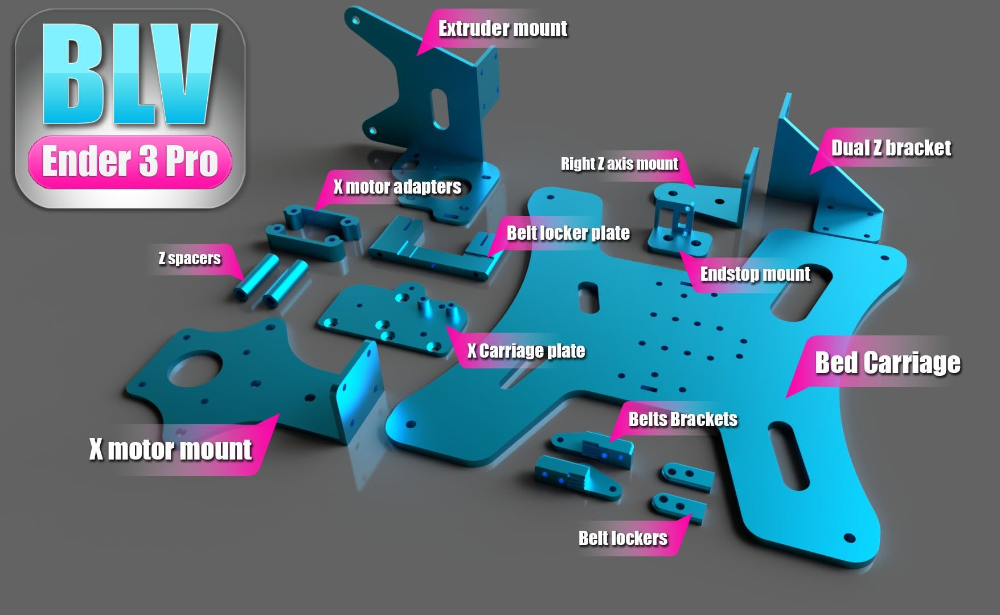
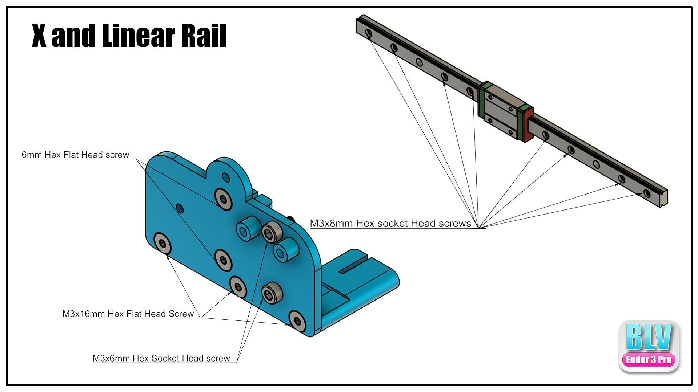
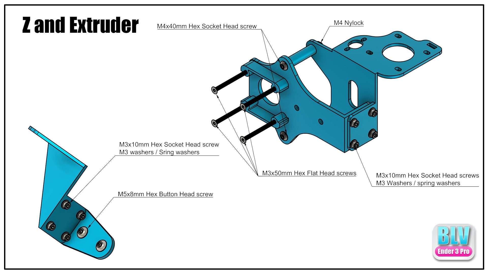
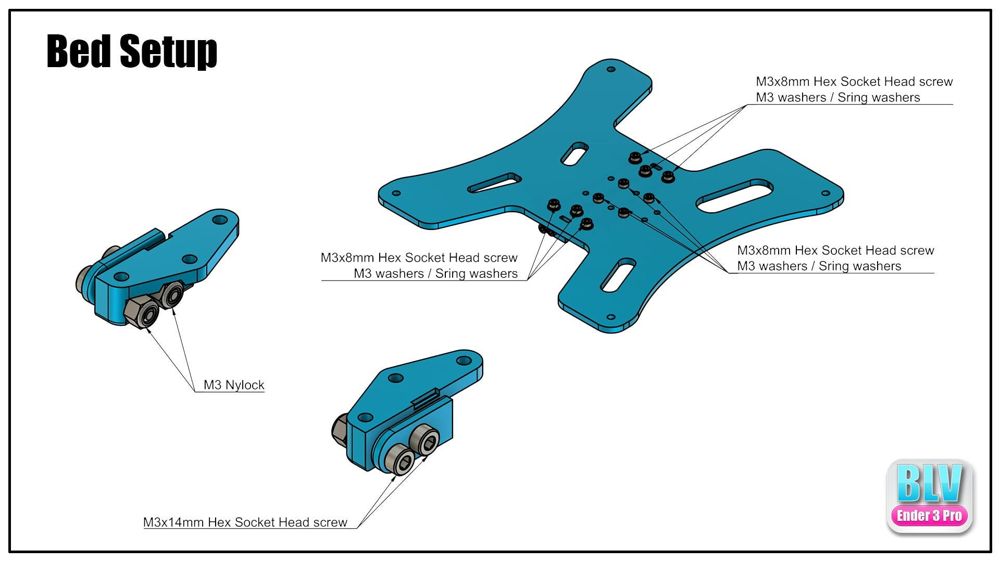
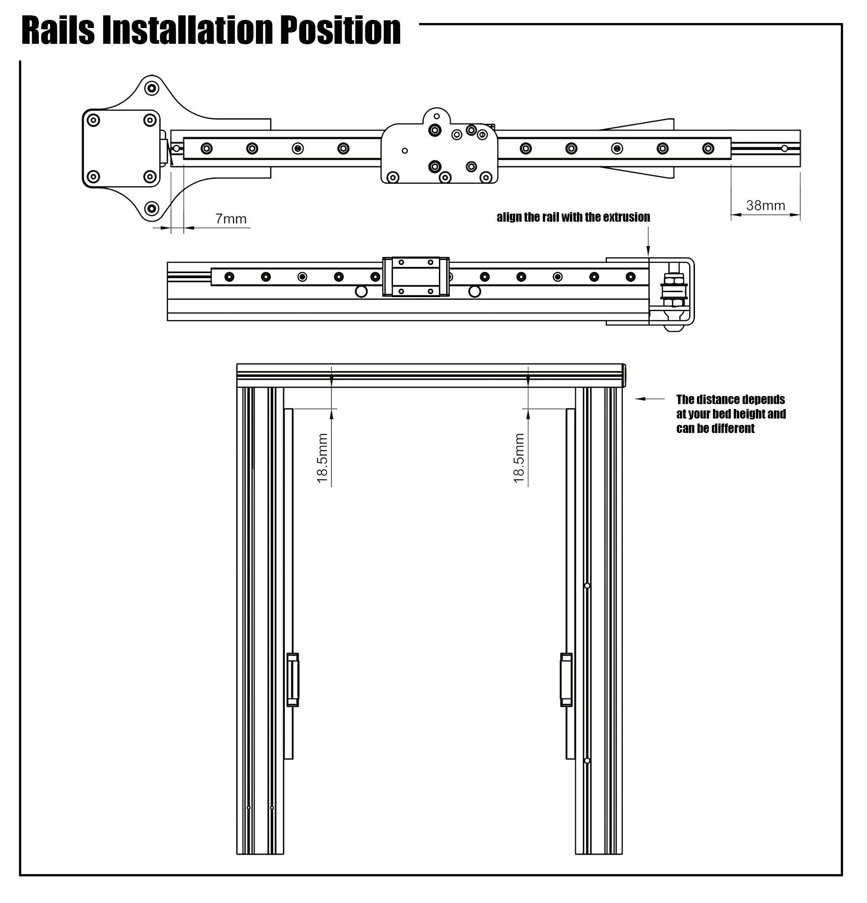
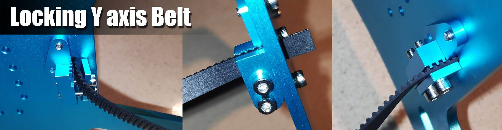
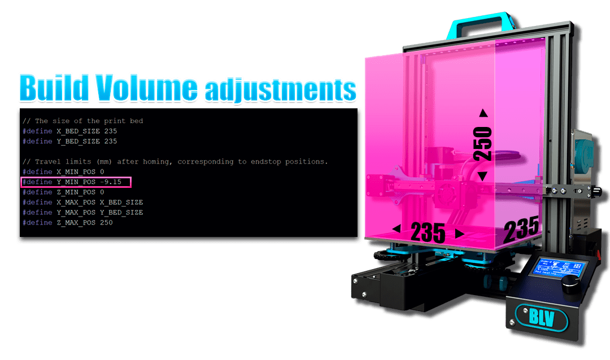
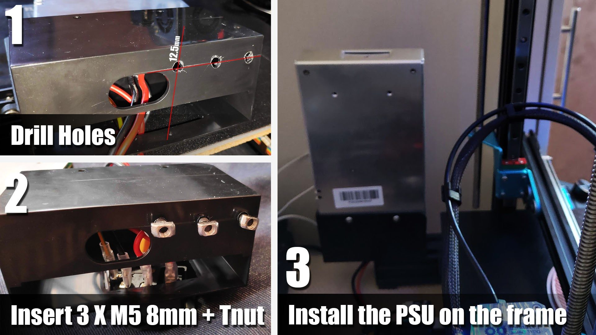

# Build guide

## Assembly videos

!yt RGLydw9Z-Pk | Disassembly steps
!yt 2qyT3RMo_xo | Z axis and extruder assembly
!yt Ezdl2pPzPiA | Bed assembly
!yt jtvkmLhM9FM | X carriage assembly

## Assembly instructions

## Belts

The original Creality belt is too flexible and reduces print quality. Use a fiberglass-reinforced GT2 6 mm belt instead. The X axis belt is clamped at a length of **785 mm**, measured between the clamps and not including the brass clamps. When replacing a belt, both ends can be locked with a zip tie.

**Build volume.** To keep the original build volume, change `Y_MIN_POS` in Marlin's **Configuration.h**. My value was **-9.15**. Adjust it to your setup. The picture shows where to find it.

## Dual Z: moving the PSU

The dual Z option requires moving the PSU:

1. Disconnect the PSU from the wall.
2. Disconnect the PSU from the printer.
3. Partly remove the plastic cover from the PSU.
4. Drill M5 holes as shown below.
5. Insert 3 × M5 8 mm button head screws with T-nuts.
6. Put the plastic cover back on the frame and tighten the screws.
7. Put the PSU back and lock it to the cover.

