# Tips & extras

## Smart filament sensor

Why pay $15 for the **SKR [smart filament sensor](http://s.click.aliexpress.com/e/4FrAxFZW)** when a wire and an endstop switch cost $1.5? [This video](http://Youtube.com/watch?v=iFGIKMAGJTk) explains the difference.

A switch sensor only detects whether filament is present. If the spool jams or the filament gets stuck, nothing happens and the printer keeps printing air. The smart sensor tracks filament movement with a rotary encoder and pauses the print when the filament stops moving. It is well worth it, especially for long prints of 12 hours or more.

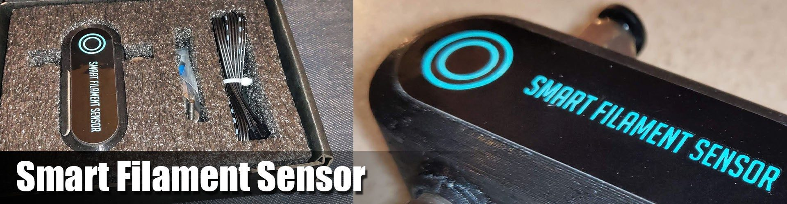

## PEI surface

After a long time with the Energetic PEI spring steel sheet, I tested the Trianglelab double-coated PEI sheet. It arrived well packed, with alcohol wipes and a printed manual. On the first try the corners lifted. The last tip in the manual solved it: **scuff the PEI well with brass wool**, and prints stick very well. Unlike the Energetic sheet, prints also release easily once the sheet cools down.

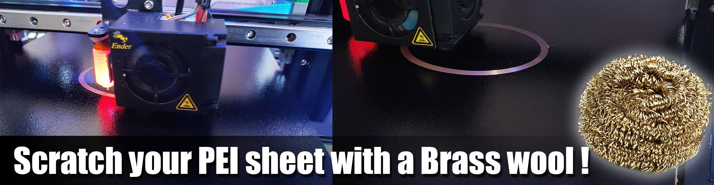

## LED installation

Use a 5V, 60 LEDs/m, non-waterproof strip that can be cut after every LED. The non-waterproof type slides into the V-slot channel more easily.

1. Cut a 15-LED strip, solder a long 4-wire cable to it, and slide it into the top V-slot channel.
2. Cut a 3-LED strip, solder a cable to it, and secure it with 2 zip ties to the back of the [transparent BMG extruder](https://s.click.aliexpress.com/e/_A3OmVx).
3. Connect both strips together and check the connection.
4. Then either:
    - connect them to a simple RGB LED controller and use the IR remote, or
    - connect them to the SKR Mini E3 LED pins and configure it.

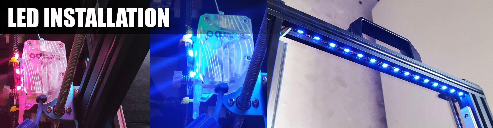

## Bed carriage springs

Replace the original bed springs with the [stronger yellow Creality CR-10 springs](http://s.click.aliexpress.com/e/YFNHPjE) for a much more stable bed.

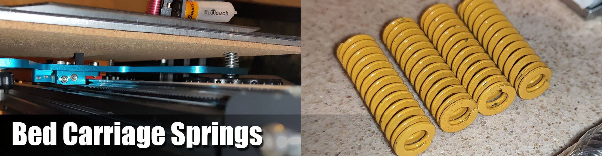

## Trianglelab DDE

To install the Trianglelab DDE system:

1. Print `Carriage template.stl`.
2. Place the drilling template on the rear of the DDE system.
3. Drill two holes as shown, with a 6 mm drill bit, 4 mm deep.
4. Remove the template.
5. Install the DDE on the X carriage.

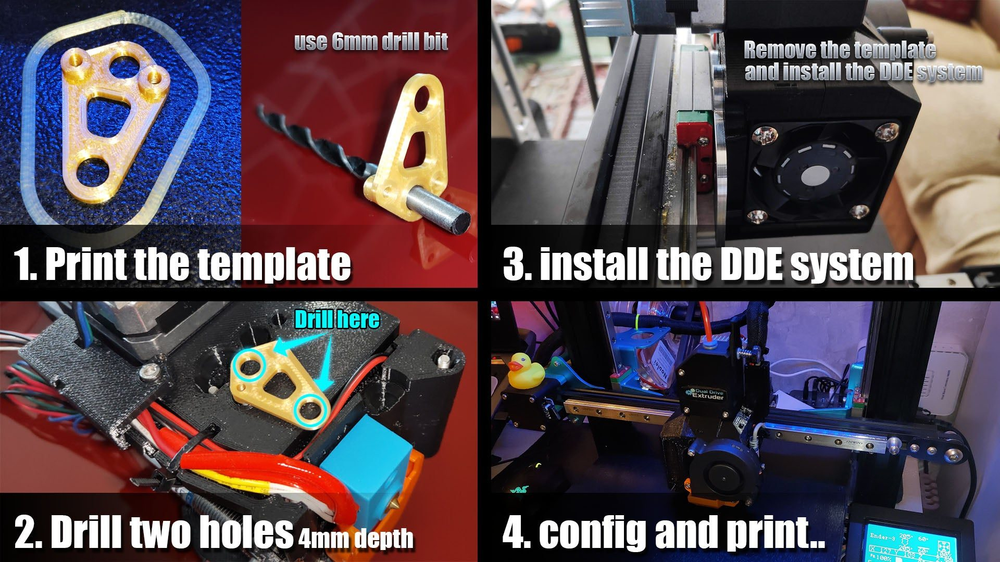

[Trianglelab DDE installation guide and STL](https://drive.google.com/drive/folders/1KL6InrIttUU6s1C7EP5DR8_zmNnUmlQb?spm=a2g0o.detail.1000023.51.47dc9b5afl5hrg){ .md-button }

## More printed parts

- [BMG bracket](https://www.thingiverse.com/thing:3117704). With dual Z on one stepper, it recovers lost Z height by lowering the BMG and its motor.
- [Filament holder with ball bearings](https://www.thingiverse.com/thing:3209211)
- [Power supply silencer](https://www.thingiverse.com/thing:3659432)
- [Bed cable holder](https://www.thingiverse.com/thing:3423163)
- [Ender 3 / Pro X-axis cable holder](https://www.thingiverse.com/thing:2949858)
- [LCD cable holders](https://www.thingiverse.com/thing:2960375)
- [Filament filter](https://www.thingiverse.com/thing:497764), recommended

## Rail tips

I started with [affordable MGN12H rails from AliExpress](http://s.click.aliexpress.com/e/b4ZT5JAu) at about $18 each. After buying from four different sellers, I found the best value at the [CNA Mechanical Parts Store](http://s.click.aliexpress.com/e/b4ZT5JAu). Their carriages slide smoothly straight out of the box, with no cleaning needed. For higher quality at a reasonable price, the [HIWIN rail set](http://s.click.aliexpress.com/e/cTl59jr2) is excellent.

!!! danger "Sellers to avoid"
    Avoid **RDC Official Store** and **linkcnc Store** on AliExpress. linkcnc sent me a used, damaged rail that was shorter than ordered and stayed stuck even after cleaning. RDC started shipping carriages that don't match the MGN standard.

**Cleaning and lubrication.** New rails usually feel rough because they are coated with a protective oil at the factory. Clean it off (several YouTube videos show how to clean the carriage with WD-40), then lubricate the rails and carriages with sewing machine oil or a PTFE silicone grease. These are miniature rails, so avoid thick grease. The goal is a smooth carriage without free play.

The [video below](http://www.youtube.com/watch?v=c53sa46C1qQ) shows the cleaning process well. Work over a container so you don't lose any steel balls. After reassembly there is room for one more ball, which is normal.

!yt c53sa46C1qQ | Tuning up cheap Chinese linear bearings

Mounting the rails takes patience. They must be perfectly straight and aligned, and rushing this step causes problems later.

!!! warning "Don't rely on the gravity test"
    Tilting a rail and watching the carriage slide down says nothing about its quality. A rail with too much free play passes easily and then fails every print quality test. The tolerance grade of the rail sets the friction of the carriage.

## Print samples

Most of these prints were made with [NOULEI silk filaments](http://s.click.aliexpress.com/e/dAY2Eky0) ([more NOULEI](http://s.click.aliexpress.com/e/l3V3Lymy)).

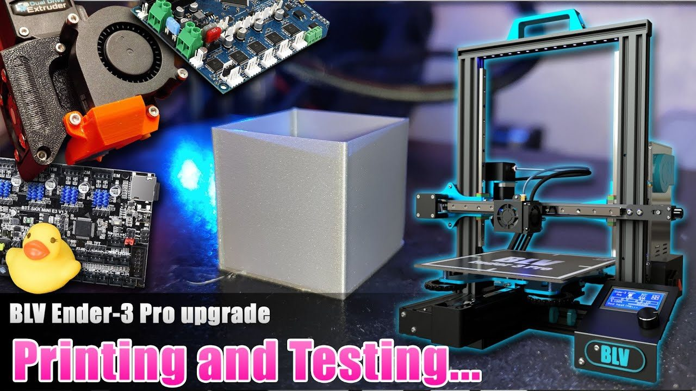
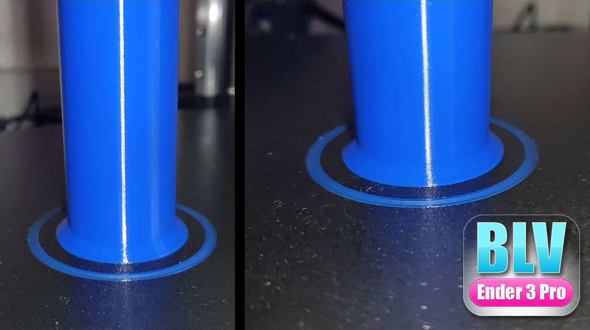
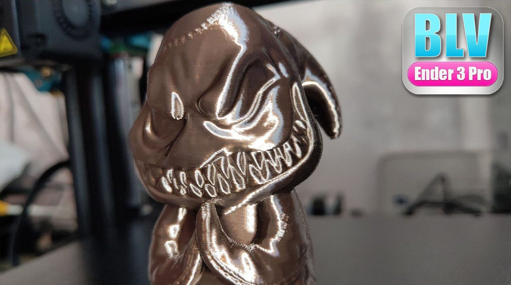
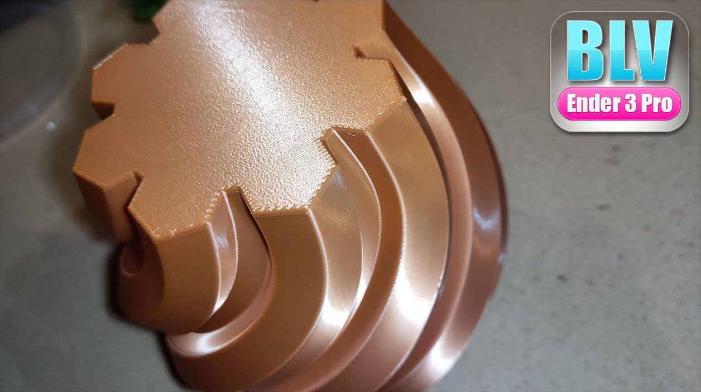
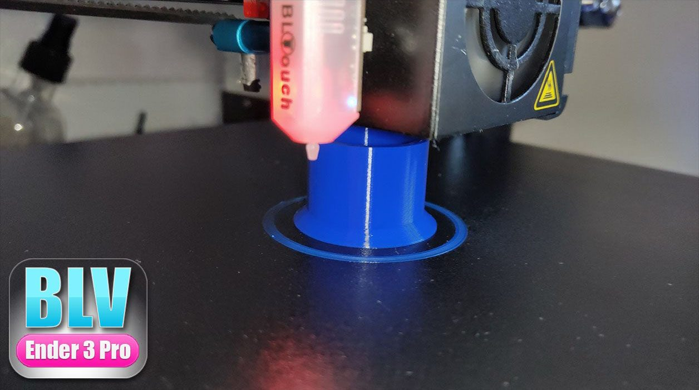
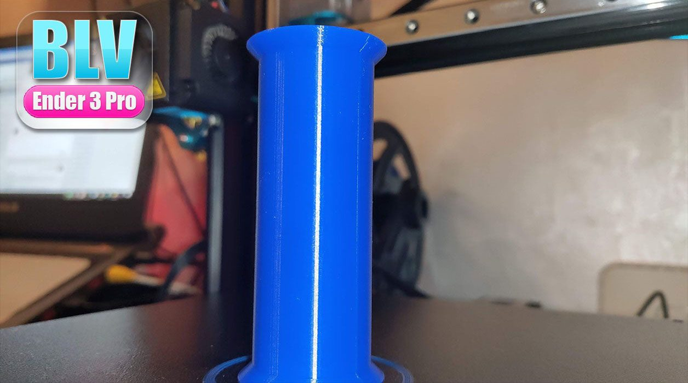
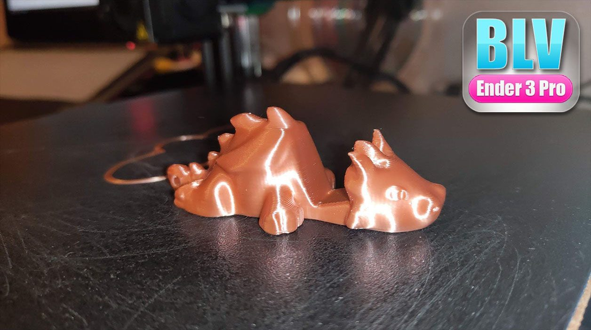
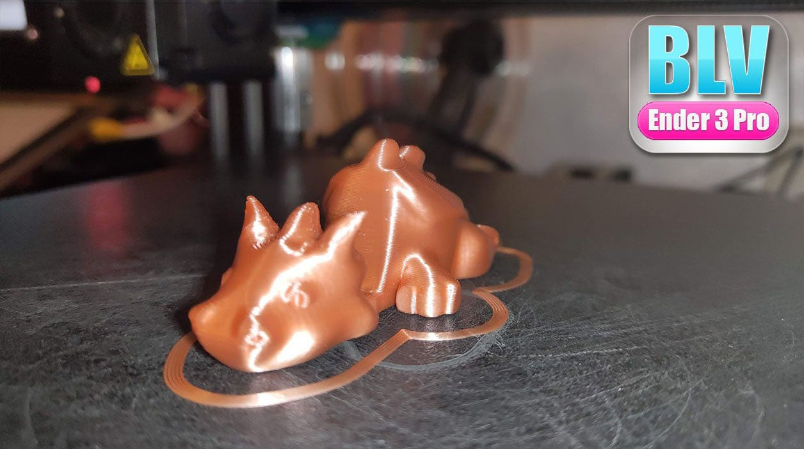
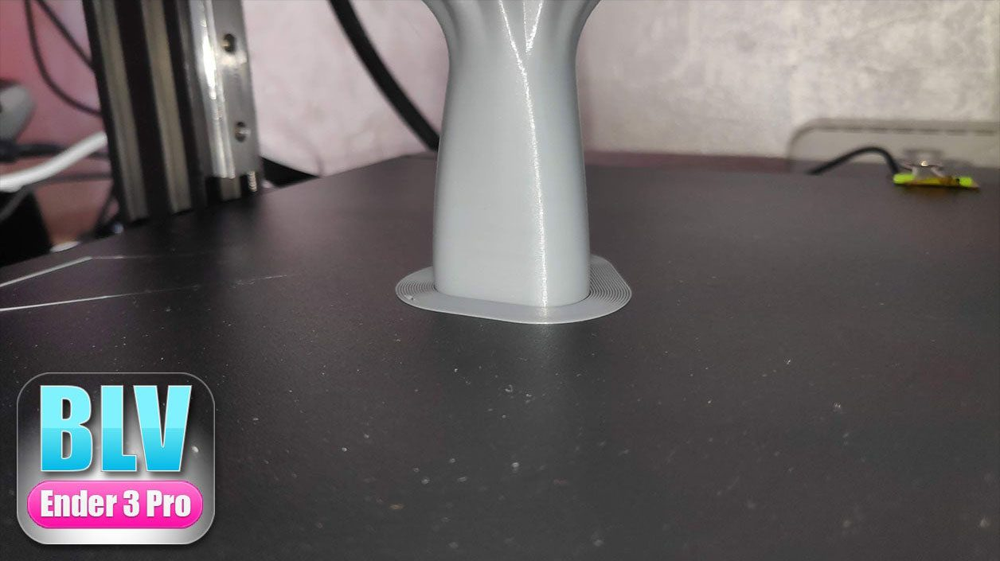
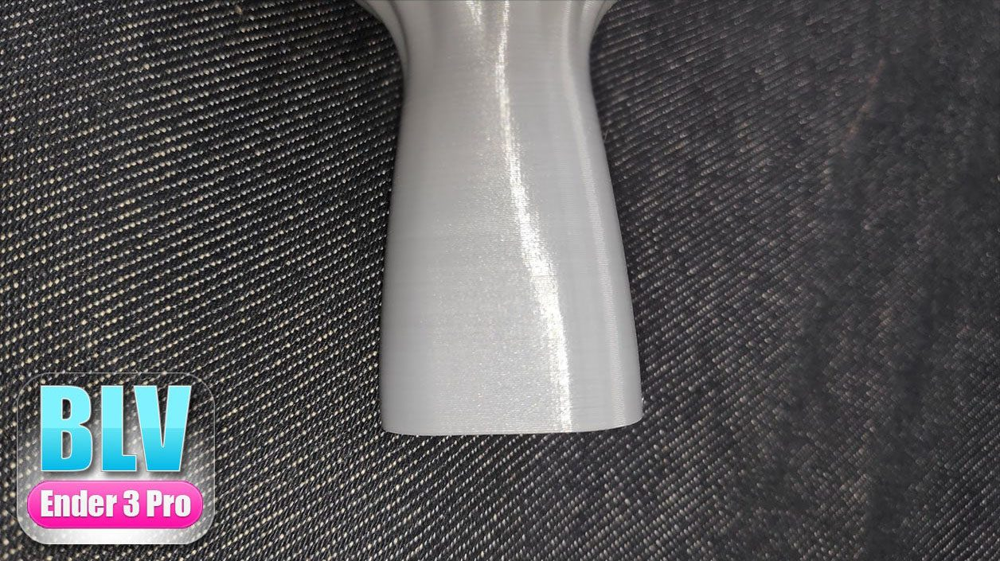

