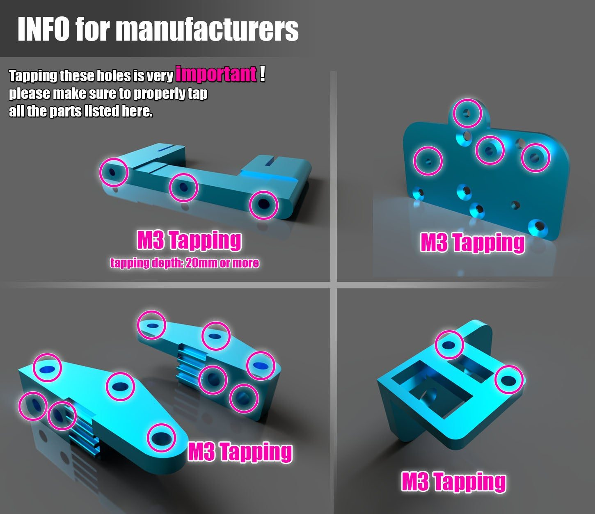
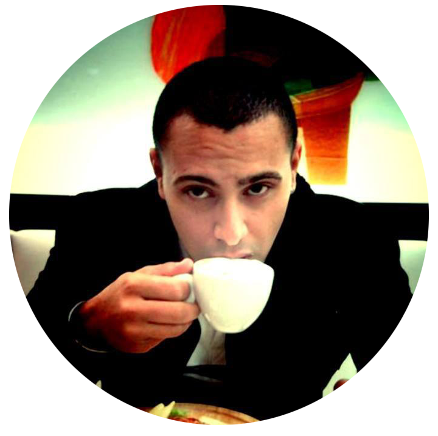

# License & Thanks

## License

**BLV Ender 3 Pro** by [BLV](https://www.thingiverse.com/BLV) (Ben Levi) is licensed under the [Creative Commons Attribution Non-Commercial Share Alike](http://creativecommons.org/licenses/by-nc-sa/3.0/) license.

{ .no-lightbox }
{ .no-lightbox }
{ .no-lightbox }
{ .no-lightbox }

## Legal license

**For manufacturers of the aluminum parts.** The files can be used commercially, free of charge, with my permission only. I provide additional production information and guidance to approved manufacturers. I don't charge for the files, so that competition keeps the parts affordable. The listing must credit the designer as "designed by Ben Levi" and link to the Thingiverse project.

Contact me:

- [Private message on Thingiverse](https://www.thingiverse.com/BLV)
- [Private message on Facebook](https://www.facebook.com/groups/BenLevi/)

!!! warning "Beware of scammers"
    Ignore anyone who claims to be my business partner or asks for free parts on my behalf. I'm an independent open-source developer with no partners or representatives, and I will never ask for free parts or money.

### Info for manufacturers

The holes marked in the picture must be tapped M3 on all the listed parts.

## Thank you

- To my wife, for her encouragement and support throughout the project.
- To Peter (Blurolls store), for his great support of the project.
- **To this community, for becoming my second home. Thank you!**

No conditions apply beyond the license terms. If you would like to support the work, a [small donation](https://www.paypal.me/BenBLV) is always appreciated.

{ width="200" .no-lightbox }
