[← All updates](index.md){ .back-link }

# BLV Ender 3 Pro upgrade project

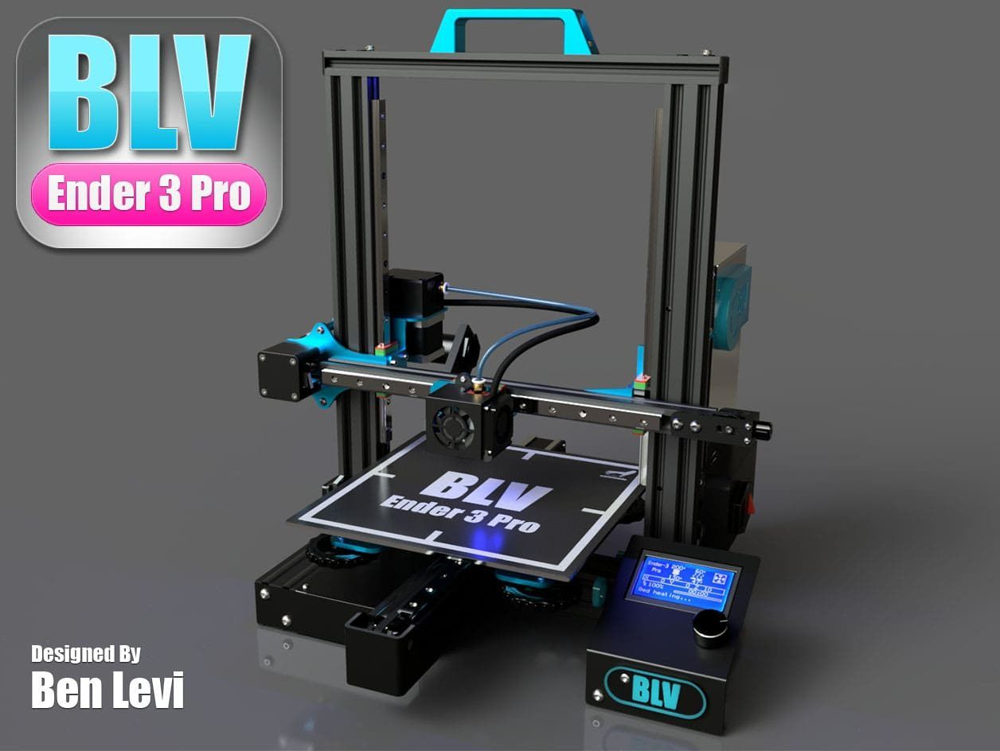

Hi friends, after a lot of hard work the new open source project is alive. This upgrade will boost up your Ender 3 Pro performance. Your Ender 3 Pro will be more silent, rigid, accurate and provide high quality prints. No more worn out POM wheels.. no more eccentric adjustments, no more lose / free play on-axis. Just pure accurate motion on all the axis using Linear rails!

Instead of using elastic 3d printed parts as adapters, I designed 16 parts that are **fully aluminum CNC machined** for maximum rigid structure.

As always, the projects will be **Open-source** ☺️ and I trying my best to make it affordable and accessible to all. by giving all my hard work (200+ hours) for free (non-profit project) to the manufacturer and saving the development cost - the manufacturers are willing to produce the kit for cheap.

**Some of the features:**

- all the parts are aluminum anodized parts!
- Linear rails on all the axis (X,Y,Z).
- easy installation (assembly 1.5h top).
- Dual drive extruder
- Option for Dual Z (extra stepper / single stepper with dual TR8).
- new and improved Y carriage
- Direct drive option (Triangelab DDE setup with V6)
- Mosquito adapter (work in progress)
- dedicated hotend led lighting
- SKR mini E3 (tmc 2209) or original creality board.
- all CAD files are available.
- SKR filament smart sensor support
- Currently testing the kit on CR-10/Ender 3 (regular) without the Bed.
- and more...

Guys as always, I made a 3d assembly video, instructions, and more useful data.

Have fun 🤩

### LINKS

- [**Project link**](../index.md)
- [**link for the Aluminium Kit (from Blurolls)**](http://s.click.aliexpress.com/e/dC4nTB6C)
- [**Kit for the Ender 3 (Regular - not the pro) without the Bed**](http://s.click.aliexpress.com/e/5aTdbQ8o)[setup](http://s.click.aliexpress.com/e/5aTdbQ8o)

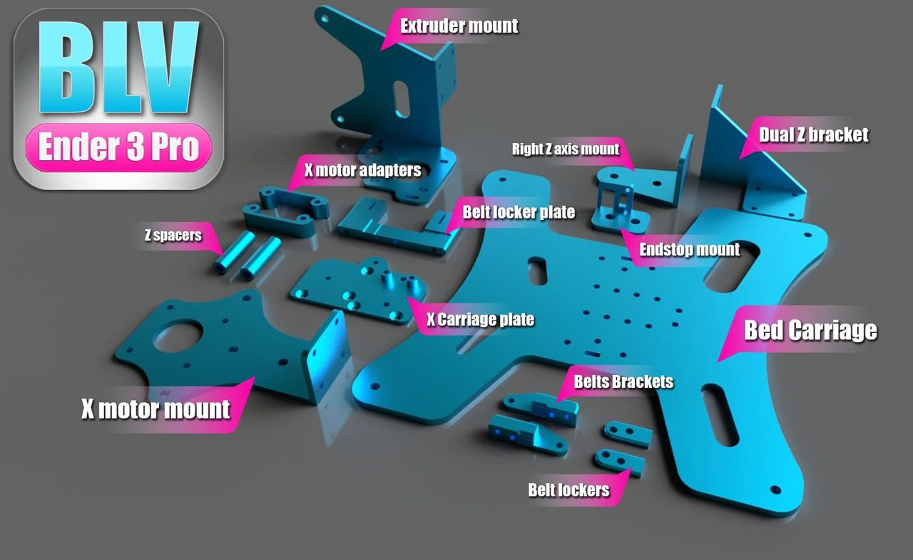
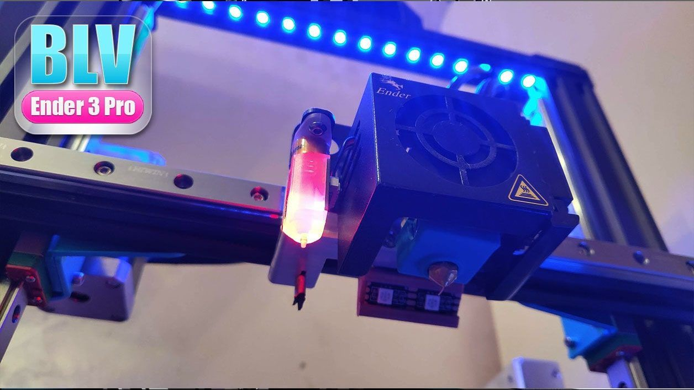
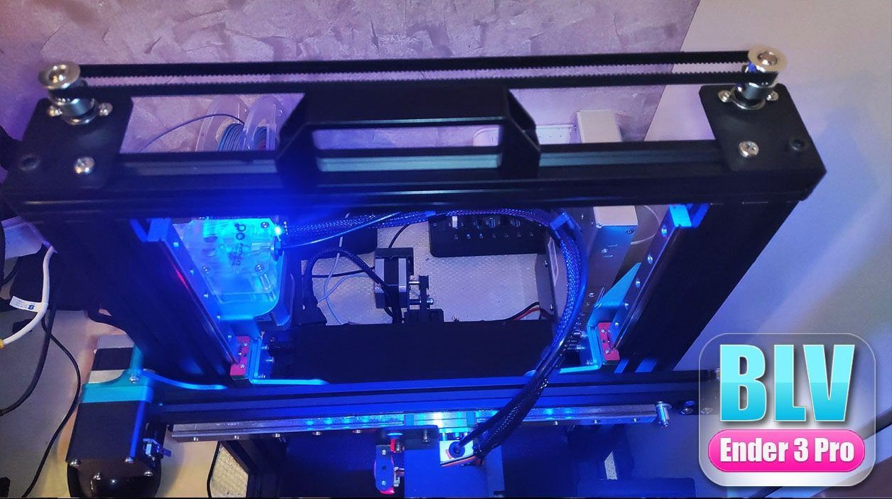
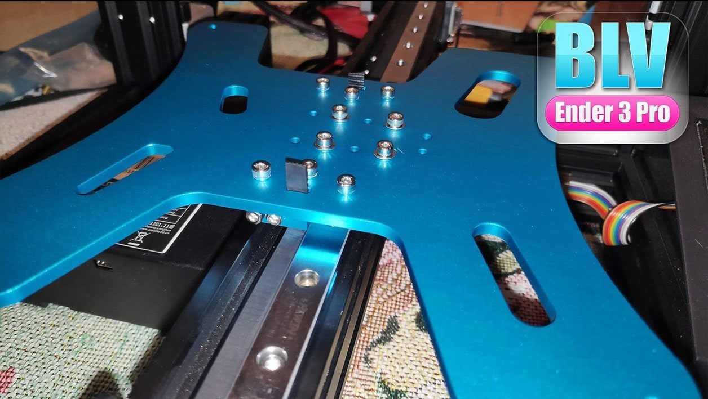
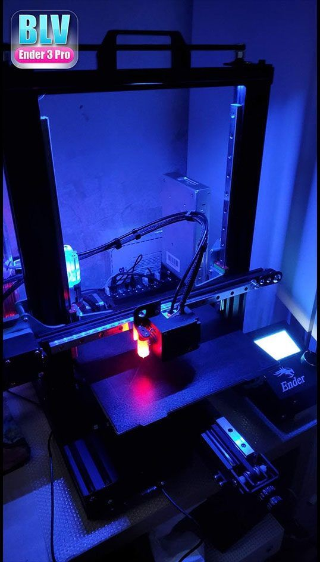
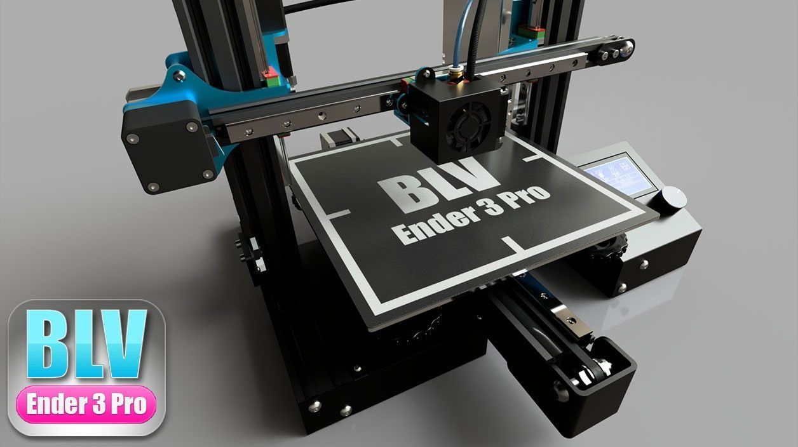
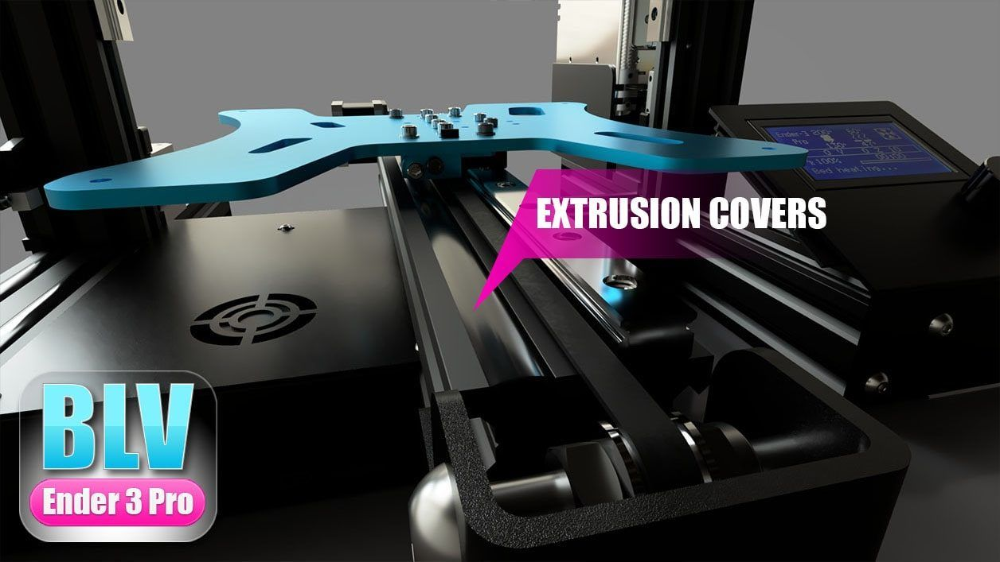
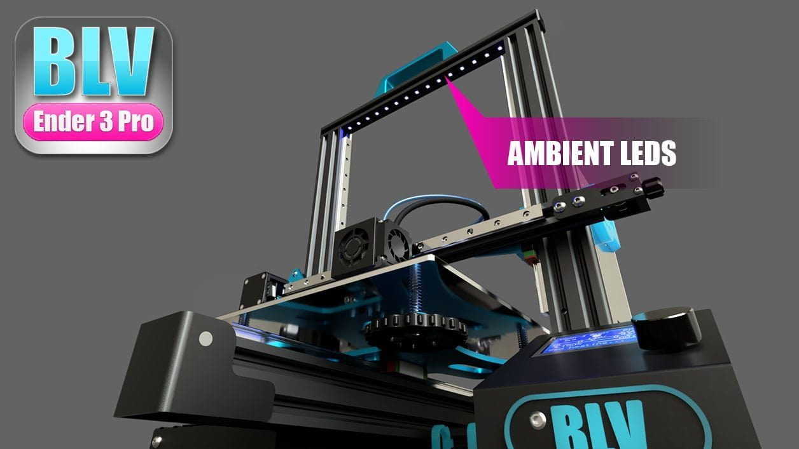
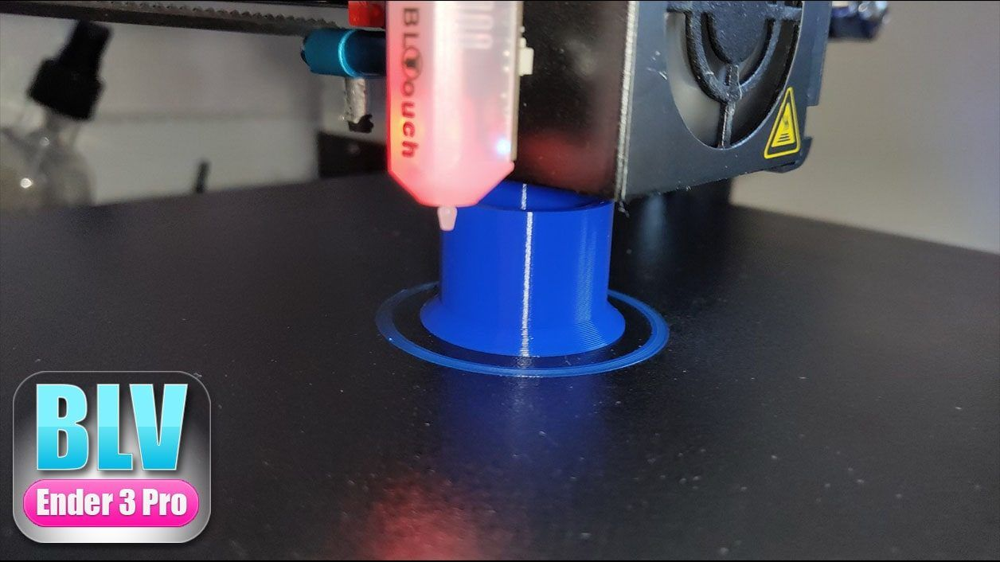
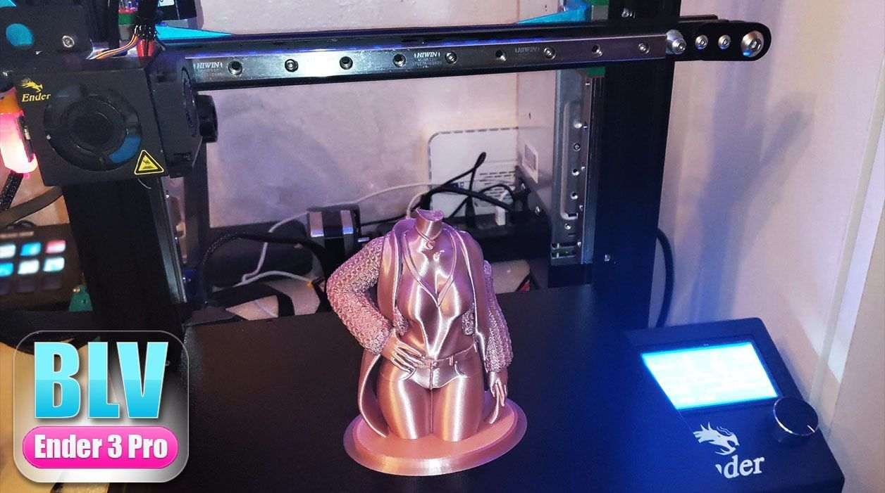

