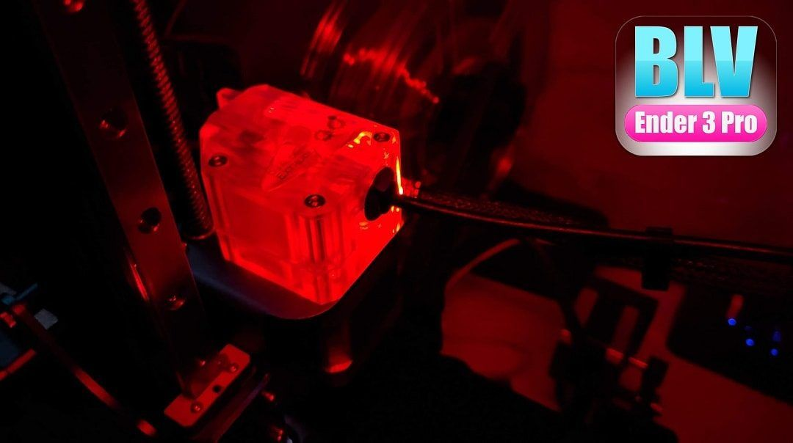
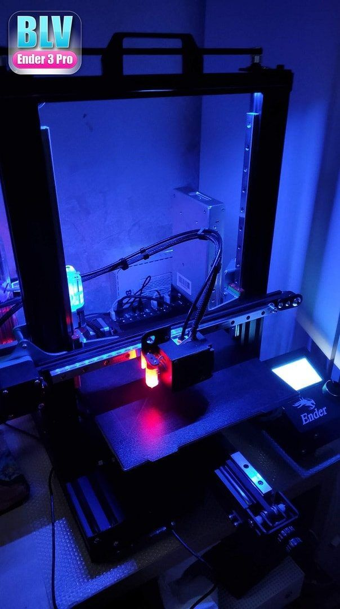
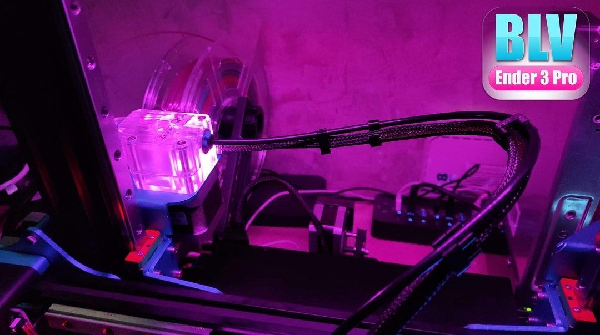

[← All updates](index.md){ .back-link }

# Cosmetic upgrade: clear BMG extruder

Just sharing a cosmetic idea with you. In my new [BLV Ender 3 Pro project](../index.md), I decided to install [**Mellow's transparent BMG dual drive extruder**](http://s.click.aliexpress.com/e/eaG0yBIs), and then I wondered what would happen if I added a few LEDs. So I installed a small LED strip (3 LEDs), and I think it made the extruder look even more awesome.

Get the [Mellow transparent BMG dual drive extruder](http://s.click.aliexpress.com/e/eaG0yBIs).
