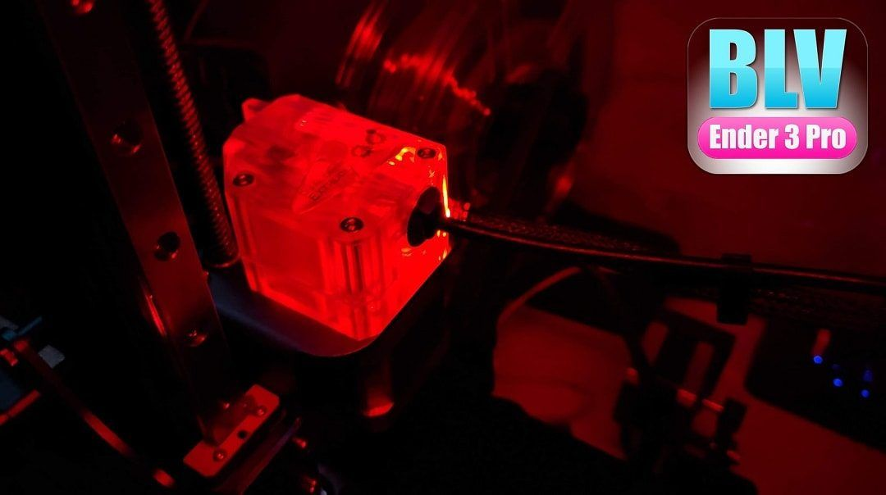
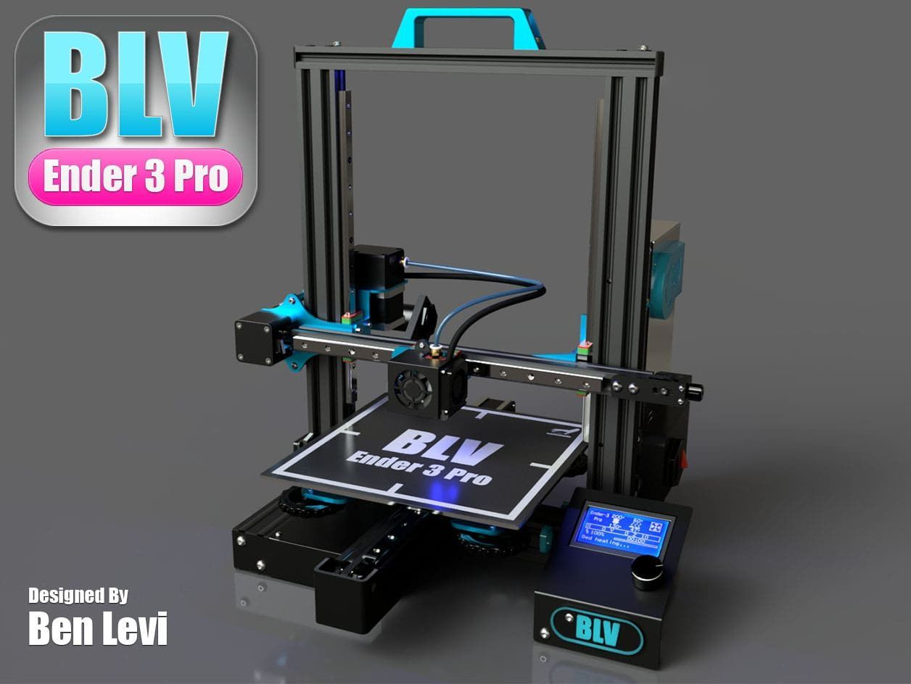

# Project updates

Posts published during the development of the BLV Ender 3 Pro upgrade. Kits and offers mentioned in them have ended.

<a class="mod" href="cosmetic-upgrade-clear-bmg-extruder/"><b>Cosmetic upgrade: clear BMG extruder</b>Just sharing with you a cosmetic idea. in my new BLV ender 3 Pro project, I decided to install the Mellow&#x27;s transparent BMG Dual drive extruder. Then, wondered </a>
<a class="mod" href="blv-ender-3-pro-upgrade-project/"><b>BLV Ender 3 Pro upgrade project</b>Hi friends, after a lot of hard work the new open source project is alive. This upgrade will boost up your Ender 3 Pro performance. Your Ender 3 Pro will be mor</a>

