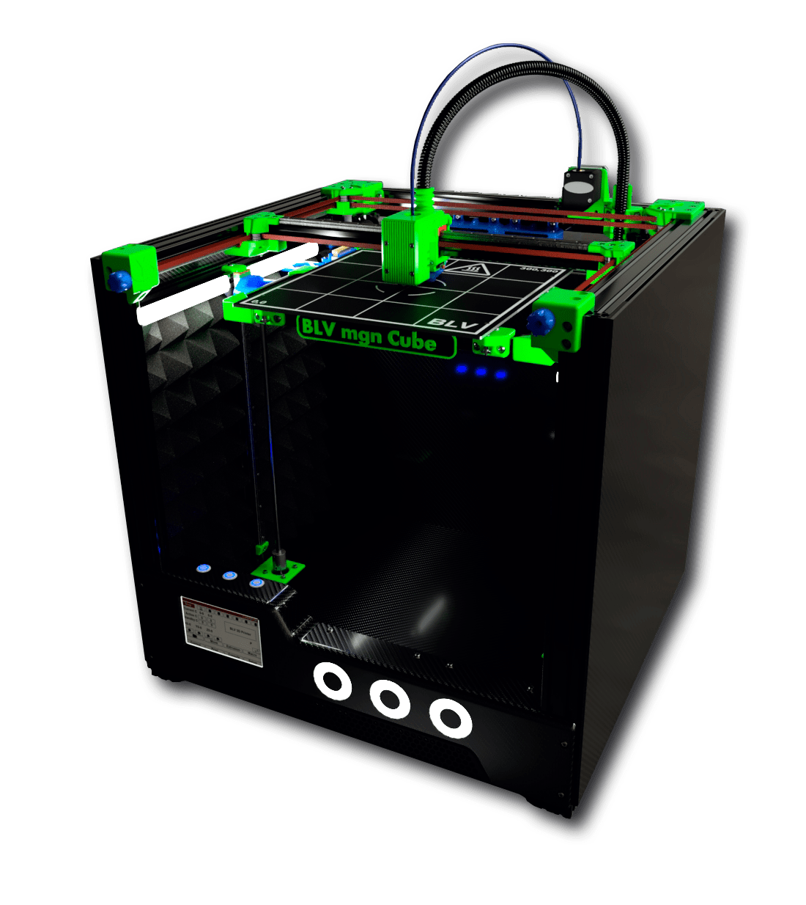
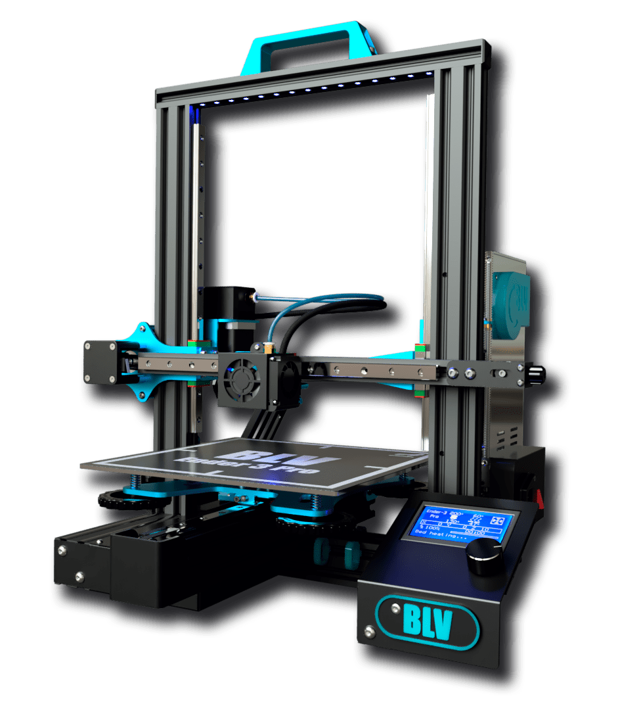
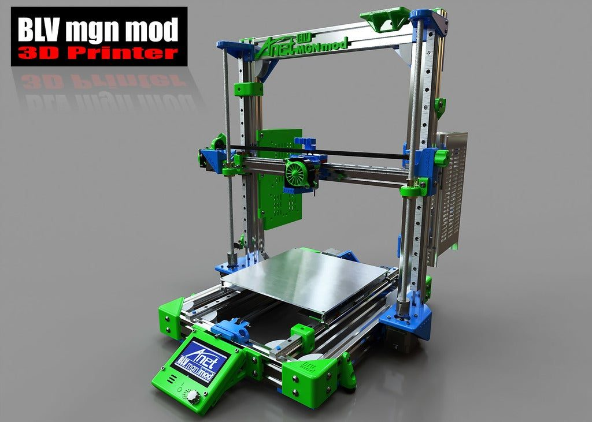

# BLV 3D Printers

Open-source 3D printers by Ben Levi. An archive of the BLV mgn Cube, BLV Ender 3 Pro and BLV mgn12 projects.

I design open-source 3D printers, and the BLV projects are my way of thanking the 3D printing community. Each project comes with full build guides, assembly videos, a bill of materials, firmware settings and the original CAD files. Everything is free for non-commercial use.

Sincerely yours, <b>Ben Levi</b>

<b>3 projects</b>printers and upgrades
<b>1.78M</b>downloads of the Cube
<b>MGN12 rails</b>in every project
<b>STEP files</b>open CAD sources
<b>CC BY-NC-SA</b>free for personal use
<b>Archive</b>no longer updated

## The projects

Not sure where to start? The **BLV mgn Cube** is a complete printer built from scratch. The other two are upgrades for printers you may already own.

-   [{ .no-lightbox width="110" }](mgn-cube/index.md)

    **[BLV mgn Cube](mgn-cube/index.md)**

    ---

    An open front CoreXY printer on MGN12 rails with a 300 × 300 bed, RepRap or Klipper and speeds up to 500 mm/s. The main BLV project, with 1.78M downloads.

    [Overview](mgn-cube/index.md) · [Start here](mgn-cube/start.md) · [Download](mgn-cube/download-and-print.md)

-   [{ .no-lightbox width="110" }](ender-3-pro/index.md)

    **[BLV Ender 3 Pro](ender-3-pro/index.md)**

    ---

    An upgrade for the Ender 3 Pro with all-aluminum parts, MGN12 linear rails and a BMG dual drive extruder.

    [Overview](ender-3-pro/index.md) · [BOM](ender-3-pro/bom.md) · [Build guide](ender-3-pro/build.md)

-   [{ .no-lightbox width="110" }](mgn12/index.md)

    **[BLV mgn12 mod](mgn12/index.md)**

    ---

    Turns an Anet A8 or Prusa i3 into an accurate, fast printer with MGN12 rails on an aluminum frame. AM8 compatible.

    [Overview](mgn12/index.md) · [BOM](mgn12/bom.md) · [Print & assemble](mgn12/build.md)

## Join the community

[:fontawesome-brands-facebook: Facebook group](https://www.facebook.com/groups/BenLevi){ .md-button }
[:fontawesome-brands-youtube: YouTube](https://www.youtube.com/c/BenLevi0){ .md-button }
[:fontawesome-brands-discord: Discord](https://discord.gg/zY4GBfuzC4){ .md-button }
[:fontawesome-brands-tiktok: TikTok](https://www.tiktok.com/@benleviblv){ .md-button }
[:material-heart: Donate](https://www.paypal.com/paypalme/BenBLV){ .md-button .md-button--primary }

News and posts from the project years are on the [updates blog](https://benlevi8.wixsite.com/blvprojects/blog) on the old site.
