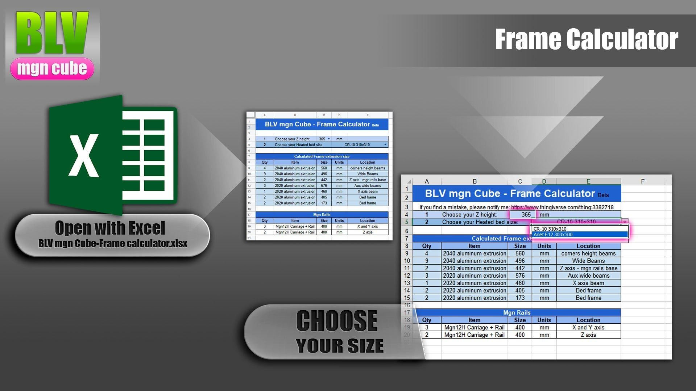
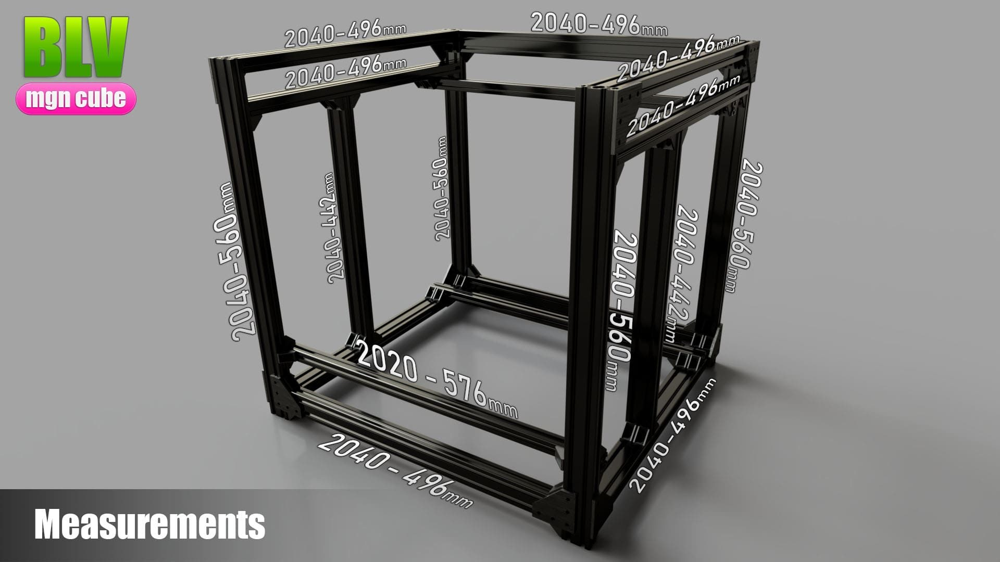
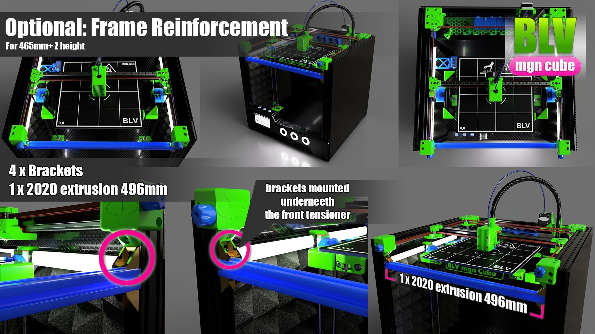
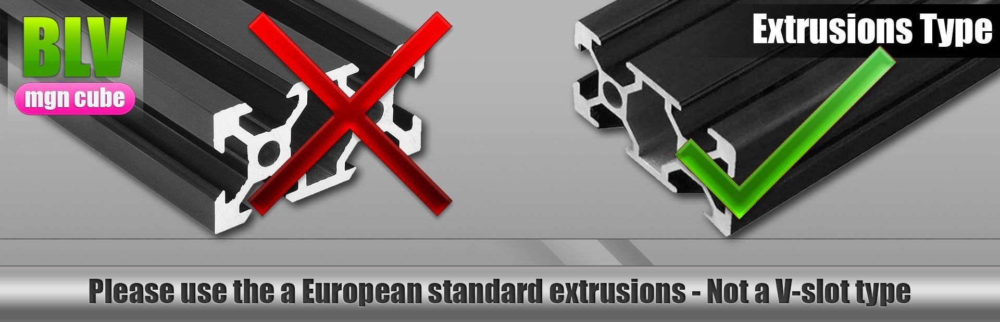
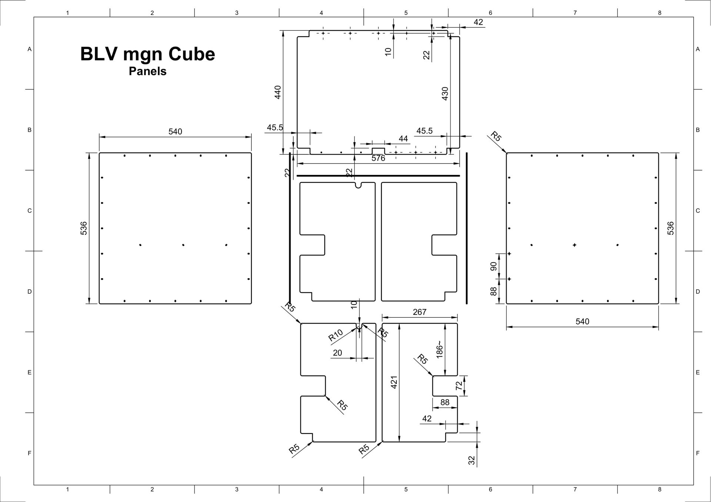

# Bill of materials

Every mechanical and electrical part besides the printed parts. I bought and tested these parts myself. Quantities are for a **365 mm Z height**. For other sizes, use **BLV_mgn_Cube-Frame_calculator.xlsx** from the project ZIP.

!!! info "Kits are no longer sold"
    The full kits, the Metal Kit and the Blind Joints frame were once sold by FYSETC and Blurolls. This list covers the individual parts, and the Metal Kit drawings are still in the [project files](download-and-print.md). **Metal or printed?** CNC parts are about 10× stiffer and ready to install, but must be machined. Printed parts are cheap and easy to remix, but less rigid and slow to print.

## Frame

Buying the extrusions from a local supplier is usually cheaper. Use regular European extrusions with MGN rails, not the V-slot type, and don't replace 2040 profiles with 2020, since that reduces the stiffness of the frame.

### Extrusions

- 9 × 2040 aluminum extrusion, 496 mm (wide beams)
- 3 × 2020 aluminum extrusion, 576 mm (auxiliary wide beams)
- 4 × 2040 aluminum extrusion, 560 mm (corner height beams)
- 2 × [2040 aluminum extrusion](https://s.click.aliexpress.com/e/_9J8l7c), 442 mm (Z axis)
- 2 × [2040 aluminum extrusion](https://s.click.aliexpress.com/e/_9J8l7c), 405 mm (bed frame)
- 2 × 2020 aluminum extrusion for the bed, by bed type:
    - CR-10 bed: **173 mm**
    - Anet bed: **142 mm**
    - E3D high temperature bed (314 × 314): **240 mm**
    - Ender 3 bed: **106 mm**

**X axis, choose one:**

- 1 × 2020 aluminum extrusion, 460 mm
- 1 × [lightweight carbon fiber X axis](https://s.click.aliexpress.com/e/_DD2c4YF) (upgrade)
- 1 × [CNC aluminum X axis tube, 460 mm](https://s.click.aliexpress.com/e/_DDJPdlv) (upgrade)

**Frame reinforcement** for heights of 465 mm and more (optional):

- 1 × 2020 aluminum extrusion, 496 mm
- 4 × [2020 aluminum brackets](https://s.click.aliexpress.com/e/_DD1V16j), 20×20 or 20×17

**Triple Z magnetic system:** an unofficial [triple Z add-on](https://www.thingiverse.com/thing:4611244) based on the work of community member [Druce Taylor](https://www.thingiverse.com/thing:4611244).

**Brackets:**

- 2 × T-shape bracket 60×60 to support the Z rail extrusions
- 14 × [90° corner bracket](https://s.click.aliexpress.com/e/_AbriPg) for 2020/2040
- 100 × [2020 aluminum brackets](https://s.click.aliexpress.com/e/_A2p4Tg), 20×20 or 20×17

## Motion system

### Rails

- 5 × [MGN12H carriage with 400 mm rail](https://s.click.aliexpress.com/e/_DmEozrH) from the [CNA store](http://s.click.aliexpress.com/e/b4ZT5JAu). Use the frame calculator for other heights.
- [A cheaper rail set, about $17 per rail](https://s.click.aliexpress.com/e/_DmEozrH). This is the set I bought first. Choose 400 mm with MGN12H.
- [HIWIN rail set](http://s.click.aliexpress.com/e/cTl59jr2) or a [single HIWIN rail](http://s.click.aliexpress.com/e/bOWLVhhO). HIWIN rails are the best you can get, and E3D uses them too. A large authorized HIWIN dealer on AliExpress sells a full set at a good price, while a single rail cost about $80 locally. Test HIWIN rails with a load on the carriage.

!!! tip
    For precise rail installation, [use this alignment adapter](https://s.click.aliexpress.com/e/_DBqJqer).

!yt HQoGXPk7drw | Genuine HIWIN MGN rails for the BLV mgn Cube

### Stepper motors

- 2 × X/Y stepper: [Nema 17 42STH48 2504AC, 48 mm, 2.5 A](https://s.click.aliexpress.com/e/_DdPNBjz) (updated version)
- 2 × Z stepper: [Nema 17 42STH48 2504AC, 48 mm, 2.5 A](https://s.click.aliexpress.com/e/_DdPNBjz) (updated version)
- 1 × extruder stepper, normally supplied with the extruder
- 2 × [GT2 16 tooth pulley](http://s.click.aliexpress.com/e/cLqfXLpQ) for the X/Y steppers

### Belt system

The belt path is shown on the [Assembly page](assembly.md#belt-system).

- 24 × [F623ZZ flanged ball bearings](http://s.click.aliexpress.com/e/WJXxClE). Choose option 3 only. Flip the belts at the rear and don't use toothed GT2 16T idlers.

!!! warning
    Avoid the Amazon seller who sells low quality 623ZZ bearings at three times the price. The bearings are loose and ruin print quality.

### Belts and lead screws

- 1 × 4 m GT2 6 mm reinforced belt: [Gates fiberglass](http://s.click.aliexpress.com/e/bvgA8Jbi), [Gates fiberglass (tested)](http://s.click.aliexpress.com/e/lMixbe0) or [6mm-LL-2GT RF](https://s.click.aliexpress.com/e/_Am6zMq)
- 2 × [PTFE coated 8 mm lead screw, 400 mm](https://s.click.aliexpress.com/e/_DCOm5Sx) (choose "lead8mm 400")
- 2 × [Mellow NF Oldham coupling](https://s.click.aliexpress.com/e/_DdsqySP) for the Z lead screws

## Main electronics

Start by choosing the firmware: Klipper or RepRap.

=== "Klipper (recommended)"

    Klipper is faster and has more advanced features.

    **Board, choose one:**

    - [BIGTREETECH Octopus V1.1](https://s.click.aliexpress.com/e/_DlHZzxd), board only
    - [FYSETC Spider V2.2](https://s.click.aliexpress.com/e/_DkG4XUJ), board only. This is the board I use.

    **Drivers, choose one:**

    - 6 × [Mellow Fly HV TMC5160 Pro V1.2, 24V/48V](https://s.click.aliexpress.com/e/_DliqsiP) (recommended)
    - 6 × [FYSETC TMC5160 QHV 60V](https://s.click.aliexpress.com/e/_DCY9Ugb)

    **Host computer, choose one:**

    - [Raspberry Pi 4, 4 or 8 GB](https://s.click.aliexpress.com/e/_DEpa46f), with the cooled case option
    - [BIGTREETECH Pi4B adapter with CB1 core board](https://s.click.aliexpress.com/e/_DDEt6yb), a cheaper option. An [original Raspberry Pi CM4](https://s.click.aliexpress.com/e/_DcwmgVd) can replace the CB1.

=== "RepRap"

    - 1 × [Duet WiFi](http://s.click.aliexpress.com/e/_dZhVdmB), or 1 × [Duet 3 6HC](https://s.click.aliexpress.com/e/_DkObfYr) with built-in drivers
    - 1 × [PanelDue 5" screen](http://s.click.aliexpress.com/e/bwwzkkpK) (not the "5i"). Optional, a phone or tablet works as well.

**Z probe, choose one:**

- [Mini differential IR sensor](http://s.click.aliexpress.com/e/coEOOhKC) (not suitable for glass)
- [BLTouch](https://s.click.aliexpress.com/e/_DdLRlVv)
- [Super PINDA 5V](https://s.click.aliexpress.com/e/_DFlNxe3). I use this one and it works very well.

**Power, wiring and fans:**

- 1 × [Mean Well LRS-350-24 (24V)](https://s.click.aliexpress.com/e/_DnBS6k7) and 1 × [Mean Well LRS-350-48 (48V)](https://s.click.aliexpress.com/e/_DnBS6k7). The 48V HV TMC5160 setup needs [both power supplies](https://www.aliexpress.com/store/product/BLV-MGN-Cube-3d-printer-good-quality-power-supply-Geniune-Meanwell-PSU-SE-450-24-24V18/2808029_32988813396.html).
- 2 × [KW11-3Z 3-pin endstop switch](http://s.click.aliexpress.com/e/xaJ9E2y)
- 1 × [300 mm bed heat insulation](http://s.click.aliexpress.com/e/HdBbxLw)
- 3 × [WS2812 Neopixel ring, 16 LEDs](https://s.click.aliexpress.com/e/_Dd3f9GJ), black
- 1 × [14AWG silicone wire, 5 m, black and red](http://s.click.aliexpress.com/e/c5ts2wZS)
- 1 × [22AWG cable, 4 or 5 wires, 5 m](http://s.click.aliexpress.com/e/btaHHrm0)
- 1 × [16 mm momentary switch with LED, 110/220V](http://s.click.aliexpress.com/e/cOgjjw4g), power icon
- 2 × [16 mm momentary or latching switch with LED, 12/24V](http://s.click.aliexpress.com/e/b1i9Fkha) (optional)
- 3 × [4010 24V fan, dual ball bearing](http://s.click.aliexpress.com/e/bjuRTQJe) or a [budget 24V fan](http://s.click.aliexpress.com/e/bNQ2C3C8). Add 4 for the small air scrubber.
- 1 × [5015 24V blower fan, ball bearing](http://s.click.aliexpress.com/e/cTnlOmKc)
- 2 × [4010 24V blower fan, dual ball bearing](http://s.click.aliexpress.com/e/bR84eKyo), only for the twin blower shroud
- 1 × [24V to 12V 15A step-down converter](http://s.click.aliexpress.com/e/cs6KZwJI), only with the Anet E12 bed
- 2 × [120 mm 24V fan, ball bearing, 3000 RPM](http://s.click.aliexpress.com/e/bJjclu56) for the large air scrubber

### Hotend, choose one

1. **Mellow NF-Sunrise V1.1** lightweight dual drive extruder, with the [Mellow Fly-SHT board](https://s.click.aliexpress.com/e/_DE7tSZl).
2. [Trianglelab TCHC TD6 high flow 24V](https://s.click.aliexpress.com/e/_DBsqqZd) with the [BIQU Orbiter V2.0 extruder](https://s.click.aliexpress.com/e/_DCS2FPN) and the [Mellow Fly-SHT board](https://s.click.aliexpress.com/e/_DE7tSZl).
3. **[BIQU H2](https://s.click.aliexpress.com/e/_DCeiYqr)**, a lightweight extruder and hotend in one unit. I use the H2 V2S Lite on the 48V setup at 25K acceleration and 1250 mm/s. A carriage for the H2 series is in the project files.
    1. [BIQU H2 V2S Revo](https://s.click.aliexpress.com/e/_DCFWy8T)
    2. [BIQU H2 V2S Lite](https://s.click.aliexpress.com/e/_DBCLutV), only 180 g (preferred)
    3. [BIQU H2 V2.0](https://s.click.aliexpress.com/e/_DdT9ymP)
4. **Trianglelab Matrix:**
    1. [Trianglelab Matrix](https://s.click.aliexpress.com/e/_DeZtOPD)
    2. [Trianglelab Matrix LC Lite](https://s.click.aliexpress.com/e/_DEfkeiB) with a [water cooling system](https://www.aliexpress.com/item/32850217541.html) (24turn12v option) and [thermal fluid](https://s.click.aliexpress.com/e/_DBuSiTv)

!!! note "Trianglelab hotend with RepRap firmware"
    Replace the M305 line in `config.g` with: `M305 P1 T100000 B4725 C0.0000000706 R4700`

**Tool changer** (advanced): [E3D toolhead clone by Funssor for MGN12H](https://s.click.aliexpress.com/e/_Dm5VvUX)

**Hotend upgrades:**

- [CHT clone nozzle for high flow printing](https://s.click.aliexpress.com/e/_DlRJk15), 0.4 mm. A must-have upgrade.
- Spare thermistors: [Semitec 104GT-2](http://s.click.aliexpress.com/e/b3YkgynA), [thermistor with connector](http://s.click.aliexpress.com/e/c2IGfgLA) or [standard thermistor](https://s.click.aliexpress.com/e/_DBgg7GB)
- [Phaetus tungsten carbide nozzle](https://s.click.aliexpress.com/e/_DEAzwrv), very wear resistant for carbon and wood filaments
- [Hardened steel A2 nozzle](https://s.click.aliexpress.com/e/_DepZDr9) for abrasive materials

### Heated bed (8 mm plate)

- [8 mm aluminum 7075 plate, 310 × 310 mm](https://s.click.aliexpress.com/e/_Dmsq70n)
- [Silicone heater pad 310 × 310, 750W, with adhesive](https://s.click.aliexpress.com/e/_DD6ifvp). Choose 220V, 120V or 24V.
- [Thumb wheels](http://s.click.aliexpress.com/e/bKMV1NCy), M4
- [PEI spring steel sheet](https://s.click.aliexpress.com/e/_DCVXv3H), 310 mm, without a magnetic base
- [Solid silicone spacers](https://s.click.aliexpress.com/e/_Dn3AjbV) to replace the bed springs

## Mechanics and more

- 1 × [BMG extruder](https://s.click.aliexpress.com/e/_DnclLVh) for a classic Bowden setup
- 1 × [Capricorn style PTFE tube, 1 m, 1.9 or 2 mm ID](http://s.click.aliexpress.com/e/c0Bjxidi)
- 2 × [635ZZ bearing](http://s.click.aliexpress.com/e/bdteVkks) to align the stepper shafts (optional)
- 5 × [silicone sock](https://s.click.aliexpress.com/e/_Dl41fjN) to keep the nozzle temperature steady

## Screws

??? note "Screw list (35 items, quantities rounded for bulk packs)"

    | Qty | Part | Note |
    | ---: | --- | --- |
    | 300 | [M5 10 mm button head](http://s.click.aliexpress.com/e/cpnplQQc) | buy 300 to 350 |
    | 2 | [M5 16 mm button head](http://s.click.aliexpress.com/e/bPEOlP9A) | |
    | 4 | [M5 35 mm button head](http://s.click.aliexpress.com/e/bPEOlP9A) | |
    | 200 | [M5 washer](https://s.click.aliexpress.com/e/_DmLXgTt) | |
    | 283 | [M5 roll-in spring T-nut](https://s.click.aliexpress.com/e/_Dc8Guzd) | buy at least 300 |
    | 4 | [M4 40 mm flat head](https://s.click.aliexpress.com/e/_DlbxgCT) | for the bed |
    | 2 | [M4 30 mm hex head](http://s.click.aliexpress.com/e/OI2rlP6) | |
    | 2 | [M4 nut](https://s.click.aliexpress.com/e/_Dme4c6n) | |
    | 78 | [M3 8 mm socket head](https://s.click.aliexpress.com/e/_DdxB7EL) | buy at least 100 |
    | 2 | [M3 10 mm socket head](https://s.click.aliexpress.com/e/_DdxB7EL) | |
    | 8 | [M3 12 mm socket head](https://s.click.aliexpress.com/e/_DdxB7EL) | |
    | 1 | [M3 16 mm socket head](https://s.click.aliexpress.com/e/_DdxB7EL) | |
    | 5 | [M3 16 mm socket head](https://s.click.aliexpress.com/e/_DdxB7EL) | only without the block cover |
    | 8 | M3 18 mm socket head | only with the block cover |
    | 8 | M3 22 mm socket head | |
    | 3 | M3 25 mm socket head | |
    | 2 | [M3 30 mm socket head](https://s.click.aliexpress.com/e/_DdxB7EL) | |
    | 13 | [M3 35 mm socket head](https://s.click.aliexpress.com/e/_DdxB7EL) | |
    | 4 | [M3 40 mm socket head](https://s.click.aliexpress.com/e/_DdxB7EL) | |
    | 2 | [M3 50 mm socket head](https://s.click.aliexpress.com/e/_DdxB7EL) | |
    | 11 | [M3 14 mm Phillips round head](https://s.click.aliexpress.com/e/_DEbeJuP) | |
    | 2 | [M3 18 mm Phillips round head](https://s.click.aliexpress.com/e/_DEbeJuP) | |
    | 1 | [M3 22 mm Phillips round head](https://s.click.aliexpress.com/e/_DEbeJuP) | |
    | 3 | [M3 25 mm Phillips round head](https://s.click.aliexpress.com/e/_DEbeJuP) | |
    | 40 | [M3 roll-in spring T-nut](https://s.click.aliexpress.com/e/_Dc8Guzd) | |
    | 62 | [M3 0.5 mm washer](http://s.click.aliexpress.com/e/ZTKSC40) | two 0.5 mm or one 1 mm per spot, buy at least 100 |
    | 26 | [M3 nut](http://s.click.aliexpress.com/e/c2TqLSnI) | buy at least 50 |
    | 16 | [M3 Nyloc nut](http://s.click.aliexpress.com/e/h5iPrs4) | |
    | 4 | M2.5 12 mm flat head | |

    A [440-piece set of M3 DIN912 socket head screws](http://s.click.aliexpress.com/e/bEBhHo8s) covers most of the M3 sizes.

## Panels

The walls are a cheap semi-enclosure that keeps the chamber warm and quiet. Use 4 mm cardboard or KAPA foam board (cheapest), aluminum composite panel or 4 mm plywood. Cover it with [carbon fiber vinyl](https://s.click.aliexpress.com/e/_DBgNjFN) and fix it to the frame with M3 or M5 screws. The DXF and DWG files are in the project ZIP.

## Optional

- [Quick wire connectors](http://s.click.aliexpress.com/e/cq30k5Yk)
- [Corrugated tube, 1 m](http://s.click.aliexpress.com/e/VAVZHrw)
- [Braided cable sleeve, Prusa style](http://s.click.aliexpress.com/e/c4TGFoTe)
- [SSR-25DA solid state relay](http://s.click.aliexpress.com/e/c9BSvYtK) to switch the printer on with a button, with an [SSR heatsink](http://s.click.aliexpress.com/e/bC2PgQK4)
- [Wago compact connectors](http://s.click.aliexpress.com/e/cpmjKbk8)
- Activated carbon filter for the large air scrubber
- [3/32" G10 hardened steel balls, 500 pcs](http://s.click.aliexpress.com/e/bNxC5T6s), spares for MGN12H carriages
- [100K NTC 3950 thermistors](http://s.click.aliexpress.com/e/bPgML85K), spares
- [HEPA filter for iLife robot vacuums](http://s.click.aliexpress.com/e/b0PPT4Co) for the small air scrubber
- HEPA filter for Eufy RoboVac 11c for the large air scrubber
- [Acoustic foam tiles](https://s.click.aliexpress.com/e/_DC5Z6wn)

**Filaments I used:**

- [PETG 1 kg, transparent green, black or blue](https://s.click.aliexpress.com/e/_9RCwpL)
- [Dual color PLA 250 g](https://s.click.aliexpress.com/e/_DFzLWwf) (test prints)
- [Rainbow silk PLA](https://s.click.aliexpress.com/e/_DC8xPcn) (test prints)
- NOULEI silk filaments: [store 1](http://s.click.aliexpress.com/e/l3V3Lymy), [store 2](http://s.click.aliexpress.com/e/dAY2Eky0) (test prints)
- Silver PLA 1 kg (test prints)

**Filament dryers:**

- [SUNLU S2](https://s.click.aliexpress.com/e/_DeOjZ9t), an excellent dryer
- [eSUN eBOX Lite](https://s.click.aliexpress.com/e/_DkgEZjz), a cheaper option

## Tools

- [90° aluminum corner clamps](https://s.click.aliexpress.com/e/_DneF1GX), essential for an accurate frame
- [Cable cutter](http://s.click.aliexpress.com/e/IacurE0)
- [SN-28B Dupont crimping tool](http://s.click.aliexpress.com/e/ctVlu2Gs)
- [Tap set](https://s.click.aliexpress.com/e/_DCKRUM7), mainly for the extrusion end holes
- [PTFE tube cutter](http://s.click.aliexpress.com/e/c5dDYfHW)
- [Copper wire terminal set](http://s.click.aliexpress.com/e/tAR0say)
- [JST connector pairs, 10 pcs](http://s.click.aliexpress.com/e/bcEVk7rK) for Dupont wires
- [Dupont connector housing kit](http://s.click.aliexpress.com/e/chftfcwG)
- [Desiccant for a dry box](https://s.click.aliexpress.com/e/_DeihM7v), the best I tested
- [Mitutoyo 500-196-20 digital caliper](https://s.click.aliexpress.com/e/_DD8IAqf)
- [Cable organizer](https://s.click.aliexpress.com/e/_DnCWVdh)
- [Pinecil BB2 soldering iron](https://s.click.aliexpress.com/e/_DlzKPjH)
- [Belt tension gauge](https://www.thingiverse.com/thing:2230598), a 3D printed tool
