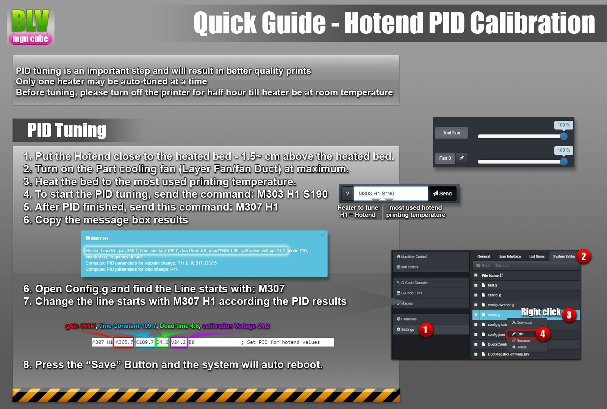
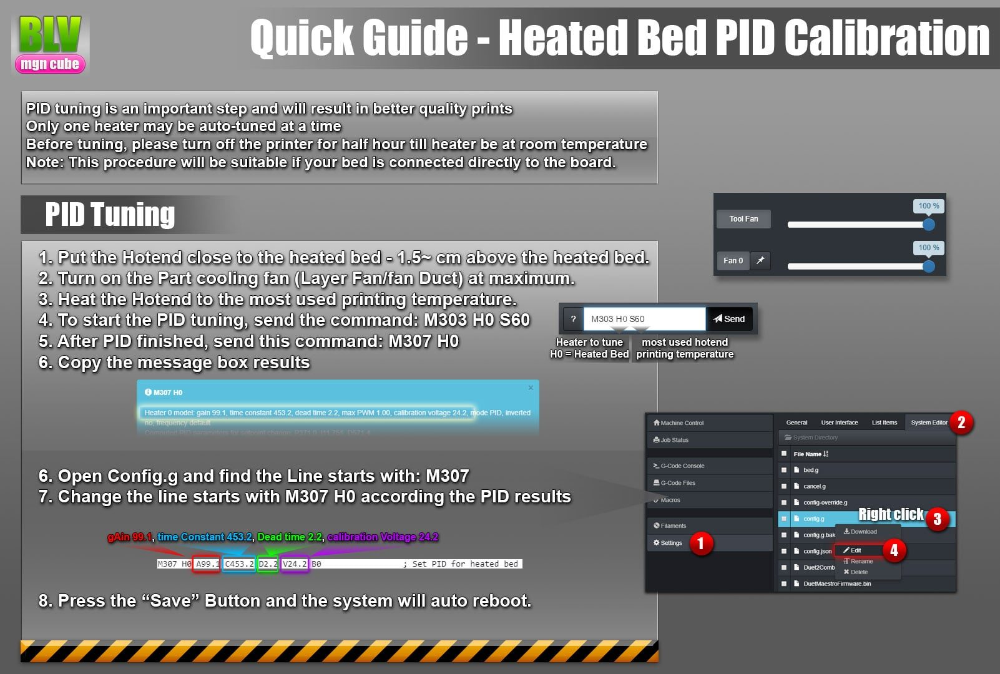

# Calibrations

Before calibrating, make sure the Duet board runs the right firmware. The project was released on RepRap 2.x and later moved to the Duet 3 board with RepRap 3.x. Community member [David Husolo](https://www.facebook.com/groups/371460246914851/user/1208415623/) published well-tuned BLV Cube configuration files on GitHub for both the Duet 2 WiFi and the Duet 3 running RepRap 3.x.

## 1. Update the Duet firmware

Duet boards are very well documented, with step-by-step guides for almost every task. Update to the latest RepRap firmware 3.x before calibrating. The Duet 2 WiFi and the Duet 3 use the same update guide.

[:material-download: Download the firmware](https://github.com/Duet3D/RepRapFirmware/releases){ .md-button }
[Update guide](https://docs.duet3d.com/User_manual/RepRapFirmware/Updating_firmware){ .md-button }

## 2. Copy the config files

Copy the BLV configuration files to the SD card. If the card is new or empty, prepare it first as described in the [Duet documentation](https://docs.duet3d.com/).

| Your setup | Config files |
| --- | --- |
| RepRap 3.x (recommended) | [David Husolo's GitHub](https://github.com/armysolo/BLV-Cube), "firmware" folder. Thank you David! |
| FYSETC parts set | [FYSETC firmware for the BLV mgn Cube](https://github.com/FYSETC/FYSETC-BLV-MGN-CUBE) |
| RepRap 2.x | The SD card ZIP in the project files. One ZIP is a basic Duet 3 configuration, the other is for RepRap 2.x only. |

## 3. Connect to the web interface

The Duet has a built-in web interface with full control of the printer, from any phone, tablet or computer on your network. The [Duet documentation](https://docs.duet3d.com/) explains the network setup, and the [Duet Web Control manual](https://docs.duet3d.com/User_manual/Reference/Duet_Web_Control_Manual) covers the interface itself.

!!! danger "Avoid damaging the hardware"
    

    - Never disconnect cables from a powered Duet, except the USB cable.
    - Check all wires for shorts, especially fan, motor and heater wires.
    - Don't feed the board more than 24 volts.
    - Ground the frame and the bed carriage, and the motors if possible.
    - Don't scratch, short or damage the electronics while installing them.
    - Don't remove the memory card while the printer is running.
    - Take your time crimping connectors and check the wires with a multimeter.
    - Triple check the polarity and position of every connection.
    - With the steppers connected, don't move an axis quickly by hand.

    

## 4. Configure your printer

The provided configuration covers almost everything. You may still want to center the bed, set motor directions, add macro buttons or define temperature presets per filament. The [Duet guides](https://docs.duet3d.com/) cover all of this:

Start with the [**RepRap 3 overview**](https://docs.duet3d.com/User_manual/RepRapFirmware/RepRapFirmware_overview), it is essential reading. Then complete these before moving on:

- [Center your bed](https://docs.duet3d.com/User_manual/Tuning)
- [Test your endstop switches](https://docs.duet3d.com/User_manual/Connecting_hardware/Sensors_testing)
- [Set up a different Z probe](https://docs.duet3d.com/User_manual/Connecting_hardware/Z_probe_connecting), only for other probe types
- [Set up a PT100 sensor](https://docs.duet3d.com/User_manual/Connecting_hardware/Temperature_connecting_PT100), only with a PT100

### Stepper motors

With the FYSETC parts set you can skip this, since its labeled cables match the FYSETC configuration. With steppers from the BOM or the Blurolls set, the motors will probably turn the wrong way at first. Set them up like this:

1. **Identify the coil pairs.** A stepper has 4 wires, 2 per coil. This [short guide](https://docs.duet3d.com/User_manual/Connecting_hardware/Motors_connecting) and [this video](http://www.youtube.com/watch?v=S0pGKgos498) show how to find them.
2. **Connect the steppers** using the original Duet stepper wiring, shown in the bottom right corner of [wiring diagram v3.2](wiring.md) under "Duet original steppers wiring".
3. **Test and configure** them with the [Duet documentation](https://docs.duet3d.com/User_manual/Connecting_hardware/Motors_configuring). The video shows the expected movement for each test command.

4. **Check the directions.** In the third video I press the jog buttons. Your printer should move the same way.

!yt S0pGKgos498 | Identify the leads of a 4-wire stepper with a multimeter
!yt fPW-o5QJiSU | Steppers test
!yt OKzHyKRgO7I | Axis movement

**More guides:**

- [Tuning stepper motor drivers](https://docs.duet3d.com/User_manual/Connecting_hardware/Motors_tuning) for the Duet's TMC2660 drivers
- [Mesh bed compensation](https://docs.duet3d.com/User_manual/Connecting_hardware/Z_probe_mesh_bed) to change the mesh settings
- [Multiple independent Z motors](https://docs.duet3d.com/User_manual/Connecting_hardware/Z_probe_auto_levelling) for true auto leveling
- [Filament sensor](https://docs.duet3d.com/User_manual/Connecting_hardware/Sensors_filament)

## 5. Calibrate

These calibrations are mandatory. Follow the pictures exactly and work accurately, since they have a large effect on print quality: the Z probe height first, then PID tuning for the hotend and the bed.

**Hotend PID.** The pictures show the classic hotend PID tuning. Newer RepRap 3.x releases add an algorithm that detects fan speed changes and adjusts the heater in advance. To use it:

- Run the latest 3.x release.
- Define all your tools (T0) correctly.
- Define your fans according to the RRF instructions.
- Turn off the part cooling fan and run `M303 T0 S200`, with 200 replaced by your usual printing temperature. The algorithm turns the fan on by itself during tuning.

In short, replace **`M303 H1 S190`** with **`M303 T0 S190`**.

## Optional features and references

Read each guide before enabling the feature.

- [Reducing stand-still noise](https://docs.duet3d.com/User_manual/Connecting_hardware/Motors_tuning) for quieter idle motors (see the standstill current setting)
- [Stall detection and sensorless homing](https://docs.duet3d.com/User_manual/Connecting_hardware/Sensors_stall_detection)
- [Pressure advance](https://docs.duet3d.com/User_manual/Tuning/Pressure_advance) to compensate for filament and extruder elasticity
- [Resume a print after a power failure](https://docs.duet3d.com/User_manual/Tuning/Resume)
- [Accelerometer (experimental)](https://docs.duet3d.com/User_manual/Connecting_hardware/Sensors_Accelerometer) to measure ringing frequencies for DAA
- [Macros](https://docs.duet3d.com/User_manual/Tuning/Macros) in RepRap firmware
- [External buttons and a custom web interface panel](https://docs.duet3d.com/User_manual/Tuning/Triggers)
- [G-code dictionary](https://docs.duet3d.com/User_manual/Reference/Gcodes) with every G-code RepRapFirmware supports

