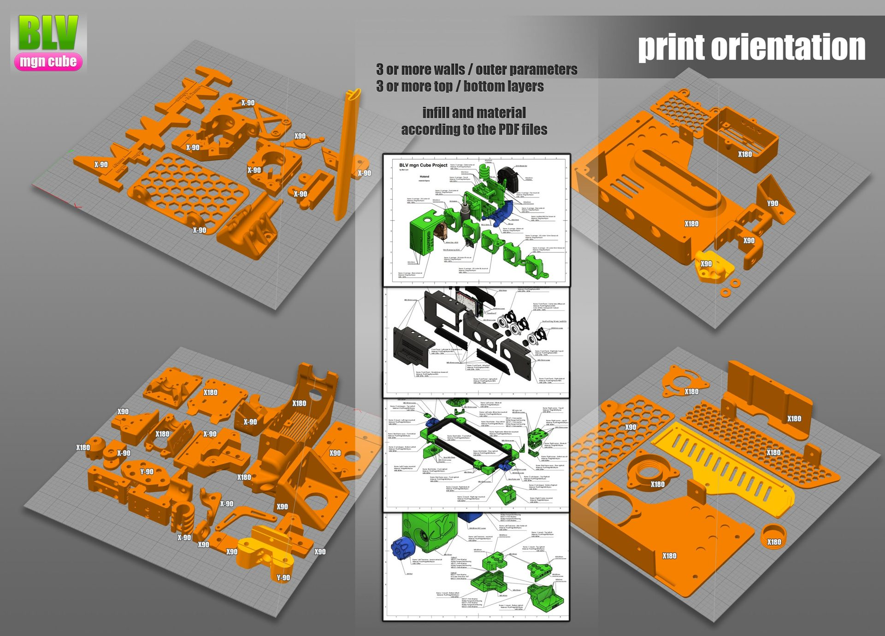
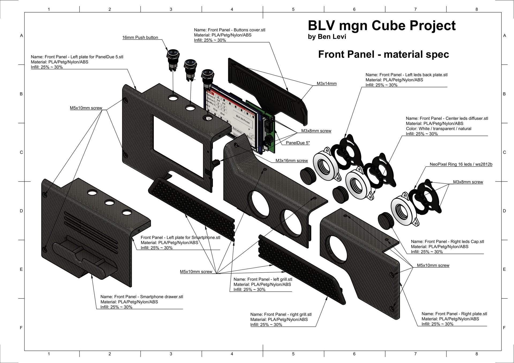
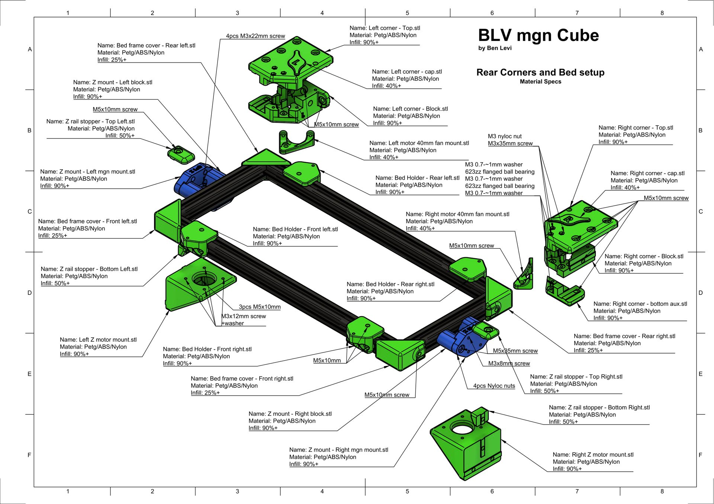
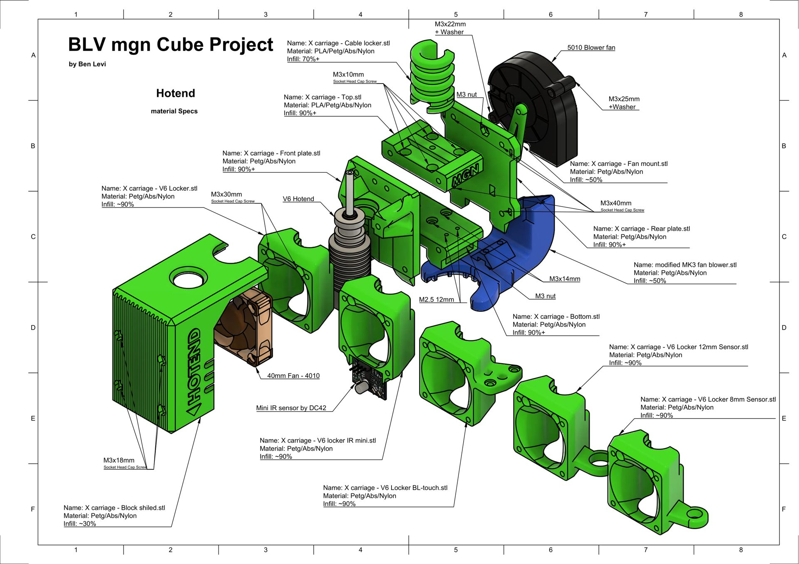
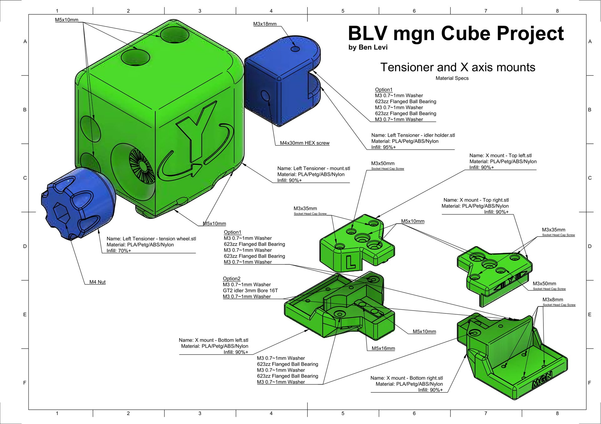
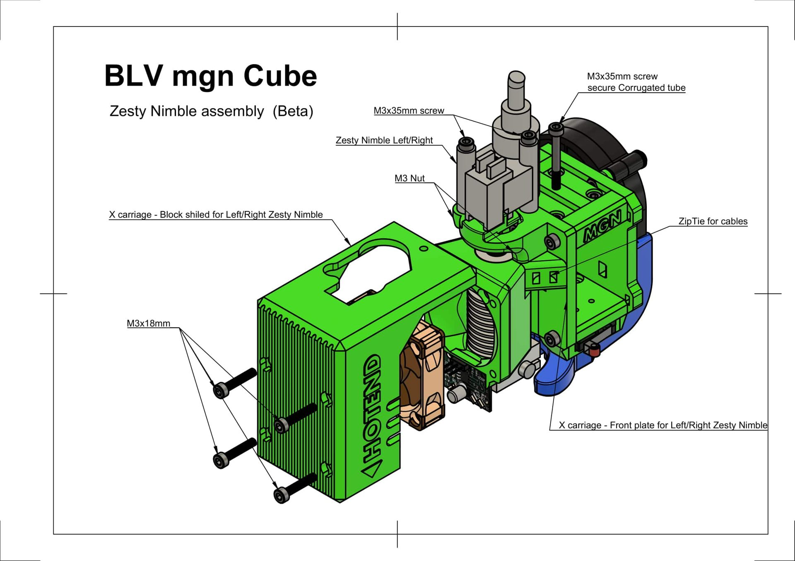
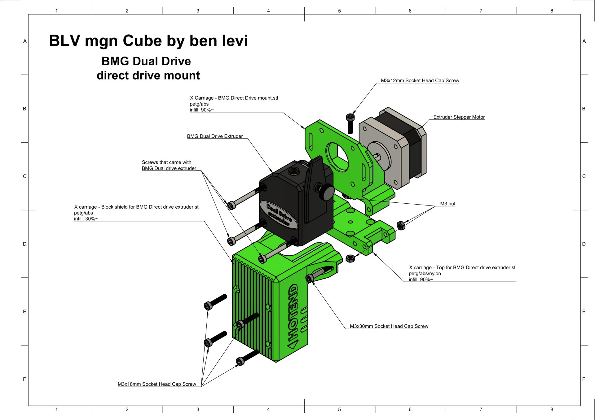

# Download & Print

## Download the project files

The project received several updates, add-ons and improvements after its release. There are two downloads, depending on whether you build with the [Metal Kit](updates/new-metal-kit-upgrade-blv-mgn-cube.md) parts.

-   **With the Metal Kit**

    ---

    A lighter version of the project files without the parts the Metal Kit replaces. You only print the hotend setup and the front panels. All other printed parts are optional.

    [:material-download: Download - 35.5 MB](download:BLV-mgn-Cube-V1.15-Metal-Kit.zip){ .md-button .md-button--primary }

-   **Without the Metal Kit**

    ---

    The complete original project with every printable part, documents, drawings, the print profile, **CAD files** and **STL files**.

    [:material-download: Download - 50.8 MB](download:BLV-mgn-Cube-V1.15.zip){ .md-button .md-button--primary }

### What's in the ZIP

| Folder | Contents |
| --- | --- |
| **Documents** | PDF files with most of the information needed for the project |
| **Firmware** | SD card content for Duet boards. **Duet 2 WiFi:** the original configuration (RepRap 2.xx and later). **Duet 3:** a basic configuration (RepRap 3.xx and later). |
| **Frame Panels** | All the measurements for making enclosure panels |
| **open source** | The original CAD files, including several add-ons and upgrades |
| **Slicing Profiles** | Simplify3D profile. Cura includes a built-in BLV mgn Cube profile. |
| **STL files to print** | All the STL files, including optional add-ons, upgrades and custom mounts, listed below |

??? info "STL folders in detail"
    | Folder | Description |
    | --- | --- |
    | Bed Holder For Anet E12 Bed | Bed carriage mounts for the Anet E12 heated bed |
    | Bed Holder For CR-10 Bed | Bed carriage mounts for the Creality CR-10 heated bed |
    | Biqu H2 extruder adapter For Metal kit | BIQU H2 extruder adapter and fan mount for the Metal Kit |
    | BLV optic Led cable concept | Concept add-on that carries the Duet status lights to the front, no soldering needed |
    | Chimera front plate adapter | For the Chimera hotend |
    | Direct Drive | Direct drive upgrade |
    | Frame wires Holder | Printed wire clip for 2040 and 2020 extrusions, 3 sizes |
    | Front Panel | All STL and PDF files for the front panel |
    | Hotend Setup for Metal kit | The hotend setup for the Metal Kit. More options are in the community remixes. |
    | Jigs | Main installation jig + 2 jigs for fixing rails on 2020 and 2040 |
    | Nozzle cleaner - Brass Brush | For the BIQU H2 extruder |
    | Nozzle cleaner - new silicone wiper | For the BIQU H2 extruder |
    | Optional - Air scrabber | Small air scrubbers that filter printing fumes |
    | Optional - BIG Air scrabber | Big, effective air scrubbers |
    | Original Bowden Hotend | The original hotend setup, not compatible with the Metal Kit |
    | Side LED diffusers | Files for the side-mounted LED lights |
    | Trianglelab Matrix adapter For Metal kit | Trianglelab Matrix extruder adapter for the Metal Kit |
    | Twin fans Bowden Hotend | Upgraded part cooling with dual 4010 blowers |
    | Zesty Nimble | Adapter for the Zesty Nimble extruder, left and right versions |
    | ... | All other STL files |

## 3D printing the parts

How you print the parts has a large effect on how well they work. Orientation, wall count, filament type and even print speed all matter. Most parts print without supports.

<b>PETG</b>what I used
<b>PETG Carbon</b>very rigid, hardened nozzle
<b>ABS</b>needs an enclosure
<b>PA12</b>MJF / SLS printed
<b>6 walls</b>at least
<b>7 top / 7 bottom</b>layers
<b>80%+ infill</b>for most parts

!!! danger "Don't use PLA or PLA+"
    The parts carry loads and work near heat, and PLA deforms inside the printer. The sketches below give the exact infill for each part.

**Orientation.** Orientation has a large effect on the strength of a part. The image shows how to place every part on the bed. A few parts need supports, for example the tensioner idler holder, so check before printing. Labels such as X90 or Y-90 give the rotation to apply.

## Parts descriptions

Each sketch shows a group of parts with the name, material and infill of every part. Where a sketch differs from the settings above, follow the settings above (6 walls, 7 bottom and 7 top layers).

