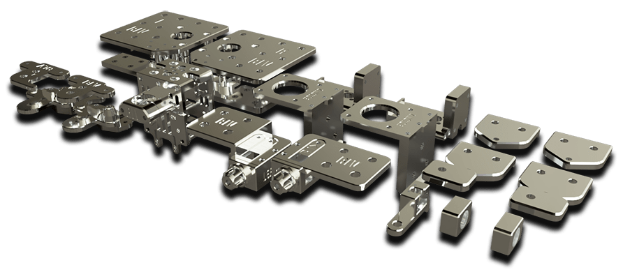

# BLV mgn Cube

OPEN-SOURCE 3D PRINTER

The BLV mgn Cube is an open front CoreXY 3D printer built on MGN linear rails, for maximum accuracy, efficiency and print quality. The goal of the project is simple: to let anyone build a good, reliable 3D printer.

<b>1.78M</b>downloads<b>6.3M</b>views<b>29/10/22</b>last update

[Start building](start.md){ .md-button .md-button--primary }
[Download the files](download-and-print.md){ .md-button }

{ .no-lightbox }

!yt FC9tIDhOgD4 | BLV mgn Cube 9000 mm/s² acc, 500 mm/s - ultra fast 3D printing

## Ways to build it

You can source every part yourself, or start from one of the kits below. The [BOM page](bom.md) walks you through the choice.

-   **Full kits** - all the needed parts in one package

    ---

    [{ width="90" .no-lightbox }](https://benlevi8.wixsite.com/blvprojects/post/unboxing-fysetc-blv-mgn-cube-full-kit)
    [{ width="60" .no-lightbox }](https://benlevi8.wixsite.com/blvprojects/post/unboxing-fysetc-blv-mgn-cube-full-kit)
    [{ width="60" .no-lightbox }](http://s.click.aliexpress.com/e/cmcYPkdE)

    [FYSETC full kit](https://benlevi8.wixsite.com/blvprojects/post/unboxing-fysetc-blv-mgn-cube-full-kit) (recommended) or the [Blurolls kit](http://s.click.aliexpress.com/e/cmcYPkdE).

-   **[Metal Kit](https://benlevi8.wixsite.com/blvprojects/post/new-metal-kit-upgrade-blv-mgn-cube)** - replace your 3D printed parts with aluminum parts

    ---

    [{ .no-lightbox }](https://s.click.aliexpress.com/e/_dZWiHmO)

-   **[Blind Joints frame](https://www.aliexpress.com/item/1005001591680638.html)** - new improved frame, 20 minutes assembly

    ---

    [{ .no-lightbox }](https://www.aliexpress.com/item/1005001591680638.html)

## Why build it

**Fast, reliable, accurate**
:   Linear bearings and Delrin wheel gantries are common in low and mid range printers because they are cheap, but they cost accuracy and reliability. MGN linear rails are more rigid, more precise and much smoother, which cuts print time without hurting quality. That is why high-end printers use them. When I found cheap Chinese MGN rails on AliExpress, I thought: why not?

**Rigid open structure**
:   The open front is as rigid as a closed cube, but gives easy access to the build plate and prints. A front belt tensioner makes it even more convenient. The design came out of many hours of software simulation and physical stress tests.

**Accessible**
:   All parts are easy to source, print or craft. There are no expensive or hard-to-get CNC parts in the BOM - and where there are, they are surprisingly cheap. You can use your own electronics, as long as you know how to adjust the firmware to the build.

**Open source**
:   The original CAD files (STEP) are included in the project folder - no need to ask. Feel free to modify, remix or improve them. I would appreciate it if you share your changes with the community and mark the parts as "remixed", linked to this project page.

**Build and print**
:   I spent many hours tuning the firmware and the slicing profile (Simplify3D) for this printer. After the build you only need to upload the config files, load the profile and you are good to go.

**Modular**
:   The printed parts and the structure are modular: both the Z height and the build plate can grow. All you need is longer aluminum profiles and MGN rails. The included CAD file helps you calculate the measurements for your custom size.

**Easy to build?**
:   Honestly, installing the rails takes about 70% of the build time. You need to be precise and spend a few hours aligning them - but the joy when it prints is worth every minute. To make it easier, I made 3D animation videos, information PDFs, sketches and measurements.

**Balanced budget**
:   The BOM is balanced for the best value without compromising quality: a top 32-bit board, excellent stepper motors and sensors. You can choose a 5" PanelDue touch screen, or save $80 and [use your smartphone or tablet](https://duet3d.dozuki.com/Wiki/Duet_Web_Control_Manual) without losing any features.

## Features

- Supports **RepRap** and **Klipper** firmware
- Input Shaper (Klipper)
- **Super fast** printing: **9000** accel, **500** mm/s (Klipper)
- Efficient cooling system
- SuperSlicer full profile + Simplify3D profile
- HEPA / carbon air scrubber
- Rigid aluminum open front frame
- Option for dual extrusion
- Front belt tensioners
- Mesh auto-leveling
- Internal LED light
- Blind Joints frame - fast assembly
- **Triple Z** - true bed leveling
- Linear rails MGN12H for high accuracy
- High resolution X/Y stepper motors
- Full firmware configs included
- Bed 300 × 300 mm, height 365 / 465 / 565 mm
- Duet WiFi / Duet 3 / FYSETC Spider v2.2 (Klipper)
- Supports TMC5160 high voltage 48V drivers
- Full web interface from phone, tablet or desktop
- Electronics at the back
- CNC aluminum machined parts - [Metal Kit](https://benlevi8.wixsite.com/blvprojects/post/new-metal-kit-upgrade-blv-mgn-cube)
- Open-source CAD files
- Many community remixes and upgrades - a huge community

## Build volume

- **Bed size:** 300 × 300 mm (standard) or 350 × 350 mm (custom)
- **Height:** 365, 465, 565 or 665 mm

{ width="480" }

## Explore in 3D

Explore, measure and isolate parts in your browser with the online 3D viewers:

- [BLV mgn Cube - full 3D viewer](https://a360.co/2FLRqSa)
- [Isolated frame - 3D viewer](https://a360.co/2DDDBn4)
- [Isolated panels / walls - 3D viewer](https://a360.co/2JGlYZ4)

{ width="420" }

## Gallery

## Printer videos

!yt exeUR__tco8 | BLV mgn Cube 3D printer - printing with Gold Silk PLA
!yt -7xCHPYShQg | BLV mgn Cube 3D printer - printing
!yt agu6ReJOmm8 | BLV mgn Cube 3D printer - printing sample

## Community videos

!yt Spc1cCTLFzs | Benchy on BLV mgn Cube and Prusament PLA
!yt N_bD6kgxAEA | Johnny Hallyday 3D print - BLV MGN 3D printer
!yt 9-EyQRFcamc | BLV MGN Cube
!yt UkFa6o_Uuig | Resonance test 100 mm/s - BLV MGN metal kit, NF Crazy Plus
!yt rSSUHyvyTfQ | BLV mgn Cube - community video
!yt dt3wfzbeUKs | Mandalorian helmet - 3D print on BLV MGN Cube, part 1
!yt 3Y3C2JK-PUg | BLV mgn Cube 3D printer
!yt ItAonH9IVy0 | BLV Cube triple Z axis bed leveling
!yt SxxE28ZN7O8 | BLV MGN - torture test
!yt MtD9szFlxQU | BLV mgn Cube 3D printer SE edition
!yt jo5cHnJwMuU | TPU with BLV MGN
!yt es9ltH34RBk | BLV MGN 3D printer printing sample
