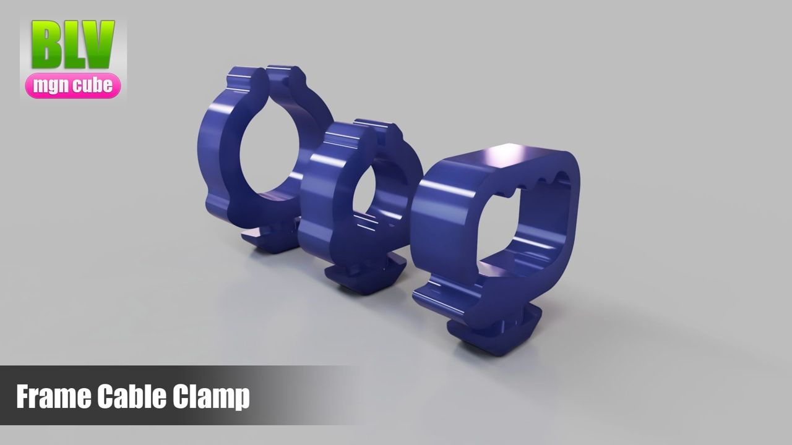
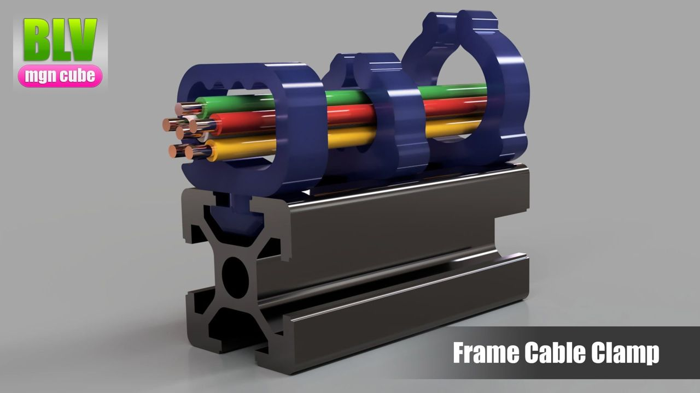
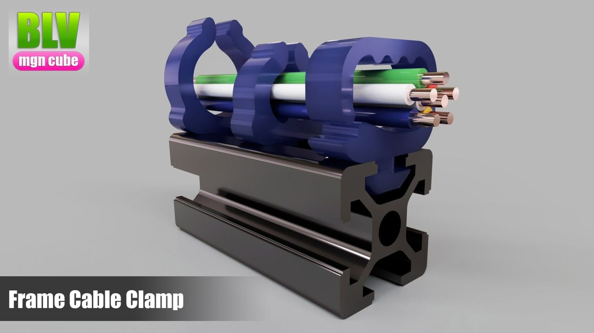
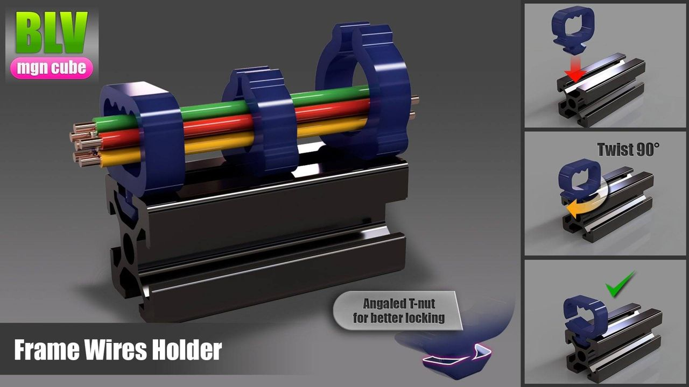

[← All updates](index.md){ .back-link }

# Beta test: frame wire holder

### Simple and fast wire holder

The nut is angled for a fast lock. Just twist it 90 degrees (check the angle direction before you lock it). The file contains 3 sizes and shapes, and it's a very fast print.

Download update: you will find the file inside the [BLV mgn Cube](../index.md) zip file.

