[← All updates](index.md){ .back-link }

# BIQU H2O and Haldis K1-XL hotend

I wanted to share with you my first impressions or shall I say unboxing of a few Hotend-extruder setups I'm testing. I'm sure it's going to be interesting 😉. As you know, I try to be very thorough. To reach full conclusions about an extruder or a particular component - it takes me about two full months of non-stop printing. In the meantime, I allow myself only to write about initial impressions.

### BIQU H2O - new extruder

I can sum up all the paragraphs about the [BIQU H2O](https://s.click.aliexpress.com/e/_AVr4sD) below in one word: **beautiful**!

The new [BIQU H2O](https://s.click.aliexpress.com/e/_AVr4sD) came a few weeks ago, But I was too busy working on the [BLV Metal Kit II](blv-metal-kit-ii-blv-carbon-new-stock-and-more.md). If I only knew what I'm missing... I have not been so impressed with an extruder for a long time.

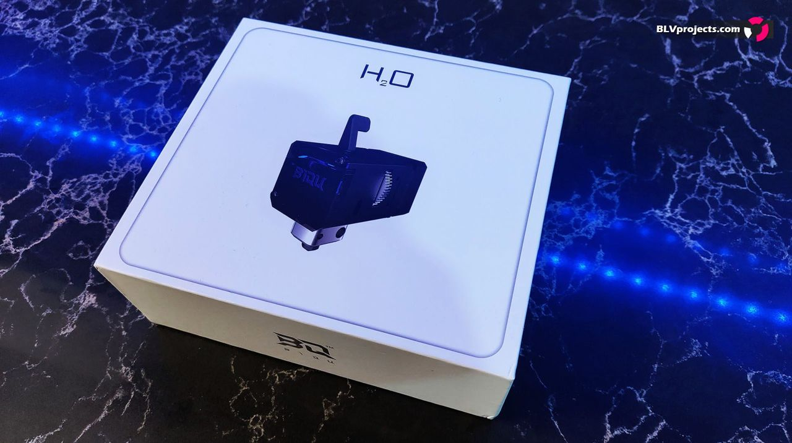

You're probably asking, **why do I even need a water-cooled extruder?**

Although I am not a fan of ABS printing and most of the time I print PLA, PETG, flex, etc. I have small children and a closed enclosure will keep odors, and particles away from them. inside the enclosure, the temperatures are much higher than without It, which may make it difficult to print using common types of filaments. part of this solution is also the use of water cooling.

Now let's get back to the [new H2O extruder](https://s.click.aliexpress.com/e/_AVr4sD). I'm sure you have already seen my first [review of the original H2 extruder](the-new-biqu-h2-extruder-review.md). A lot of improvements have been implemented in the new extruder, And it looks like someone out there in BIQU did his homework. It is equipped with a high-temperature resistant motor (180c). Stainless Steel gear (according to the spec), I just wish it was **Hardened** Stainless Steel. They added a Max31865 module to support the provided PT-100 sensor, which is a much more accurate temperature sensor for high temps. one more important thing is that the Bi-Metal heartbreak is made of copper and titanium, Not aluminum. as you know, aluminum over time can damage your water cooling system.

another thing that I really like is the sleek look. Everything is symmetrical, with clean lines, very elegant! The cool RGB LEDs illuminating the water chamber are lovely. I almost forgot to mention that the [New H2O](https://s.click.aliexpress.com/e/_AVr4sD) is very small. It is even smaller than the previous H2 by 11.6 mm. and if we are comparing both of them, the new H2O weights only 224g !! Please, check the photos attached below, notice the hub wheel's window that has been added

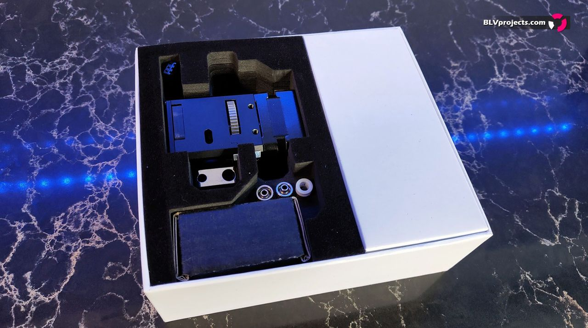
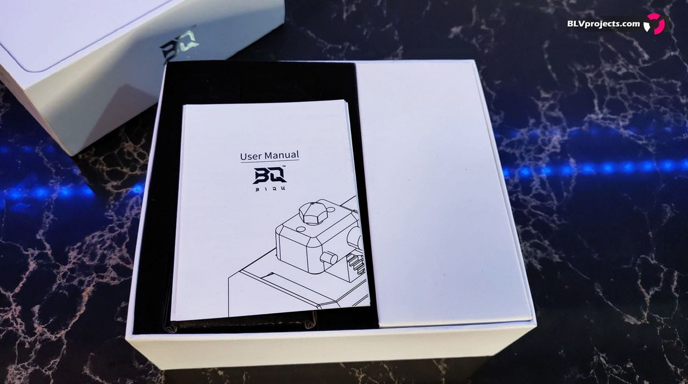
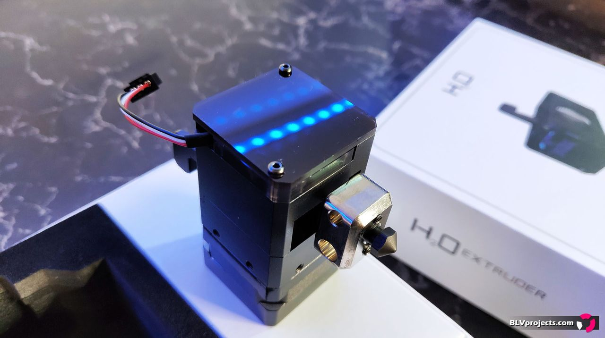
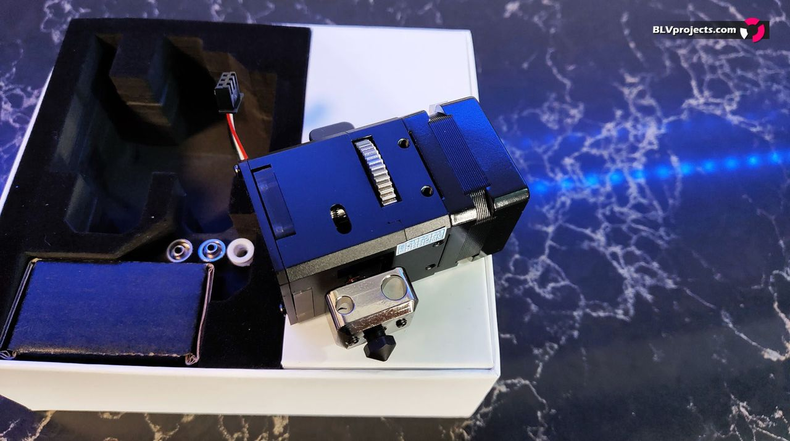

here's the full list of accessories that came inside the package:

- BIQU yellow ducky - Without it, I would probably have opened a dispute 🤣
- Full assembly manual including FW settings.
- [Biqu H2O](https://s.click.aliexpress.com/e/_AVr4sD) - fully assembled
- Copper-nickel plated heating block *(assembled)*
- Hardened steel 0.4 nozzle *(assembled)*
- Bi-Metal copper and titanium *(assembled)*
- fittings / connectors for id4/od6 pipes.
- KJH 04-M6 Pneumatic Connector for the PTFE tube
- high-quality PT-100 temperature sensor
- MAX 31865 StepStick module (for the PT-100)
- JST connector + terminals
- orange silicone sock
- 24V 70W heater cartridge
- long motor cable
- RGB LEDs cable
- screws
- all the needed tools

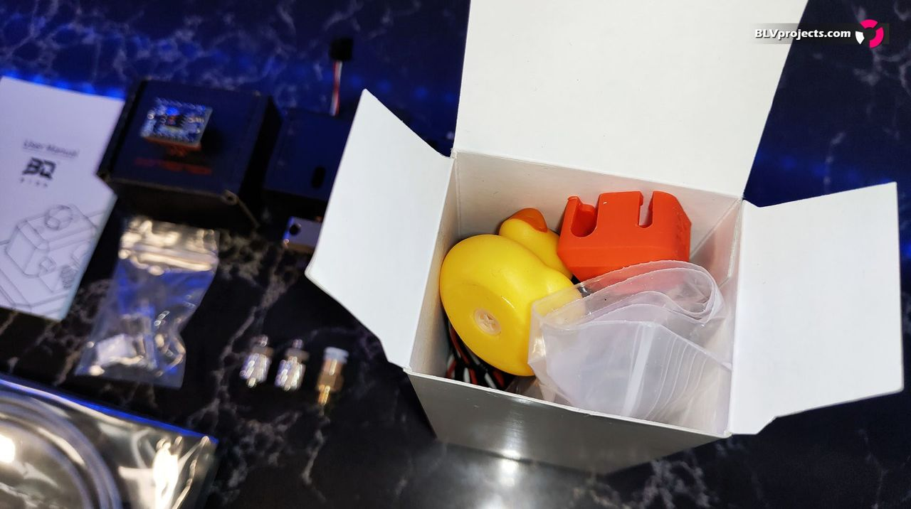
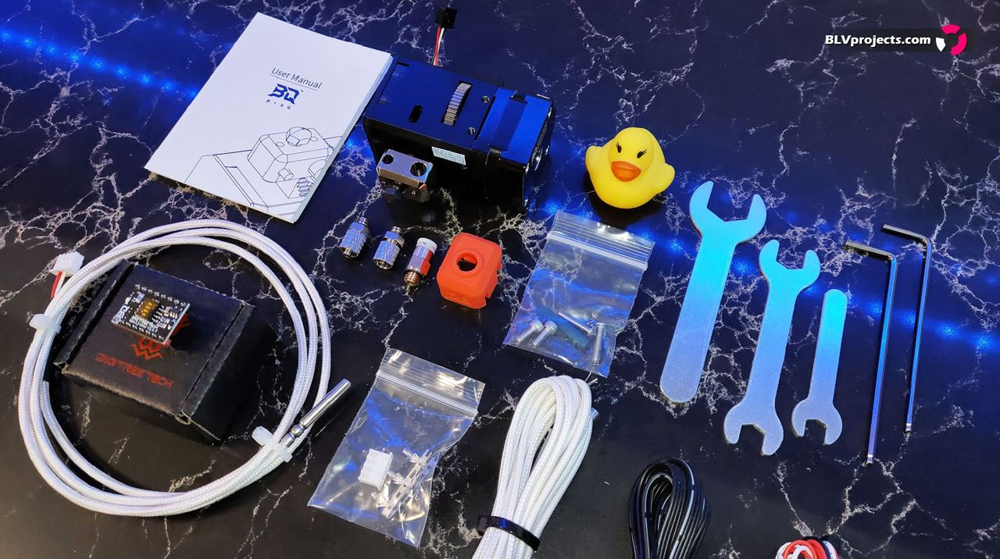
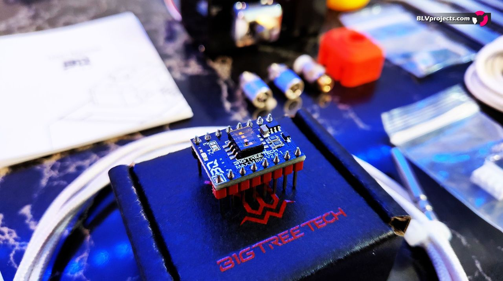
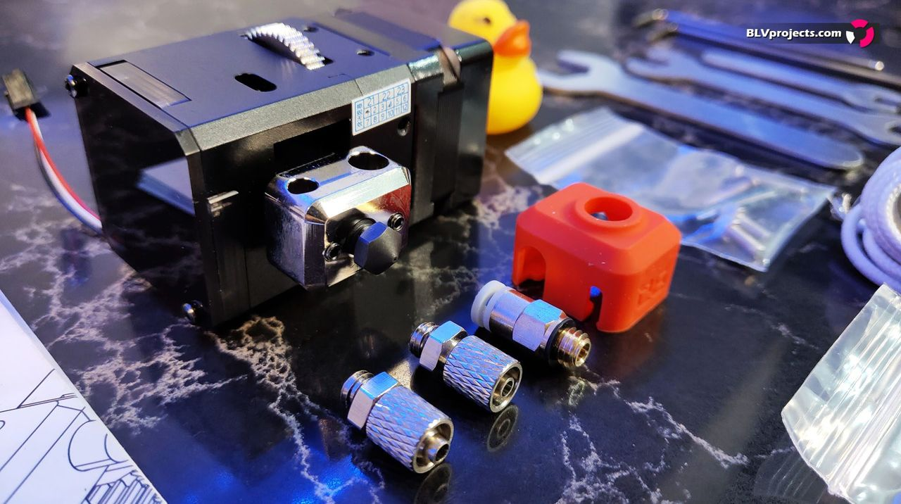
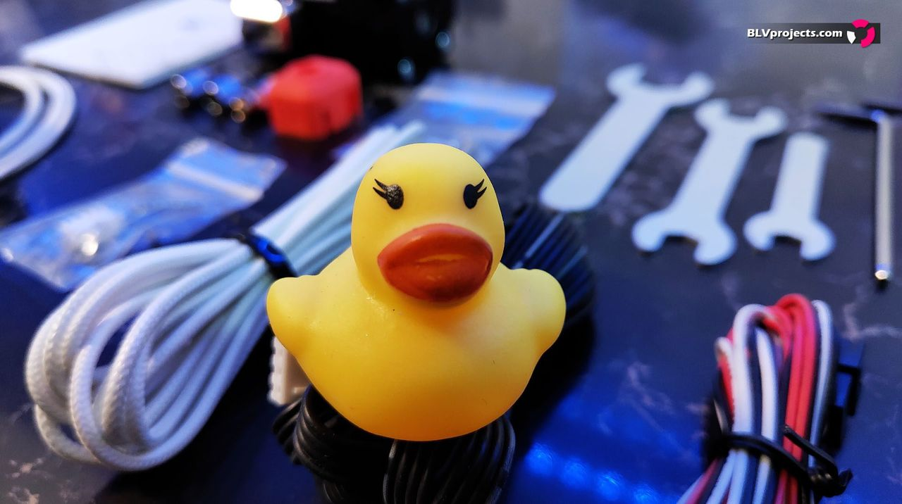

**So does it print well?**

In the **meantime I'm getting fantastic results**, I've not had any problems. But I have to postpone the full conclusions until I reach a minimum of 300 hours of printing. I used the previous BIQU H2 adapter and it works great! so far I **am absolutely in love with this extruder.**

**BIQU - you got me!**

### BIQU Water Colling System

a few days later, I realized I had thrown away all the water cooling systems issued in my old computers. luckily BIQU offered [a new 24V water cooling system](https://s.click.aliexpress.com/e/_AVr4sD) that was supposed to be suitable for the new [BIQU H2O](https://s.click.aliexpress.com/e/_AVr4sD). even though it was ordered before the extruder, the water cooling system arrived before the extruder.

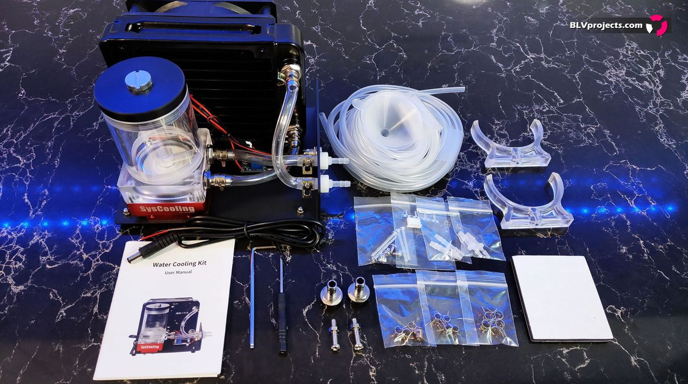
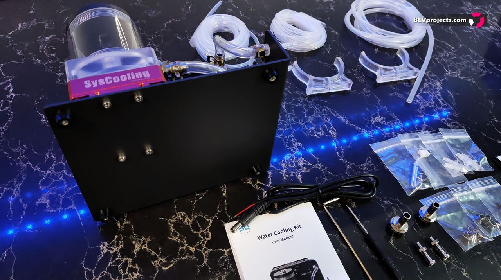
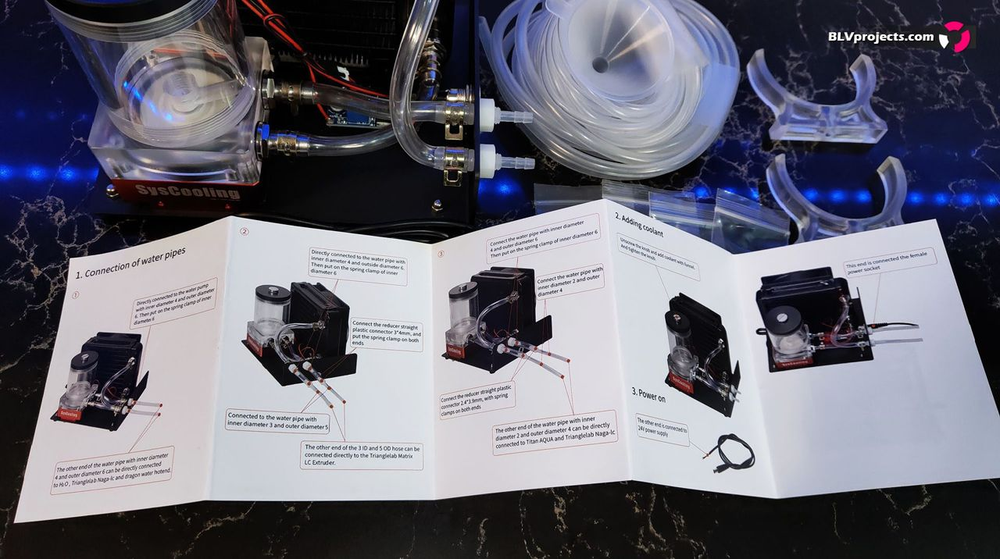
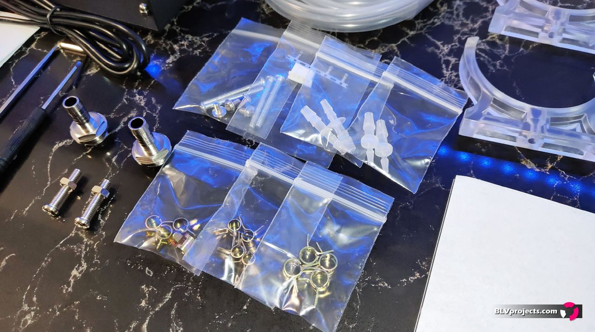

The water cooling system was packed nicely, including all the needed accessories and even more than needed. it has all the tools you need including a liquid funnel. the most important part is the pump. In this case, it's the 12V [SysCooling P67D pump](https://s.click.aliexpress.com/e/_AFztCH) - Very reliable. Max flow: 500L/H, ceramic bearings - 50k lifetime, 25~27DB sound level, G1/4 thread connectors. Biqu included 3 types of flexible tubes, brackets, double side stickers, pipe diameter reducers (for other types of extruders), tools, connectors, screws, and a power adapter.

Overall it looks good, but there is definitely something to improve:

- The pump is 12V, so they used an [LM2596 buck converter](https://s.click.aliexpress.com/e/_A8xo7f) converting 24V to 12V. The [LM2596](https://s.click.aliexpress.com/e/_A8xo7f) is a very cheap convertor and in my experience, it tends to fail after prolonged use. However, it's easy to find it because it's very common and costs only 3$.
- springs fitting - my friend **David Husolo** turn my attention to the fact that the kit uses clamps that are notorious for leaking. so I found and used a spare fitting from my PC water cooling system.
- Coolant - No coolant liquid was provided with the system. So if you have decided to purchase it, make sure to get a proper Coolant.

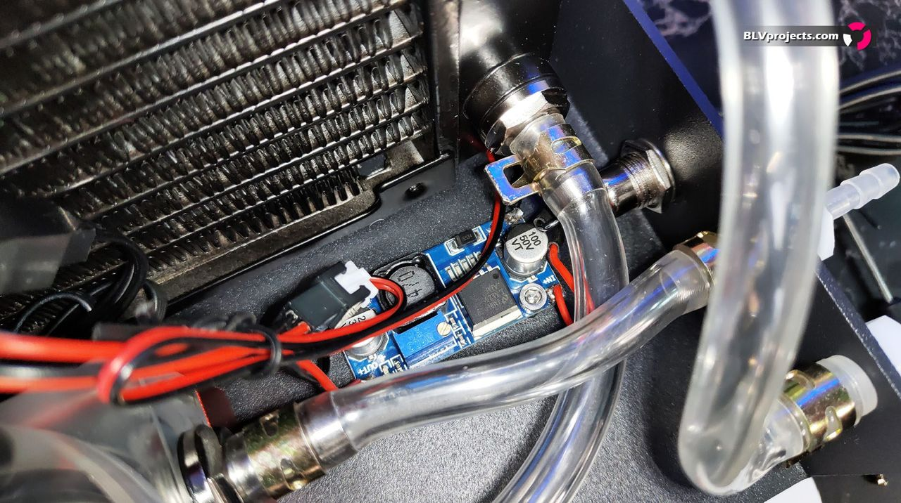
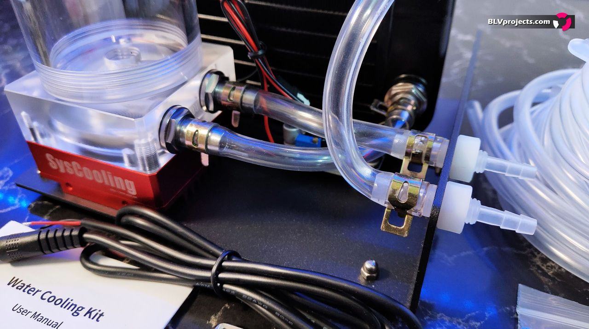

Please don't get me wrong, I really liked the water cooling system. Two years ago I purchased from another manufacturer a water cooling system. a month later the pump stopped working. Of course, they refused to replace the pump. However, with the BIQU system, I am more confident since I have had quite a successful experience with SysCooling pumps, and I also know BIQU has good customer service.

**Final conclusion?**

there is no chance that I am writing now final conclusion - only after checking the system for a long time - at least two months. I want to make sure there is no leakage, the pump won't fail over time, and make sure indeed it satisfies my requirements. In the meantime I can tell you that it works great for now, is relatively quiet and I get a very effective cooling! very!

### Haldis K1-XL new hotend with a unibody nozzle

So I got one of the first early birds of [Haldis K1-XL new hotend](https://s.click.aliexpress.com/e/_AeA133) for testing.

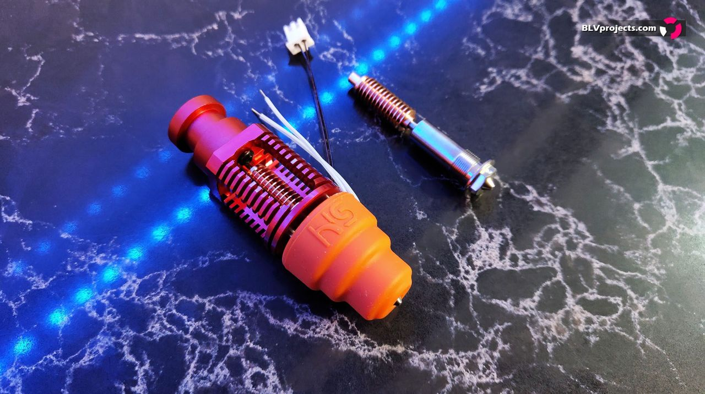

Haldis is a relatively new manufacturer entering the 3D printer market but despite being new, I must note their high production quality. Unlike few other stores, they produce everything in-house. This gives them many advantages, including the ability to develop products themselves in a short time. The [new Haldis K1-XL Hotend](https://s.click.aliexpress.com/e/_AeA133) is a good example of that. a unique unibody Nozzle that has its obvious advantage - the ability to replace nozzle quickly. how quickly you are asking? in order to answer it, just hit the play button below

!yt 1uGRFWeUHuM

The K1-XL has the same size as a regular V6 but with a unique structure. ostensibly, it looks like some sort of dragon + mosquito combination. But the truth is that it's very different. [The K1-Xl has a Bi-metal unibody nozzle](https://s.click.aliexpress.com/e/_AeA133). which means the whole nozzle and filament path including the heatsink can be replaced in a matter of seconds. Very convenient - no need to start disassembling parts to open a blockage. No more fear of screwing the nozzle too hard or of breaking the HeatBreak - I love this approach. Also, I was surprised to find a very small and new temperature sensor, it is very refreshing. You can see it in the picture on the left.

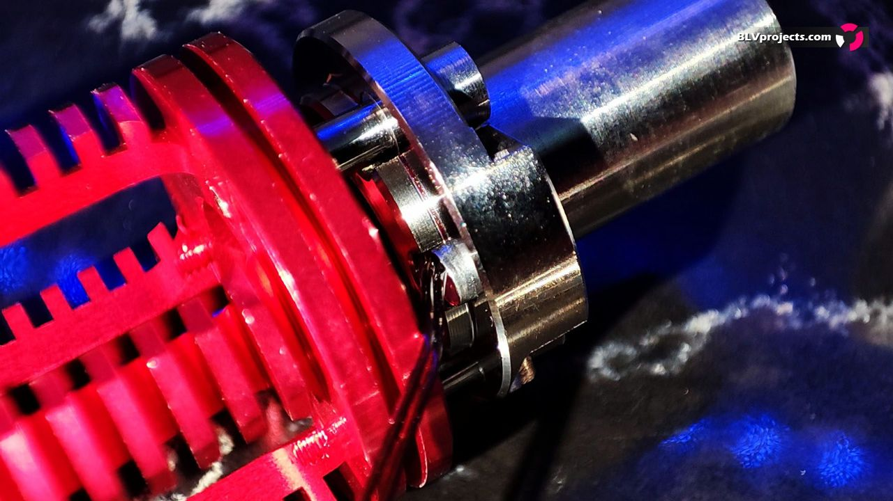
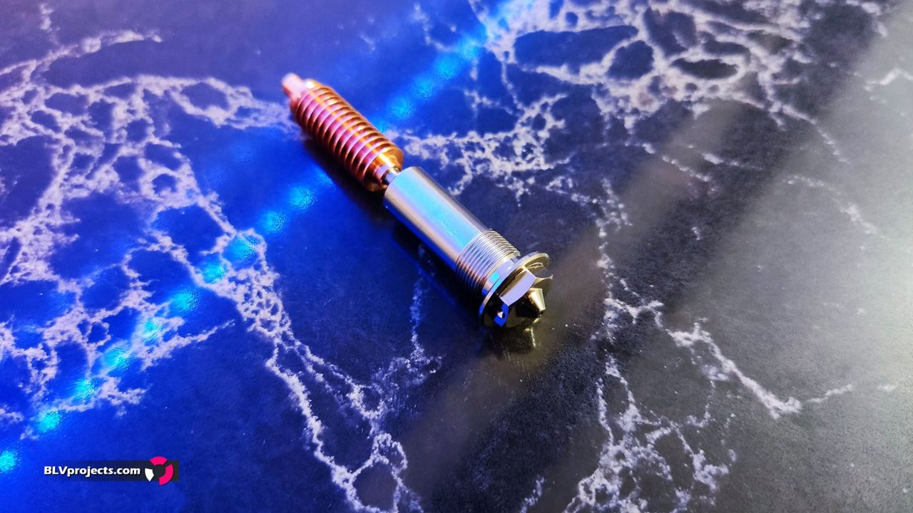

Now if we refer to the nozzle itself, It's a copper-nickel plated nozzle with an integrated Heatsink on its upper part. At the bottom there is a thread - the whole nozzle assembly is screwed into the thick heated cylinder and that's it. Please note, that the heated element is thick and my doubts about heat dissipation turned out to be true, it seems that the red heatsink is not sufficient. I think it will be hard to deal with high temperatures. BTW, In the end, I had to use a [Gdstime 4020 dual ball bearing fan](https://s.click.aliexpress.com/e/_AOiAov) to get optimal results.

**So what came in the package?**

Unlike other manufacturers, here there is no fancy packaging. Everything came packed in bubble wrap and plastic bags. Could be because this is the first batch of the [Haldis K1-XL.](https://s.click.aliexpress.com/e/_AeA133)

- [Mainframe with an integrated thermistor](https://s.click.aliexpress.com/e/_AeA133) (which type?)
- Ceramic heating element - (without connectors?)
- 2 x Bi-metal unibody 0.4mm copper nickel-plated nozzle
- Orange silicone sock
- Ptfe lockers/clips

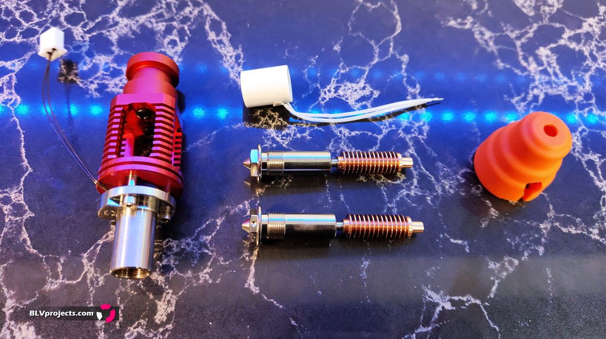
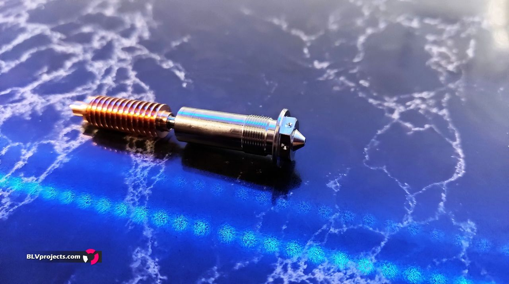
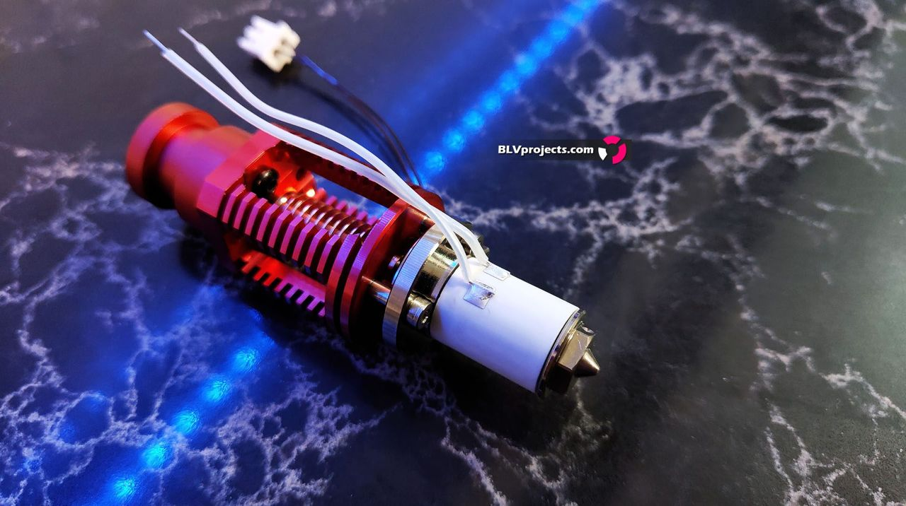

Unfortunately, for this price, I would expect it to come with fancy packaging, some tools like a socket screwdriver, a detailed manual, connectors, and appropriate cables. Also, the listing is missing a lot of information about the heating element, type of thermistor, and materials.

**important note about something that bothers me -lack of information. I recommend every manufacturer that sells 3D parts, to give full details on the material type of each component, sensor type, heater type, maximum temperature range, optimal slicing/FW settings, etc. it will help the consumer in deciding whether to purchase the product or how to use it. The less data you provide - the greater your customers' concerns and failures while using your products.**

Anyway, let's continue...

Besides the sufficient heat dissipation, I noticed that the Ceramic heater is too wide. even after heating the block up to 260c and after the metal expanded - it was too loose. This has tremendous significance - there is no efficient heat transfer between the heating element and the heating block. The manufacturer suggested using Thermal paste, in order to fill the gap between them. I tried that - the temperature jumps on the graph got smaller, but still, it was not enough in my opinion.

**Overall, I think the K1-XL idea is beautiful and very refreshing**. The production quality is excellent. however, it requires a rigorous test that examines how everything works together and a beta testing group - before releasing it to customers. If you could guide the manufacturer then I would change a few things:

- fix the gap between the ceramic heater and the metal - (like [Trianglelab CHC heater](https://s.click.aliexpress.com/e/_AE8CzL))
- provide more details: spec list, measurements and etc.
- add tools, connectors
- make a nice packaging suitable for the price

Here is a nice photo of the [Trianglelab Rapido](https://s.click.aliexpress.com/e/_ALWey1), [Haldis K1-XL](https://s.click.aliexpress.com/e/_AeA133), [Orbiter V2](https://s.click.aliexpress.com/e/_ASClVX), and the [BIQU H2O](https://s.click.aliexpress.com/e/_AVr4sD)

I know... **the BIQU is so small and yet it's both extruder and hotend**🤩

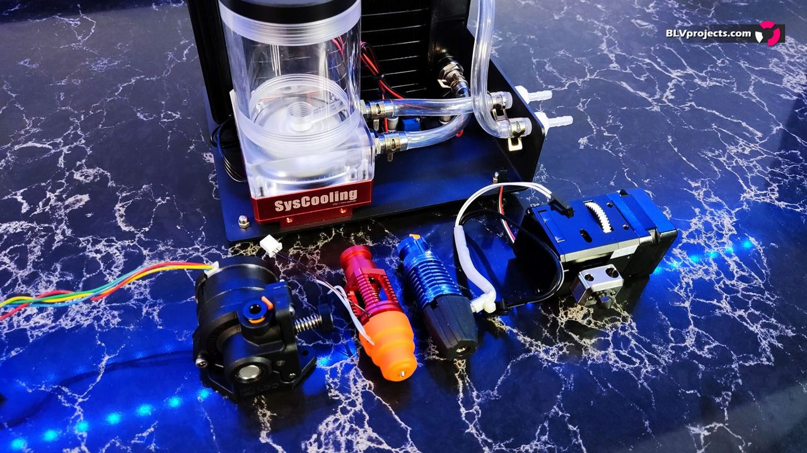

**Final conclusion?**

unfortunately, I had to take it off. I get unstable temperatures because of the ceramic heater issue, which can impact print quality. I very much hope that this will be resolved in the near future, as I really liked the idea of a unibody nozzle.

### BIQU Hermit Crab - tool changer?

**Samuel Gonzalez** from the BLV Facebook group [shared with us his plan to adapt](https://www.facebook.com/groups/BenLevi/posts/979539799440223/) the [BIQU Hermit Tool changer](https://s.click.aliexpress.com/e/_A7ZUhT) to the BLV Cube 3d printer a few months ago.

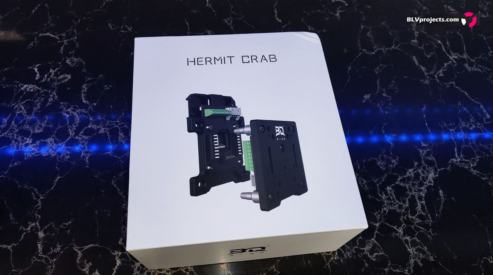
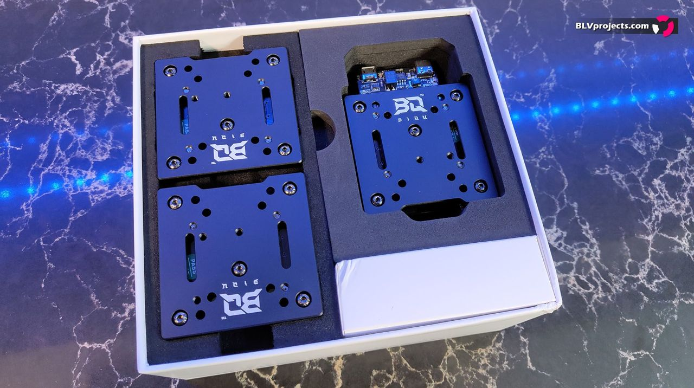
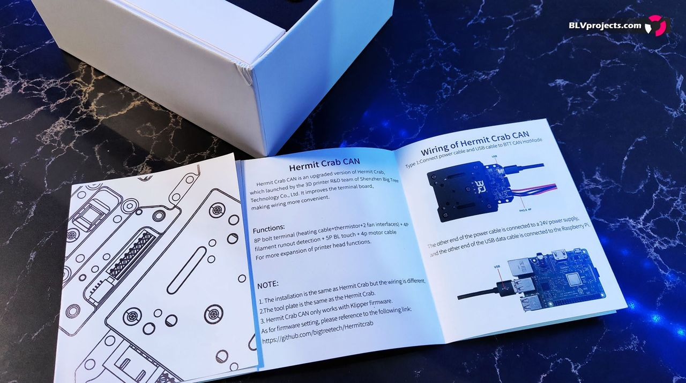

later he posted an awesome video regarding the [BIQU Hermit](https://s.click.aliexpress.com/e/_A7ZUhT) tool changer on his BLV Cube printer:

!yt hwoDO2xHcK4

Inspired by him I decided to order [BIQU Hermit crab](https://s.click.aliexpress.com/e/_A7ZUhT) for testing. I only open the box and made dry testing without mounting it on the printer yet. many modifications need to be made in order for it to be fitted to the printer. I was very impressed with the reliability of the locking mechanism. But I have 2 main concerns that keep me from continuing to explore this possibility:

1. **The weight** - both the backplate and the front plate are made of aluminum. and they weigh quite a lot. I have a suggestion for BIQU that might help make it much lighter. A lot of weight can be removed from both plates - by using a thick PCB plate instead of aluminum. you can keep the central locking mechanism made of aluminum. The bonus is that you will have even more space for lot more electronic components.
2. **Offset** - by using the Hermit, the hotend must move forward 30mm and that's a lot.

Anyway, regarding the product itself. As usual, BIQU continues to provide very high-quality products, great packaging, and a detailed manual in a way that even a 10-year-old child can put it together and his dad will help him with settings - which are also included in the manual.

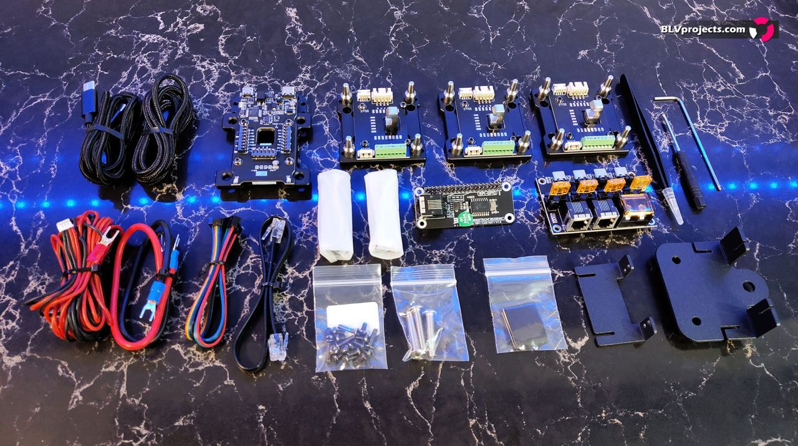
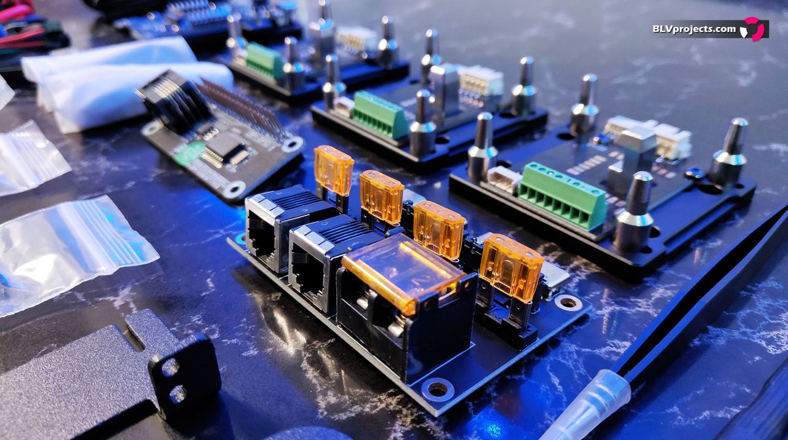
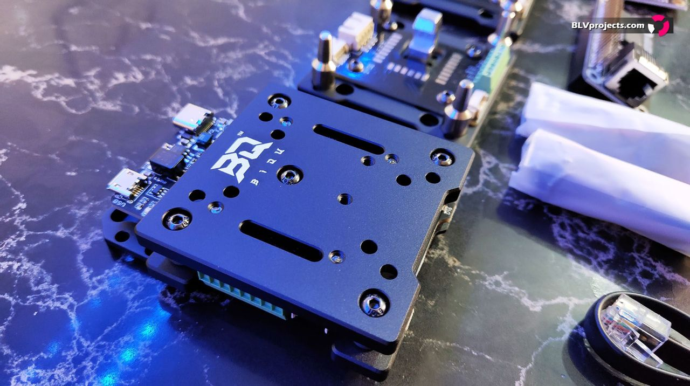

I hope you enjoyed reading. I promise to share my findings in my search after the perfect setup of the new BLV Cube update.

**Sincerely**

Ben Levi

