[← All updates](index.md){ .back-link }

# Metal Kit II, BLV carbon and more

First of all, I want to thank you all for your support. I really appreciate it.

My time is short, as I still have to get back to work on the new BLV Metal Kit II (yes, you read that right), but I wanted to update you on a few things:

- BLV Metal Kit II for the BLV Cube 3D printer
- BLV Carbon X-axis new stock

I also want to share my first impressions of a setup I'm about to test:

- Orbiter V2 and Trianglelab Rapido

### BLV Metal Kit II

Before starting work on the new BLV Metal Kit II for the BLV Cube, I wanted you to share your needs and thoughts with me. So I opened a [new discussion](https://www.facebook.com/groups/BenLevi/posts/989298145131055/) in the [BLV Facebook group](https://www.facebook.com/groups/BenLevi/posts/993367414724128/) and asked for your help. I want to thank each and every one of you who took the time to write, ask and share. Your requests are very important to me, as they reflect what community members really need from a printer. So thank you.

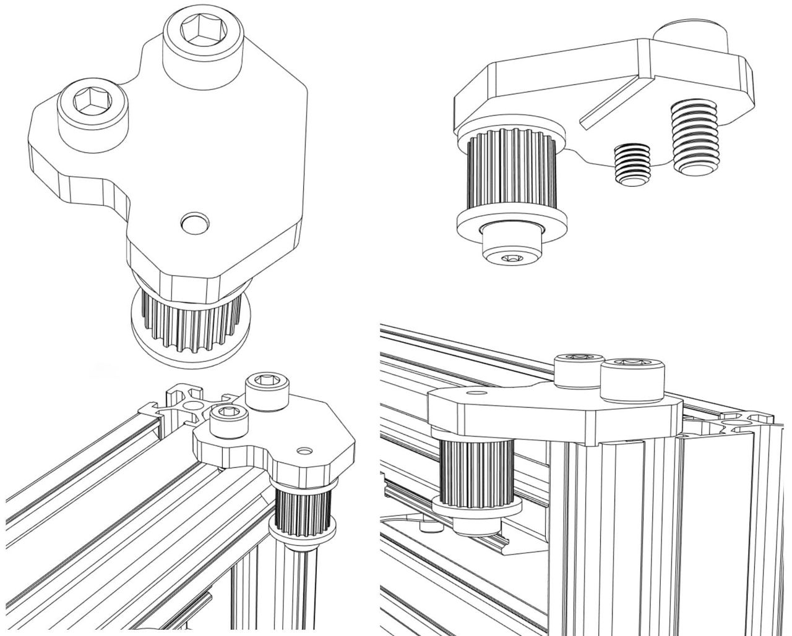
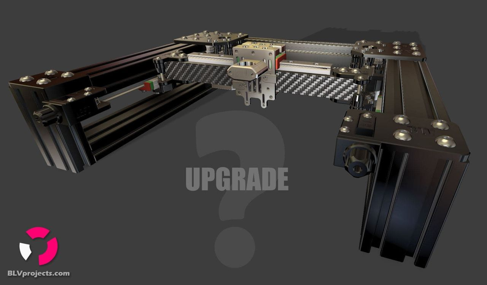

I can tell you that it will take quite some time to finish designing the new kit. It is not a matter of a month or two, but a little more. Meanwhile, I can point out that a number of things you requested have been confirmed and will be part of the new Metal Kit II.

Among other things, the planned Metal Kit II will include:

- A 9 mm belt (confirmed)
- Larger 20T Gates idlers, both smooth and toothed
- High-accuracy shoulder bolts
- Lighter X-carriage parts
- Triple Z axes (I'm checking a new mechanism)
- A rear tensioner that is more suitable for a full enclosure
- An accelerometer mount (thank you, David)
- Even easier installation

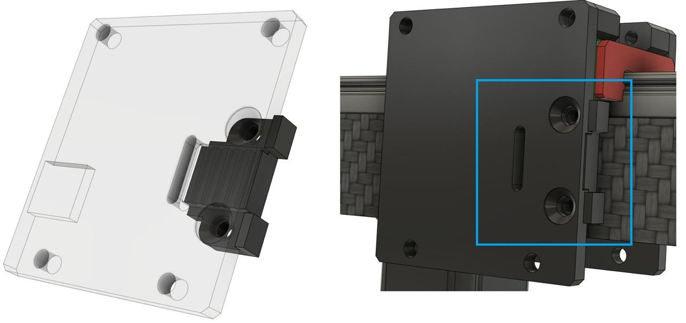
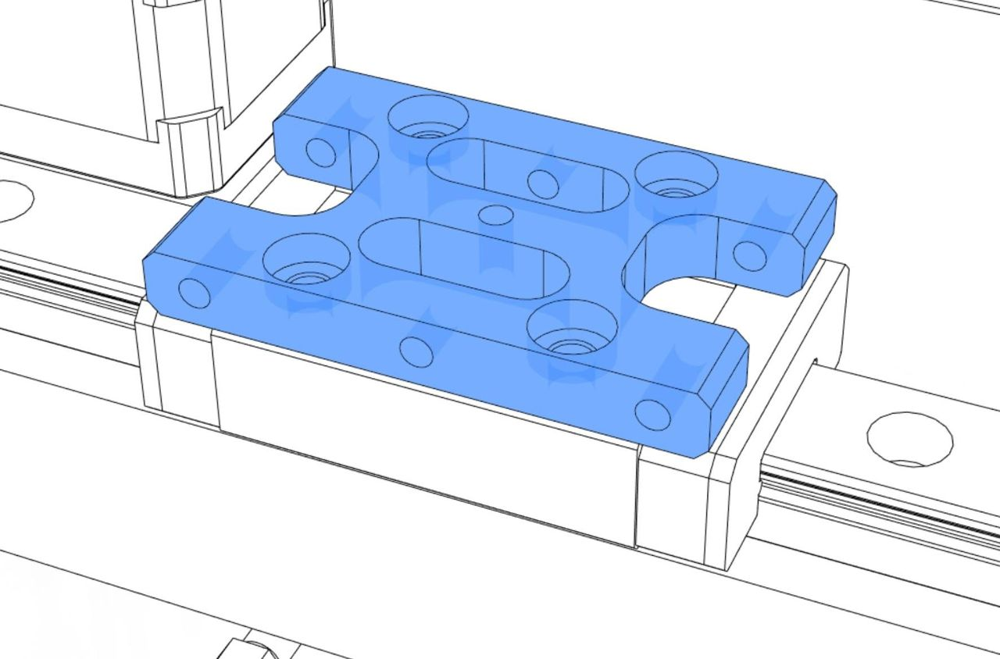

I also want to make the front plate of the X carriage completely flat, so it will be easier to mount extruders like the NF-Sunrise and the BIQU H2/H2O. For that, I moved the belt lockers to the rear of the plate. Don't worry, I will add many threaded holes to the X panels to make them lighter and suitable for many types of hotends and extruders. I'm so excited! 🤩

### BLV Carbon X-axis new stock

You left me speechless.

Within a few hours, all of Mellow's [BLV carbon X-axis](new-carbon-cf-x-axis-tube-is-available.md) stock was gone. Unfortunately, he managed to produce only 43 pieces right before the Chinese holiday. He already let me know that once they are back from the holiday, they will start making new stock. A few lucky [community members](https://www.facebook.com/groups/BenLevi/posts/1008187499908786/) have already received the carbon tube and [uploaded videos](https://www.facebook.com/groups/BenLevi/posts/996745121053024/?comment_id=1005181043542765), and I was very impressed. I got feedback on the first 30 pieces from the beta test, and it's really good.

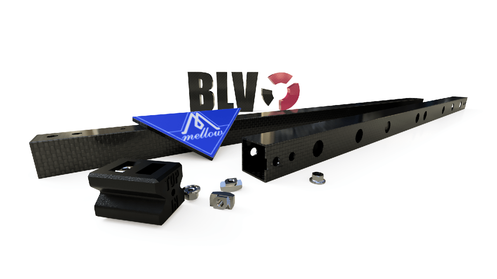
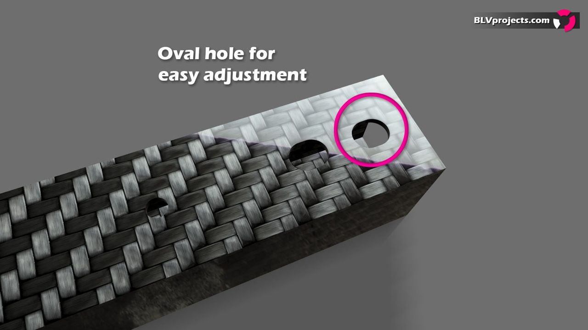
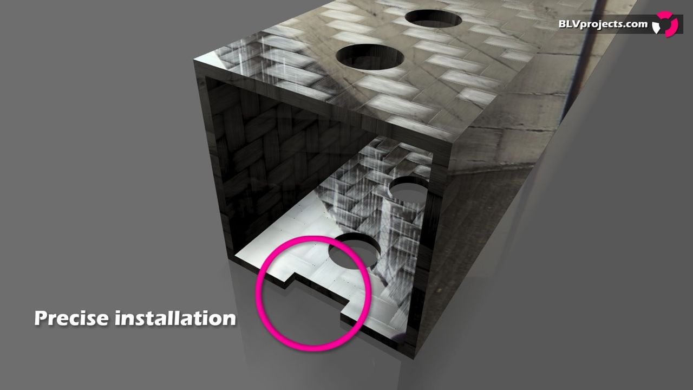

I came across a number of questions about the carbon tubes that I want to answer:

1. **The carbon tube's outer dimension is not exactly 20 mm. What should I do?** You shouldn't worry about it. A deviation of 0.3-1 mm in the outer dimensions of a square tube is very common, and it has no effect on the printer's performance or accuracy. Don't forget that the X carriage is fixed to the rail, so it is just a matter of a slightly different Z height.
2. **It is not exactly 460 mm but 460.8 mm. Can I use it?** Yes, the BLV X/Y system can handle even a 1.5 mm deviation. All you need to do is loosen the Y rail screws a bit and realign them to the new carbon tube. Very simple.
3. **My BLV carbon X-axis has oval holes on one side only. Why?** I decided to make oval holes on one side only. This way the system is more reliable, yet flexible enough for the differences between builds.
4. **Some of the bottom holes are not sanded.** To be honest, I'm a bit disappointed about that, since Mellow is a well-known, high-quality manufacturer. I think they rushed and shipped the last few pieces without a quality check because of the Chinese holiday. You can easily fix it, though. Be careful with the sharp carbon fibers: wear good gloves and sand the edges of the hole with a small file. It's very easy and takes only a couple of minutes.

I also received 3 reports of quality issues (over-sanding, damaged corners). I asked Mellow about it, and he immediately offered to send replacements. Quality is very important to him. Overall I'm very happy with the results, and to everyone who has already received the new BLV carbon X-axis: enjoy it.

### Orbiter V2 and Trianglelab Rapido

I started testing a few hotend-extruder setups, and I wanted to share my [first impressions](https://www.facebook.com/groups/BenLevi/posts/984590958935107/). So far I have tested [Mellow's NF-Sunrise](https://s.click.aliexpress.com/e/_A9Ap0z), which has done an amazing job. Then I tried a new setup: the [LDO Orbiter V2](https://s.click.aliexpress.com/e/_ASClVX) combined with the Trianglelab Rapido hotend. Without a doubt, Robert's new [Orbiter V2](https://s.click.aliexpress.com/e/_ASClVX) by LDO is fantastic. Just don't forget to readjust the hobbed wheel. I loved that it came with all the needed instructions, including Marlin, Klipper and RRF settings. Well done!

Mine came with the filament sensor. I printed the part needed for it, and I must say I absolutely love the design. I managed to get uniform layers without problems, even at very high speeds.

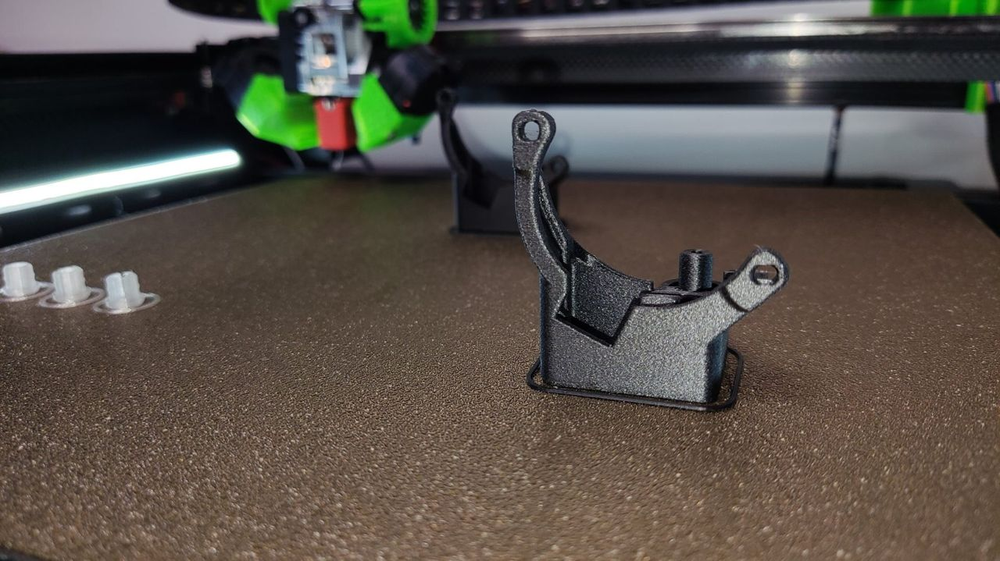
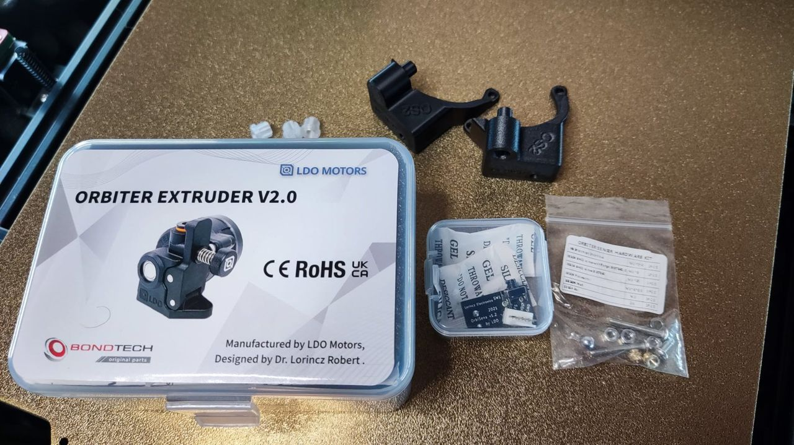
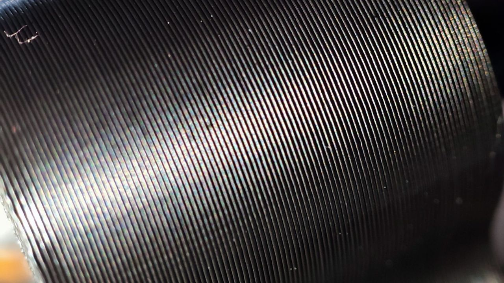

As for the [Trianglelab Rapido](https://s.click.aliexpress.com/e/_ALWey1), it's a really good hotend. With the [Bondtech CHT nozzle](https://www.bondtech.se/product-category/nozzles/bondtech-nozzles/bondtech-cht/) I was able to print at 300 mm/s and still get impressive results on detailed models, as you can see below.

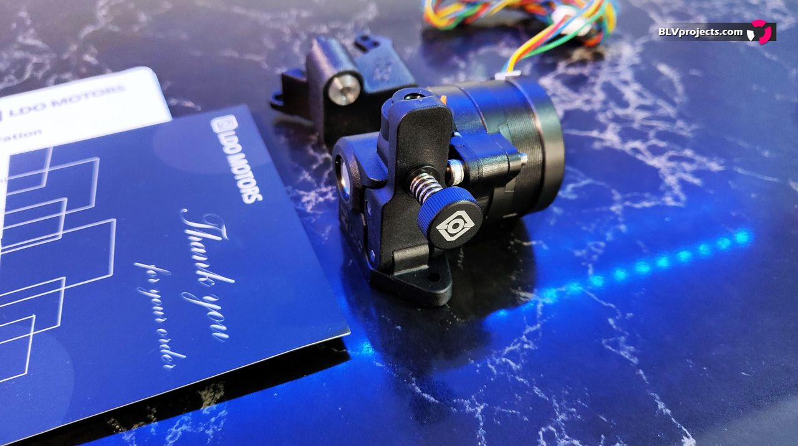
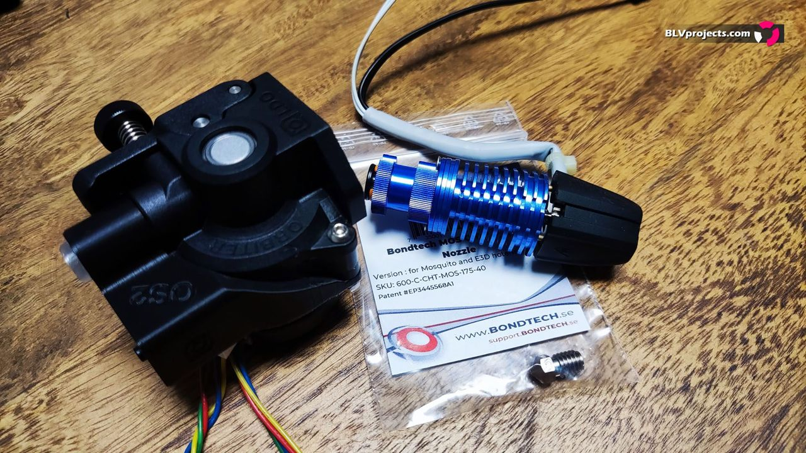
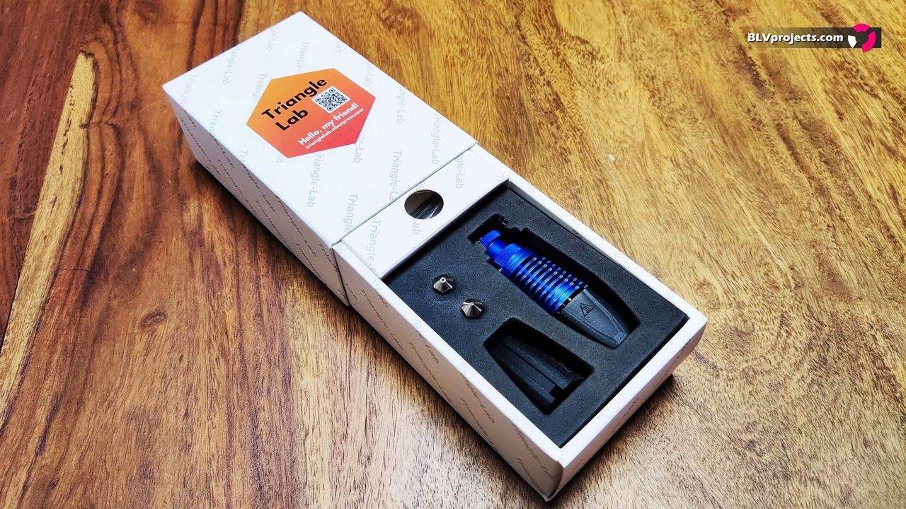
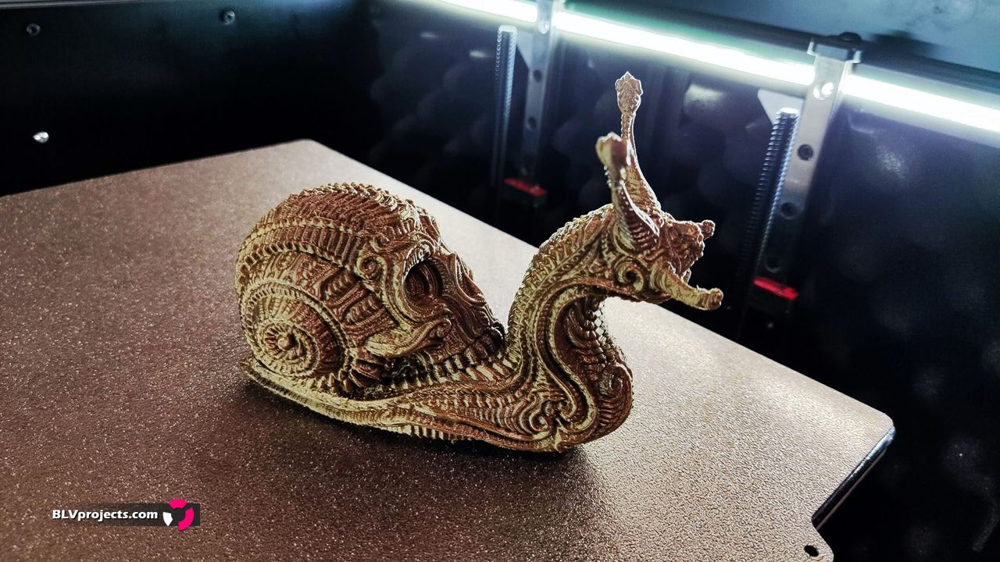
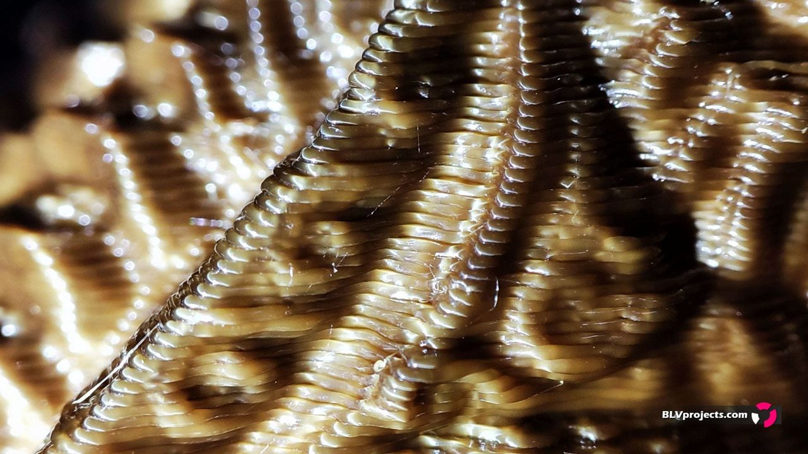
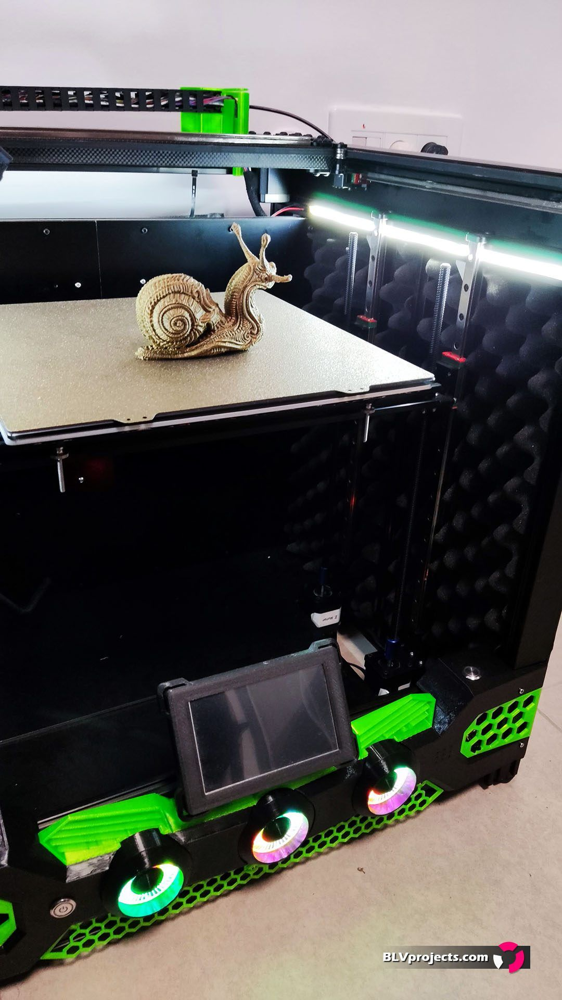

However, the [Rapido](https://s.click.aliexpress.com/e/_ALWey1) became a bit redundant after E3D set a really low price for their new Revo Six/Micro: £69.90 on pre-order, compared to $90 for the Rapido. I tried swapping nozzles on the [Rapido](https://s.click.aliexpress.com/e/_ALWey1) a couple of times. It went great until filament residue got stuck in the internal thread and prevented me from tightening the nozzle properly. It took me quite some time to clean the filament out, but in the end I was able to use it again.

Stay tuned. I will publish a new post about a few more setups I'm testing.

Sincerely,

Ben Levi
