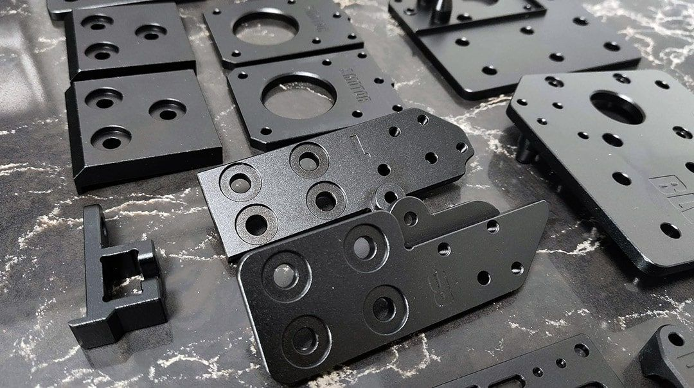
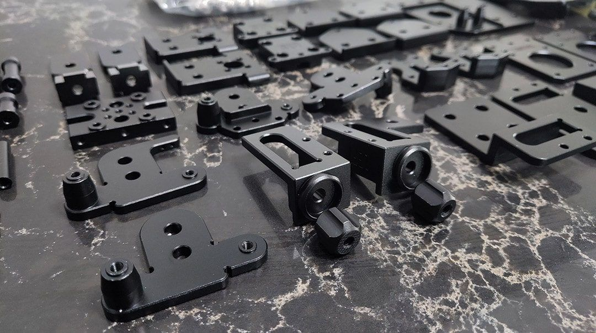
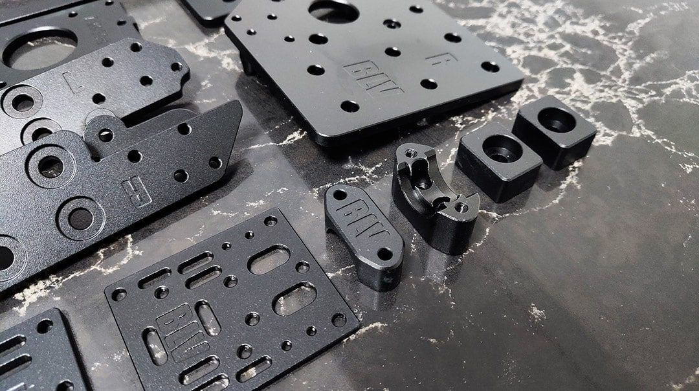
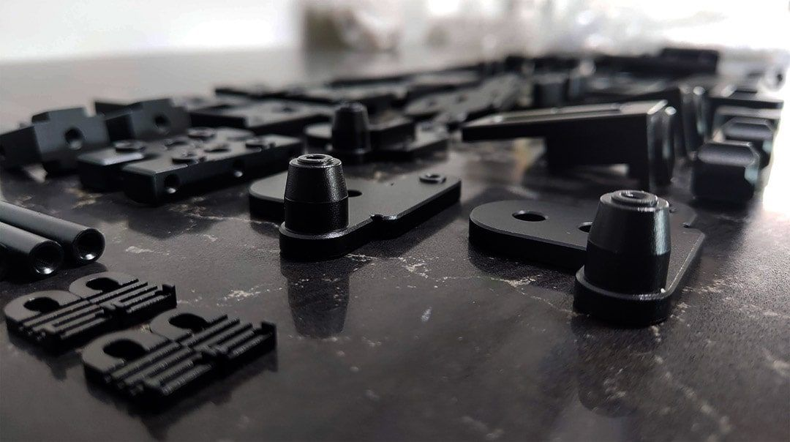
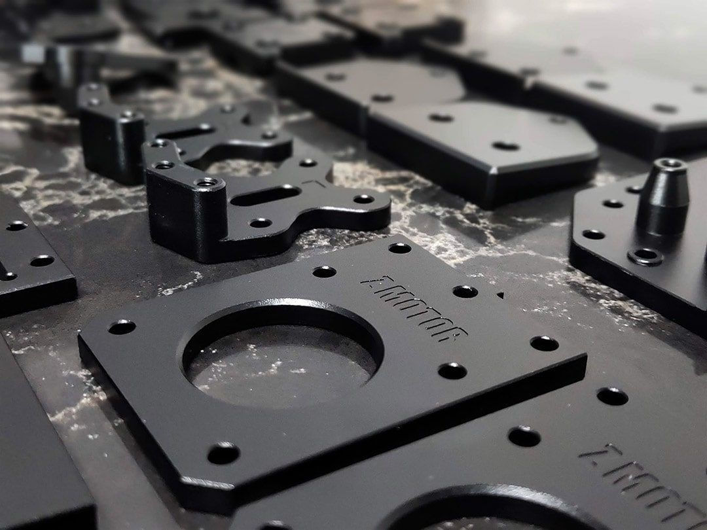
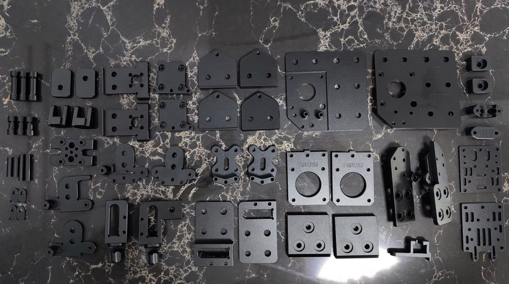

[← All updates](index.md){ .back-link }

# Metal parts: beta testers wanted

**Update:** the metal parts beta kit is finally available: [https://s.click.aliexpress.com/e/_dZWiHmO](https://s.click.aliexpress.com/e/_dZWiHmO)

Thanks to Peter, the latest version of the metal parts is ready, and I was lucky to get the first set. I'm really pleased with the quality of the parts (see the pictures below), but since I am in the middle of packing up my home to move to a new place, it will take some time before I can fully test them. This is the 4th version of the set, and many bugs were fixed and optimized. If you are truly a maker who can handle and fix small problems by yourself, you might want to read on 🤩

[**Join the beta tester group**](https://www.facebook.com/groups/BenLevi/permalink/656605898400283/?__xts__%5B0%5D=68.ARChSIaxJTbz2SHrLZ_kP0HfC4-iAJmX3QwTJ-yIM4SPEZt3AoC6iAgtWF8ARUYoLS3J4RBHb3zttzUJoOVIOyd5stgnWuUhOdifCEGqJTVonzQXcPxA-BHBr73seJDuyfgaOOMKg34T49EtjuZFfcqt9T51fZnQWcTYx_1pB95aUxEAODz2wS-SnAs8tSYavVE9JfroSxmqOoPKz97SKLyejerufNOwJZli1TNniXsGubweawghw3wRuvEvq3UT7NgHftM9b7vlHcpIY6w2Z5agIrtnRAk2&__tn__=-R)

Peter produced a limited quantity of the metal parts, and I would like to start a beta test group. It is very important to understand that this is not a final product. Or maybe it is? With your help as a beta test group, we will find out. He is going to sell it for $109 including shipping, which is a very low price for 50+ CNC-machined parts. Just a reminder: I gave him my work for free, on the condition that he makes it affordable for us. I don't know exactly how he plans to sell it, probably through a private link or an AliExpress listing.

If you are interested, please comment on the [beta tester post in the BLV Facebook group](https://www.facebook.com/groups/BenLevi/permalink/656605898400283/?__xts__%5B0%5D=68.ARChSIaxJTbz2SHrLZ_kP0HfC4-iAJmX3QwTJ-yIM4SPEZt3AoC6iAgtWF8ARUYoLS3J4RBHb3zttzUJoOVIOyd5stgnWuUhOdifCEGqJTVonzQXcPxA-BHBr73seJDuyfgaOOMKg34T49EtjuZFfcqt9T51fZnQWcTYx_1pB95aUxEAODz2wS-SnAs8tSYavVE9JfroSxmqOoPKz97SKLyejerufNOwJZli1TNniXsGubweawghw3wRuvEvq3UT7NgHftM9b7vlHcpIY6w2Z5agIrtnRAk2&__tn__=-R) with your AliExpress username. At first he will send a small number of sets. Then, after I get some feedback, he will ship to a bigger group of testers.

**I will say it again: this is NOT a final product.** You may find errors, and with your help I will be able to fix them.

P.S. I will make assembly guides to make the kit easier to put together. That will take me some time.
