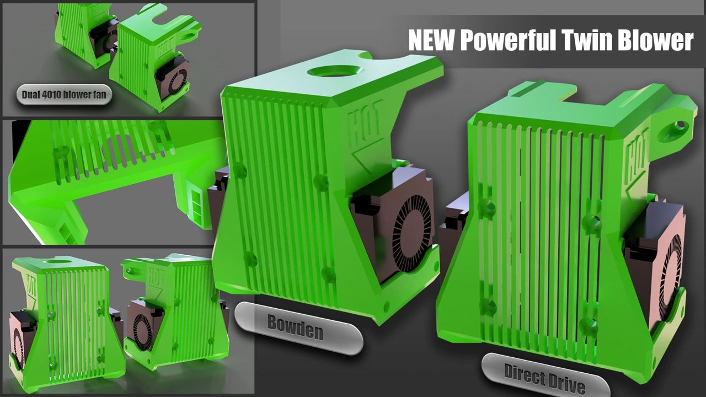

[← All updates](index.md){ .back-link }

# Dual layer fan

I decided to try making a new shield equipped with twin 4010 blowers as layer cooling fans. It has three channels on each side that direct the airflow and create a spot of about 12-15mm, 0.2mm below the nozzle (calculated with air drop over a 20mm distance).

The design is a twin blower block shield for the BMG direct drive, available in two versions. The files can be found inside the [**BLV mgn Cube**](../index.md) zip.

### Very important

- Please don't forget to run a new hotend and bed PID tuning.
- I am using dual ball bearing 4010 blower fans from this [**AliExpress 4010 blower store**](http://s.click.aliexpress.com/e/bByyuaZa):

