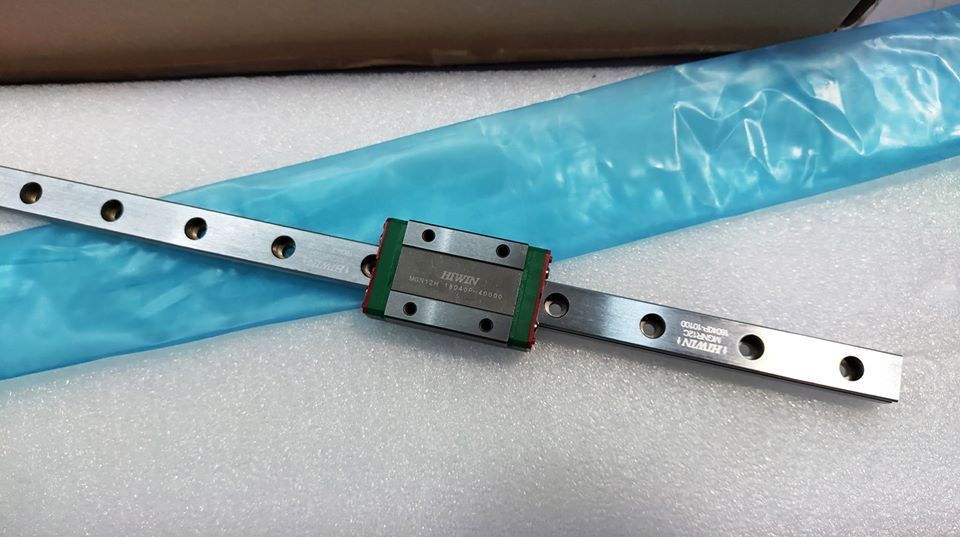
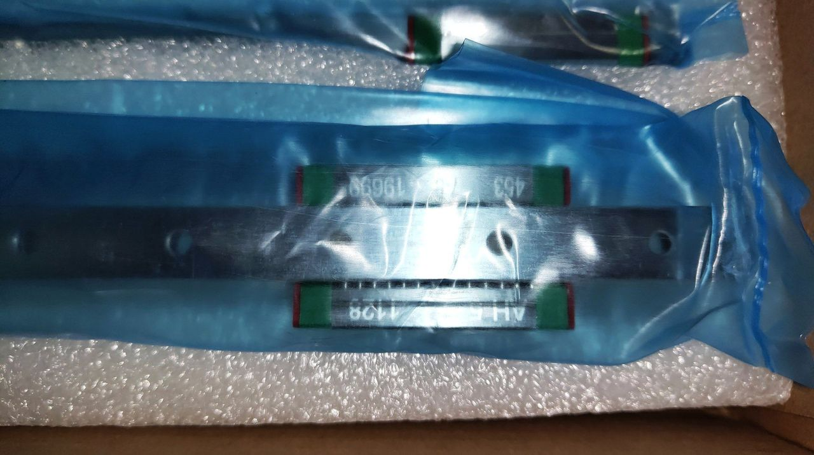
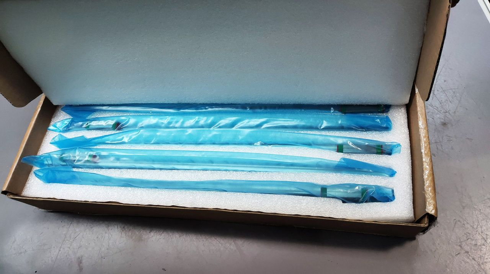
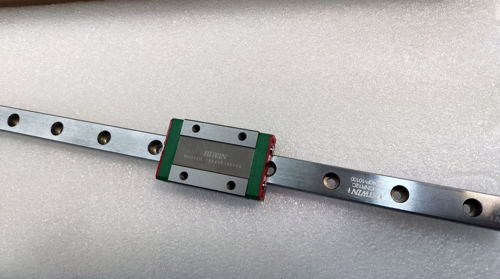
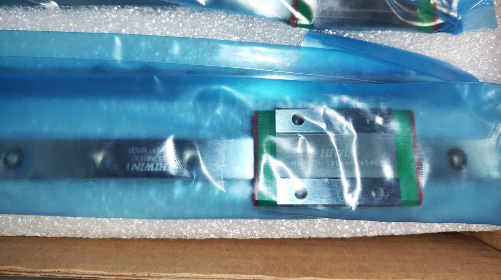
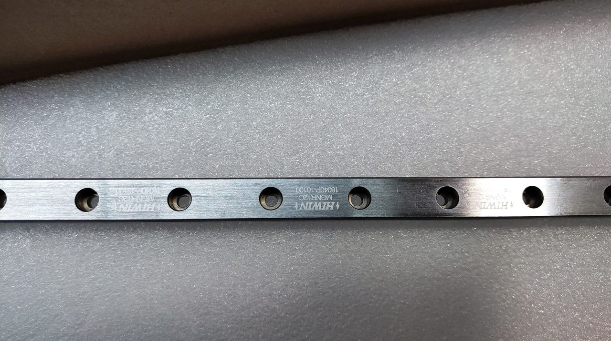
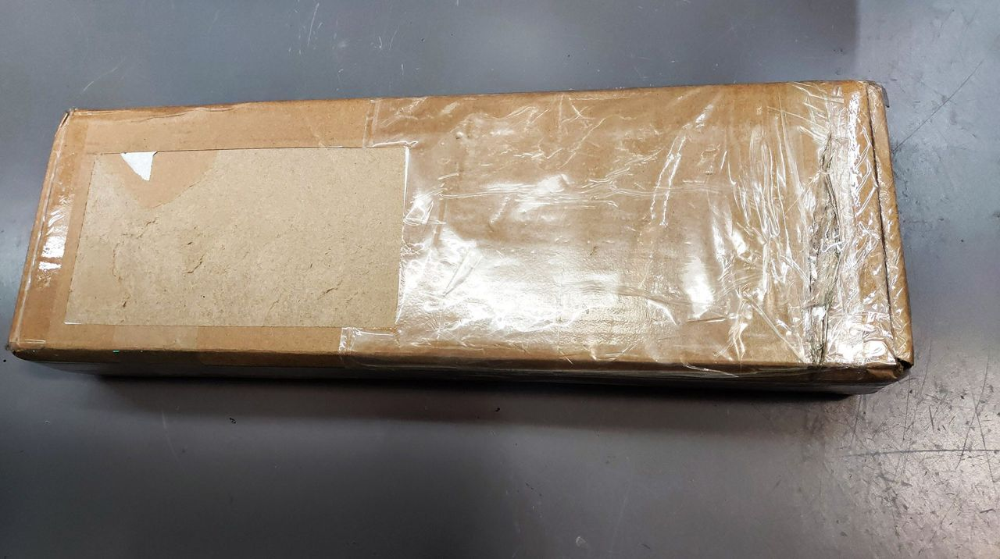
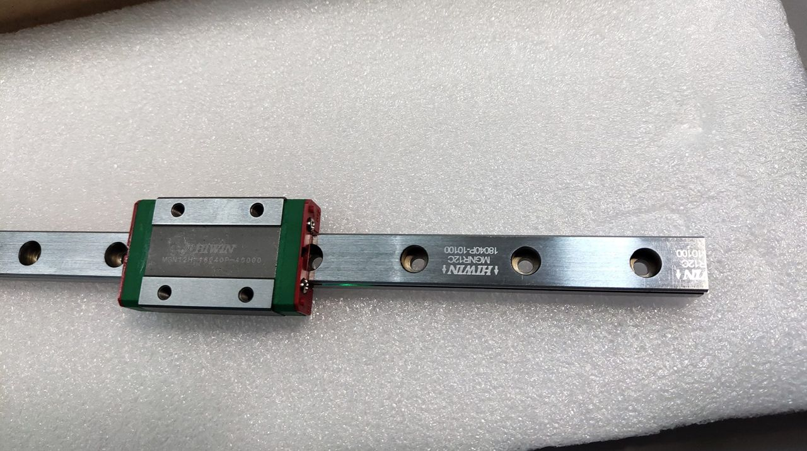
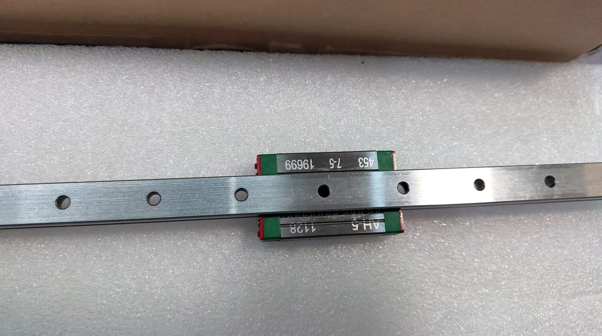

[← All updates](index.md){ .back-link }

# Affordable genuine HIWIN linear rails

I finally saved enough and bought a set of genuine HIWIN MGN12H 400 mm rails and carriages from **Blurolls Lu** (AliExpress store).

!yt HQoGXPk7drw | Genuine HIWIN MGN rails for the BLV mgn Cube

My cheap Chinese rails are pretty good, but these HIWIN rails are way better. Only one word can describe them: perfection! The set was well packed and the rails were very clean. As expected, the motion is very smooth, yet rigid. Don't expect the carriage to just fall when the rail is tilted, because it won't. If it is too smooth, you are in trouble, since you will have too much free movement when twisting the carriage. At the end of the video I tried to twist it, and it's so rigid! Great quality and worth every single penny. I bought them from the [**Blurolls Lu store on AliExpress**](http://s.click.aliexpress.com/e/cTl59jr2).

Please note that I paid for the rail set like everyone else, and no one paid me to write this.

