[← All updates](index.md){ .back-link }

# An affordable Duet 3 6HC board

### Duet 3 6HC board

For a long time I have been fantasizing about buying the [**Duet 3**](https://www.duet3d.com/Duet3Mainboard6HC) to use as the board for my BLV mgn Cube 3D printer. The Duet 3 6HC is the new generation of the well-known Duet WiFi board, running RepRap Firmware 3. It has all the hottest features, excellent specifications and the best documentation you could wish for in a 3D printer board. The main features are:

- Fast 32-bit processor
- High-speed bus for a Raspberry Pi (SBC)
- 6 x Trinamic TMC5160 stepper drivers
- 10 PWM outputs
- 9 IO ports for endstops, probes and sensors
- 4 thermistor or PT1000 inputs
- 2 CAN-FD buses for expansion boards (up to 24 steppers)
- Built-in Ethernet port
- Duet Web Control interface and RRF3 firmware

There is much more, but these are the main points.

### So where's the problem?

$225, not including shipping, is a lot of money, at least for me. Given my needs and the insane price, the Duet 3 just wasn't an option, and that's a shame.

### Finally

All this was true until FYSETC decided to produce the Duet 3 6HC. Remember that the Duet 3 is open source. When I saw the [**Duet 3 6HC**](https://s.click.aliexpress.com/e/_A1uWxz) listing on AliExpress, I was excited, because I realized there was now another source for the Duet 3 6HC at a price that made it attractive to me. [**$145**](https://s.click.aliexpress.com/e/_A1uWxz) for one of the best 3D printer boards on the market is just amazing, and that's $80 less. Shortly after I saw the listing, it was already deep in my order list and I started counting the days.

### Unboxing

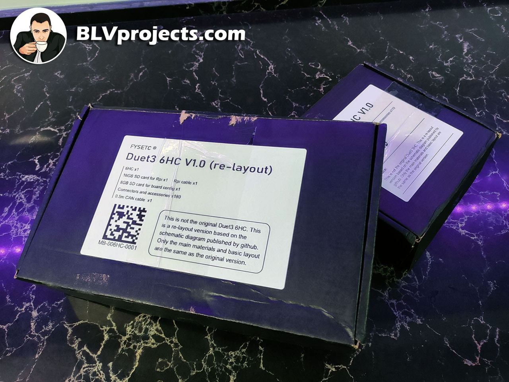
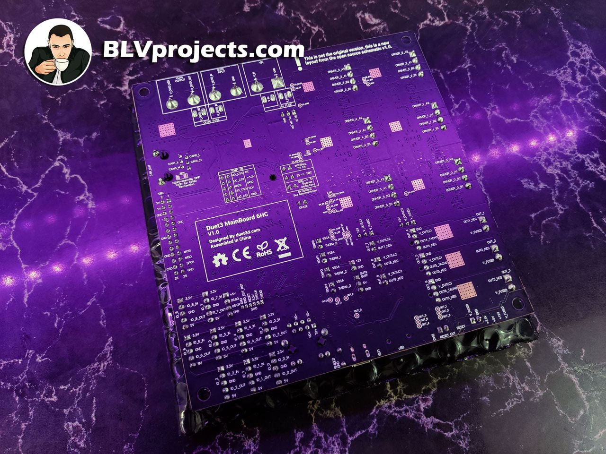
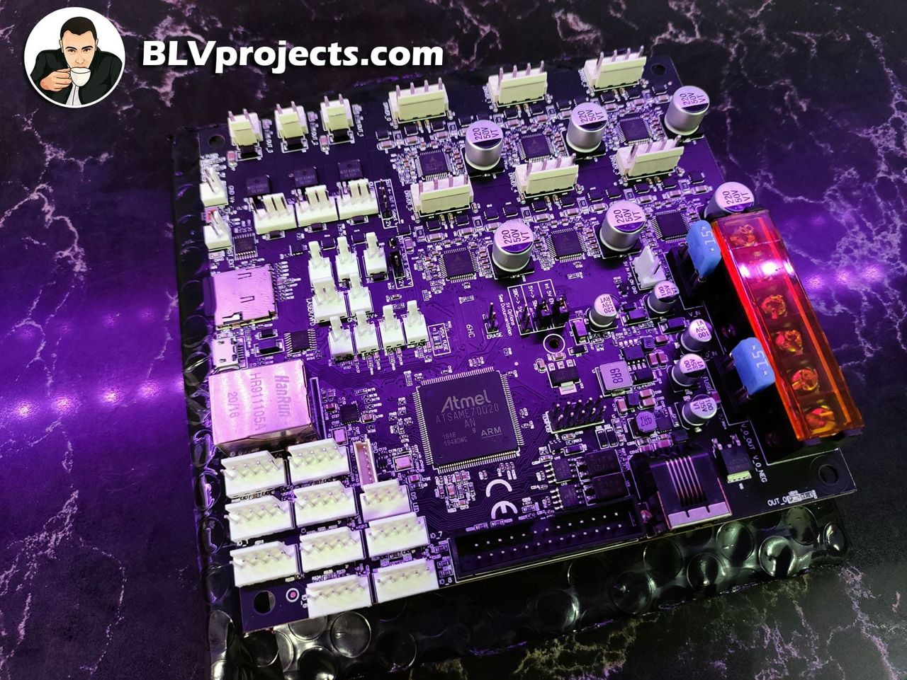

I ordered the Duet 3 6HC and, out of curiosity, also the 3HC expansion board. The boards came well packed, wrapped in an antistatic bubble bag and a carton box. I must point out that they did a good job and included everything needed to install both the mainboard and the expansion board. For some reason, nowhere is it stated what comes with the board, so I prepared a complete list of all the components I received:

- Duet 3 6HC clone board
- Pack of 2.54mm Molex KK connectors and shells for most of the components
- Pack of BVH-21T-P1.1B (JST) connectors and shells for steppers and heaters
- Crimping pins for the high current connectors
- 0.5m CAN cable
- 16GB SD card for the Raspberry Pi (if you are using one)
- 8GB SD card for the firmware and config
- Raspberry Pi cable

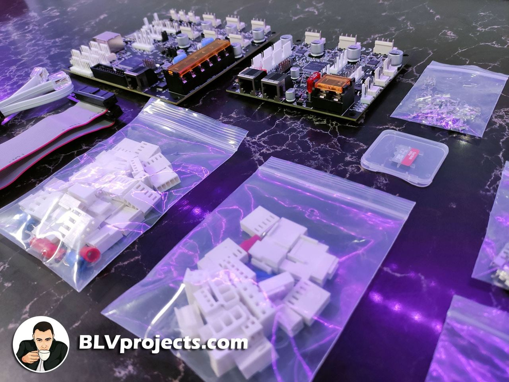
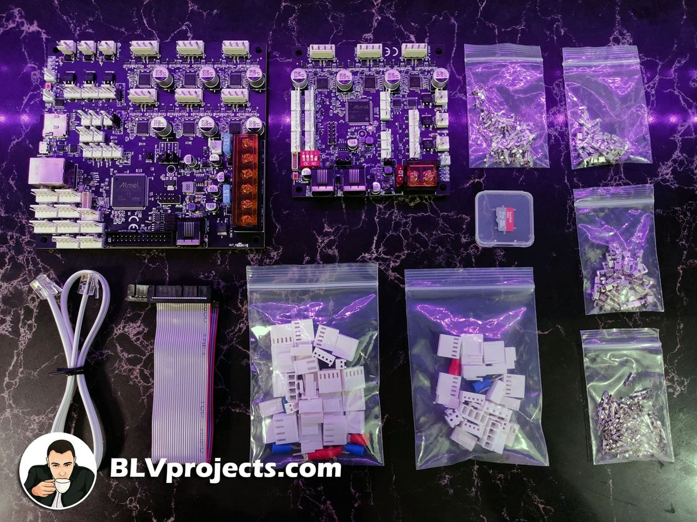
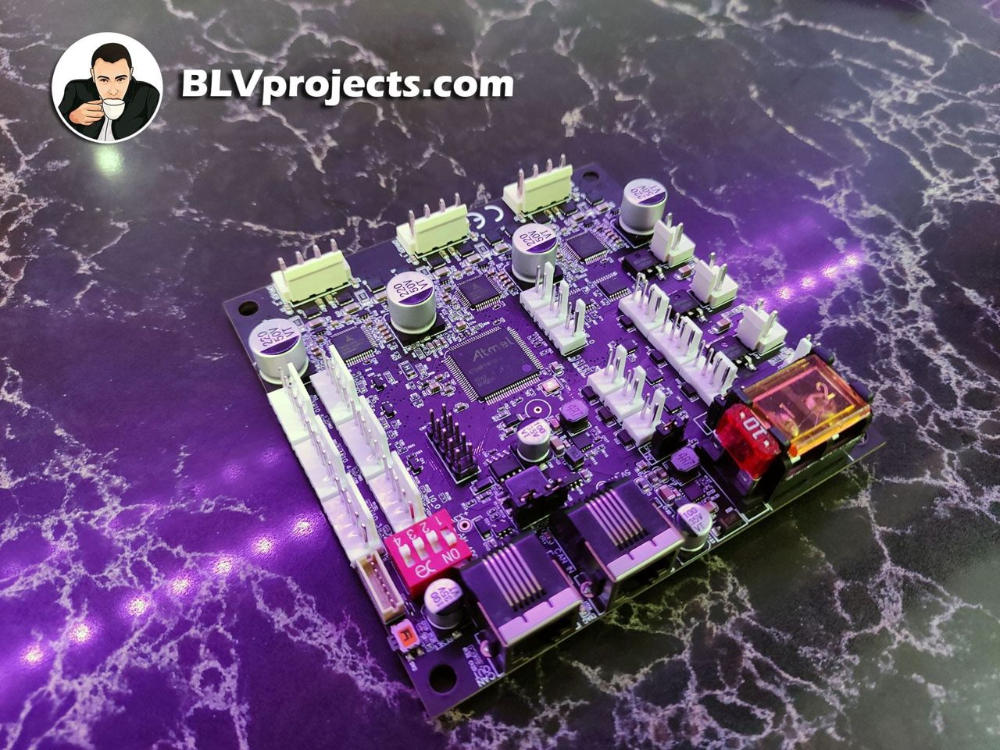

As someone who has seen quite a few boards, I can say that this is a high-quality PCB. All components were properly soldered, and the board was properly washed and tested. The connectors provided by FYSETC are among the best I have ever worked with. Using this [**cheap SN-28B crimping tool**](http://s.click.aliexpress.com/e/ctVlu2Gs), I got really nice crimps, better than on my original old Duet.

Before fixing the board to the back panel, I recommend updating the Duet 3 and making sure the firmware runs properly. You can find all the information you need about updating to the latest version in the [**Duet 3D documentation**](https://docs.duet3d.com/). The latest firmware can be downloaded from the [**RepRapFirmware releases page**](https://github.com/Duet3D/RepRapFirmware/releases).

I had to drill new holes in the rear panel, since the Duet 3 6HC is much bigger than the old Duet WiFi. So it is worth checking that there is enough space on the back panel. For your convenience, here is a basic wiring diagram of the board as I installed it. Note that I haven't added the power button yet. Also, in this version I used an inductive sensor and an AC heated bed.

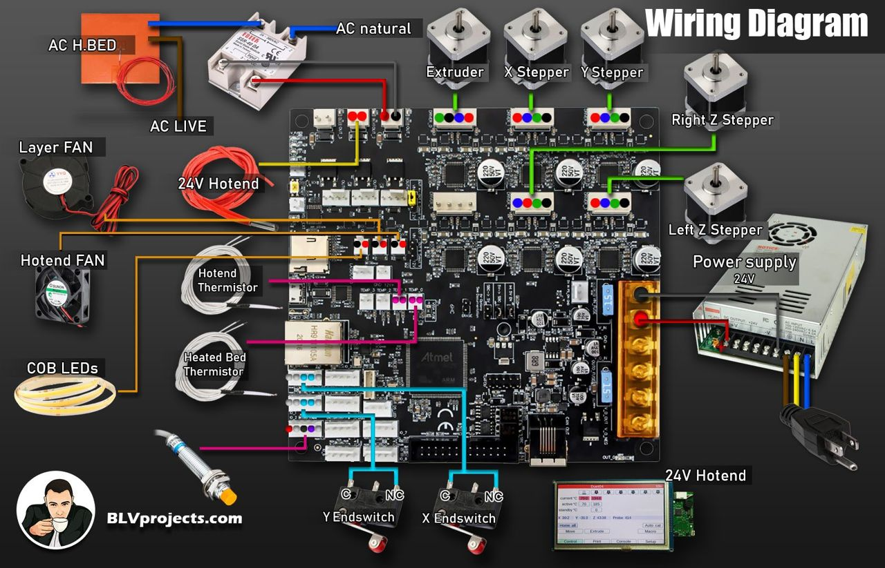

And this is what it looks like after installation:

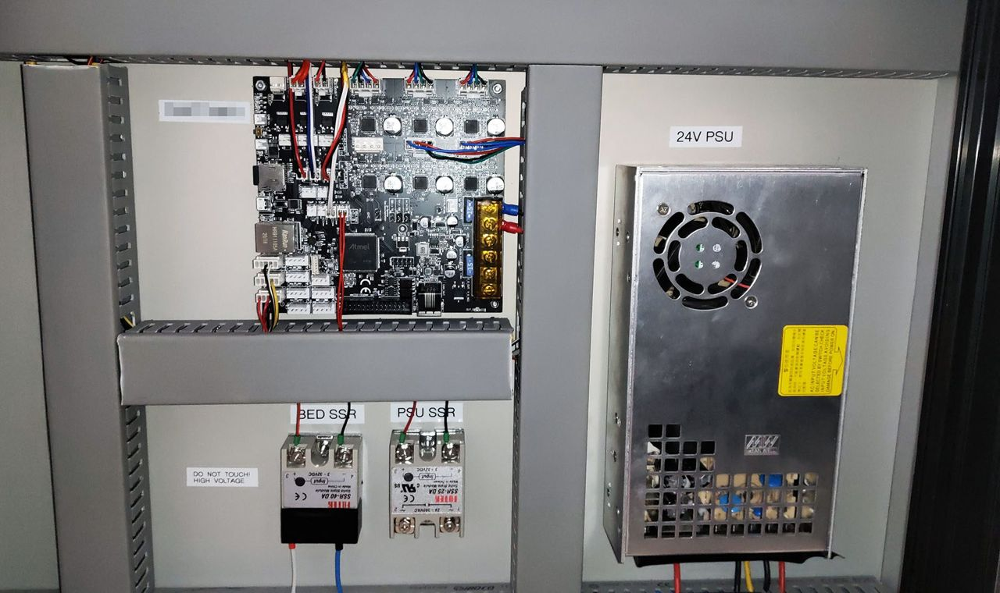
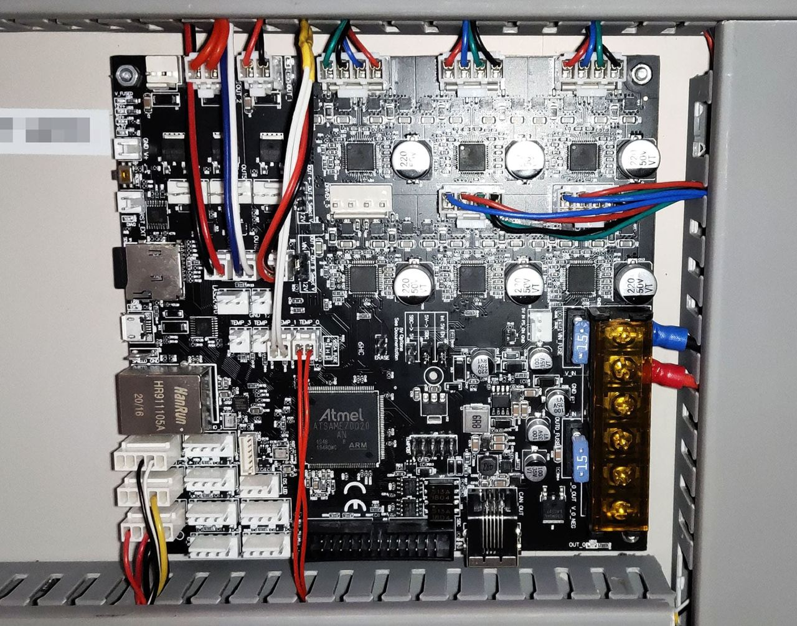
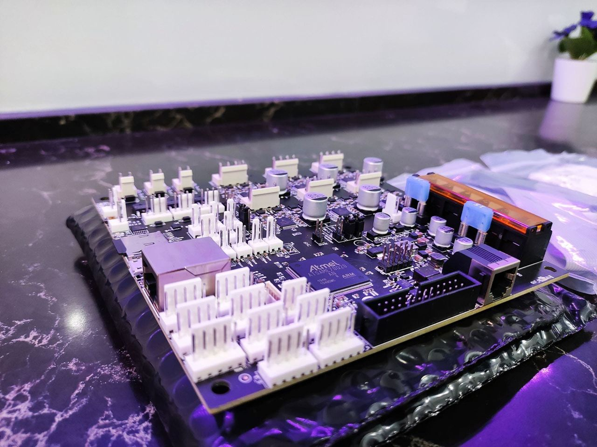

### Configuration

Before the board arrived, I sat down and read most of the Duet 3 documentation, and I highly recommend you do the same. It is all available in the [**Duet 3D documentation**](https://docs.duet3d.com/). For your convenience, I prepared a basic config you can start from when configuring your own system. Note that this config uses the new BIQU H2 extruder, so the endstop and probe locations should be changed according to your BLV Cube 3D printer settings.

My Duet 3 config files:

File: Basic Duet3 6HC config by Ben Levi.zip (ZIP, 5KB)

You can also check out **David Husolo**'s [**Duet RRF3 configurations**](https://github.com/armysolo/BLV?fbclid=IwAR0-mR3bgpyxTPCFCVhUZgBWfTpTGOmq77aLlfcxRdvNA5OaHYBYkjqmsJw) on his GitHub for both the BLV AM8 and the BLV mgn Cube. I would like to take this opportunity to thank David for his tremendous efforts in the community.

### Conclusion

I guess a lot of people are asking themselves whether it is worth upgrading to the Duet 3 6HC. After all, the Duet 3 6HC will function almost exactly like the old Duet WiFi, which costs less. That was true until FYSETC put their Duet 3 up for sale for $145, about $80 less than the official Duet. In terms of features, since the Duet 3 has a more powerful processor and double precision floating point, I allowed myself not to rely on the TMC drivers' auto interpolation and set my own micro-step settings. Keep in mind that with auto interpolation the driver will rarely reach 256 microsteps. If we force it to use a higher number of microsteps, it provides quieter motion, higher accuracy and fantastic print quality. The TMC5160 keeps surprising me with every print.

Those of you who use 3 Z axes for auto leveling will be happy to hear that the Duet 3 has 6 stepper drivers. That means you no longer need an expansion card for 3-axis auto leveling. The only downside of the Duet 3 for me is the lack of a WiFi module. True, a wireless module is slower than the Duet 3's Ethernet cable, but it's much more convenient.

After testing it for more than a month, I can say with complete confidence that overall I am very pleased with the board. Without a doubt, it is one of the best boards I have ever worked with. The prints come out great, and Duet's fantastic web interface has become a must-have feature for me. Recommended!

Here are some sample prints made with the Duet 3 6HC board.

Printed using the [**BIQU H2 direct drive extruder**](https://s.click.aliexpress.com/e/_AgqcYp).

Filament: [**Noulei silk PLA filament**](https://s.click.aliexpress.com/e/_Ag1rDK) and [**Prusament PLA Galaxy Silver**](https://shop.prusa3d.com/en/prusament/712-prusament-pla-galaxy-silver-1kg.html).

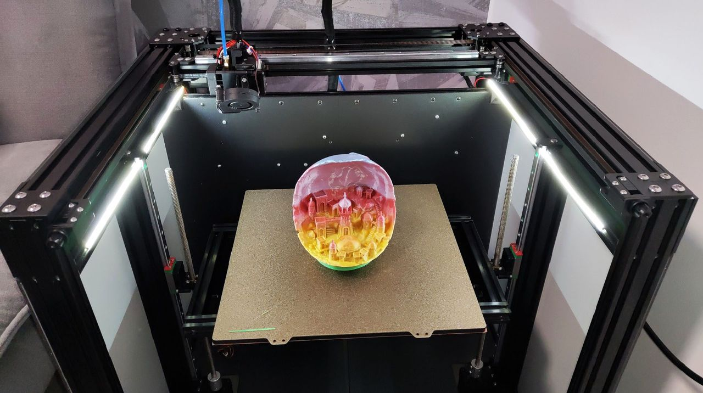
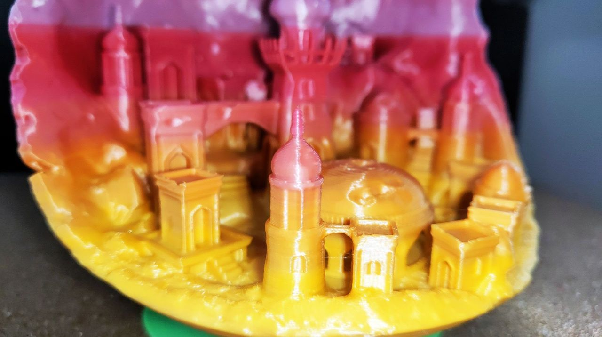
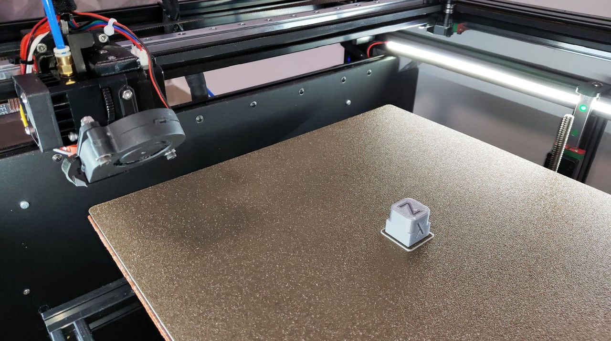
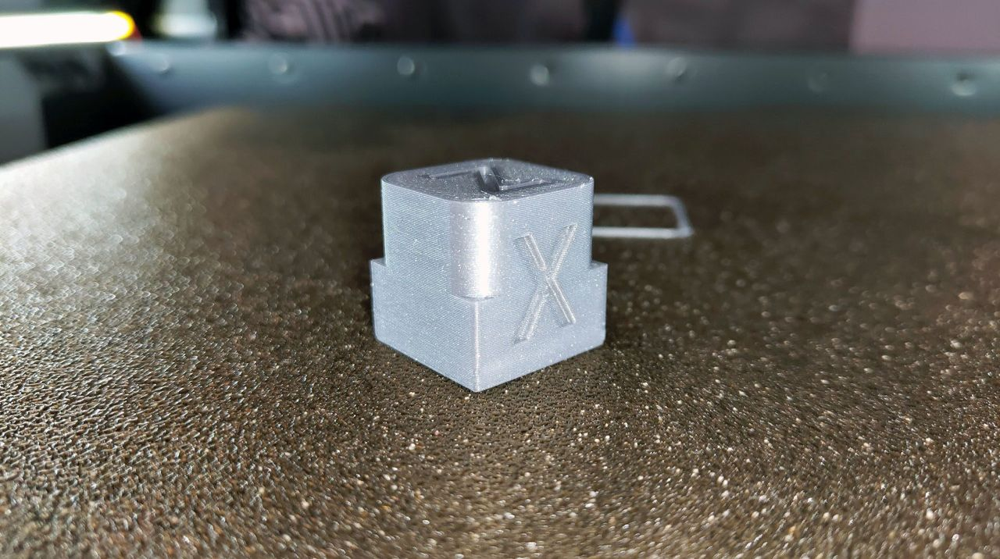
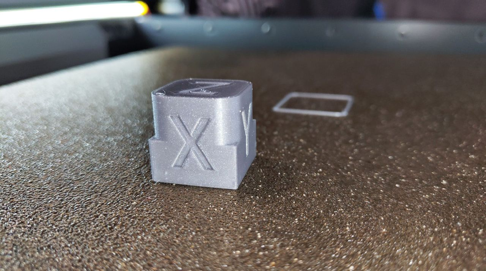
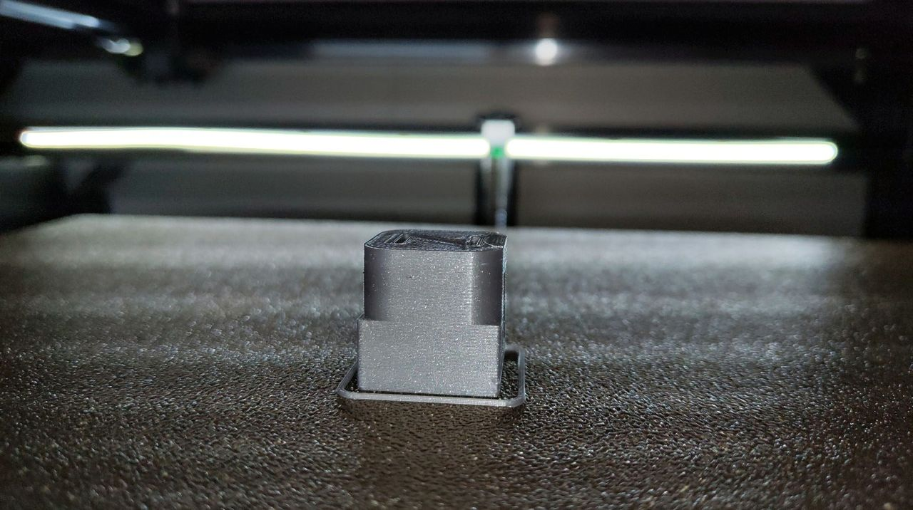

I hope you enjoyed reading.

Sincerely,

Ben Levi

**Edit**: Unfortunately, I received requests to delete this post. Some people in the industry think that open source is not really open source, but a way to double their money. Sorry, but thanks to open source, even the average person can afford an Arduino, for example. I will make this clear again: my main goal is to make it all affordable for everyone. My sincere apologies to everyone who disagrees. In addition, some claimed that I may have received the board for free. I'm sorry, but I paid for it like anyone else, as the photo below shows.

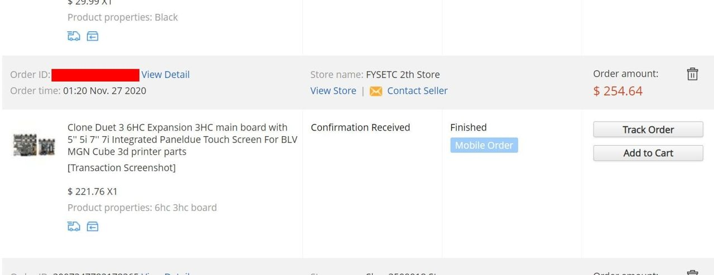
