# Project updates

Posts published during the development of the BLV mgn Cube: new parts and upgrades, reviews, beta tests and print samples. They are kept as they were written. Kits, sales and offers mentioned in them have ended.

<a class="mod" href="metal-kit-ii-update-clearance-sale/">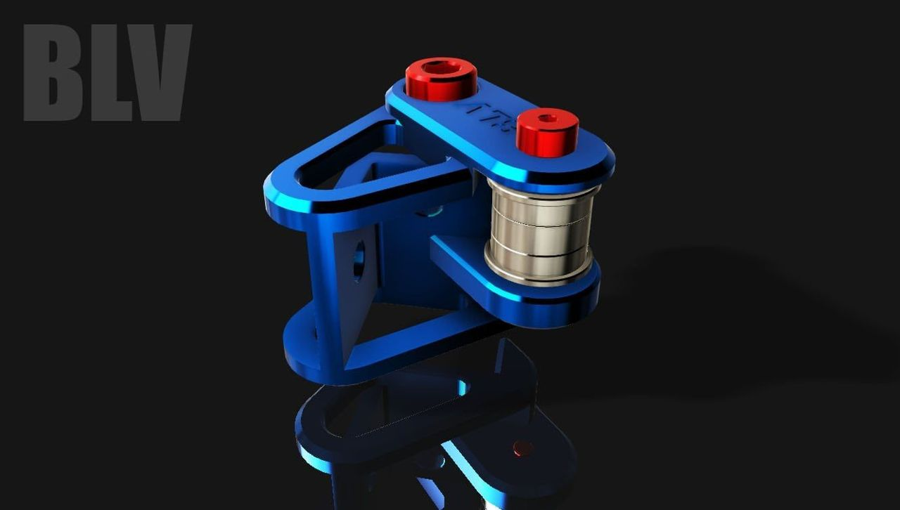<b>Metal Kit II update and clearance sale</b>It took 34 days to create this tiny part.</a>
<a class="mod" href="biqu-h20-and-haldis-k1-xl-hotend/">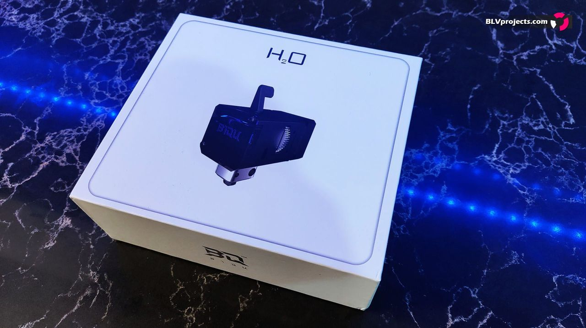<b>BIQU H2O and Haldis K1-XL hotend</b>I wanted to share with you my first impressions or shall I say unboxing of a few Hotend-extruder setups I&#x27;m testing. I&#x27;m sure it&#x27;s going to be interesting 😉. As</a>
<a class="mod" href="blv-metal-kit-ii-blv-carbon-new-stock-and-more/">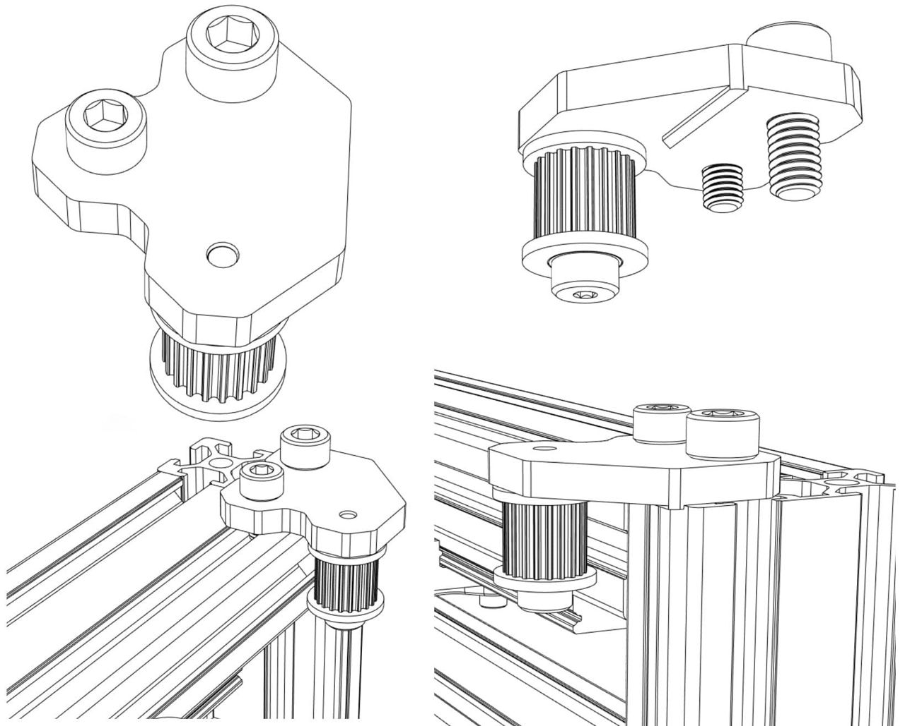<b>Metal Kit II, BLV carbon and more</b>First of all, I want to thank you all for your support, I really appreciate you guys.</a>
<a class="mod" href="new-carbon-cf-x-axis-tube-is-available/">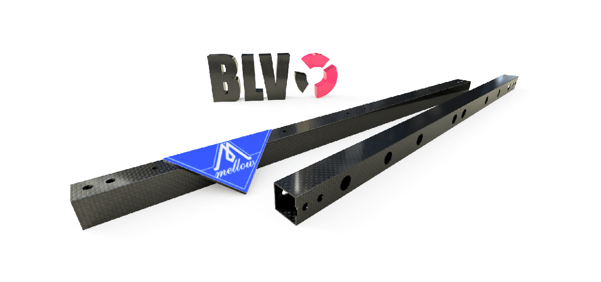<b>Carbon fiber X axis tube</b>Mellow just updated me that the first BLV Carbon X-axis tube batch is ready and finally available for us. All are made according to the ISO manufacturing sheets</a>
<a class="mod" href="klipper-mainsail-theme-and-carbon-x-axis/">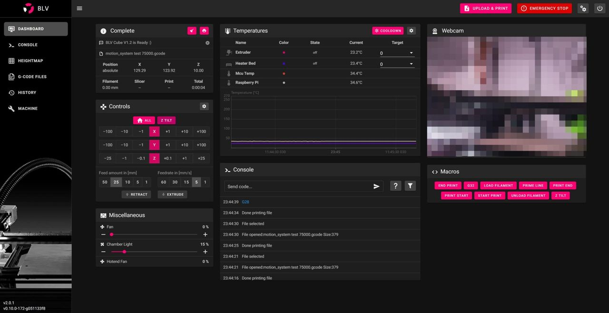<b>BLV Klipper Mainsail theme and carbon X axis</b>In my work (Autonomous Drones Dev-Lab) I use CNC machined carbon parts on a daily basis. recently, I&#x27;ve noticed that CNC machined carbon&#x27;s price has dropped sig</a>
<a class="mod" href="klipper-ultra-fast-printing-9000acc-500mm-s/">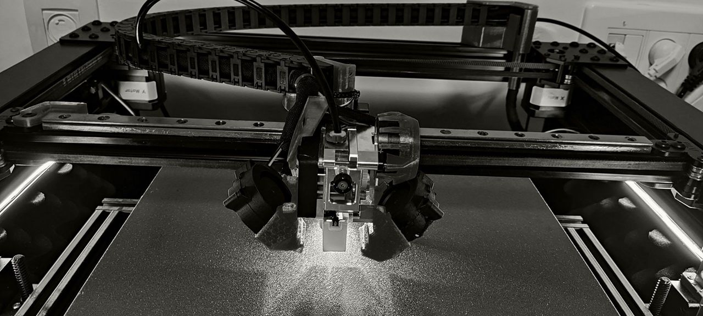<b>BLV Cube + Klipper: 9000 mm/s² and 500 mm/s</b>After long experience with Reprap firmware, I decided to try Klipper.</a>
<a class="mod" href="new-front-panel-beta/">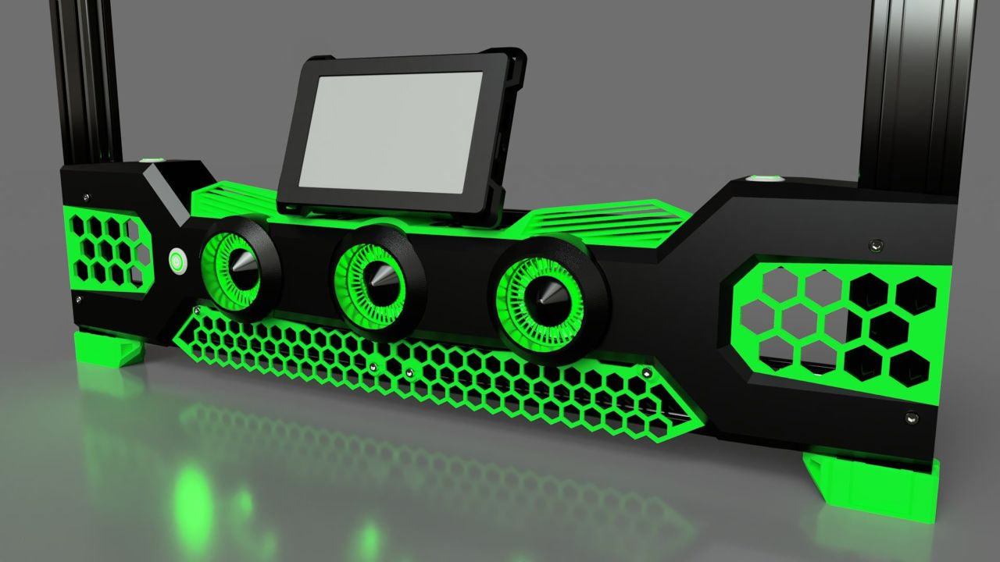<b>New front panel (beta)</b>Yes .. this is a new panel for the BLV mgn Cube printer.</a>
<a class="mod" href="unboxing-fysetc-blv-mgn-cube-full-kit/">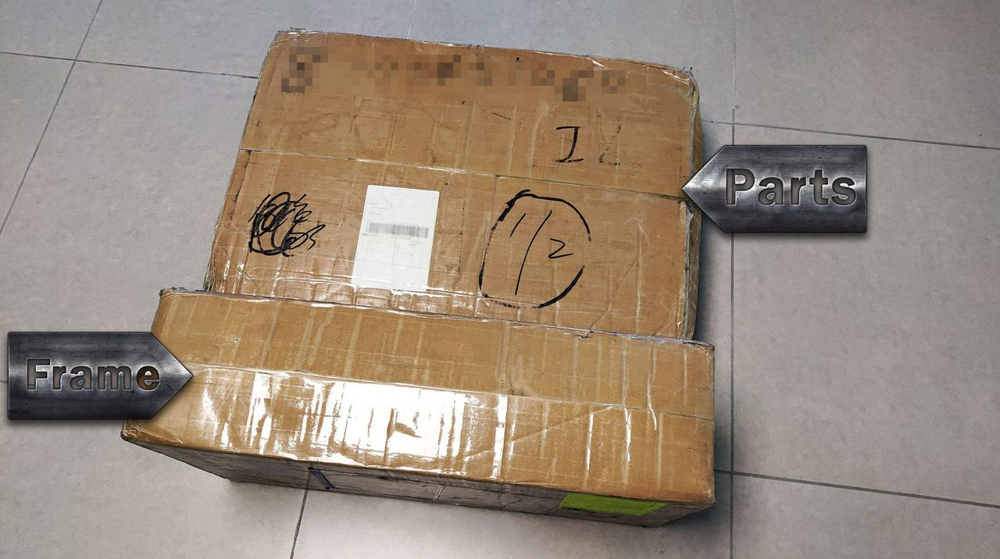<b>Unboxing: the FYSETC BLV mgn Cube full kit</b>a friend of mine (@Harel) contacted FYSETC company more than two months ago, after having difficulty ordering a kit from Blurolls. Turns out someone there took </a>
<a class="mod" href="the-new-biqu-h2-extruder-review/">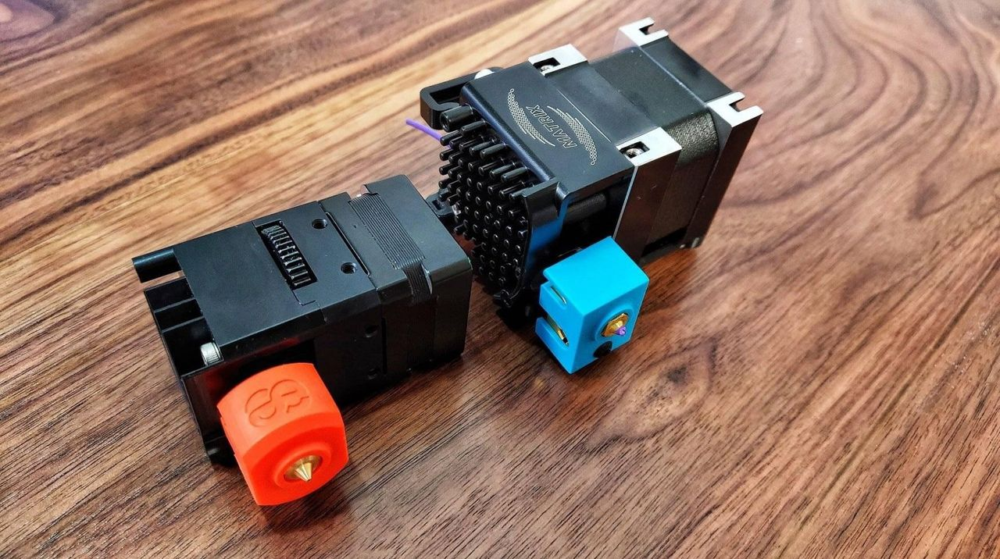<b>BIQU H2 extruder review</b>Finally, after a whole month of careful testing the BIQU H2 extruder on my BLV mgn Cube 3d printer. I feel pretty confident writing my conclusions about BIQU&#x27;s </a>
<a class="mod" href="finally-an-affordable-fysetc-duet-3-6hc-board/">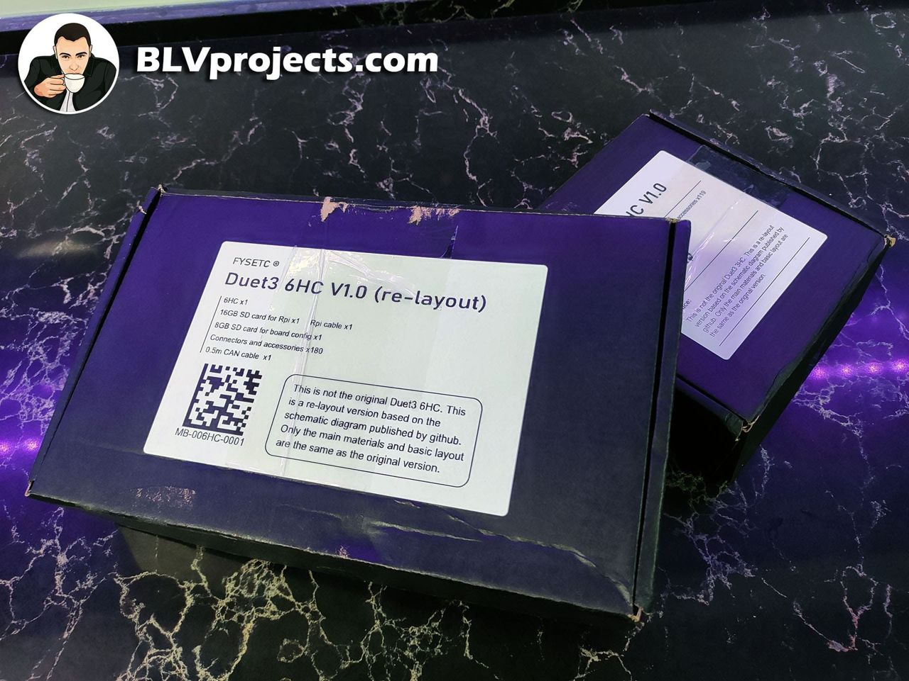<b>An affordable Duet 3 6HC board</b>I have been fantasizing for a long time about buying the Duet3 in order to use it as a board for my BLV mgn Cube 3D printer. The Duet3 6HC is actually the new g</a>
<a class="mod" href="let-there-be-cob-led-light/">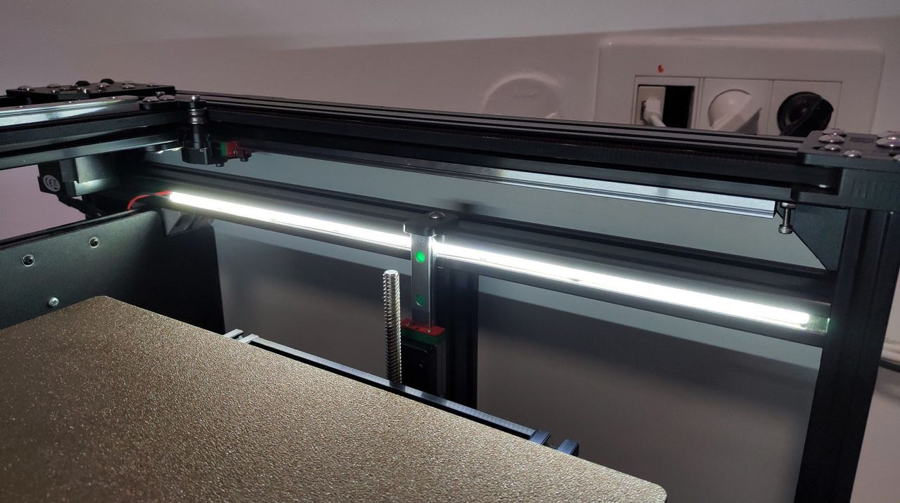<b>Let there be COB LED light</b>After a long time using the LED strip to illuminate the printing area, I wondered how I could make the LEDs sexier, hidden, and without having to print parts. A</a>
<a class="mod" href="trianglelab-matrix-adapter-for-blv-cube-metal-kit/">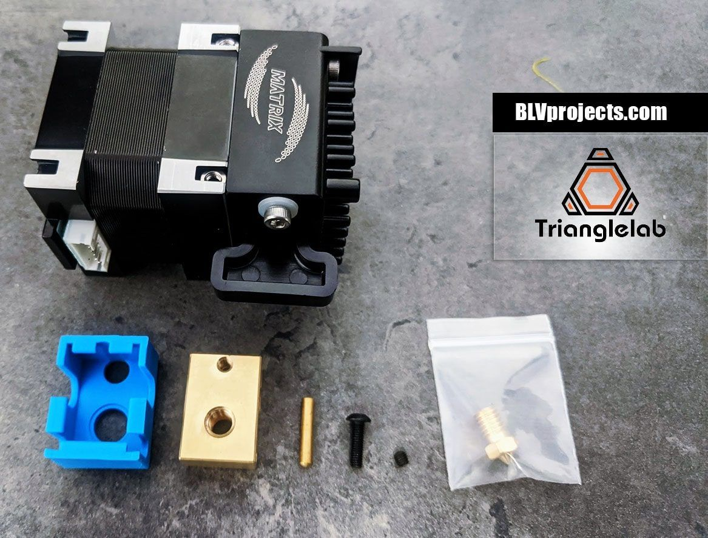<b>Trianglelab Matrix adapter for the Metal Kit</b>Hello my friends, for a long time I have been considering whether to purchase the E3D HEMERA extruder. To my great joy, a new extruder from Trianglelab appeared</a>
<a class="mod" href="new-mic6-350-heated-bed/">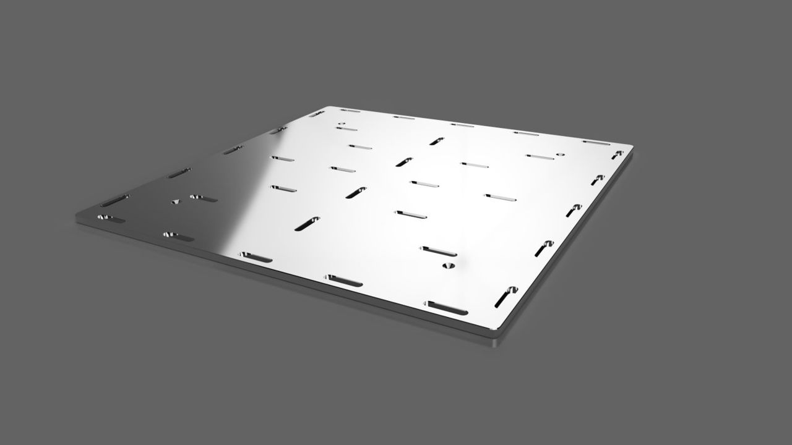<b>A new heated bed?</b>Following many requests, I have designed a new magnetic heated bed and I would be very grateful if you could please share your thoughts with me about the idea.</a>
<a class="mod" href="new-metal-kit-upgrade-blv-mgn-cube/">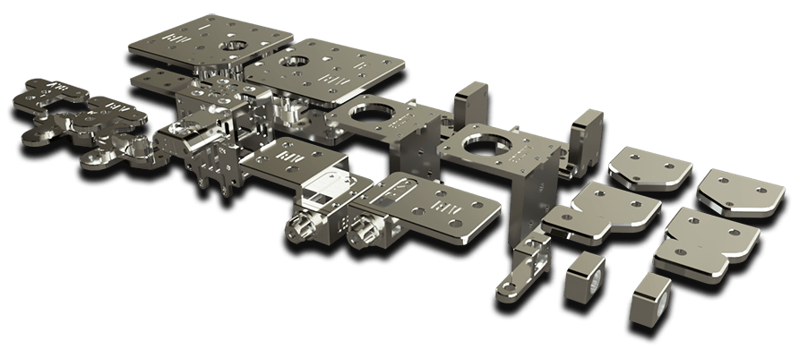<b>The Metal Kit upgrade</b>As you know, for several months I have been designing and testing a new kit of components that will replace all the BLV mgn Cube&#x27;s motion system printed parts. </a>
<a class="mod" href="blv-mgn-cube-metal-part-beta-testers/">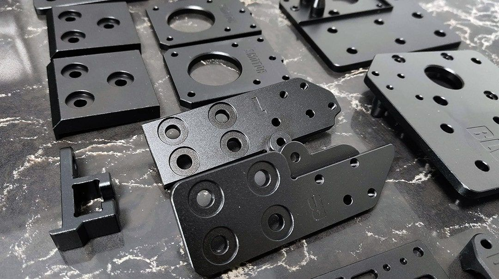<b>Metal parts: beta testers wanted</b>Metal Parts - Beta testUPDATE: the beta kit is finally available: https://s.click.aliexpress.com/e/_dZWiHmO</a>
<a class="mod" href="the-metal-parts-are-finally-here/">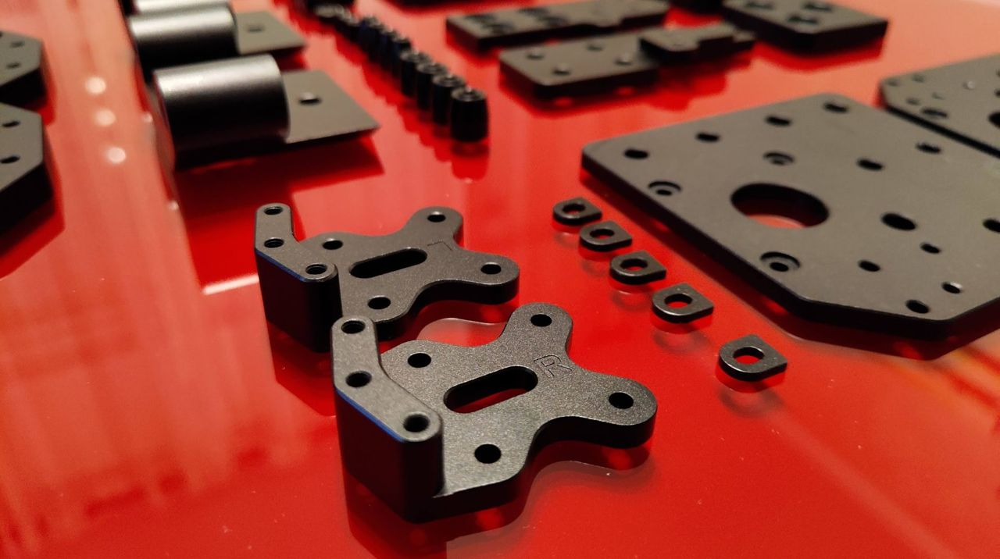<b>The prototype metal parts are here</b>After 2.5 years of waiting we finally got our new apartment. The plan was to assemble a new BLV mgn Cube 3d printer, using the new Metal parts in our new home.</a>
<a class="mod" href="prototype-metal-parts/">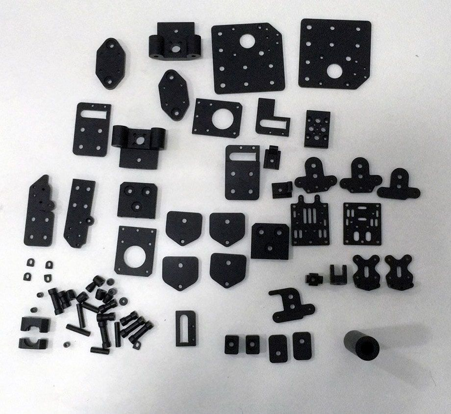<b>Prototype metal parts</b>small update about the BLV mgn Cube metal parts that i designed. They finished making the prototype + black anodized. before shipping it to me for testing, they</a>
<a class="mod" href="move-your-led-s-to-the-front-without-soldering/">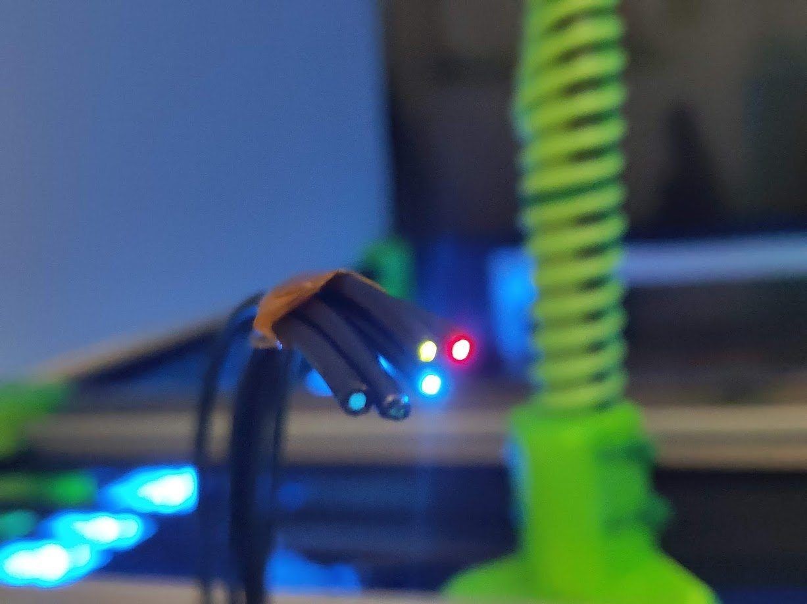<b>Move the board LEDs to the front without soldering</b>&quot;Moving&quot; the board indicators leds to the front without any soldering The DuetWifi board has number of indicator leds for the heated bed, endstops, power, diag,</a>
<a class="mod" href="pid-tuning-important/">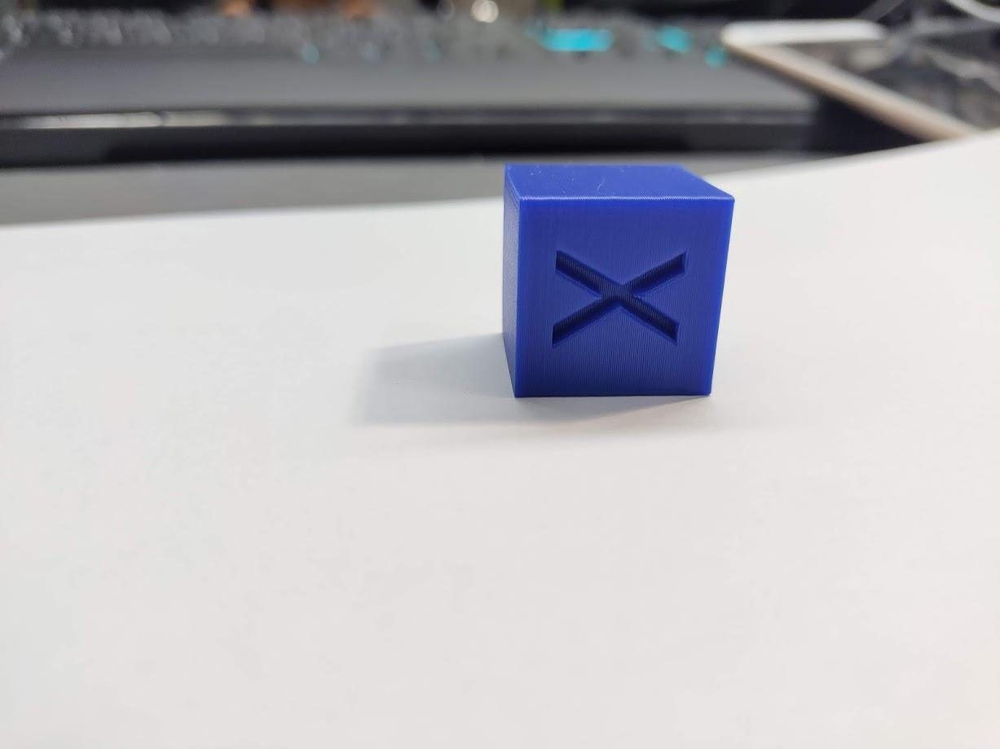<b>PID tuning: important</b>PID Tuning - I know that most of you are familiar with that and already have done it. But for those who not performed a PID calibration: The PID calibration is </a>
<a class="mod" href="print-sample-from-blv-mgn-cube-3d-printer/">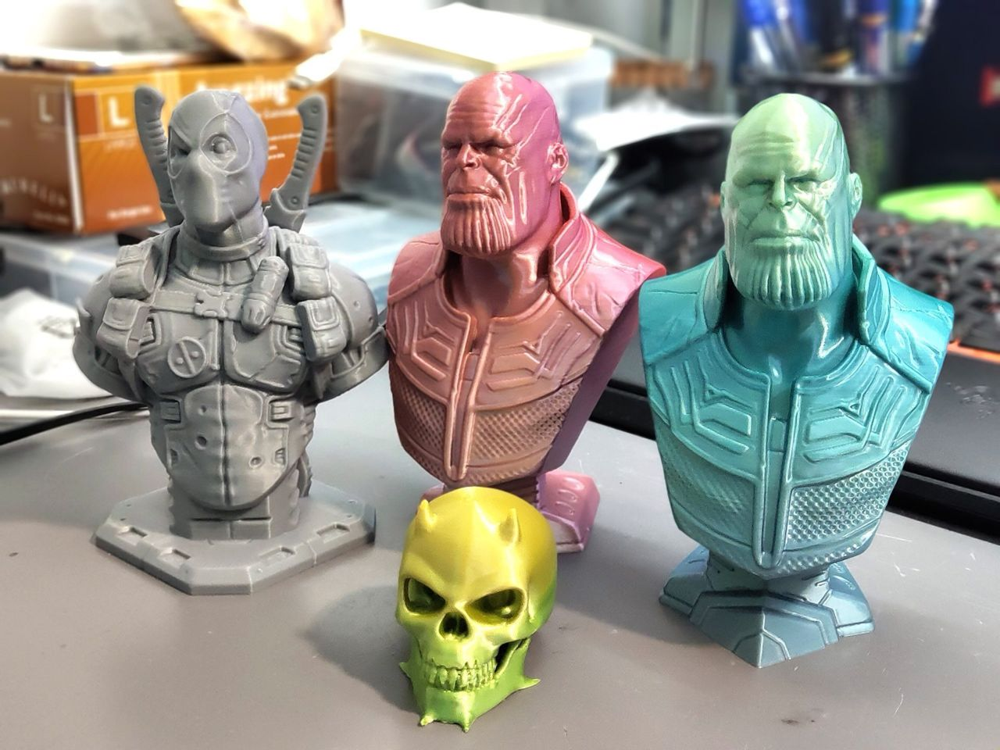<b>Print samples</b>i am adding few print samples of models i printed using my BLV mgn Cube 3D printer</a>
<a class="mod" href="beta-test-frame-wires-holder/">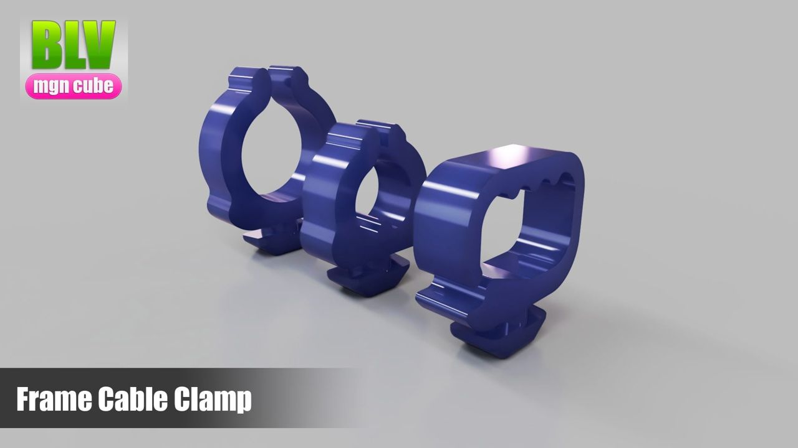<b>Beta test: frame wire holder</b>The nut is angled for a fast lock, Just twist it 90 degrees (check the angle direction before you lock it). The file contains 3 sizes and shapes and its a very </a>
<a class="mod" href="printed-cable-harness-tube-update-canceled/">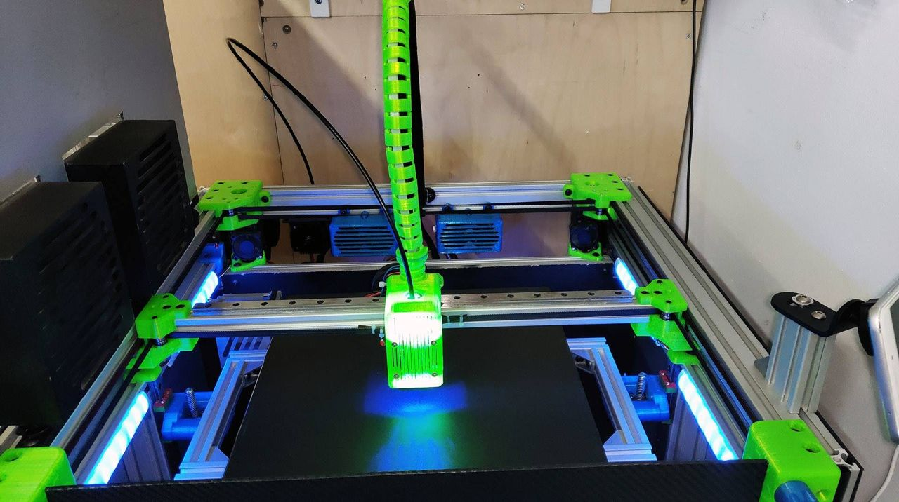<b>Printed cable harness tube (canceled)</b>Testing new printed cable harness tube :) inspired by the Vertical Cable riser from workplace-products.co.uk Basically, its meant for those who can get the PVC </a>
<a class="mod" href="the-singing-serpent-print-sample/">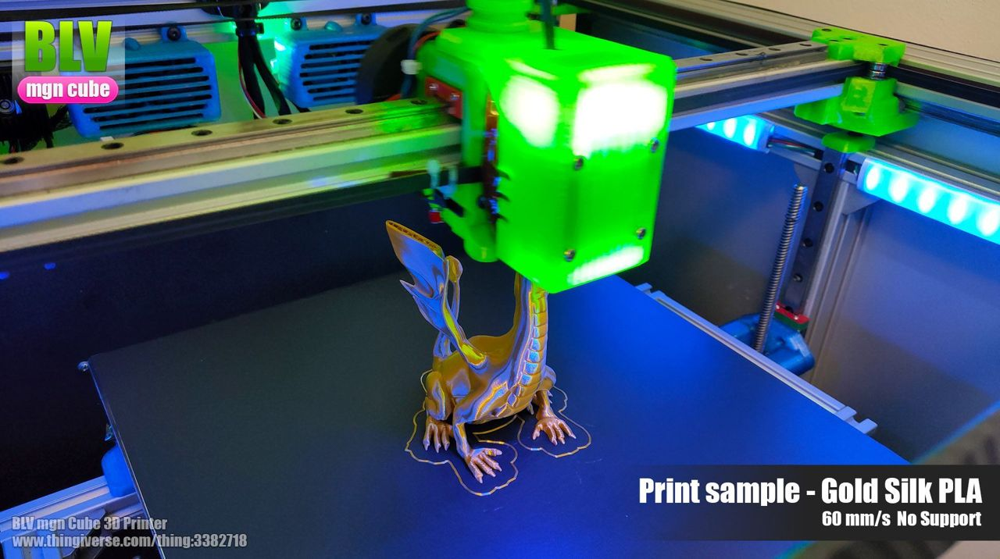<b>The Singing Serpent print sample</b>Today I printed the &quot;Adalinda: The Singing Serpent&quot; and i made a video + a few photos Printed with Gold Silk 195C/60C 60 mm/s without support. Model: Adalinda T</a>
<a class="mod" href="blv-mgn-cube-cheaper-kit/">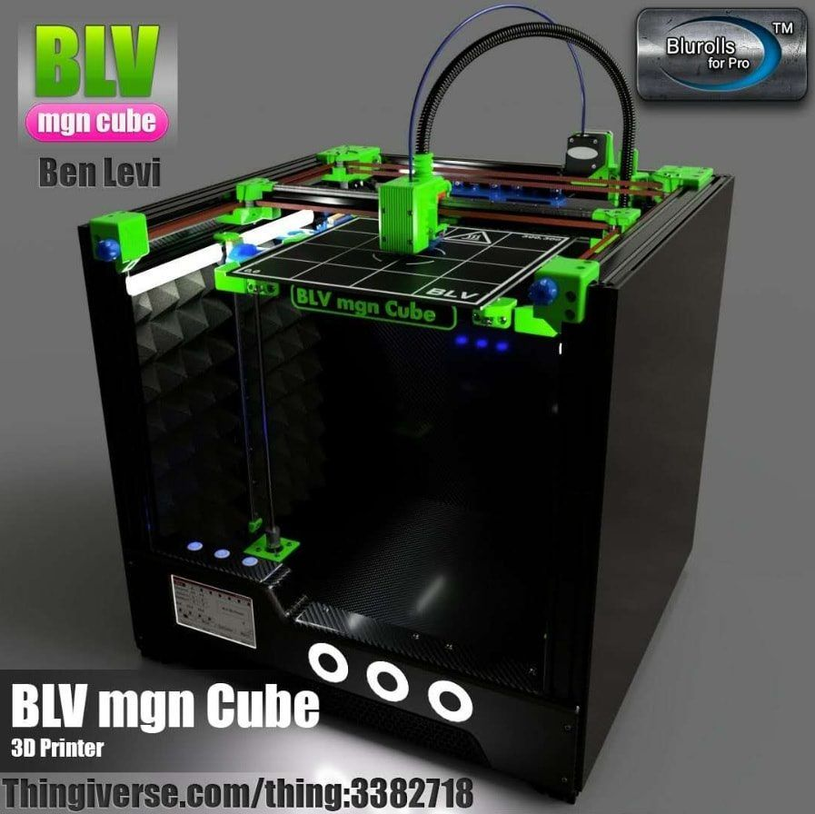<b>A cheaper BLV mgn Cube kit?</b>As you know I try my best and assist as much as I can here and also on Facebook private msgs (BLV Group). recently, similar requests have come up and I asked th</a>
<a class="mod" href="silicone-wiper-cleaner-beta/">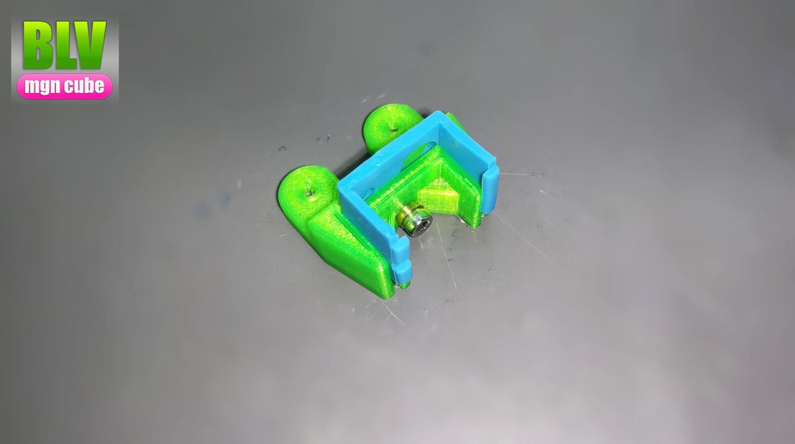<b>Silicone wiper and nozzle cleaner (beta)</b>After replacing my nuzzle with Mellow&#x27;s Ruby nuzzle, i found under my lab microscope that the old nuzzle&#x27;s hole shape heavily destroyed by the brass brush. unde</a>
<a class="mod" href="blv-mgn-cube-sealand-full-kit-unboxing/"><b>Sealand full kit unboxing</b>So i decided to build another BLV mgn Cube only this time it&#x27;s going to be much easier since it&#x27;s going to be assembled using the full Sealand Kit from here LIN</a>
<a class="mod" href="dual-layer-fan-blv-mgn-cube/">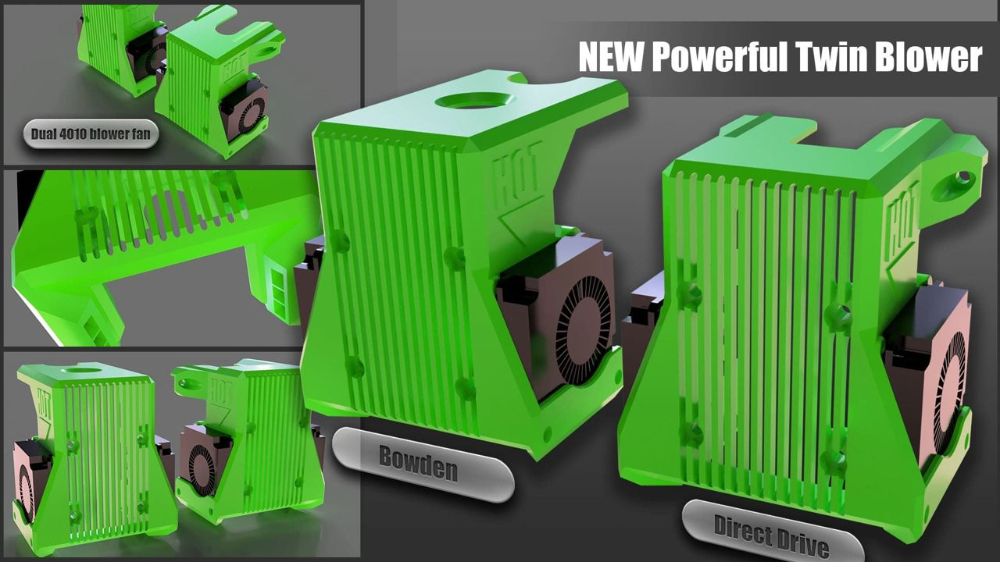<b>Dual layer fan</b>So, I decided to try and make a new shield equipped with twin 4010 blowers as a layer cooling fans. It has 3 channels on each side, directing the air flow and c</a>
<a class="mod" href="new-parts-for-testing/">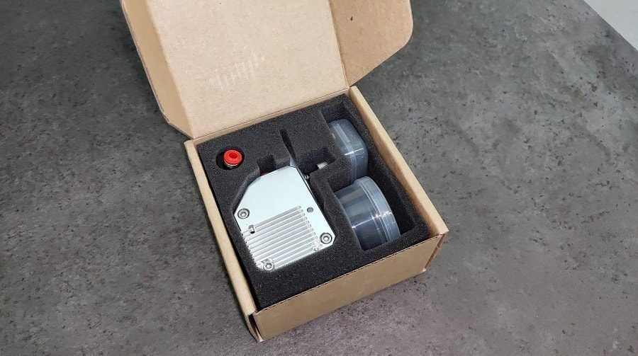<b>New 3D printer parts for testing</b>So lately I tested parts before adding to the BOM list. looking to add more links of quality parts and i found - Mellow store at Aliexpress. first, It&#x27;s very im</a>
<a class="mod" href="reinforcement-for-higher-z-axis/">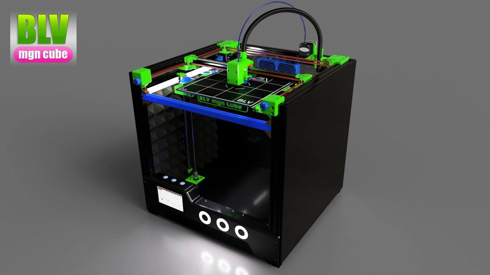<b>Reinforcement for a higher Z axis</b>If you have a build with higher Z-axis like 465mm+ You can add (optional) a reinforcement to X by adding:</a>
<a class="mod" href="finally-an-accessible-genuine-hiwin-linear-rails/">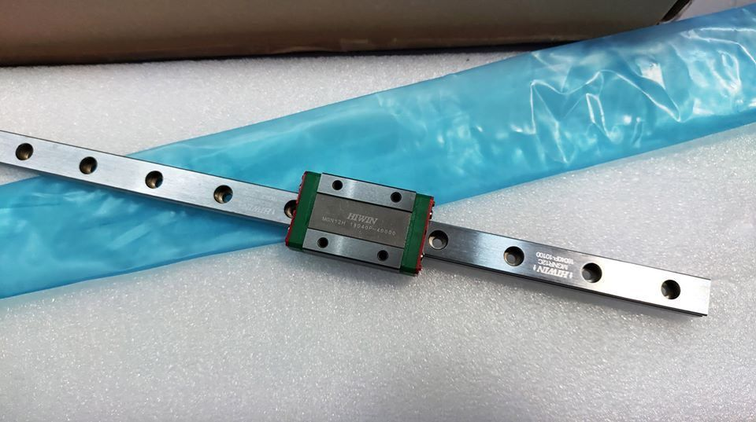<b>Affordable genuine HIWIN linear rails</b>I Have finally saved enough and bought a set of Genuine HIWIN mgn12H 400mm rails + carriages from Blurolls Lu (Aliexpress Store).</a>
<a class="mod" href="tpu-experience-with-blv-mgn-cube-3d-printer/">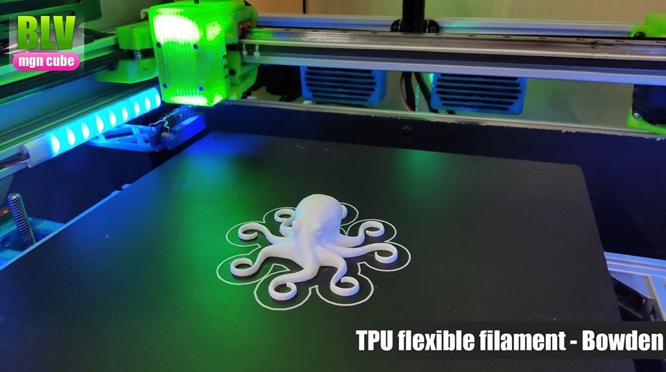<b>Printing TPU on the BLV mgn Cube</b>So, i tried to print TPU (flexible) filament with my bowden setup. It came out not bad considering my Bowden is 65cm~. used a non brand TPU that I bought locall</a>
<a class="mod" href="static-neopixel-animation/">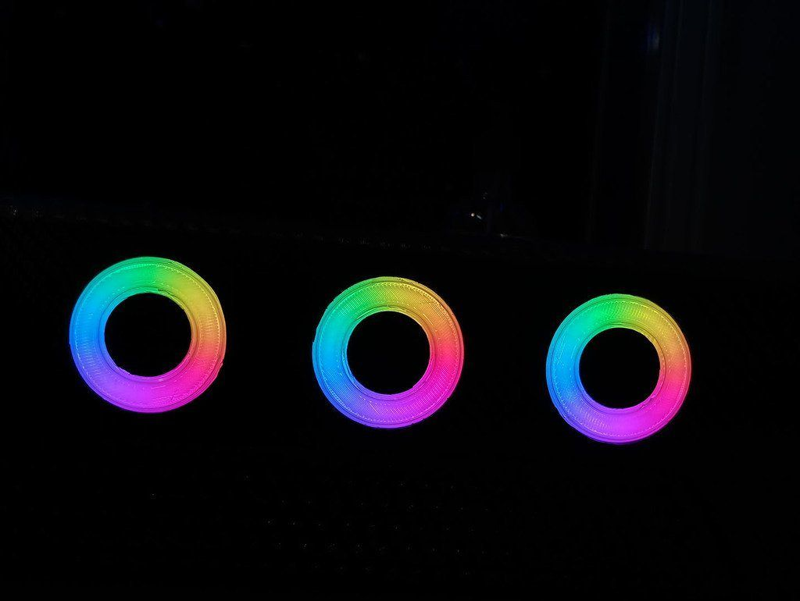<b>Static Neopixel animation</b>For those who are looking for a nice static animation without the board feedback,</a>

