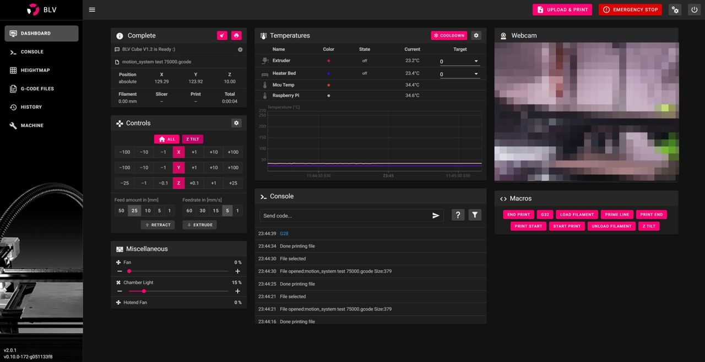

[← All updates](index.md){ .back-link }

# BLV Klipper Mainsail theme and carbon X axis

### Carbon X-axis

In my work (Autonomous Drones Dev-Lab) I use CNC machined carbon parts on a daily basis. recently, I've noticed that CNC machined carbon's price has dropped significantly.

A carbon tube is significantly lighter than aluminum extrusion. The low weight reduces some of the load from the motion system, which helps to achieve better performance.

So, I pulled out an old Carbon X-axis design I made 2 years ago. it's an X-axis carbon tube combined with rivet nuts for fixing the rails, saving the hassle of inserting nuts along the entire length of the tube. only 2 Gigs are needed for the edges, to hold the M5 nuts.

back in July, I tried 4 different carbon services found on [Aliexpress](https://s.click.aliexpress.com/e/_AMCl4g)- They all failed. Some weren't accurate, some told me a minimum of 100pcs, and others simply just couldn't combine rivet nuts without making it stick out of the carbon's outer walls.

finally, I asked [mellow](https://s.click.aliexpress.com/e/_AMCl4g), sent him the plans. two weeks later he sent me a video of the BLV Carbon X-axis:

<video controls preload="metadata" style="max-width:100%;width:280px" src="../../files/BLV-Klipper-Mainsail-theme.mp4"></video>

I don't have it yet and I have not tested it, Most of you are familiar with [Mellow's](https://s.click.aliexpress.com/e/_AMCl4g)high-quality products. Hope to get it soon and test it. I have some concerns about the thickness of the tube and a deep fear the rivet will be loose over time without Epoxy or a thicker tube. My backup plan is a safe solution - having Only holes without a Rivet and using a long Jig to Hold the M3 nuts. need to test it first... If it will survive my tests, I will ask [Mellow](https://s.click.aliexpress.com/e/_AMCl4g)to add it to his store.

At this point, I must mention again that I have no profit from it and Not from [Mellow](https://s.click.aliexpress.com/e/_AMCl4g). BUT I thank him and appreciate him for supporting the project and making prototypes for testing.

### Klipper Mainsail Theme

and so I moved from [Fluidd](https://docs.fluidd.xyz/)to [**Mainsail**](https://docs.mainsail.xyz/)and I'm happy. for those who don't know, Klipper has few User interfaces to choose from. So far I have used Fluidd but soon I found out that Fluidd has not been updated for several weeks because the main developer has left the project.

Therefore, I decided to move on to Mainsail which became popular lately.

The installation process was very convenient, and It is highly recommended to install the [MainsailOS](https://github.com/mainsail-crew/MainsailOS/releases)image on your Raspberry sd-card. it will save you a lot of time and frustration.

Just follow the installation guide [here](https://docs.mainsail.xyz/setup/mainsail-os).

After a short use, I createed a BLV Theme for the Mainsail UI and wanted to share it with you:

You can download the BLV Mainsail Theme pack from here:

BLV Mainsail klipper theme.zipDownload ZIP • 210KB

in order to install, please check [this link](https://docs.mainsail.xyz/theming/prepare) or follow this guide:

**Quick Installation guide:**

1. Download the file and extract
2. Under "**machine**" menu, click on the Gear icon and enable the "**show hidden files**" option.
3. create a “**.theme**” folder in your config folder.
4. Upload all the files from the Zip files into **.theme** folder
5. hit **Ctrl+F5** and Enjoy.

!!! download "Files from this post"
    [:material-download: BLV-Klipper-Mainsail-theme.mp4](../../files/BLV-Klipper-Mainsail-theme.mp4){ .md-button }
