[← All updates](index.md){ .back-link }

# BLV Cube + Klipper: 9000 mm/s² and 500 mm/s

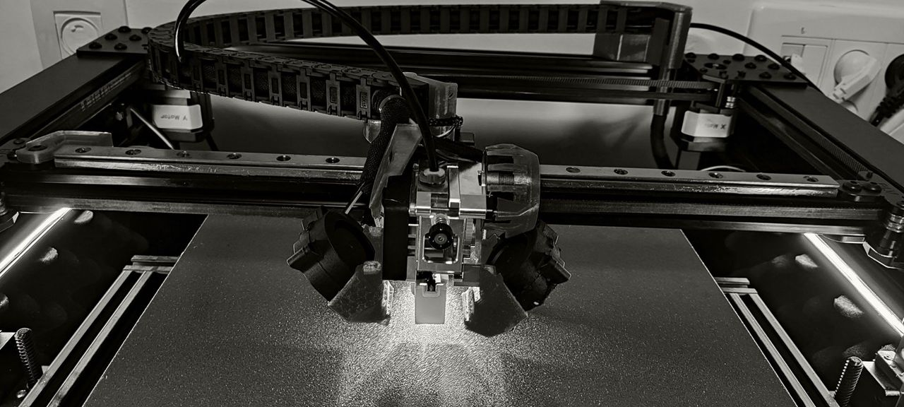

After a long time with RepRap firmware, I decided to try [Klipper](https://www.klipper3d.org/).

A good friend of mine, Manu, had strongly recommended Klipper to me long before. At the time, the Klipper project was starting to take shape, but the documentation was a big mess. Despite its potential, I decided to wait until it became more convenient to install and easier for the average user. To be honest, I was also a bit skeptical. I'm glad to see that Klipper has since become easier to install and reliable too.

Before I started testing Klipper, I took my system to the edge of its limits running RRF, or at least that's what I thought. Installing Klipper was a smart move. I felt like I was getting a crazy new printer that prints at ridiculously fast speeds. It was the same [**FYSETC full kit**](https://s.click.aliexpress.com/e/_ACzKw1) I bought with the BLV metal kit, and the only difference was the firmware. I quickly came to the conclusion that the hotend was not good enough for fast printing, so I bought the [**Mellow NF-Sunrise Volcano 24V**](https://s.click.aliexpress.com/e/_A9Ap0z), a direct drive extruder/hotend that weighs only 185g. Soon after, I found that fast printing needs fast cooling, so I added twin [4020 blowers](https://s.click.aliexpress.com/e/_9Hktwl) and started my tests.

<div class="gallery big" markdown>
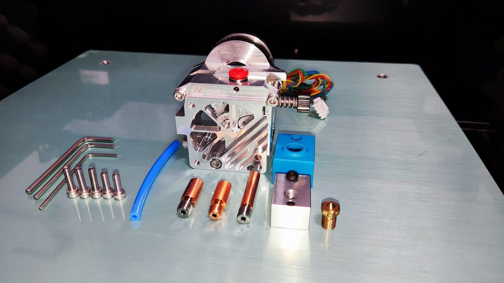
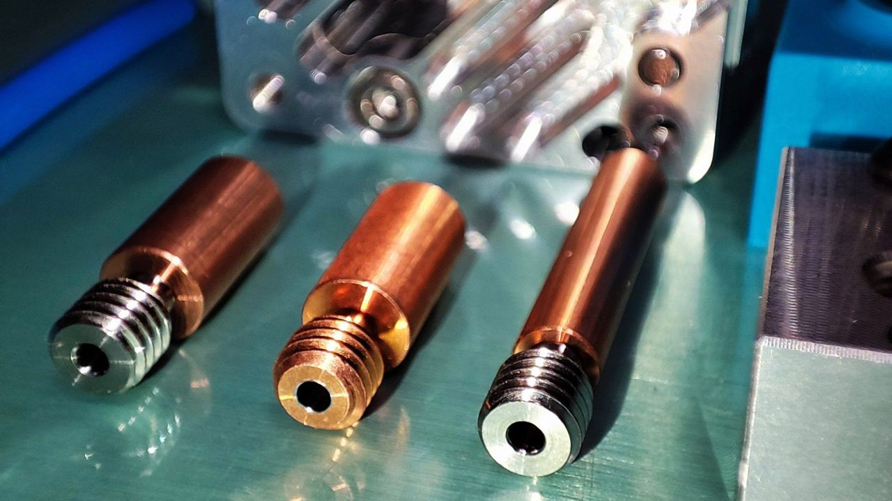
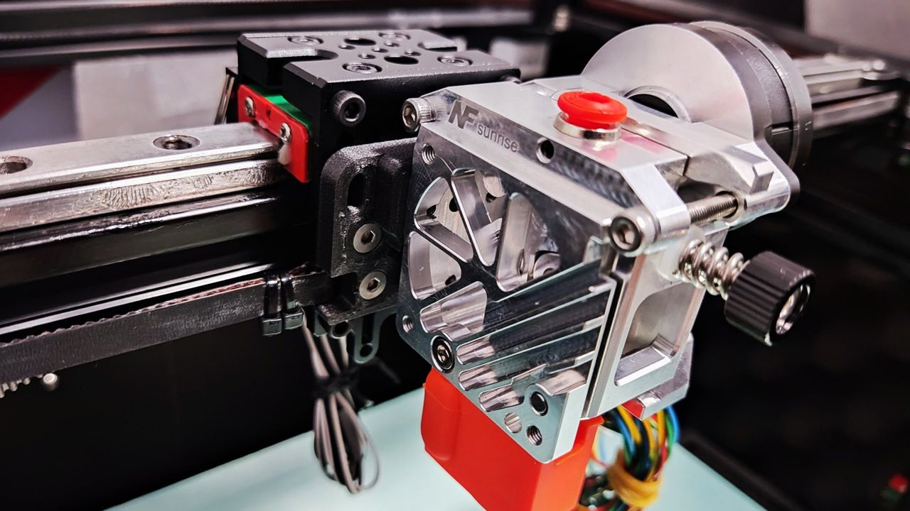
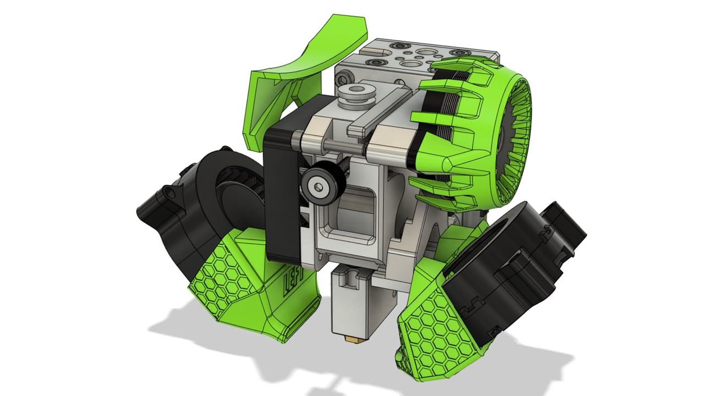
</div>

This is a video I took while testing the machine with Klipper. All advanced settings were disabled, and I only calibrated the extruder and the Z-offset. The print results were amazing, but even more amazing was that the prints were made at speeds I had never even dreamed of. It looked like the system was capable of much more, mainly thanks to the aluminum parts and the fact that it was designed to withstand loads nine times greater than this:

!yt FC9tIDhOgD4 | BLV mgn Cube at 9000 mm/s² acceleration and 500 mm/s

Some of the prints you saw in the video:

<div class="gallery big" markdown>
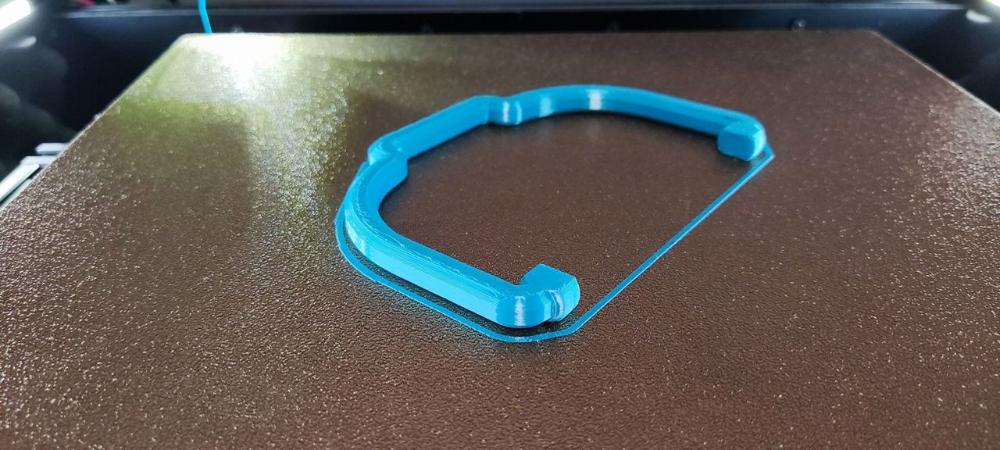
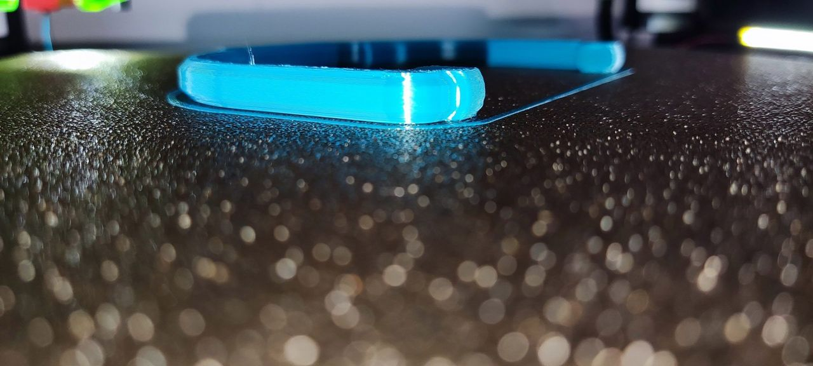
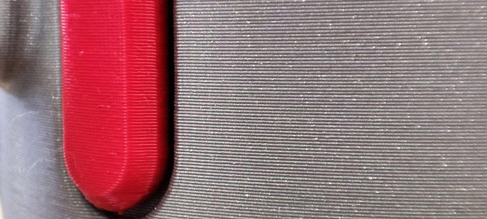
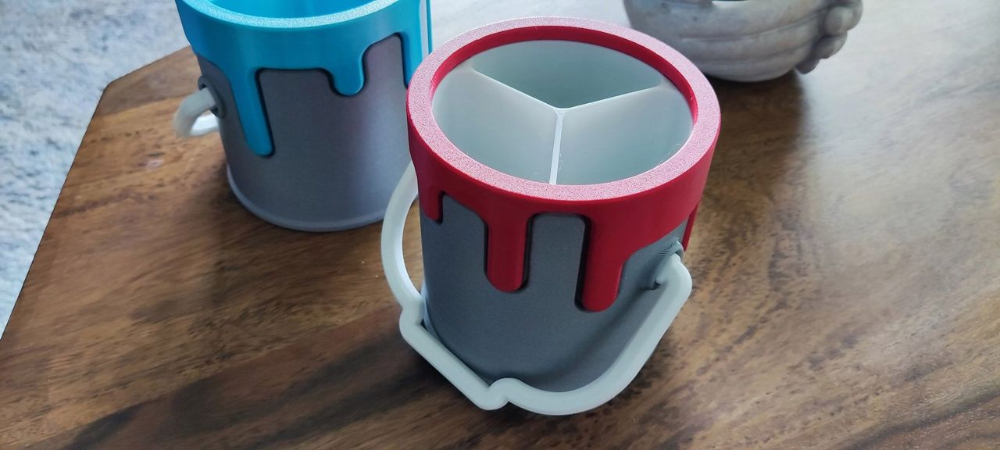
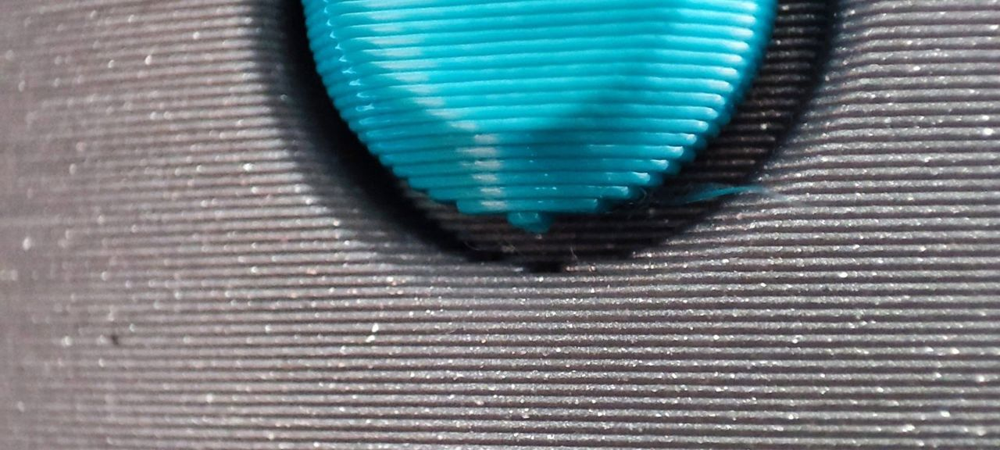
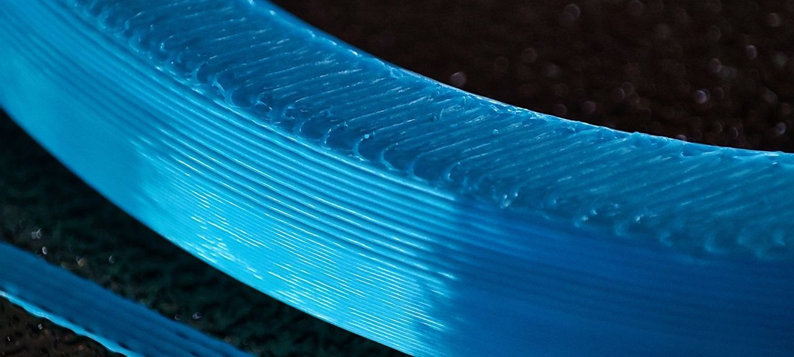
</div>

Right after I took this video, I started a long series of tests that pushed the boundaries further. Then I wondered whether the Duet's built-in drivers were my limit. When the TMC2130 came out, I paid $35 each for my BLV Anet mod and fed them 24V directly instead of 12V to get more juice (torque). In this case, I'm testing a new **prototype board** that has not been released to the market yet. It's so powerful, it's just amazing. More details to come, I promise.

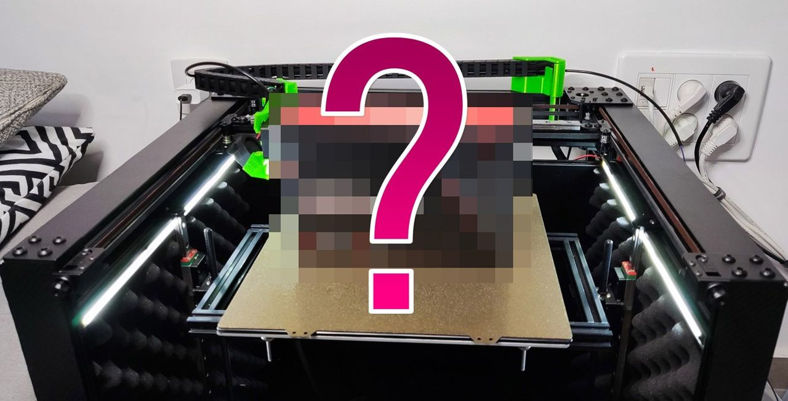

Anyway, I'm now confident enough to share all my Klipper files and settings with you, including the beta BLV SuperSlicer profiles. They will give you a good starting point for getting your printer up and running with Klipper.

If you can't wait and just want the files, here are the BLV Klipper files:

- **Printer.cfg**: `BLV printer cfg.zip` (ZIP, 5 KB)
- **BLV SuperSlicer profile**: `BLV Superslicer profile.zip` (ZIP, 327 KB)

### Installing Klipper

#### BLV mgn Cube setup for the provided Klipper config

- [FYSETC BLV mgn Cube full kit 3D printer](https://s.click.aliexpress.com/e/_ACzKw1) (Duet 2 WiFi)
- BLV metal kit (included in the FYSETC kit), which replaces all the printed parts with metal parts
- [Mellow NF-Sunrise Volcano 24V](https://s.click.aliexpress.com/e/_A9Ap0z), a lightweight, high-flow direct drive extruder (185g)
- [Twin 4020 blowers](https://s.click.aliexpress.com/e/_9Hktwl) for part cooling
- Official Prusa SuperPINDA leveling sensor, which probes fast and accurately (not for glass)
- FYSETC bed + FYSETC glass (included in the kit) + magnetic PEI spring steel sheet

STL and CAD files for the [NF-Sunrise Volcano 24V](https://s.click.aliexpress.com/e/_A9Ap0z) and the dual [4020 blowers](https://s.click.aliexpress.com/e/_9Hktwl) can be found further down this page.

### Extra parts you need for Klipper

- Raspberry Pi (I used a Raspberry Pi 4)
- USB Type-C cable
- Fast micro-SD card or USB 3.1 SSD (I used a 64GB SanDisk Ultra)
- An acceleration sensor, if you want to use input shaper

Klipper has two main parts:

1. Klipper firmware, installed on the board
2. Klipper core files + GUI, installed on the Raspberry Pi's micro-SD card. Here you have three choices: [Fluidd](https://docs.fluidd.xyz) (my favorite), Mainsail or OctoPi.

### Klipper installation guide

I want to thank a special person, [**David Husolo**](https://www.facebook.com/groups/371460246914851/user/1208415623/), who has contributed a lot to the BLV project and keeps contributing. My dear friend David prepared an excellent guide that explains step by step how to install Klipper. You can find [**David's Klipper install guide on iFixit**](https://www.ifixit.com/Guide/Klipper+Install/145923).

At some point you will need to upload your `printer.cfg` file. My printer.cfg is inside the `BLV printer cfg.zip` file mentioned above (ZIP, 5 KB). Please feel free to use it and modify it as you need.

Don't forget to edit the line below the `[mcu]` tag:

```
[mcu]
serial: /dev/serial/by-id/usb-Klipper_sam4e8e_xxxxxxxxxxxxxxxxxxxxxxxxxx-if00
```

You can find the correct ID by running this command in PuTTY:

```
ls /dev/serial/by-id/*
```

Now that you are connected to your Klipper firmware, I advise you to first read all the relevant documentation on the [official Klipper website](https://www.klipper3d.org).

In the next update, you will be able to choose a BLV color scheme/theme from the settings menu (thanks to [Stefano](https://github.com/StuSerious)). This is what your panel should look like after you finish installing:

<div class="gallery big" markdown>
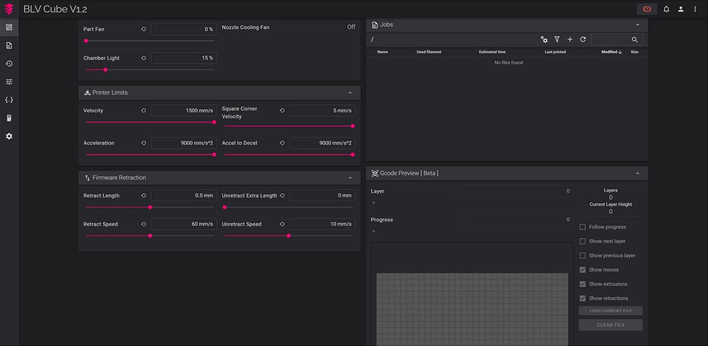
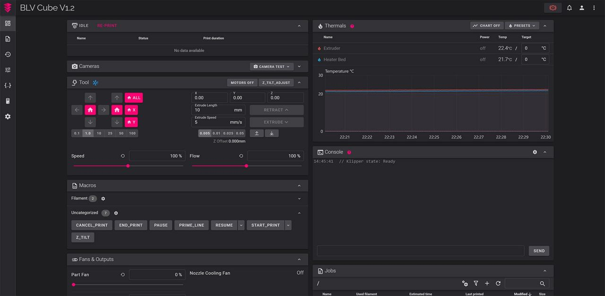
</div>

Please note that I added a slider that controls the COB LED light (connected to the Fan2 port).

### BLV SuperSlicer profiles

The most suitable slicer for Klipper right now is [SuperSlicer](https://github.com/supermerill/SuperSlicer/releases). It's an open-source slicer based on PrusaSlicer. I managed to create a beta printer + print profile that will give you a starting point. Please keep in mind that these are the original files I used for some of the tests. In the video, I changed all the acceleration settings to 9,000 mm/s² and increased my speeds dramatically. Feel free to use any other custom print profile and share it on the BLV Facebook group or the Discord channel. If it's good, I will be happy to merge it into the official beta profile.

<div class="gallery big" markdown>
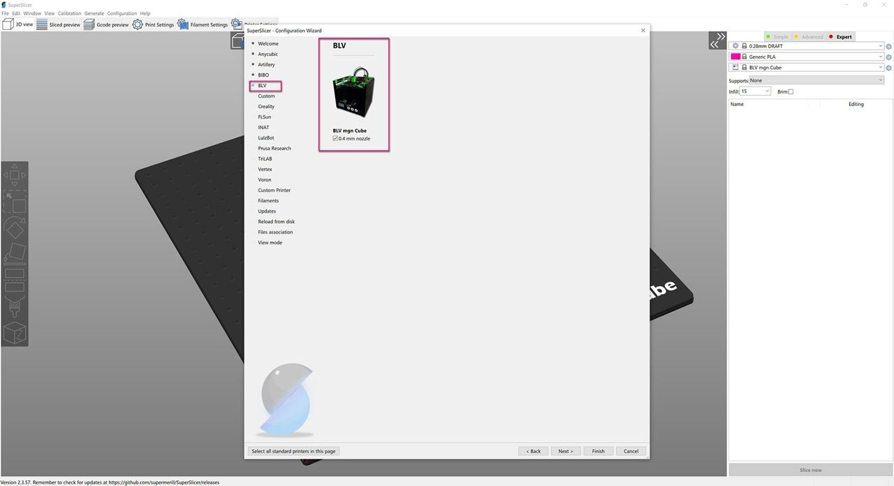
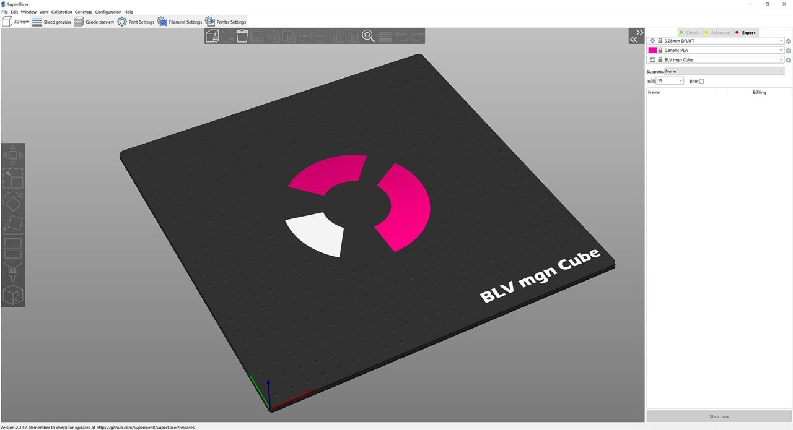
</div>

To use SuperSlicer, download the [latest SuperSlicer release](https://github.com/supermerill/SuperSlicer/releases). Then download the BLV SuperSlicer profile zip (`BLV Superslicer profile.zip`, ZIP, 327 KB).

How to use the BLV SuperSlicer profile:

1. Extract the contents of the zip file.
2. Copy the **BLV** folder to `\SuperSlicer_x.x.xx.x_win64_xxxxxx\resources\profiles` inside your SuperSlicer installation folder.
3. Copy `BLV.ini` and `BLV.idx` to the same `\SuperSlicer_x.x.xx.x_win64_xxxxxx\resources\profiles` folder. It should look like this:

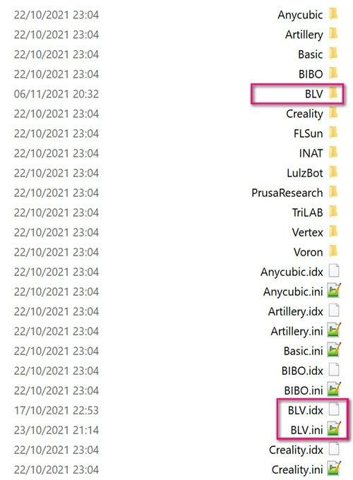

Finally, open SuperSlicer and choose BLV and the filament set from the configuration screen.

### BLV NF-Sunrise printed parts

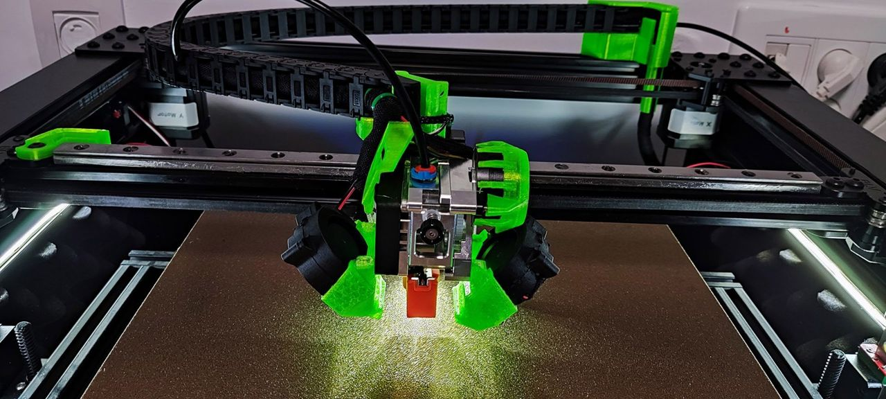

Inside the CAD file you will also find the cable chain files. It's an alpha version, and I will probably switch to a bigger cable chain.

<div class="gallery big" markdown>
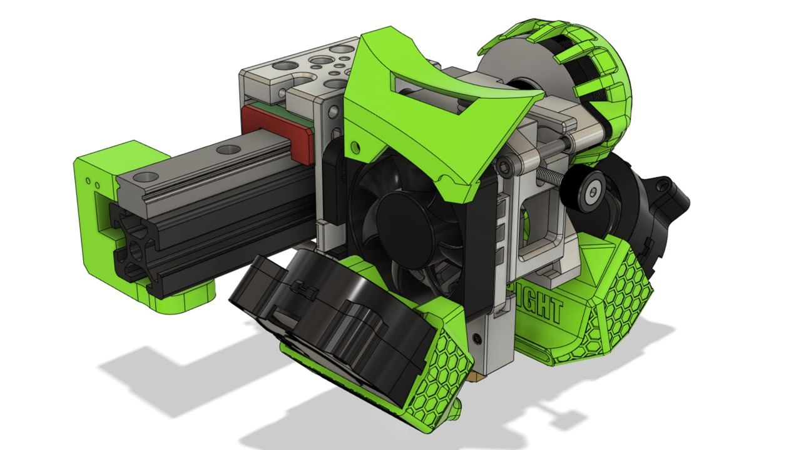

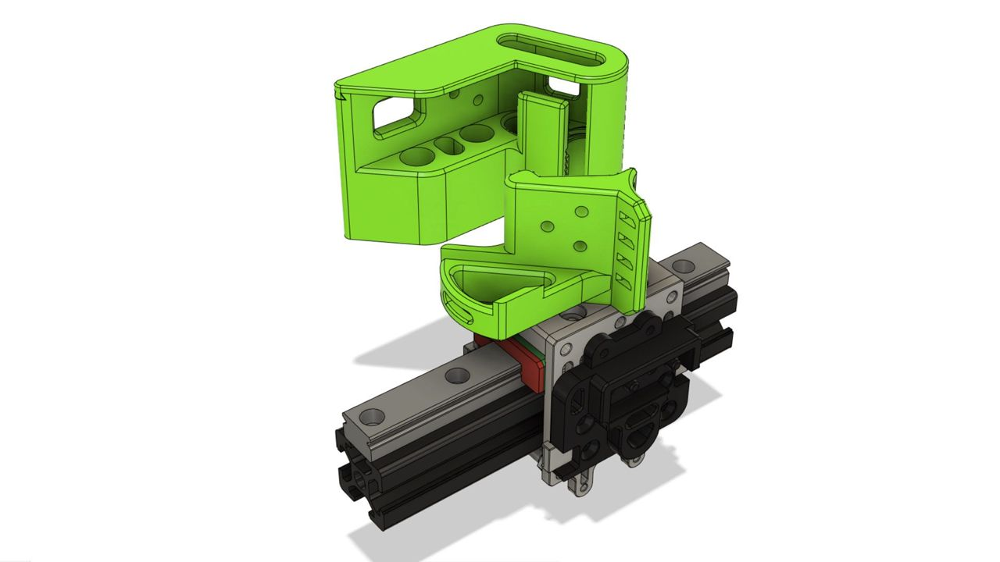
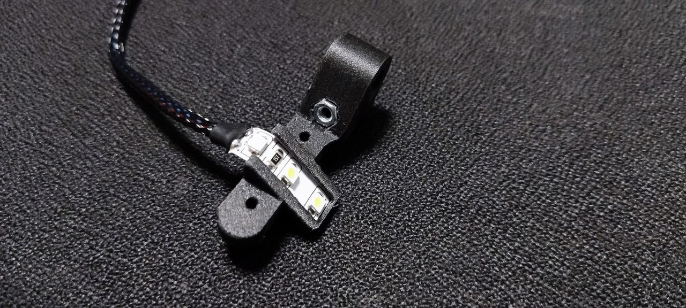
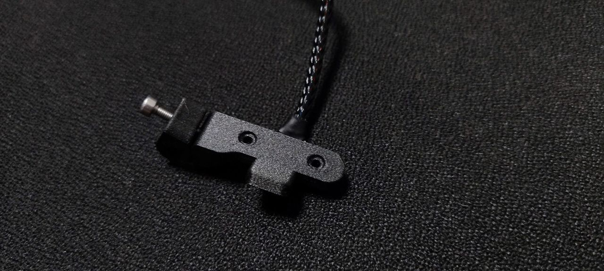
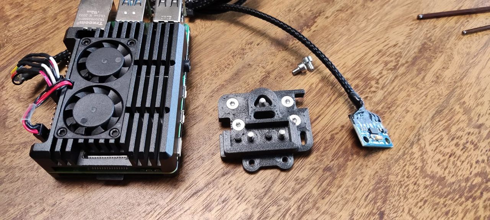
</div>

All the STL files are in `BLV NF-Sunrise Volcano STL V1.1.zip` (ZIP, 2.08 MB), licensed under the Creative Commons Attribution-NonCommercial-ShareAlike license.

Edit: fixed the NF mount.

Here are the names of the parts and how to print them:

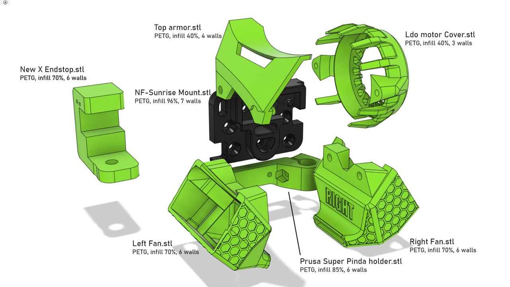

For your convenience, the F3D (CAD) file is also available in `BLV NF-sunrise share CAD.zip` (ZIP, 23.09 MB), licensed under the Creative Commons Attribution-NonCommercial-ShareAlike license.
