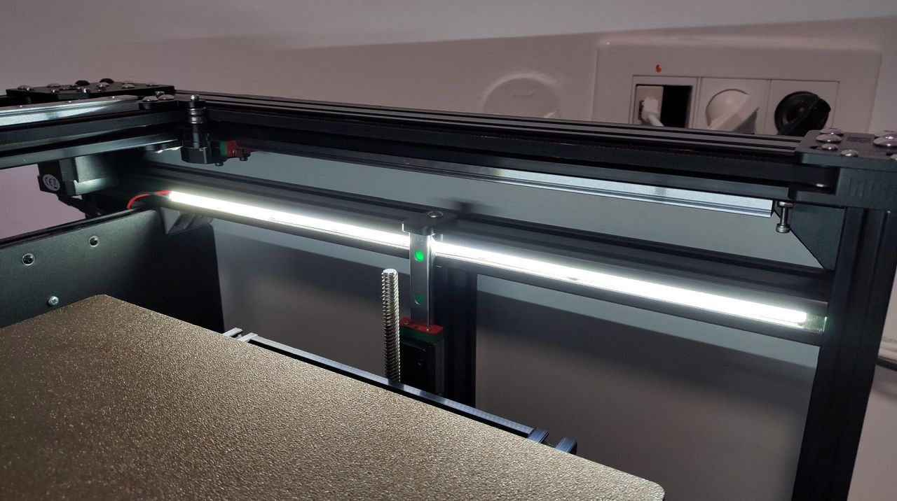
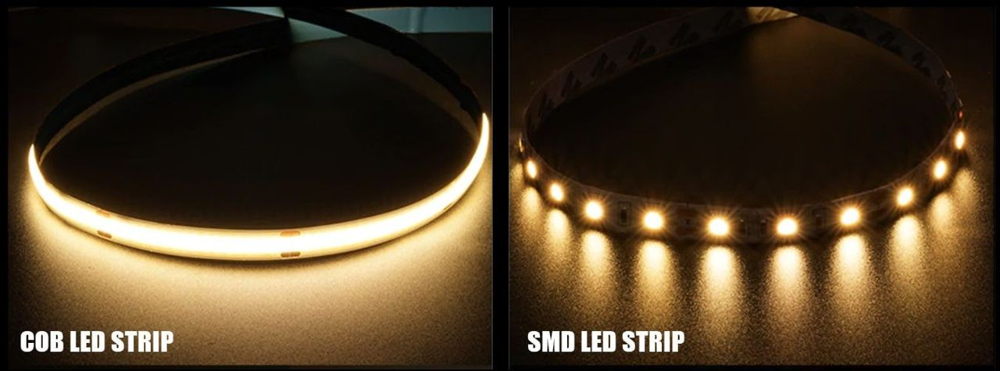
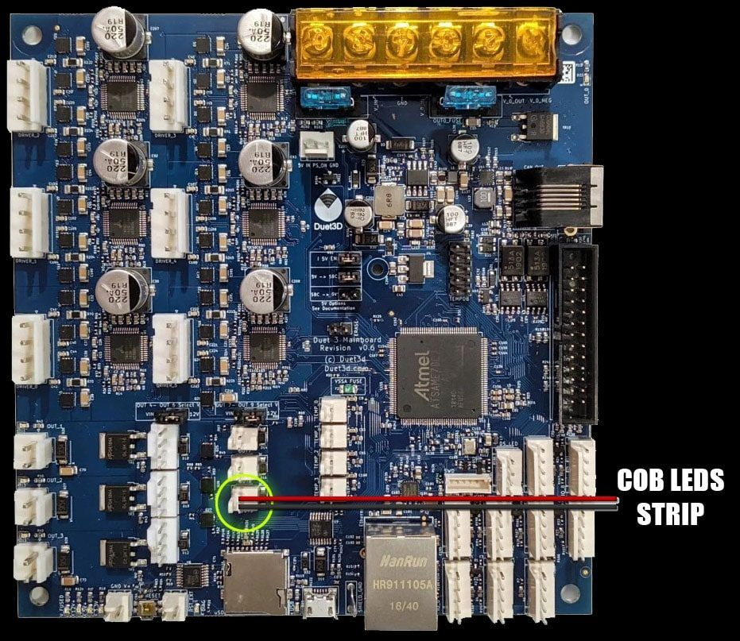
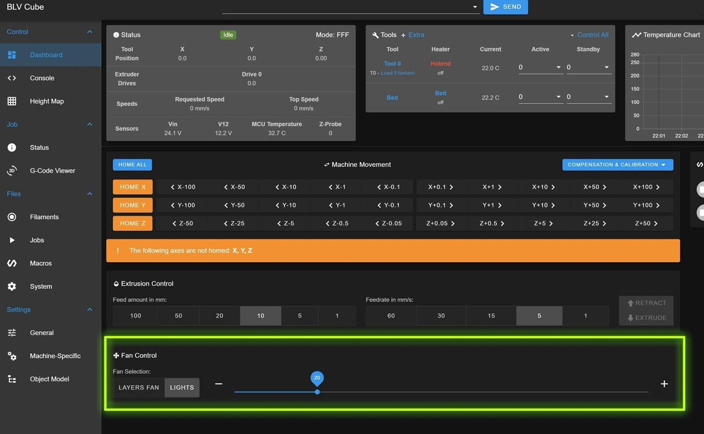
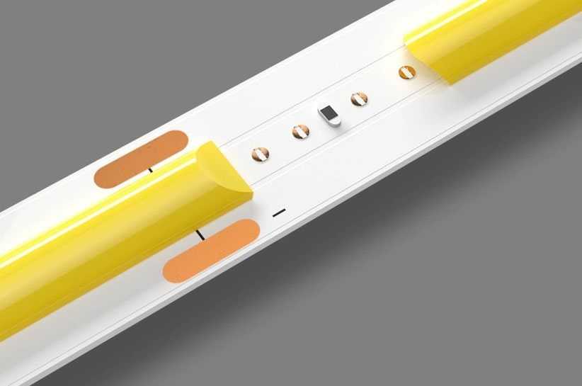
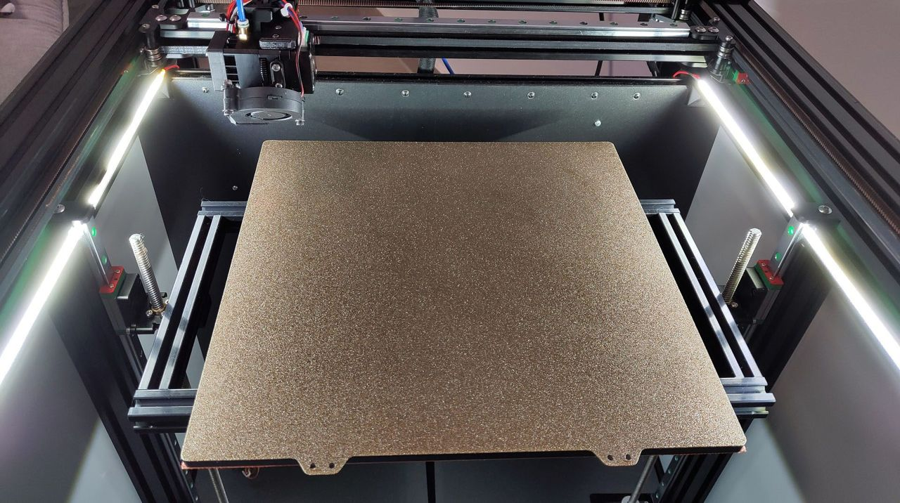
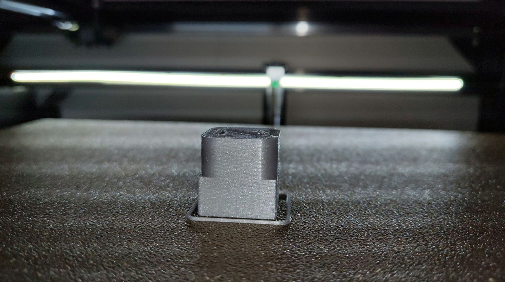
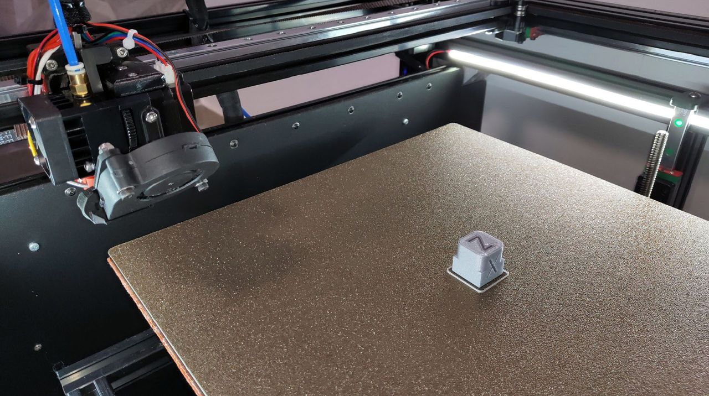
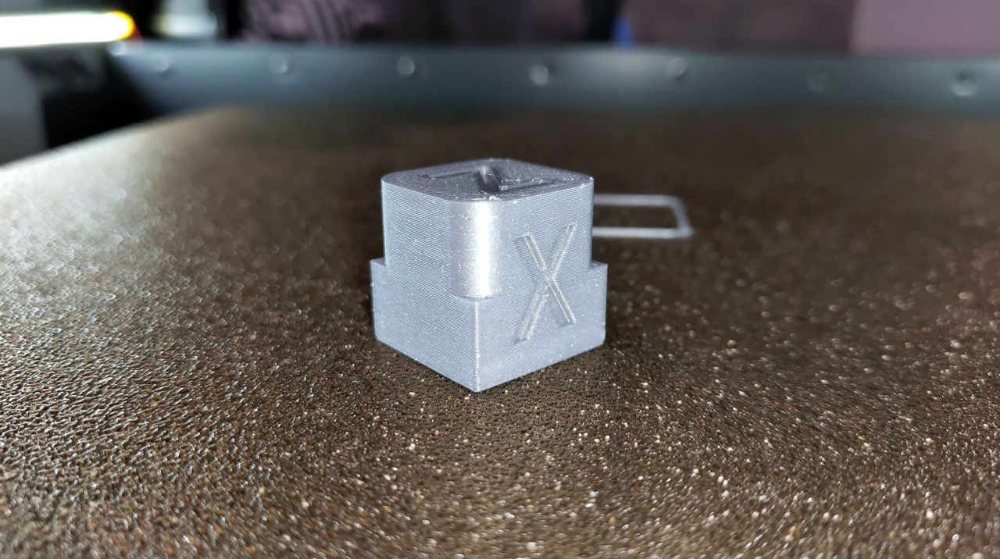

[← All updates](index.md){ .back-link }

# Let there be COB LED light

After a long time using an LED strip to light the print area, I wondered how I could make the LEDs sexier and hidden, without having to print parts. I was also tired of the uneven light shining through the diffuser because of the large gap between one LED and the next.

So I started researching again and finally found another type of LED strip that is more suitable for the BLV mgn Cube 3D printer: the COB LED strip.



In a COB strip the light-emitting diodes are much smaller than in a standard LED strip, which allows many more of them to fit on the strip. A standard LED strip has about 60 LEDs per meter, whereas a COB strip has 360 LEDs per meter. That is 6 times more than a standard strip, and it makes uniform light diffusion possible. Another advantage is that the LEDs are covered with a layer of silicone that acts as a diffuser and helps distribute the light evenly.



The smaller diodes also allow the strip to be narrower. I chose an 8 mm width, which let me insert the COB strip into the extrusion channel easily. The COB strip can be cut every 50 mm, and the light intensity can be adjusted too.

The first two strips I ordered from different stores on AliExpress disappointed me, and I almost gave up. Eventually I found a [**reliable store that sells quality COB strips**](https://s.click.aliexpress.com/e/_9i94Go). From the listing options I chose **6000K Cool White**, **24V 360 LEDs** and **2 meters**. The strips came well packaged, met the specifications and felt like high-quality COB strips.

I cut the COB strip to the right length with scissors, following the markings (every 50 mm), and soldered on two 26 AWG wires. If you can't or don't want to solder, you can use [**this quick connector**](https://s.click.aliexpress.com/e/_9II1fw) (choose the "For 8 mm PCB" option). Then I threaded the strip easily into the upper aluminum extrusion channels. The wires can be connected in 2 ways:

- Direct connection to a 24V PSU
- Duet fan output - if you connect the COB strip to a fan output, you can control its intensity with a slider in the Duet control panel

In my case I'm using FYSETC's amazing [**Duet 3 6HC board**](https://s.click.aliexpress.com/e/_A1uWxz), so I had to define the lights as a fan output by adding these lines to the **config.g** file:

```
M950 F2 C"out9" Q500
M106 P2 S0.2 H-1 C"Lights"
```

Then I connected the COB LED strip wires to the **OUT9** port on the Duet 3 6HC board.

<div class="gallery big" markdown>



</div>

I am very pleased with the end result. The lighting is very efficient, it looks good and I can control its intensity from the panel. I could not have asked for anything better. I really hope this helps those of you who want to add lighting to your printer.

In these pictures you can see the strips I installed. By the way, the prints in them were made with [**BIQU's amazing H2 extruder**](https://s.click.aliexpress.com/e/_AgqcYp).

<div class="gallery big" markdown>




</div>
