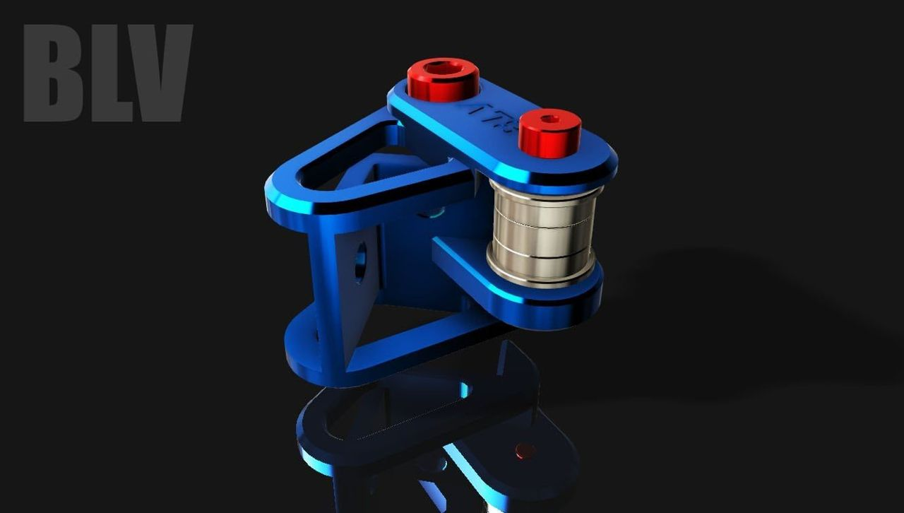
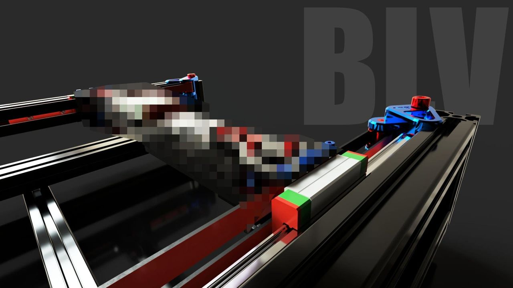
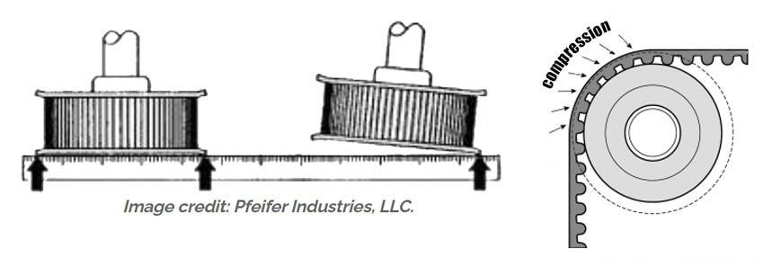
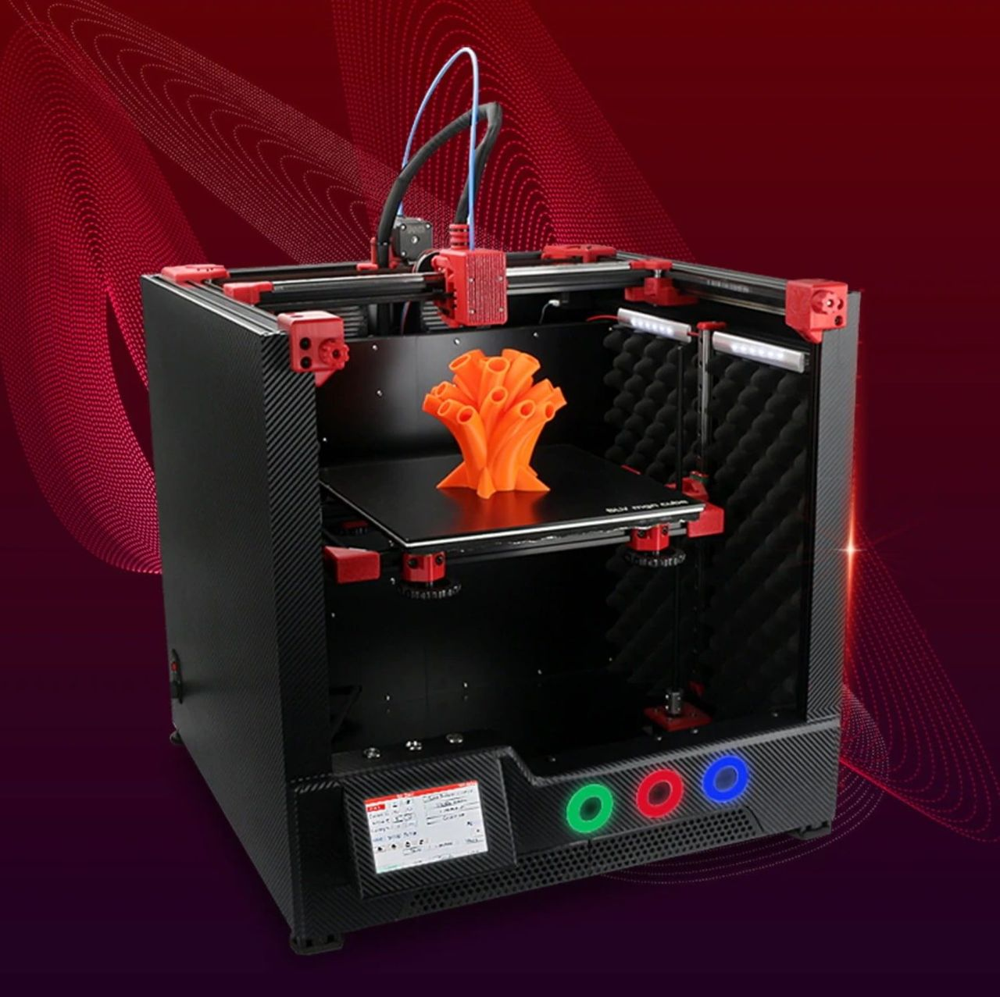

[← All updates](index.md){ .back-link }

# Metal Kit II update and clearance sale

### Metal Kit II update

It took 34 days to create this tiny part.

Over the course of those 34 days, I changed countless designs, tested, experimented, and gathered and analyzed data. Thanks to this small piece of the puzzle, I gained a better understanding of the entire picture.

To design a system that is truly optimized for performance and produces above-average print quality, I had to stop compromising. Since I still have access to academic articles through my old university student account, I started searching for information that could help me develop a better motion system. While I studied all sorts of belt drive principles, some of which were completely new to me, I also planned my experiments. At first, most experiments aimed to compare the old system with the prototypes. But in the process, I discovered that many clones do not even meet 30% of the specifications in the original datasheets. Since a user may accidentally pick a less reliable alternative, I had to replace every component. Rather than testing only 3 types of parts, I ended up buying and testing at least 28 different kinds of bearings, idlers, steppers, belts and more.

This is a great opportunity to thank a friend of mine who provided me with professional laboratory equipment. Half a year's salary would not cover most of it. Since he could be fired for this, no names or photos will be shared here. Thanks a lot, bud :)

So as not to bore you with too much data, here is an example of a small test. I built a closed-loop jig to find the correlation between vibration and bearing type.

The jig consists of a closed-loop belt, a stepper, a pulley, an idler, lab equipment for 3-axis vibration measurement with 3 probes plus a stationary pre-calibrated probe, 2 optical speed sensors for the steppers and idlers, a data logger and more. Each idler/bearing was tested with five mounting options, three types of belts, many bearings, Chinese idlers and Gates idlers. Isolating the idler vibrations was the most challenging part, and this was only one of many experiments. I also had to test each setup twice to measure both idler/bearing orientations (side and top).

Based on the information I gathered, I came to the following conclusions:

- **Structure.** Despite its small size, this part aligns the two most critical parts of the system. You can see that it is attached to the frame in three different directions while aligning the profiles that hold the Y axis (second image). There are better ways to align a motion system frame, but given the circumstances and a DIY budget, this is the most efficient method.
- **No more idlers.** They failed over and over again. My tests showed that even the original Gates idler for 9mm belts failed. Within 65 hours of work, black powder appeared inside the Gates bearings and the vibration levels increased. I have tested idlers/bearings from 28 manufacturers (with different clearances and accuracy levels) and have lost all trust in idlers.
- **Belt teeth on a bearing.** The community has never given a definitive answer on whether belt teeth can run on bearings. There will always be different opinions, but I'm looking for facts, not opinions. As I write this, a small 680mm belt system test jig has been running (almost non-stop) for 384 hours. After only two checks, it has already answered 60% of my questions.

- **No tensioners**, at least not like the traditional ones. A tensioner makes it very convenient to maintain the belt, but there are usually two or three moving parts with clearance between them. Whether it is held with a screw or locked with set screws, I measured a 19% increase in system noise. I have come up with a solution that I will share with you later.
- **Screws are not accurate.** A large clearance between the screw's OD and the bearing/idler ID can also hurt the reliability of the system, and that is exactly the case when screws are used as idler/bearing axles. Shoulder bolts (-0.005h) are an option, but after measuring a couple of them, I found that some don't follow DIN specifications and their makers don't care about the customer. I think BOSSARD makes the best ones, but they are expensive. To solve this problem, I chose a high-precision custom solution.
- **Balance is crucial!** Motion systems suffer from incorrect use of washers and from shafts/dowels of poor accuracy. It can even damage the belts. So I had to design parts that compress the bearings and also align them with the other components.
- **Weight and center of mass.** Even light components matter, because of their position relative to the moving masses. Many changes there :)

This is just the tip of the iceberg. I have already changed many parts in the final design to make it more reliable. To those asking when it will be ready: I will probably send a few prototype files for manufacturing (not the full motion system). You can probably expect some of the parts to be revealed along the way, as I won't be able to hold back.

### FYSETC BLV mgn Cube clearance sale

The FYSETC team asked me to share a clearance sale for the BLV mgn Cube 3D printer with you. I was really surprised to see that they are offering it with **free shipping** to USA and EU customers. In addition, the price has dropped dramatically to **$630**, which is an excellent deal. If you're interested, here are the links to the FYSETC BLV clearance sale:

- [BLV mgn Cube with free shipping to the EU](https://s.click.aliexpress.com/e/_DDYrms7)
- [BLV mgn Cube with free shipping to the USA](https://s.click.aliexpress.com/e/_DB5a3Gr)
