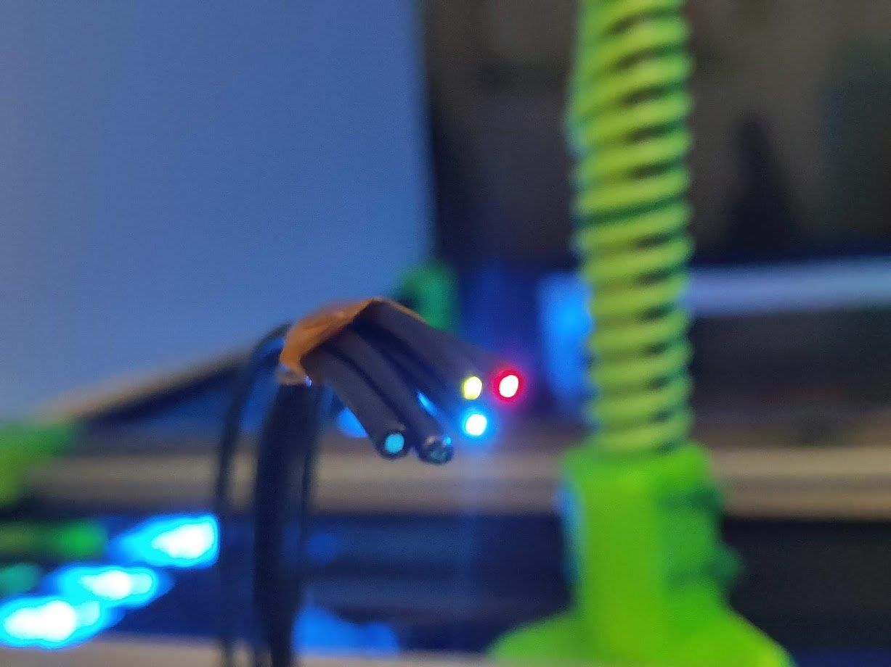
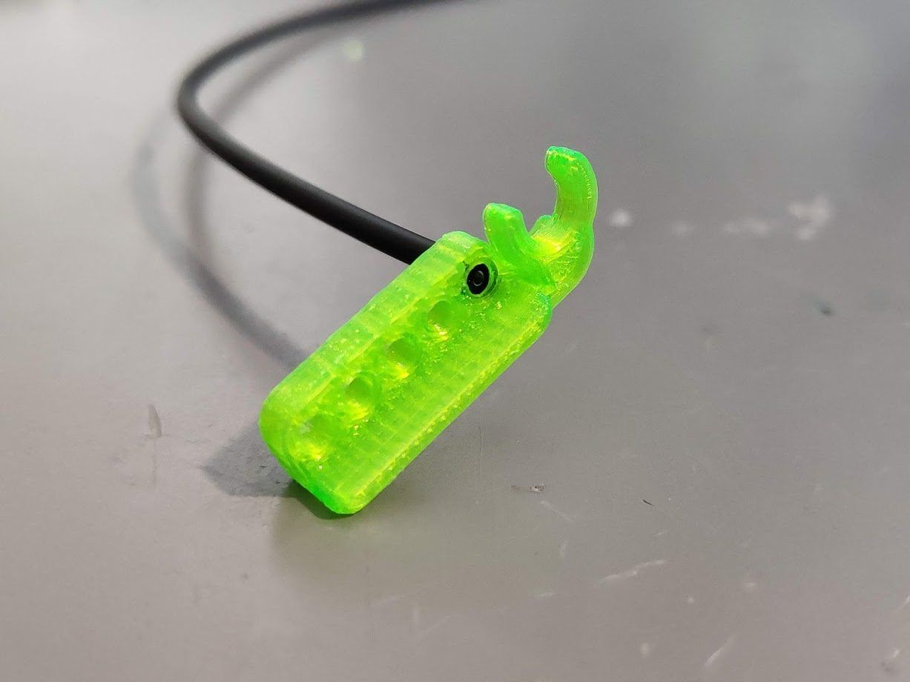
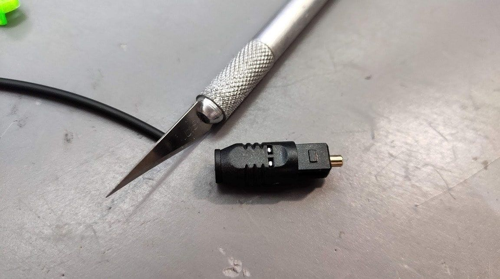
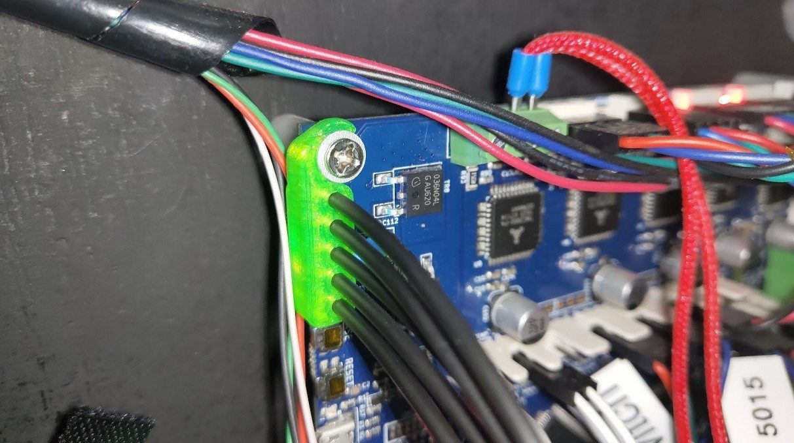
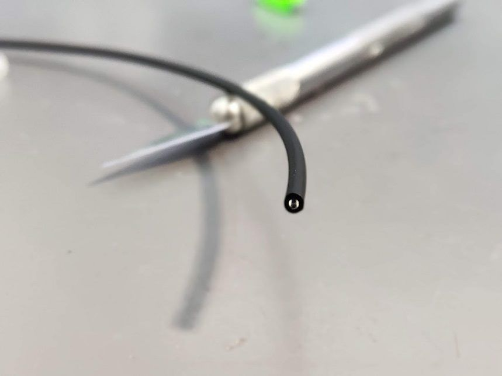
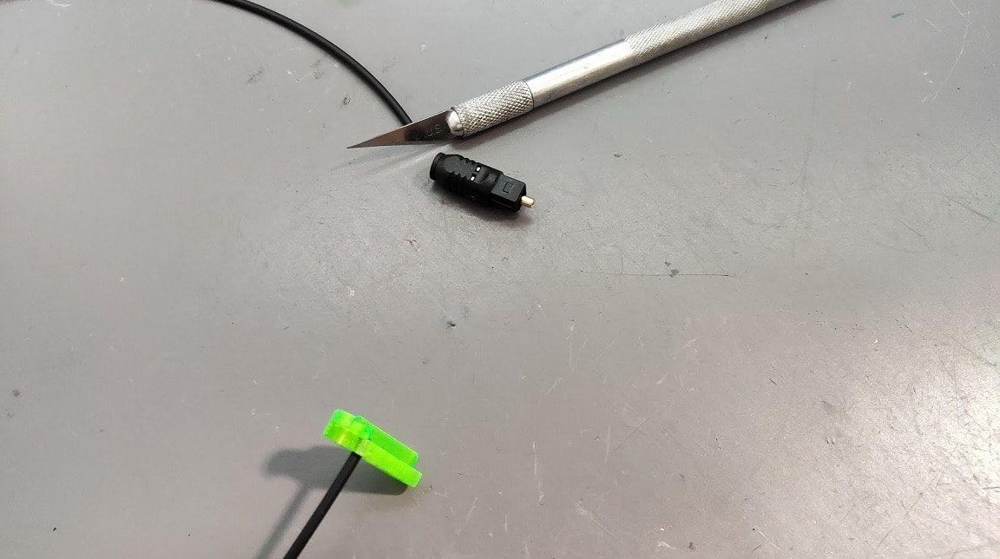
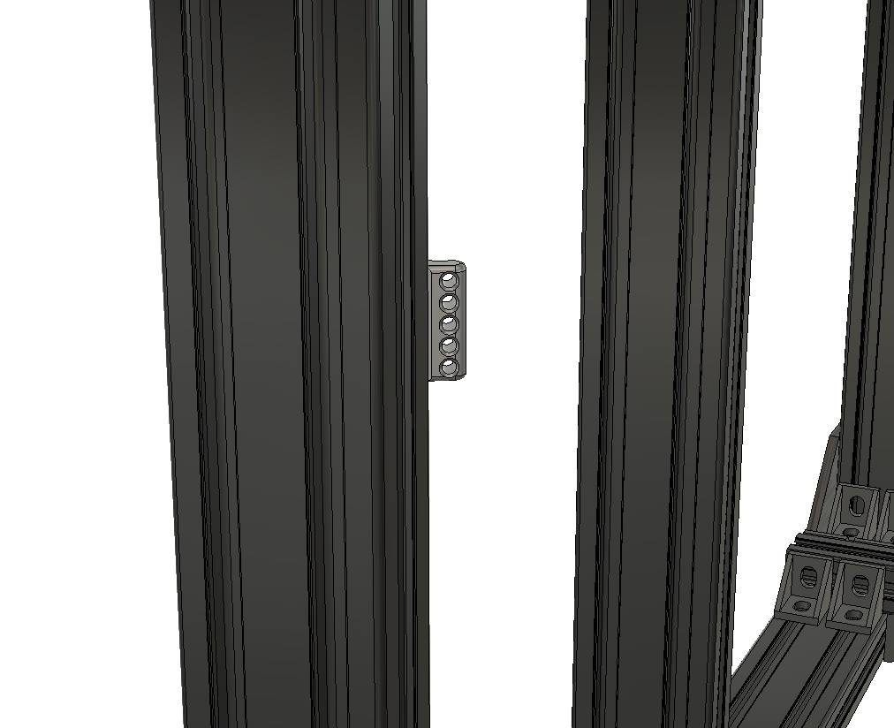
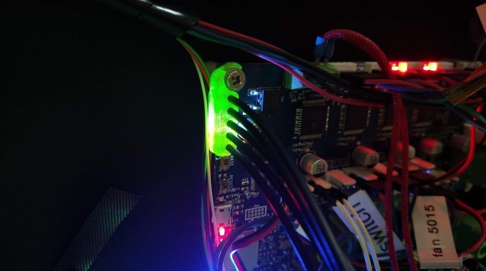
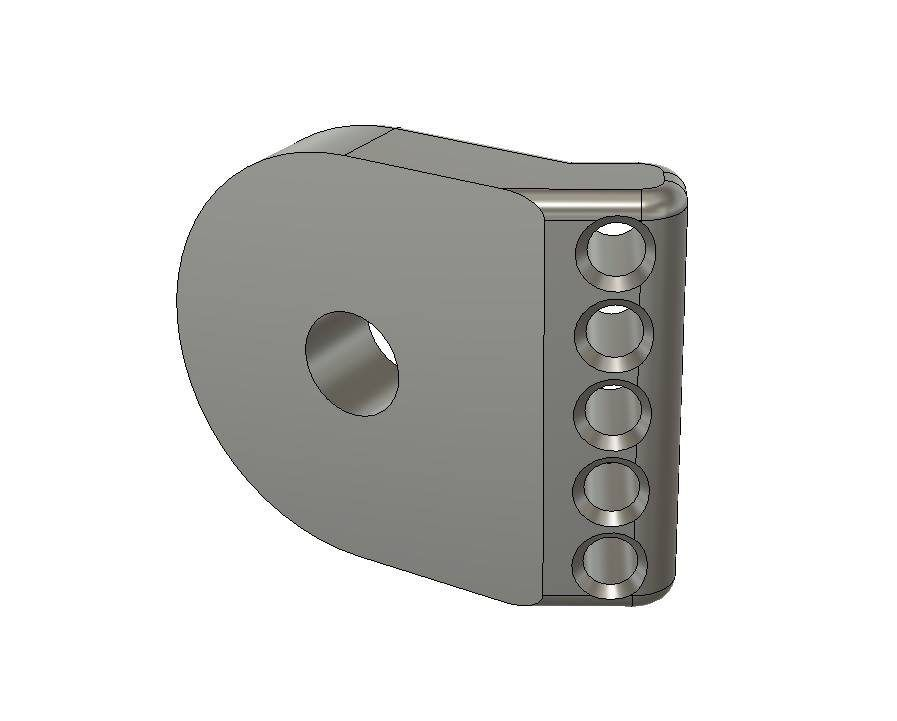

[← All updates](index.md){ .back-link }

# Move the board LEDs to the front without soldering

### Concept

This is a way of "moving" the board indicator LEDs to the front without any soldering. The Duet WiFi board has a number of indicator LEDs for the heated bed, endstops, power, diag, status and more.

I think I found a simple, clean and fast way to "move" the LEDs to the front using cheap audio optical cable ($3 for 10m). So I ordered 20m of optical cable, started modeling some concept parts, and guess what? It worked!

Here is how I made this concept:

- Buy 2 x 10m of [optical cable on AliExpress](http://s.click.aliexpress.com/e/b06GWlGc) for $6.
- Download the [optical LED cable mounts](../../files/BLV-optic-LED-cable-mounts.zip) I modeled.
- Use a sculpting knife to cleanly cut the optical cable into wires about 1.6m long.
- Mount the "optic cables board mount" part on the board, then slide 5 optical cables (about 1.6m long) into the mount.
- Install the "Front Panel optic cable indicators" part using an M5 screw and T-nut, and slide the cable ends into the holes of the panel.

### Please note

The files I provided are more of a concept version. You can make even better front panels with text (just an idea) or route the cables inside the front panels. After getting some feedback from you, I will add it to the project.

You are more than welcome to post your remix of this concept.

**Note:** the files are licensed under the Creative Commons - Attribution - Non-Commercial - Share Alike license.

