[← All updates](index.md){ .back-link }

# Carbon fiber X axis tube

My dear friends, wonderful news!

**Mellow** let me know that the first batch of the [**BLV Carbon X-axis tube**](https://s.click.aliexpress.com/e/_A80Zvm) is ready and finally available. All tubes are made according to the ISO manufacturing sheets and data.

Update: it's all sold out!

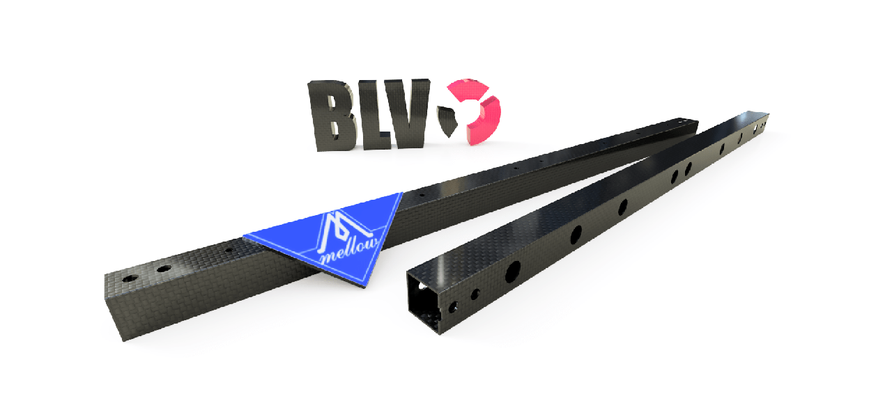

For those who are not familiar with it, carbon fiber (CF) is a very strong, extremely lightweight material with low thermal expansion. When permeated with resin and baked, it forms a carbon fiber reinforced polymer. This composite is extremely rigid and has a very high strength-to-weight ratio. Carbon fiber is very popular in civil engineering, the military, sports cars and aerospace. In fact, at my work (an autonomous drones development lab) I use CNC-machined carbon parts on a daily basis.

So you must be asking yourself why you would use it in your 3D printer, right?

Well, a carbon fiber tube is significantly lighter than an aluminum extrusion. The classic BLV X-axis aluminum extrusion weighs **213 g**, while the new BLV X-Carbon tube weighs only **65 g**. That's amazing! The lower weight takes some of the load off the motion system, which helps achieve better performance.

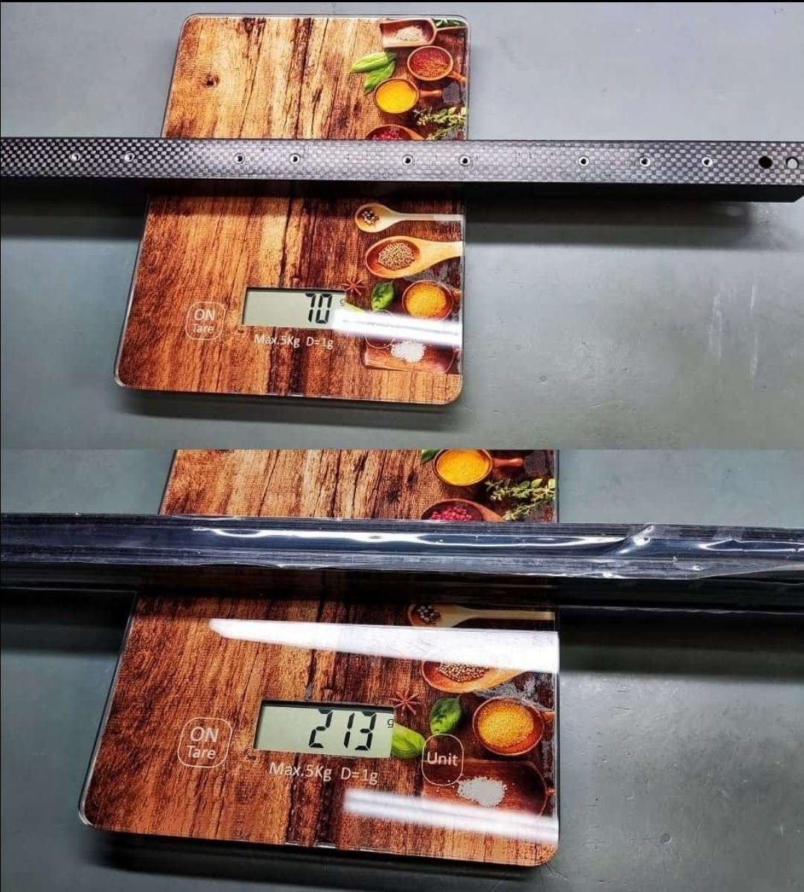
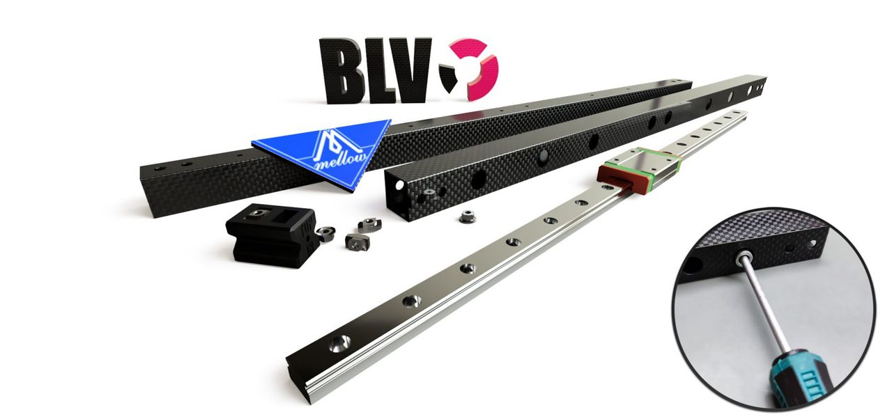

Since I started using Klipper, I noticed I can squeeze a lot more juice out of the BLV mgn Cube 3D printer and print way faster than before. Knowing that the metal kit and the BLV frame can handle much more, I upgraded the steppers to LDO 42STH48-2504AC (2.5 A) and installed a Spider v2.2 board with TMC5160 HV drivers running at 48V. With this setup I now print extremely fast. But it wasn't enough for me. I knew that reducing weight on the X axis would let me print even faster. Mellow surprised me by telling me he had started working with CF parts. That was my cue, and I asked him to make the first BLV X-axis CF prototype.

Instead of rivet nuts, which loosen over time, I suggested a much simpler and cheaper solution to Mellow: under each screw there is an access hole for a socket screwdriver. Simple and effective. This method made the CF tube very cheap to produce. The price dropped by 65%, and the CF tube is now affordable, with free shipping.

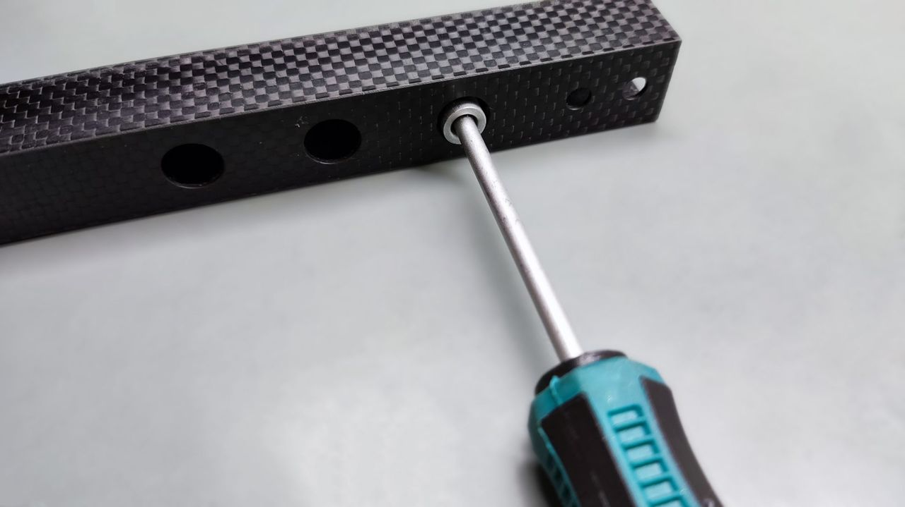
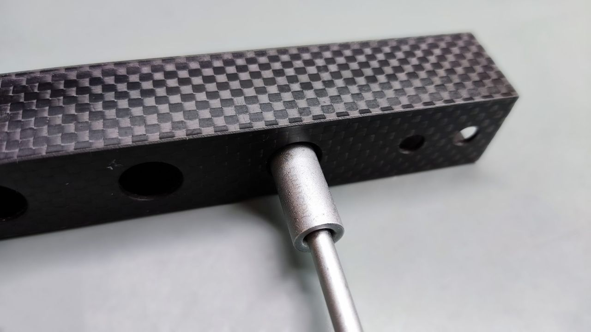
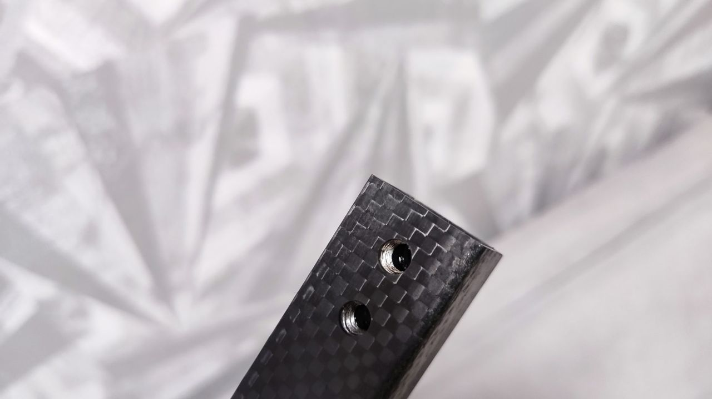
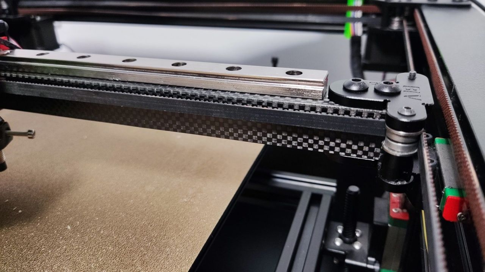
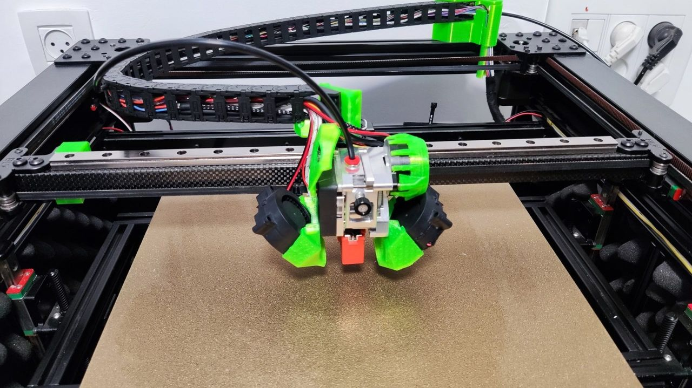
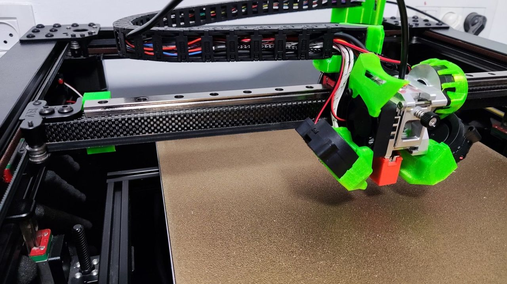

Compared to the first prototype I tested, I changed and improved a few things. The world isn't perfect, and sometimes the installation doesn't go 100% the way it was designed in CAD. So I added oval screw holes on one side of the tube only. This makes the installation much easier and lets you adjust the tube position. I also added a hole that centers the tube if you are using the BLV Metal Kit.

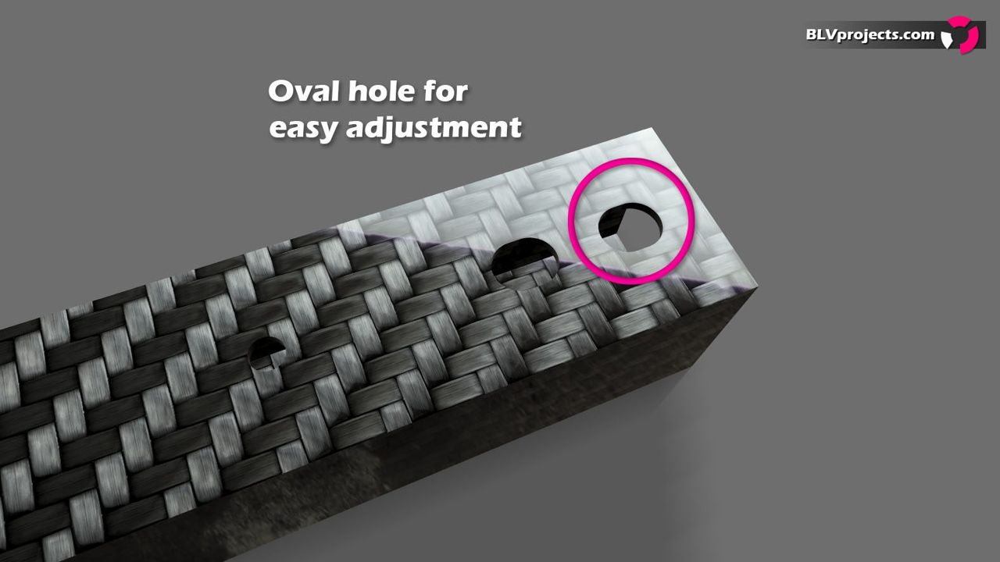
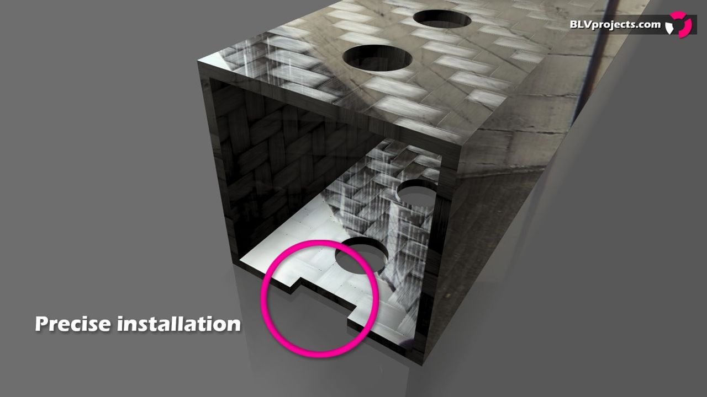

By the way, the [**new BLV Carbon X-axis tube**](https://s.click.aliexpress.com/e/_A80Zvm) **is suitable for the BLV Metal Kit**. If you still haven't upgraded to the Metal Kit, **I also modified the printed Y brackets to fit the new BLV carbon X-axis tube**. The files (STL and STEP) were shared as a ZIP download: *modified brackets for BLV x-carbon.zip (2.63 MB)*.

### Where can I get my BLV CF X-axis?

Many of you know the Mellow store on AliExpress and know that quality is very important to him. Although his products are not cheap, by making the CF tube manufacturing process cheaper he was able to offer the CF tubes for the BLV project **very cheap, with free shipping**. I'm so glad, since I try my best to keep every single part of the BLV project affordable to all. Get your new [BLV carbon (CF) X-axis tube from the Mellow store](https://s.click.aliexpress.com/e/_A80Zvm).

### Installation

The installation process is very easy, but first you must prepare the following items:

- 1 x [BLV carbon (CF) X-axis tube](https://s.click.aliexpress.com/e/_A80Zvm)
- 8 x [M3 flanged Nylock nuts](https://s.click.aliexpress.com/e/_AmijcU)
- 4 x [M5x12 mm DIN912 hex socket head screws](https://s.click.aliexpress.com/e/_AYmGss)
- 8 x [M3x10 mm DIN912 hex socket head screws](https://s.click.aliexpress.com/e/_AYmGss)
- 4 x [M5 T-nuts](https://s.click.aliexpress.com/e/_AWjqJw)
- 1 x [M3 nut socket driver](https://s.click.aliexpress.com/e/_9xyy2c)

First, download and print the BLV carbon adapters. You must print the file twice, one for each side of the CF tube. Make sure to use at least 6 walls and 90% infill. I shared both the STL and STEP files as a ZIP download: *Carbon Adapter.zip (130 KB)*.

After printing the adapters, take the 4 M5 T-nuts and turn them over. Insert 2 of them into the top and 2 into the bottom of the printed adapter. Make sure they go in upside down, just like in the pictures below.

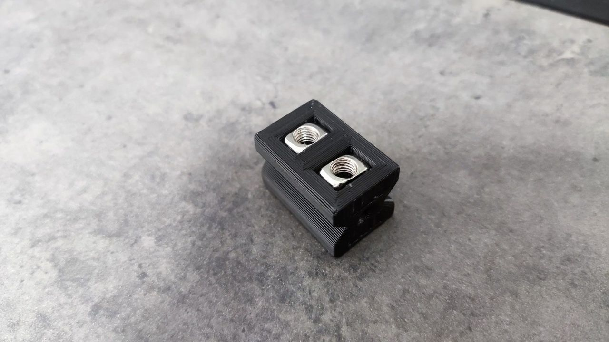
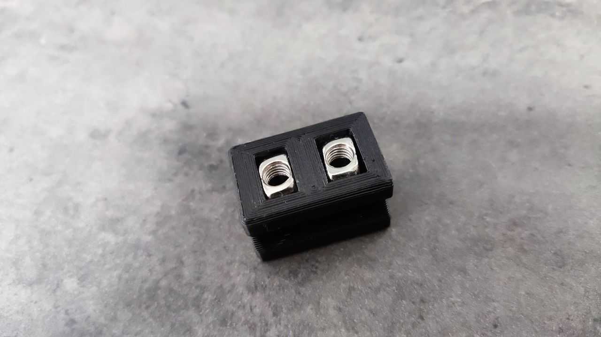

Now gently insert the adapter into the carbon tube. Note the markings on the adapter: "TOP" means this side should face up, and "IN" means this side goes inside the carbon tube. Do the same on the other side.

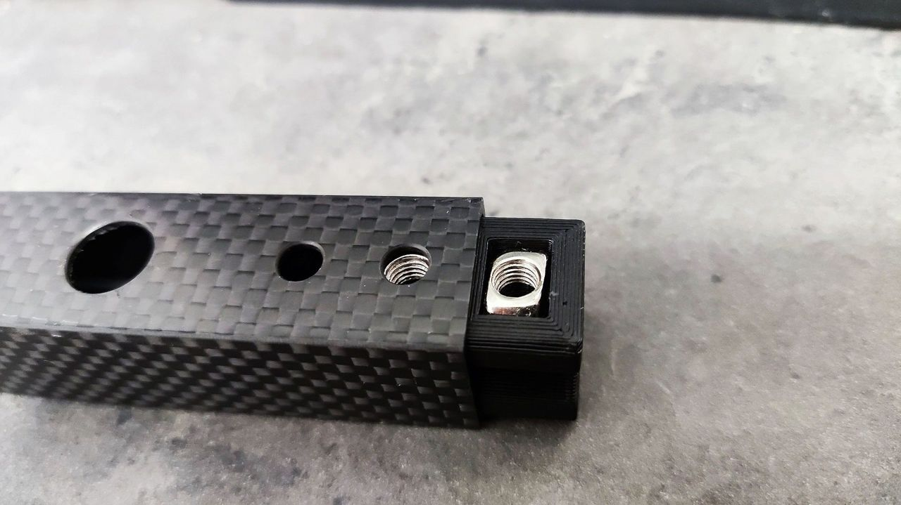
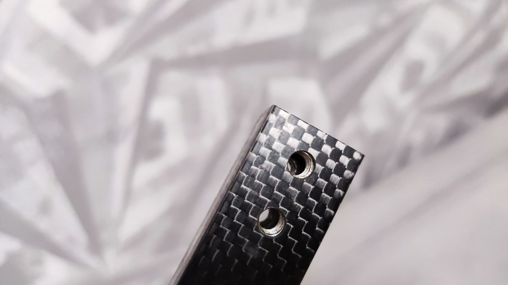

Once you have completed these first steps, place a towel on the heated bed to prevent any damage to the bed or the print head. Put duct tape on both sides of the carriage to keep it from moving left and right.

Release the upper metal parts located on top of the old X-axis aluminum extrusion. Unscrew both M5 screws and only one of the screws, as shown in the pictures below:

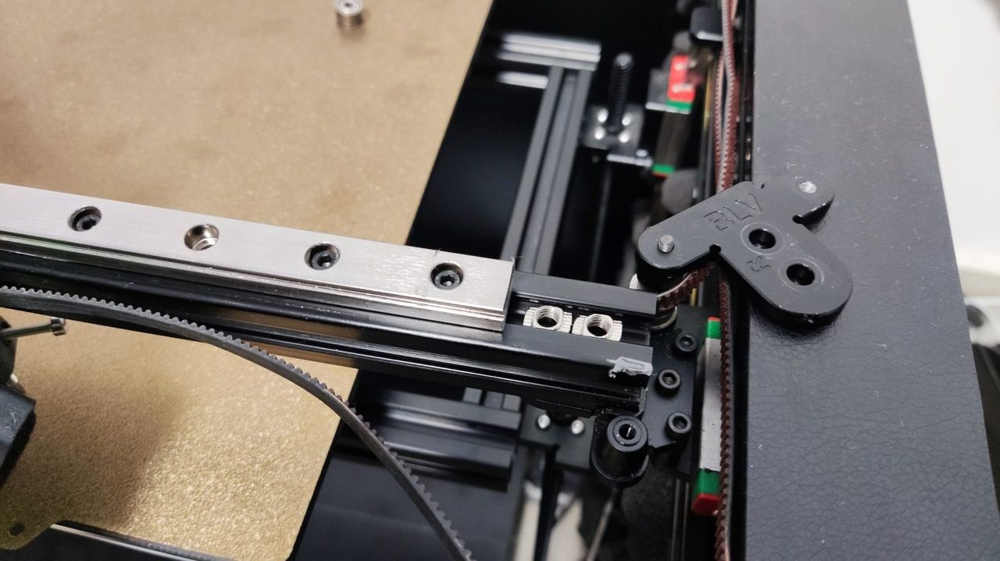
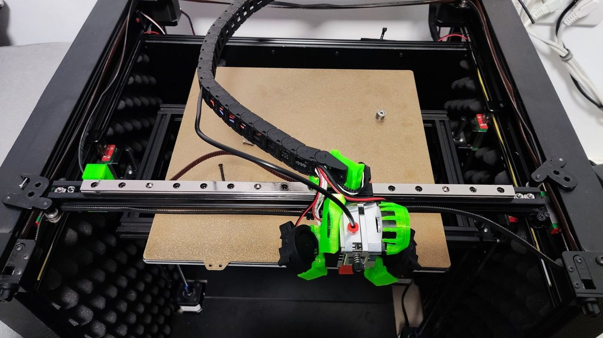

Unscrew the M3x8 mm rail screws, lift the X axis and carefully separate the rail from the aluminum extrusion. While doing this, make sure the X carriage is secured and can't slide off the rail. Then remove all the M3 screws from the rail.

Slide the new carbon X-axis tube into place and lock the bottom part using 2 M5x12 mm screws. Do the same on both sides. Once finished, put the upper metal parts back and lock the M5x12 mm screws in place. Also, carefully put the idler back and tighten the screw that holds it in place.

**Please note:** if for some reason the CF tube doesn't fit exactly, loosen one of the Y carriage or Y rail screws to make small adjustments. You can also sand the center hole a bit to enlarge it for a perfect fit.

Reinstall the X rail exactly as shown in the following animation:

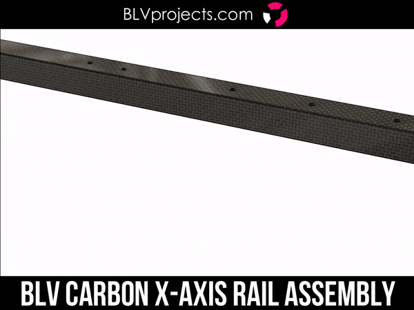

It is very important to tighten the nuts well and make sure the Y axis moves smoothly.

If your BLV printer runs Klipper and you use input shaping (resonance compensation), you must recalibrate it.

I hope you like it!

Sincerely,

Ben Levi - BLV project developer

