[← All updates](index.md){ .back-link }

# New front panel (beta)

Yes .. this is a new panel for the BLV mgn Cube printer.

Immediately after I received my order from FYSETC and assembled the BLV mgn Cube 3dp printer Kit. I thought to myself: why not refresh the look of the front panel?

Designing the new front panel was not easy And it took me quite a while. As part of the new Panel, I added a ball-jointed bracket for the LCD screen that fysetc provided me with the kit.

The look is unconventional, I know... But I sincerely hope you like it.

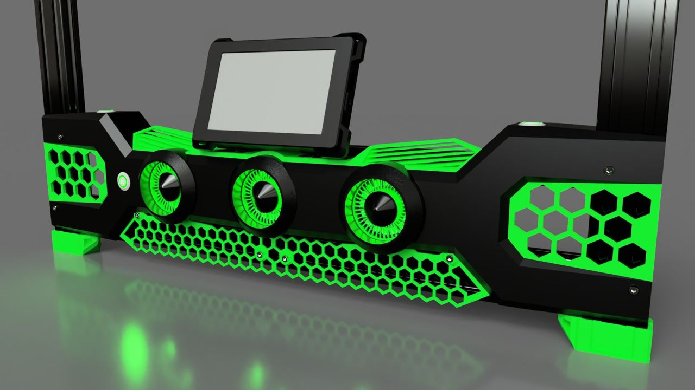

I have rendered you a few more pictures to help you understand what the final panel looks like:

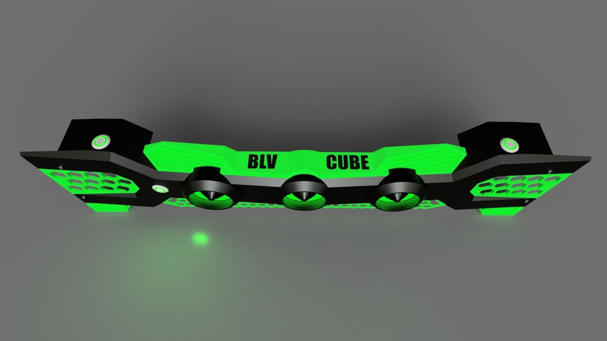
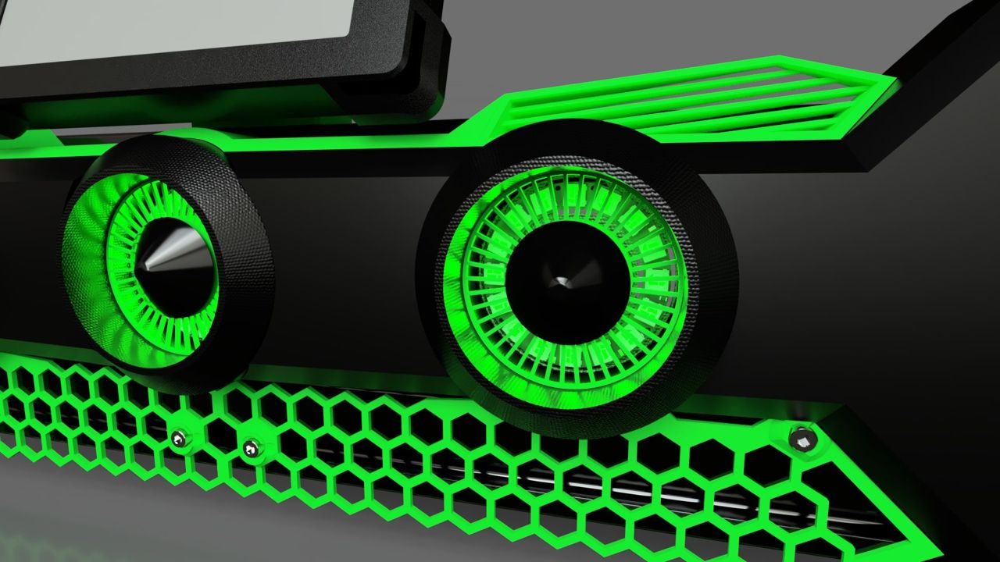
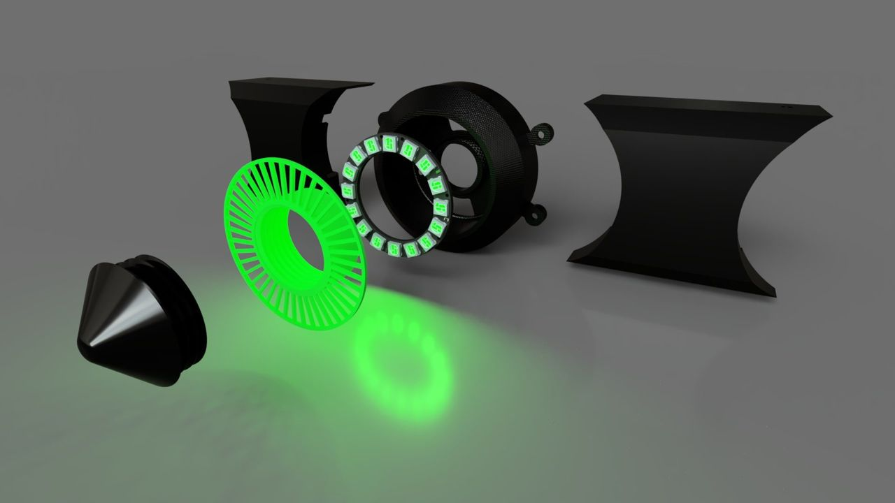
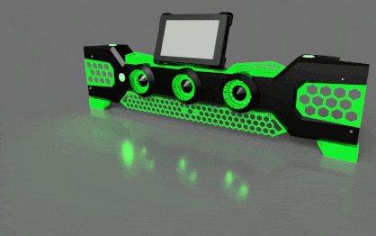

The panel had several versions before I allowed myself to release it as a BETA. These are the prototype parts I printed using the Ender 3 V2 printer in the following pictures. As you can see, print quality is not amazing, but that was before I upgraded it with a BLV ENDER 3 V2 kit (coming out soon ).

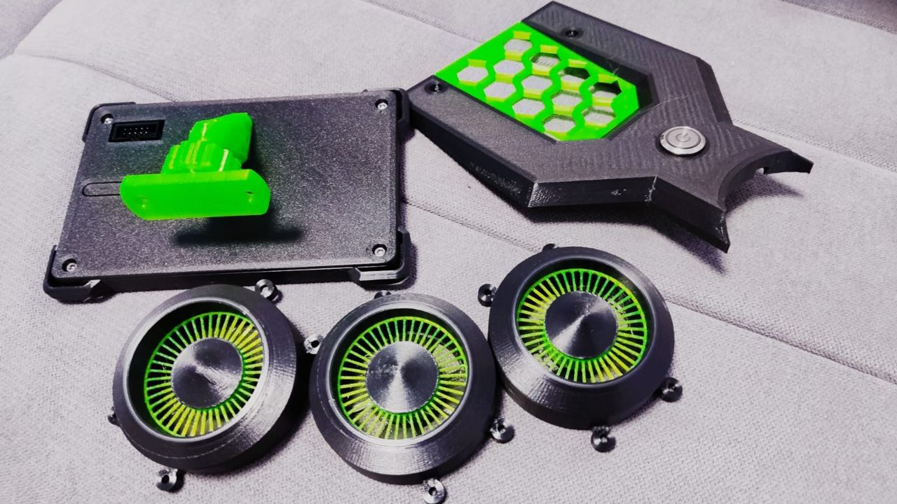
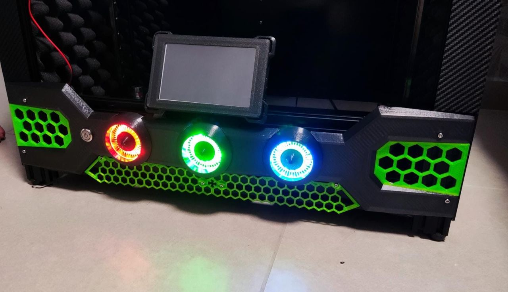
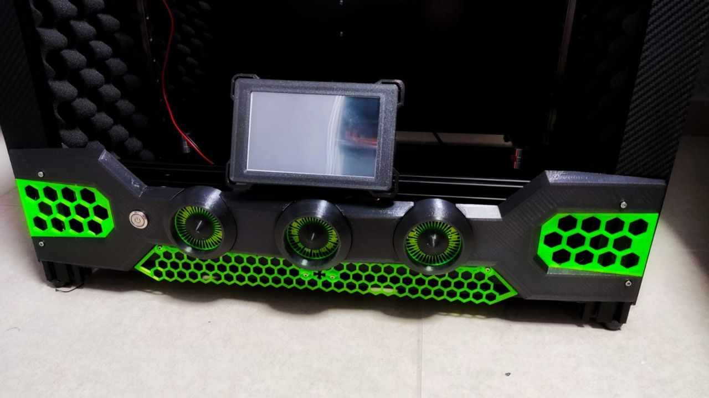
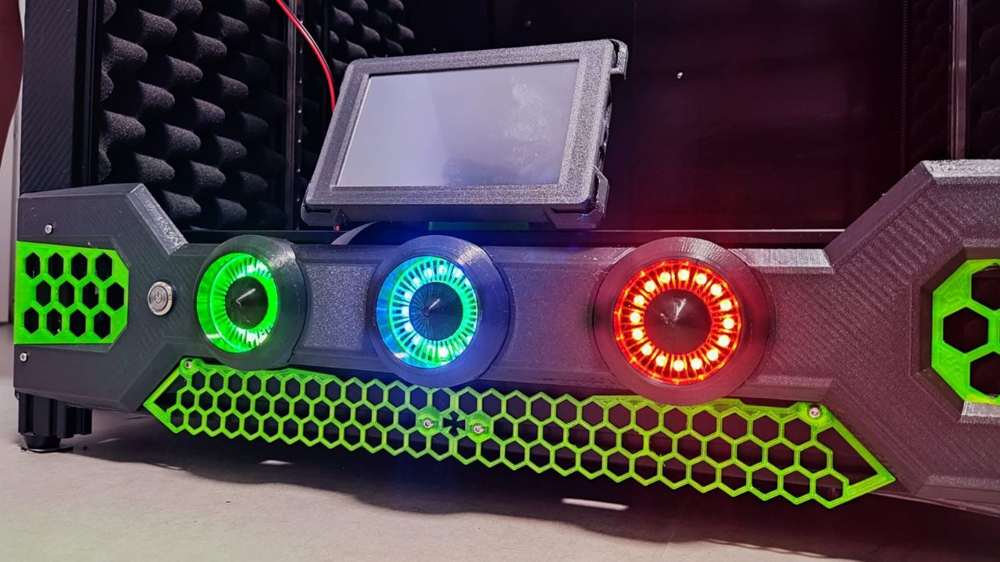

And a small video demonstrating the Neopixel animation: [Click here](https://www.tiktok.com/@benleviblv/video/6985640380427406594)

For those of you who do not quite understand what the role of LEDs is. Well, the LED rings show the status of the printer, the hotend status, and the bed status. This is done by an Arduino component that monitors the communication line of the duet board and the LCD. The first circuit was a bit completed and not many have done it. Luckily, a month ago FYSETC released a [**Super easy BLV PCB**](https://s.click.aliexpress.com/e/_AC5kIC) that saves all the trouble and made an ALL-IN-ONE board that has a 24V regulator, Arduino, level shifter, and all the needed parts to connect the neopixel to your printer.

I used it since it has part of the FYSETC kit and it took me less than 3 min to assemble. please note - if you are using Reprap v3.xx Please update your PCB using the latest code from [here](https://github.com/mule1972/NeoPixelBLVmgn). you will find a flashing guide for the PCB [here](https://github.com/FYSETC/FYSETC-BLV-MGN-CUBE/tree/main/Firmware).

The assembly process is relatively simple, some part contains printed threads, therefore, it is recommended that the printer will be calibrated. I have created also a 3D viewer for you. it will be easy for you to understand where each part goes to. [**Click here to Check the 3D VIEWER**](https://a360.co/3BMm2xx)

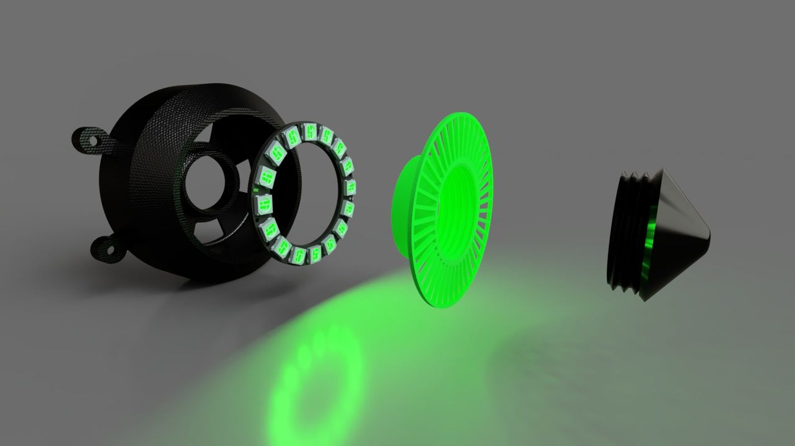
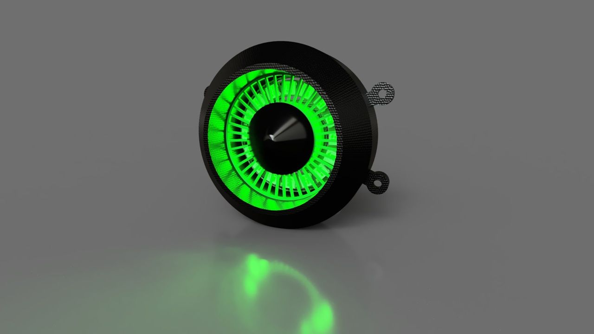

### DOWNLOAD

Just before you download the files, please understand that it's not the final version. Therefore it is important to share your opinion with me. If you have any comments, insights, or anything else on your mind - I would love to hear about it and improve.

**The files are licensed under the** [**Creative Commons - Attribution - Non-Commercial - Share Alike license.**](http://creativecommons.org/licenses/by-nc-sa/3.0/)

The STL files are available to download here:

BLV Cube new Front Panel STL files - BETA.zipDownload ZIP • 3.57MB

The beta CAD file (Fusion360) is available to download here:

BLV Cube_Front panel - BETA.zipDownload ZIP • 13.04MB
