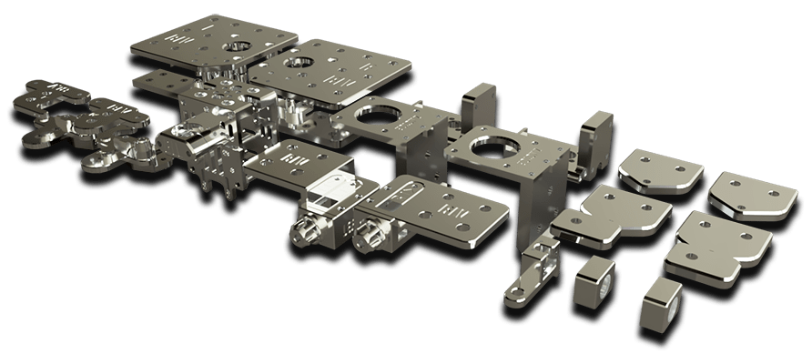
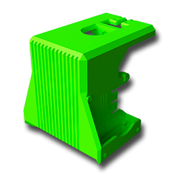
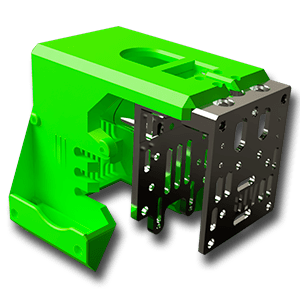
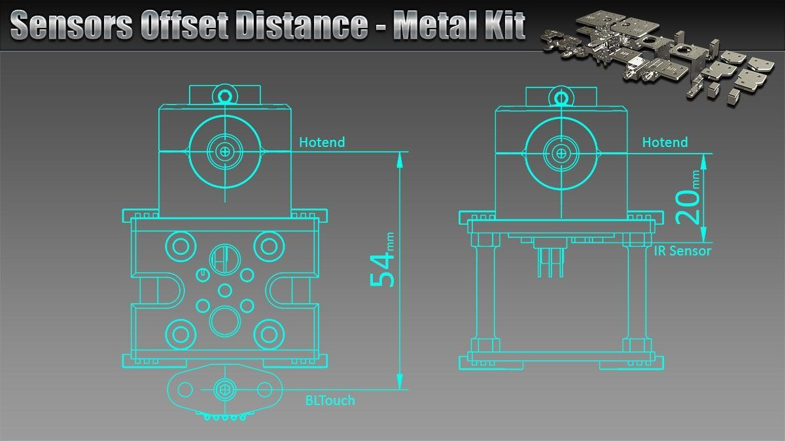

[← All updates](index.md){ .back-link }

# The Metal Kit upgrade

As you know, for several months I have been designing and testing a new kit of components that will replace all the BLV mgn Cube's motion system printed parts. in other words, Instead of printed parts made of PETG/ABS, we will be able to enjoy precise, reliable parts made of CNC machined aluminum. The new upgrade kit further increases the printer's capabilities, eliminating flexibility on the frame, and increasing performance. The new components are smaller, more powerful, and weigh much less!

Happily, after such a long and tedious period, the moment we have all been waiting for has arrived - the kit is ready in beta. I sent all the source files I developed to the manufacturer for free. in return to sell the kits to us at a very low price. Of course, I do not get any profit from this and it allows him to sell us the kits at a very low price.

In less than a week, 100 kits were sold to the beta group members for $ 109, including free shipping. Currently, he has raised the price to $ 119 + free shipping and promised it would be the fixed price of the kit. This is still a bargain as it is over 50 pieces!

### WHERE CAN I GET IT?

you can get it from the official manufacturer and seller - [**click here to get it**](https://s.click.aliexpress.com/e/_dZWiHmO)

Please note my dear friends, again I will remind you that I don't own any store and I have no profit. I'm only the developer of the kit and the files were given to the manufacturer for free in order to make it affordable. since the manufacturer doesn't need to pay for designing.

**Warning**

I have been notified that an **unauthorized** store on Aliexpress started selling **NOT genuine metal kit** that is not accurate and not using the original files. I've received some complaints about parts miss matching parts. **Please do not buy from them!The only** genuine **BLV metal kit parts can be found here -** [**Click here**](https://s.click.aliexpress.com/e/_dZWiHmO)

### Source files and STL's files to print

- For now, you would need to print the new Hotend shield. The new shield is smaller and can fit the new setup. please mind that the kit doesn't include the 4010 fans and fan screws. you can download the new Hotend shield as STL file from here > [**Download**](../../files/BLV-Metal-Kit-hotend-shield.zip)

- In order to help you guys, I'm releasing the source files of the X-carriage. the zip contains both the new Hotend shield and the X-carriage metal parts. It will be easier to remix, design, or modify parts and make them even better. Please note the files are [under Creative Commons - Attribution - Non-Commercial - Share Alike](https://creativecommons.org/licenses/by-nc-sa/4.0/) license > [**Download**](../../files/BLV-Metal-Kit-X-carriage-source.zip)

### Auto-Leveling sensors

The kit supports:

- **IR mini** sensor.
- **BLTouch** with a printed adapter (experimental) > [**Download**](../../files/BLV-Metal-Kit-BLTouch-adapter.zip)

The firmware needs to know the position of the probe in relation to the tool

On Duet the Command that defines the offset is G31, you can search for it inside the config file.

more information can be found [**here**](https://docs.duet3d.com/). Since it's a new carriage, you would need to change the offset of the probe on the FW.

to your convenience, I have added an accurate distance measurement of the probes

### ASSEMBLY 3D VIDEO GUIDES

!yt h6RqIR12xYc | Metal Kit - left X mount
!yt PkNG_4DqNDU | Metal Kit - right X mount
!yt xgskB43XnrQ | Metal Kit - left rear corner

**Left X mount - assembly video**.

please use only the plates with the "L" mark

on them. Do not use plates with "R" marking.

**Right X mount - assembly video**.

please use only the plates with the "R" mark

on them. Do not use plates with "L" marking.

**Left rear corner - assembly video**.

Please pay attention to the Length of

the motor Standoff.

!yt mT_S7TKsJ8E | Metal Kit - right rear corner
!yt ZSMAie1AsHY | Metal Kit - left tensioner

**Right rear corner - assembly video**.

Please pay attention to the Length of

the motor Standoff.

!yt XTAEOTpn_As | Metal Kit - right tensioner

**Left Tensioner - assembly video**.

Please make sure to use only parts with

an "L" or "Left" marking.

**Right Tensioner - assembly video**.

Please make sure to use only parts with

an "R" or "Right" marking.

!yt ychonAO79lA | Metal Kit - Z motor mount

**Z Motor mount - assembly video**.

!yt hjXf-C7vWmQ | Metal Kit - Z axis top mount
!yt eE851Lm2ddo | Metal Kit - X carriage

**Z Top mount - assembly video**.

**X Carriage - assembly video**.

please min that the Belts locker is experimental. I personally prefer using a zip tie instead.
