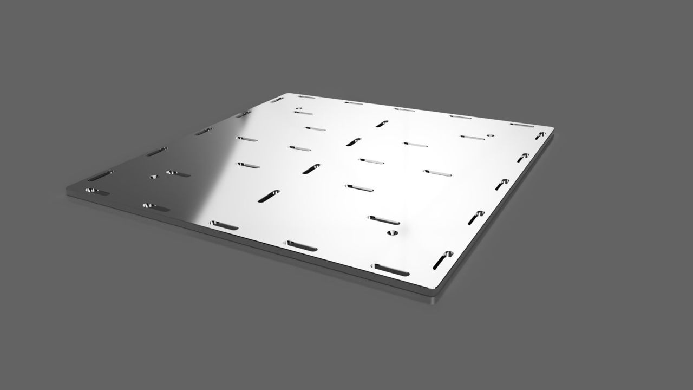
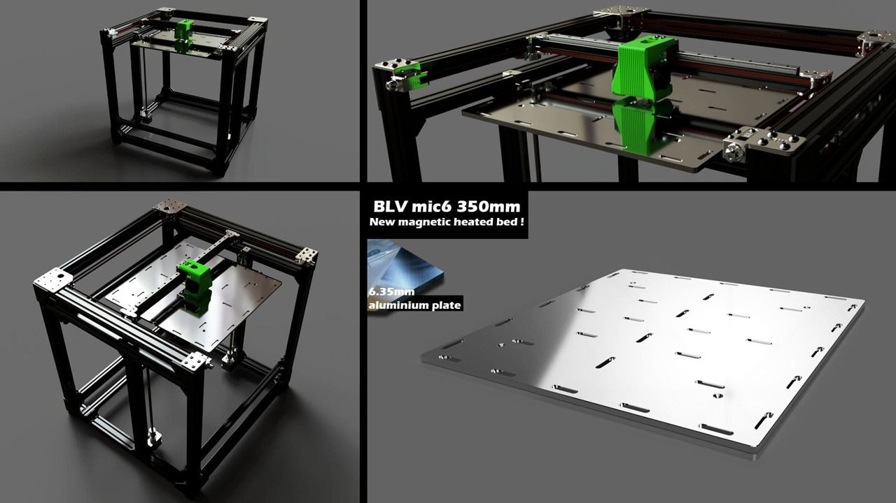

[← All updates](index.md){ .back-link }

# A new heated bed?

Following many requests, I have designed a new magnetic heated bed, and I would be very grateful if you could share your thoughts with me about the idea.

First, it was important to me not to compromise, so the bed will be made entirely of a flat **6.35mm MIC-6 aluminum plate**.

Many of you wanted a bigger bed, so the new bed will be **350x350mm**.

Like the first version of the metal bed, it will be studded with **strong N35HT magnets** (heat resistant) at the top surface. For safety, I asked Blurolls to equip the bed with a **24V silicone heater** with an integrated thermistor.

You can find more details in the [Facebook group post about the new bed](https://www.facebook.com/groups/BenLevi/permalink/756704198390452).

