[← All updates](index.md){ .back-link }

# New 3D printer parts for testing

I test parts before adding them to the BOM list. While looking for more links to quality parts, I found the **Mellow** store on AliExpress. First, it's very important to me to mention that I paid the full price for the parts without any discount. In short, no one paid me to write this.

!yt hZ4hPYj_TOo

### All-metal BMG dual drive extruder

After two weeks of using it, I honestly think it's the best extruder I have used. Most of the previous extruders failed to align the filament to the center. Only the Mellow all-metal, Trianglelab and Sealand BMG extruders aligned the filament to the center correctly. It's CNC machined, accurate and very reliable. Since it weighs almost twice as much as a regular one, I recommend using it only in a Bowden setup. It performs exactly like a regular one, but I really like using it because of its robust shell.

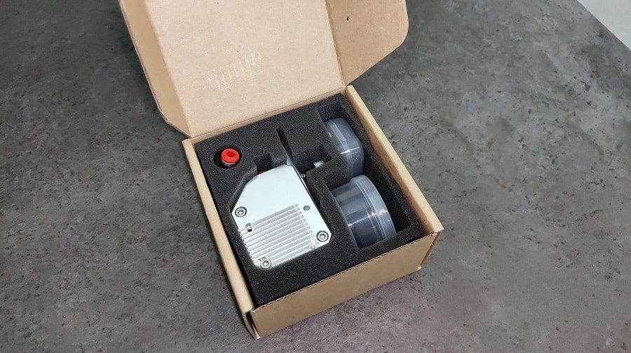
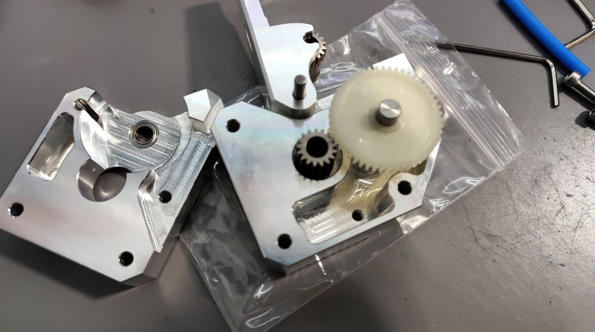

### Ruby nozzle 0.4 / 1.75

I had to print a carbon mount. Before that I used a steel nozzle. It worked, but steel behaves a bit differently than brass (thermal reaction delay). So I decided to test Mellow's ruby nozzle. The throat is polished and the edges are chamfered. I had the best experience printing carbon with it, definitely a keeper (in a safe 🤣).

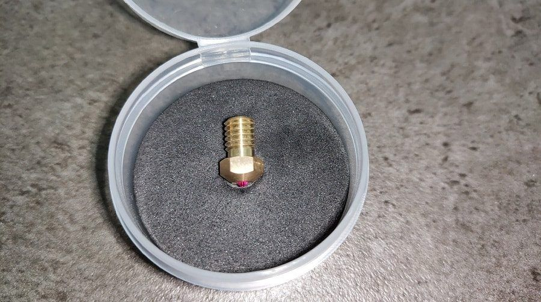
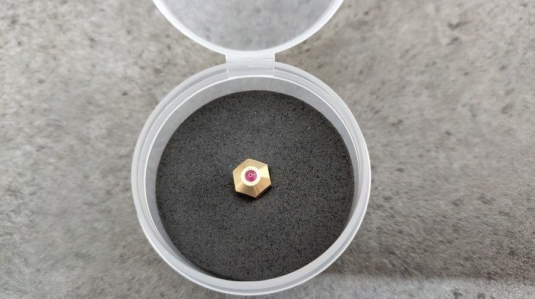

### 623ZZ flanged ball bearings

These are very important. Unfortunately, a few members bought expensive bearings from Amazon and got junk, which gave them a really bad experience and low-quality prints. I previously had the +/-0.05 bearings and decided to try the +/-0.005 tolerance (option 3). They are excellent bearings and highly recommended, with almost no free play on the screw.

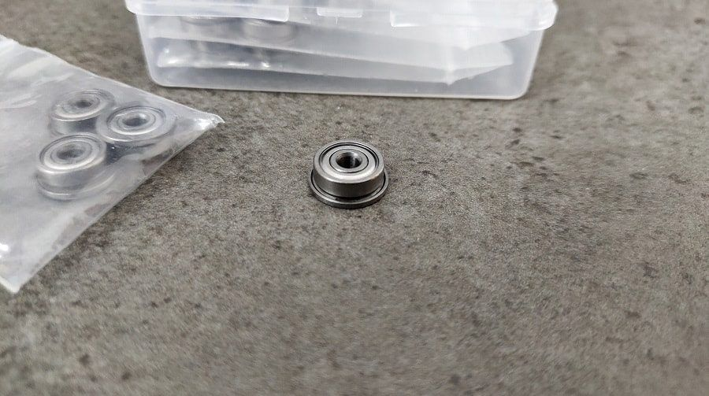

### The other parts

I was surprised to see how well the brass block was made. However, I haven't tested it yet, since it's much heavier than the aluminum block I use. Take a look at the photos of the aluminum block. It's a work of art. I'm really pleased with the quality, and especially excited to see the sensor and heater combo, because the sensor has a crimped case.

The nozzles are also high quality (I haven't tested the steel one yet).

I also checked the new GT2 pulleys. You will immediately notice the perfect edges, the tooth angle and the polish. It's an improvement, although there is no noticeable difference in print quality. Still, I do think they are worth the price.

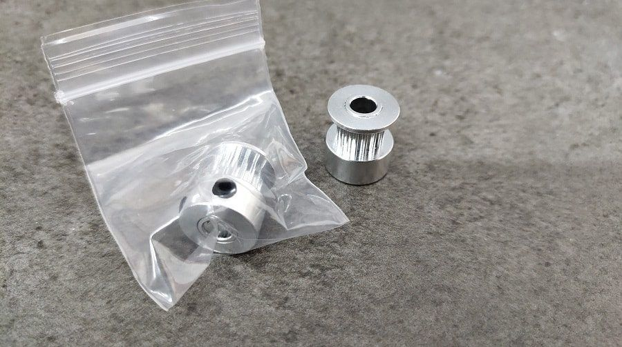
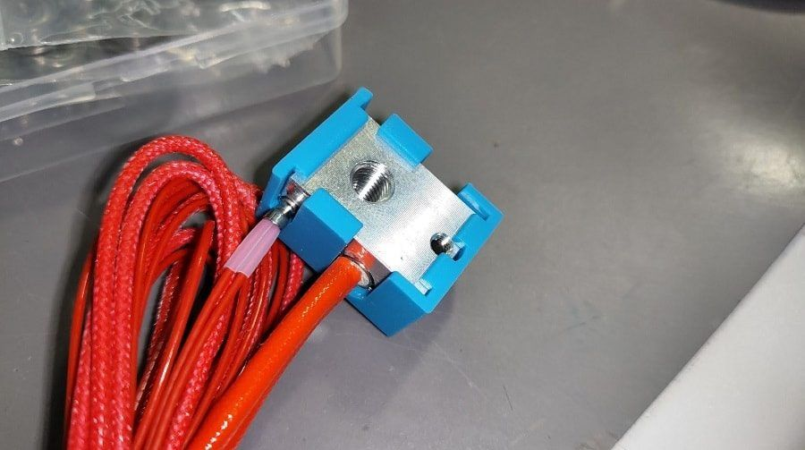
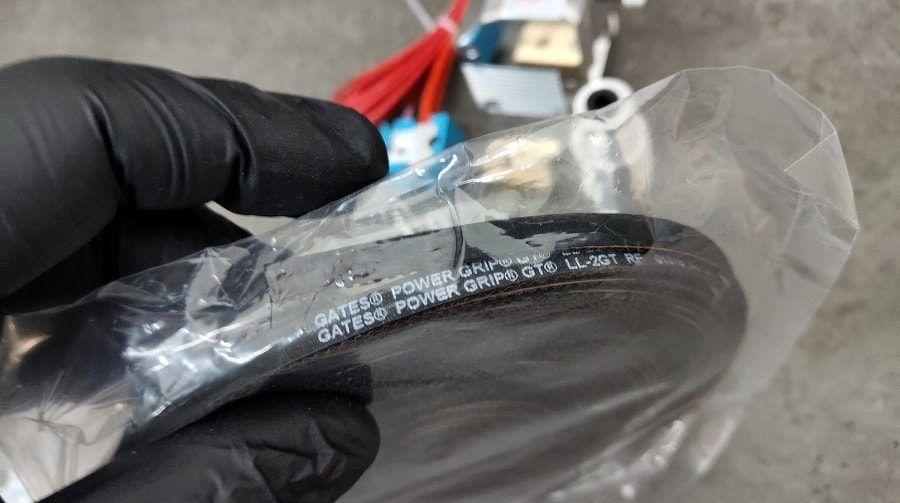
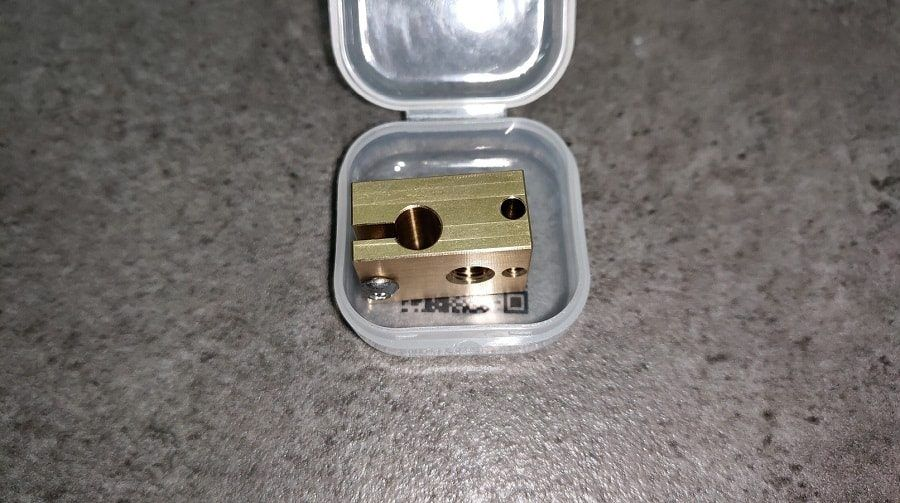
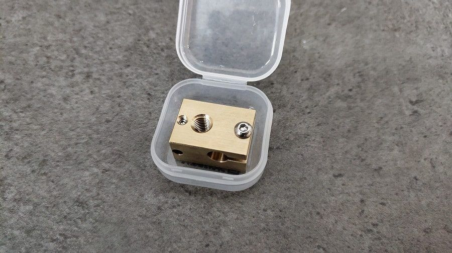
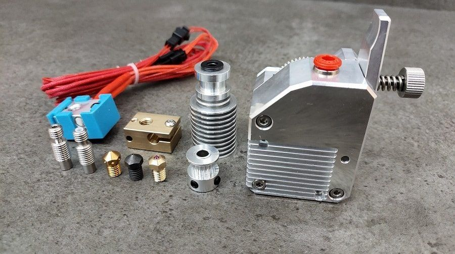

I updated the BOM links, and since I know a few of you will ask:

- [All-metal BMG extruder](http://s.click.aliexpress.com/e/cmISe6Kc)
- [Ruby nozzle](http://s.click.aliexpress.com/e/FhCK6i4)
- [F623ZZ flanged ball bearings (option 3)](http://s.click.aliexpress.com/e/WJXxClE)
- [Hotend kit (24V, PTFE)](http://s.click.aliexpress.com/e/bCjYIiV2)
- [4m Gates 6mm GT2 fiberglass reinforced belt](http://s.click.aliexpress.com/e/lMixbe0)
