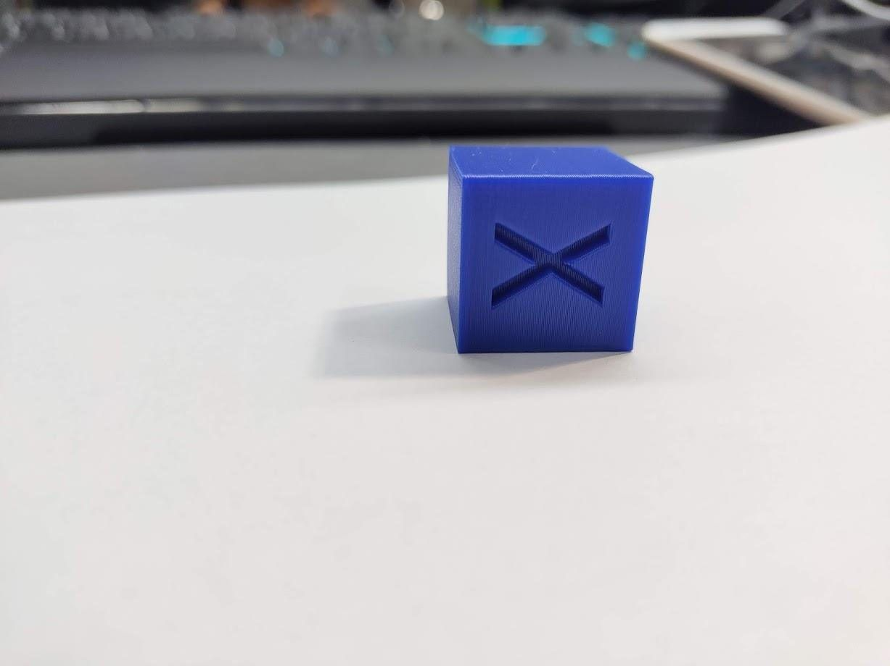
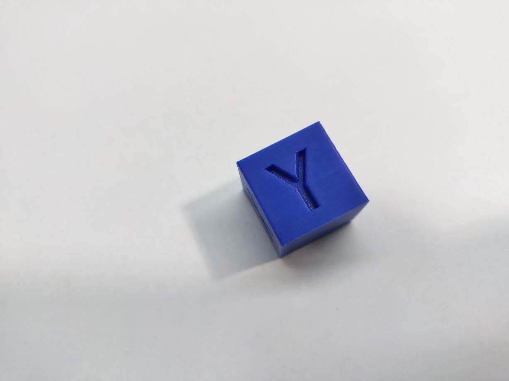
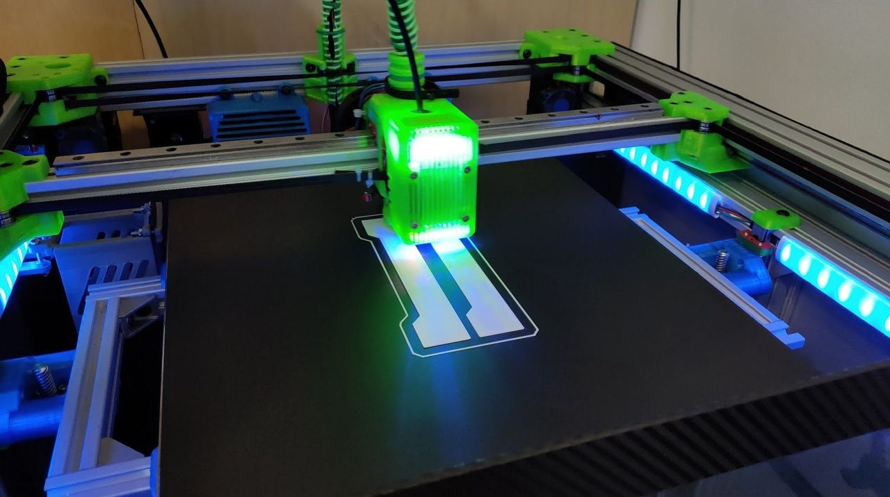

[← All updates](index.md){ .back-link }

# PID tuning: important

PID Tuning - I know that most of you are familiar with that and already have done it. But for those who not performed a **PID calibration:**  
The PID calibration is a crucial step to get high-quality prints. It's an algorithm who use 3 defined value to control and stabilize nozzle and bed temperature. The PID process is very simple.. it should be done after building it and every time you change a component such as heating element, sensor, bed sheet and even adding a silicone sock. at least 4 guys asked for my help on messenger and most of the printing quality issues vanished after PID calibration.  
here are two links for useful information about it:

1. [https://duet3d.dozuki.com/…/Tuning_the_heater_temperature_c…](https://docs.duet3d.com/)
2. [https://betrue3d.dk/duet-wifieth-pid-tuning-hotend/](https://betrue3d.dk/duet-wifieth-pid-tuning-hotend/?fbclid=IwAR1x5exzV9DZmbrZbsseSdE3A_UrQ3_d7P3zbOxuXRyruCojGM3fNyTuqDI)
3. and if you are using marlin: [https://reprap.org/wiki/PID_Tuning](https://reprap.org/wiki/PID_Tuning?fbclid=IwAR2wKRebERrejZ3yASsZZFfb0tpw_ZAt5W_upDq-C2qVUOMuEnP0HHXlRmo)

**Please notice:**

- before PID the hotend and bed must be cool - turn it off for half hour before you do it.
- before doing PID to hotend: turn on the bed to your regular print temps, position the hotend about 5mm above the bed, turn on the layer fan to your regular used fan speed and only then start the hotend PID.
- before doing PID to bed: turn on the hotend and fan and position the hotend about 20-10 mm above it.

