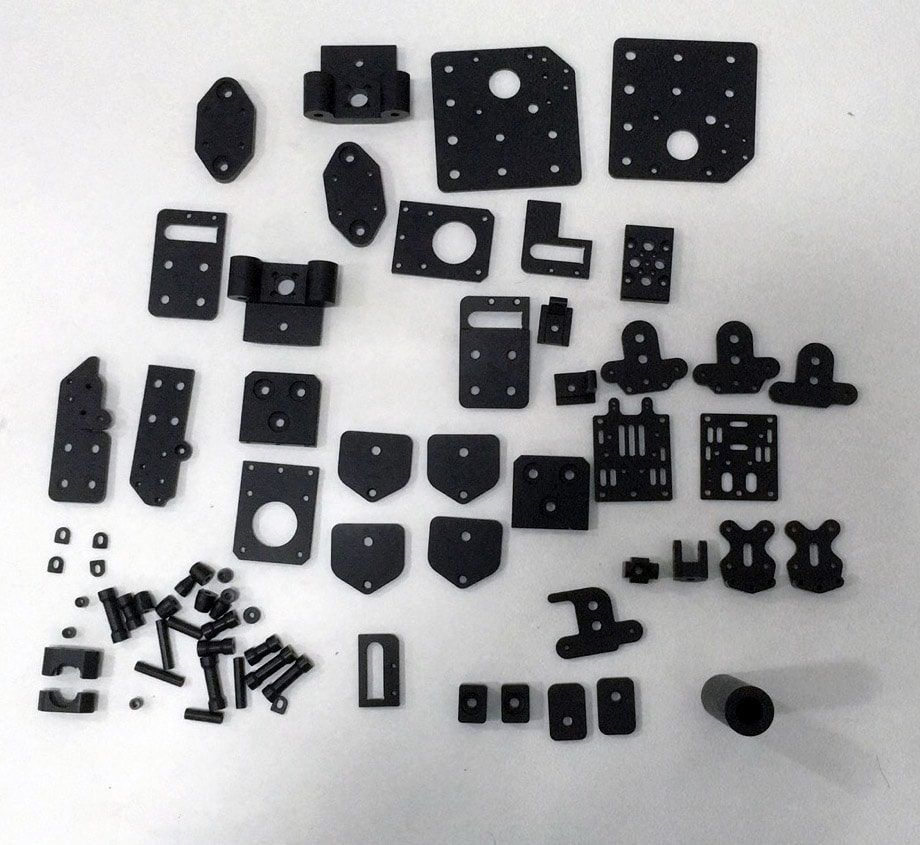
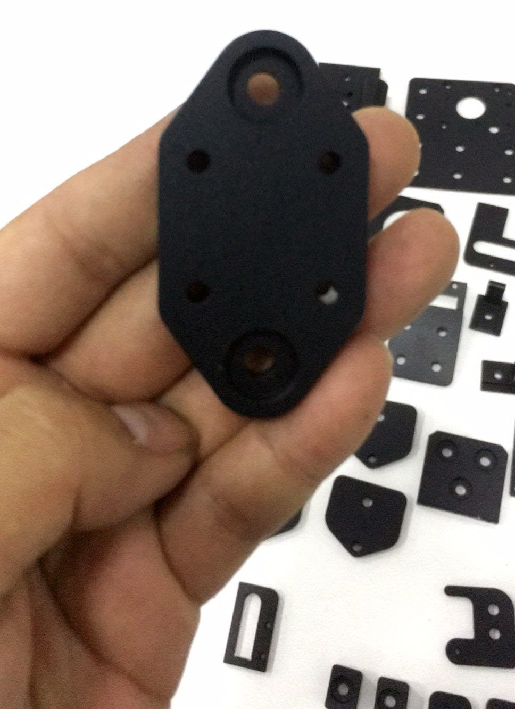
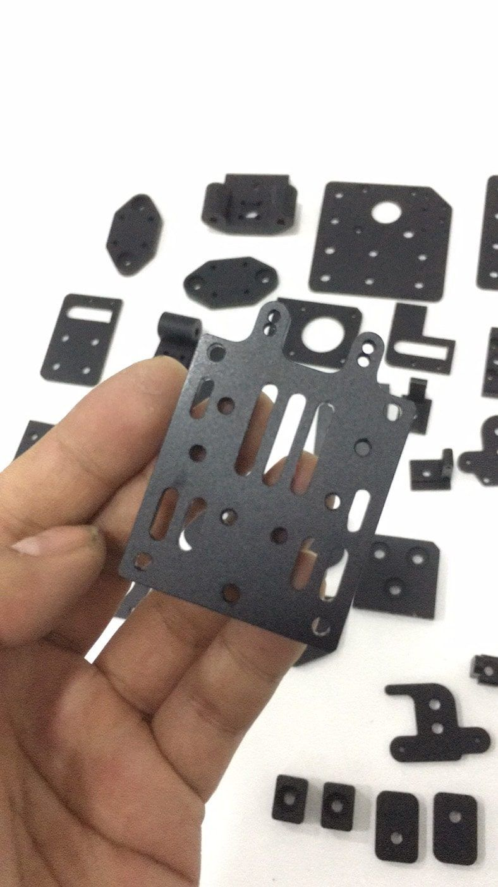

[← All updates](index.md){ .back-link }

# Prototype metal parts

small update about the BLV mgn Cube metal parts that i designed. They finished making the prototype + black anodized. before shipping it to me for testing, they sent me these pictures.

**update** They forgot making a 0.6mm high accuracy washers, it adds 2-3 days delay.

### Hope to test it soon

It's an aluminum CNC machined parts, most of them are flat plates, so it would be cheaper to make.  
The parts supposed to be light weight yet very strong. as I told before, I gave them the files for  
free in condition to make it cheaper for us - according to the manufacturer, the final price should be around 109$ including shipping.  
Please mind that I only designed it and i'm not the seller, nor have any business related to 3D printing.

**note**: The hands are not mine, these are pictures that was sent from the factory :)

Promise to update you as soon as i will get the Parts.

Feel free to leave a comment and share your thoughts about it.

Ben.l
