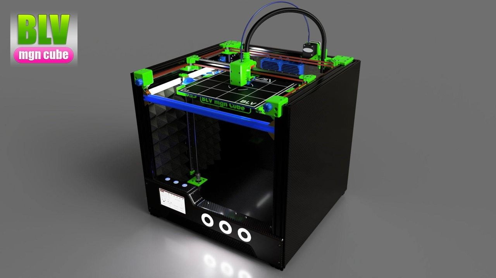
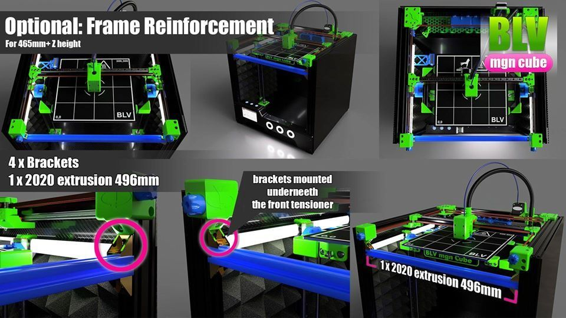
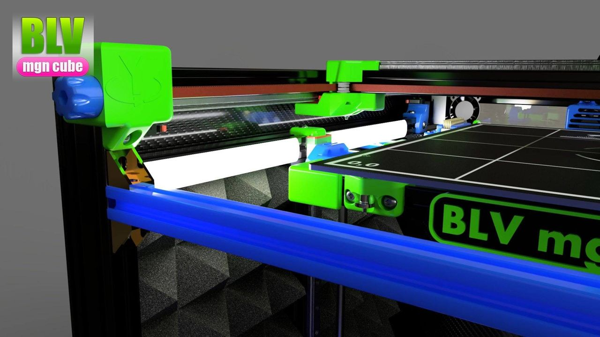
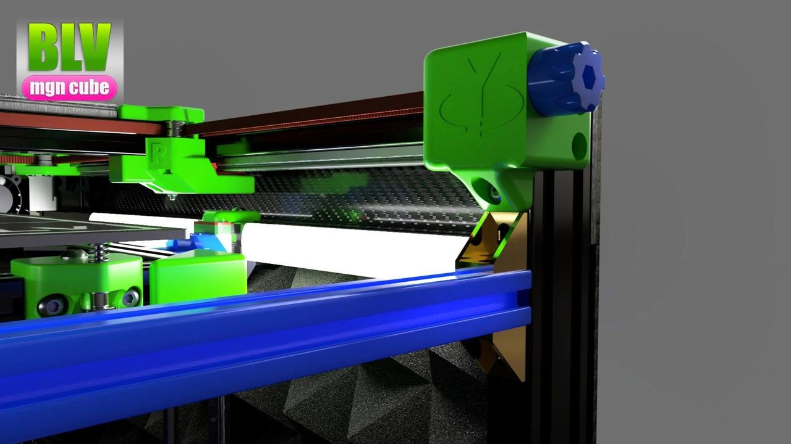
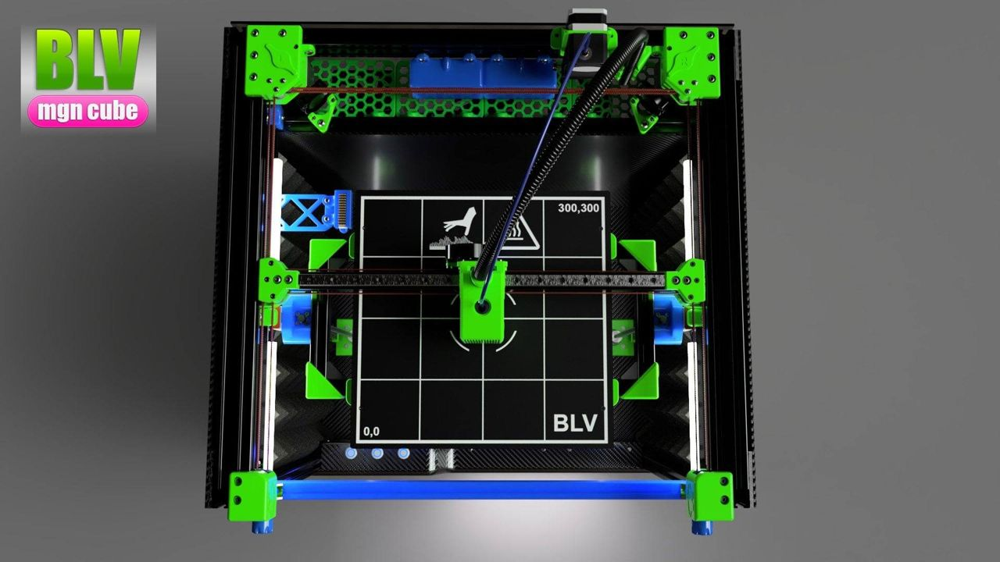
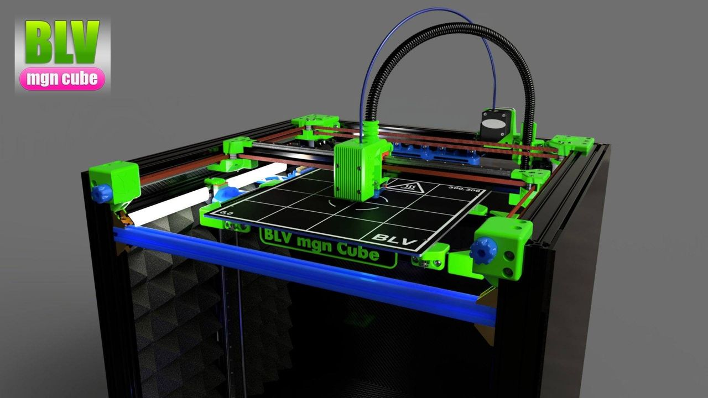

[← All updates](index.md){ .back-link }

# Reinforcement for a higher Z axis

If you have a build with higher Z-axis like 465mm+ You can add (optional) a reinforcement to X by adding:

1. 1 x 496mm 2020 aluminum extrusion profile
2. 4 x corner brackets the upper brackets can be placed underneath the front tensioner.

