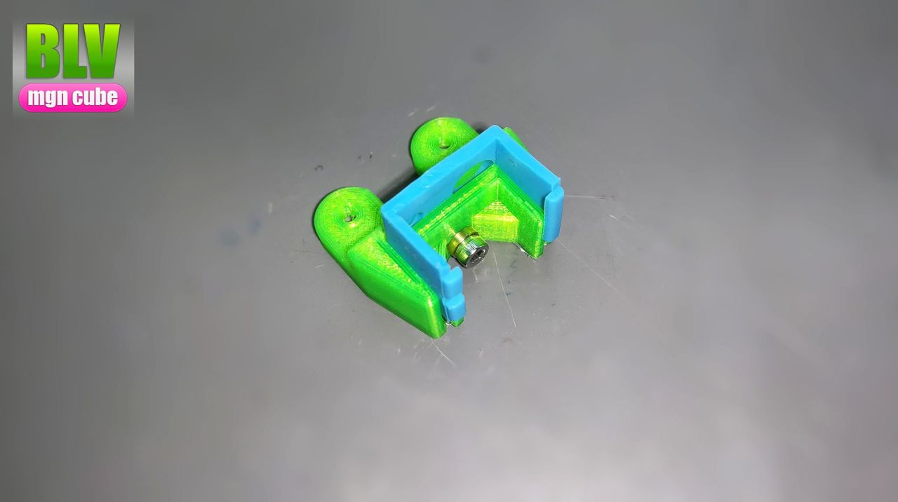
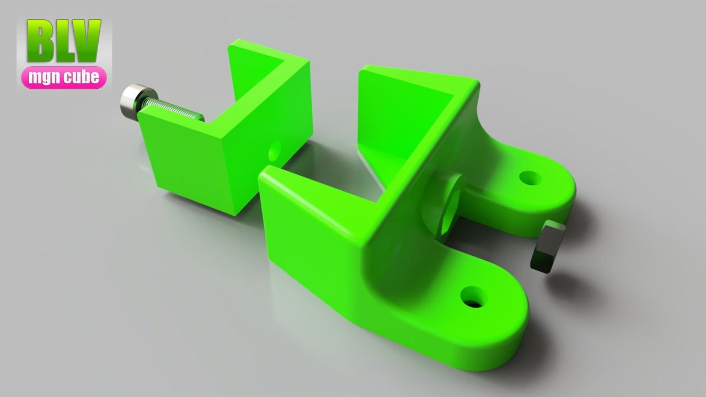
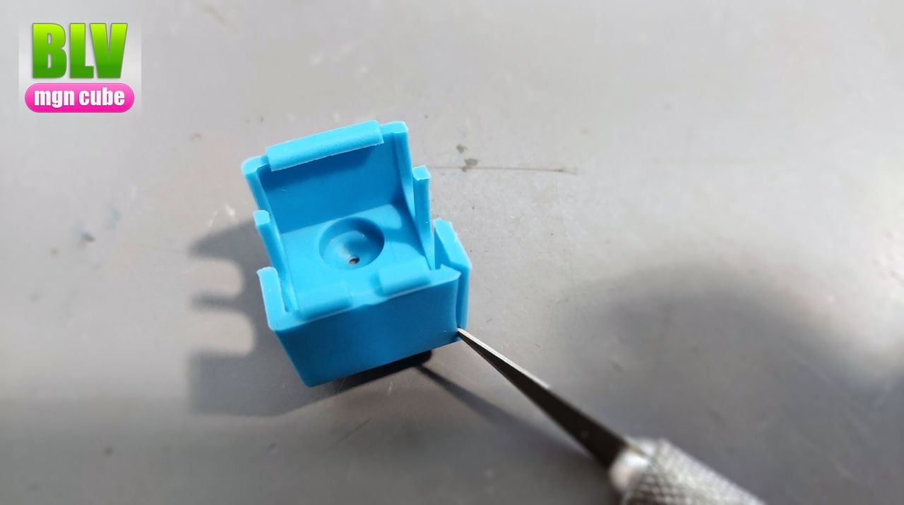
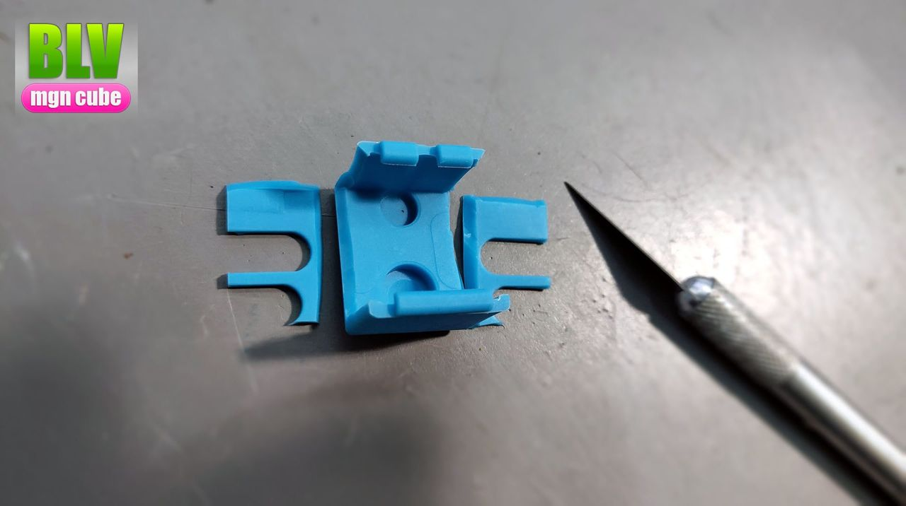
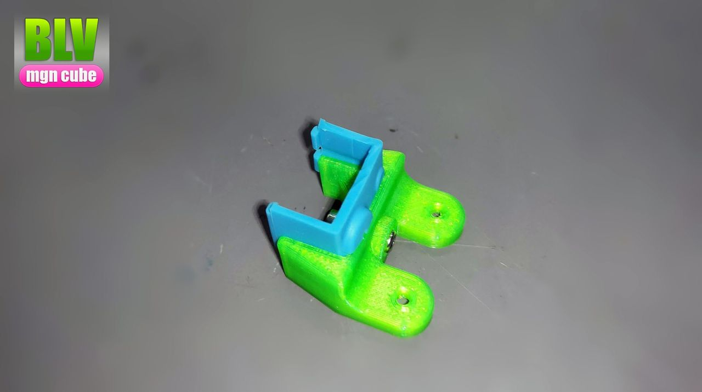
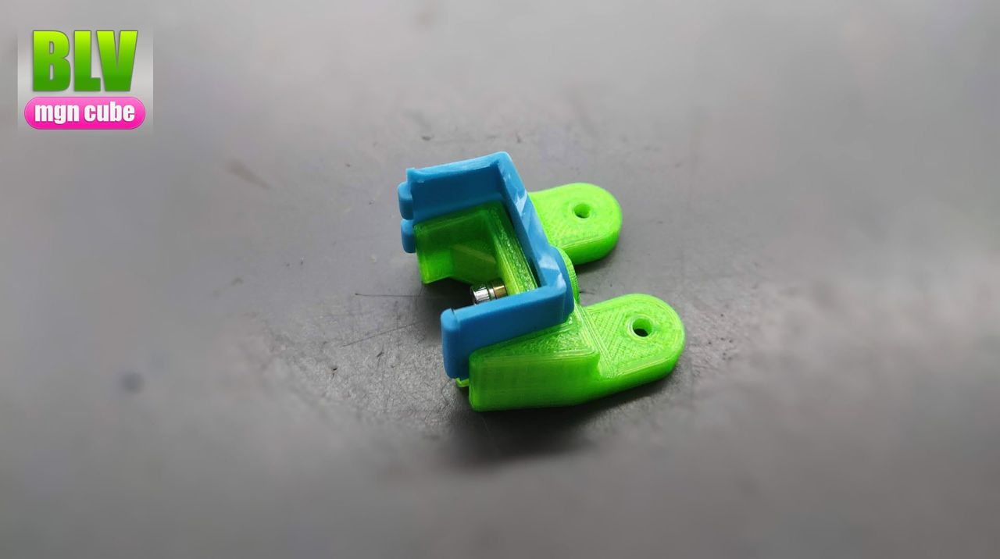
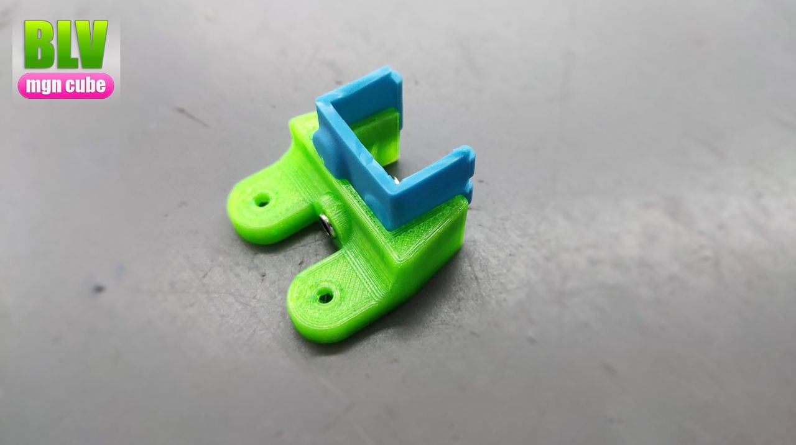
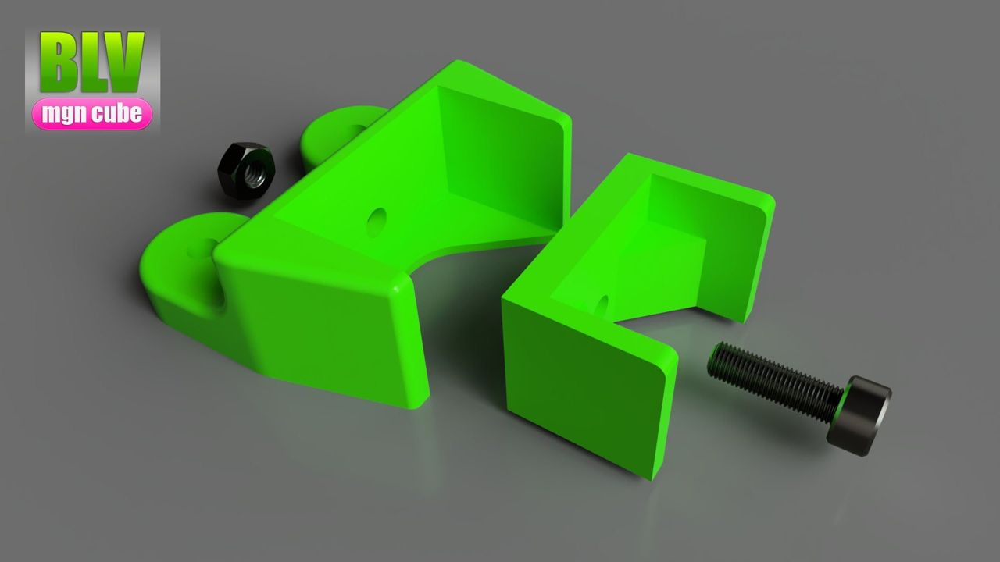
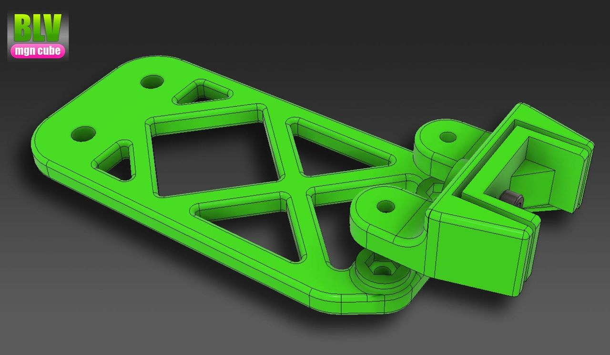
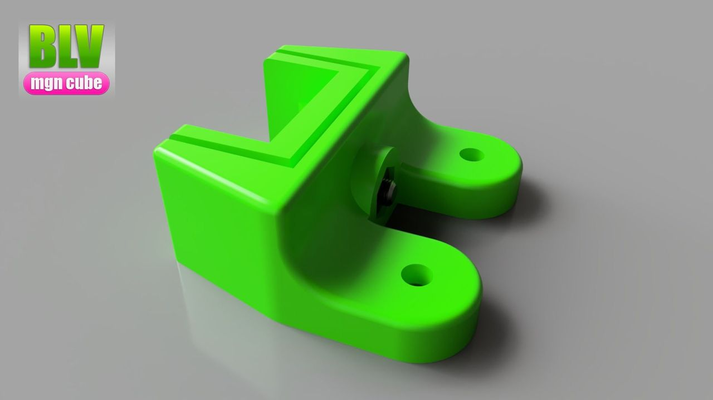

[← All updates](index.md){ .back-link }

# Silicone wiper and nozzle cleaner (beta)

After replacing my nozzle with Mellow's Ruby nozzle, I looked at the old nozzle under my lab microscope and found that the shape of its hole had been heavily damaged by the brass brush.

So the best solution is a silicone wiper, but it's pretty difficult to find one that is available to anyone, anywhere. Oh wait, we do have one: the cheap, easy-to-find V6 hotend silicone sock. As far as I know, nobody has used it this way yet (please correct me if I'm wrong).

### How to make it

- Grab a V6 silicone sock and cut it as shown in the pictures.
- Insert it into place and lock the two parts together with an M3x10 screw and an M3 nut.
- Install it with the original cleaner mount.

The files are available in the BLV mgn Cube 3D printer project files. I hope you like it.

