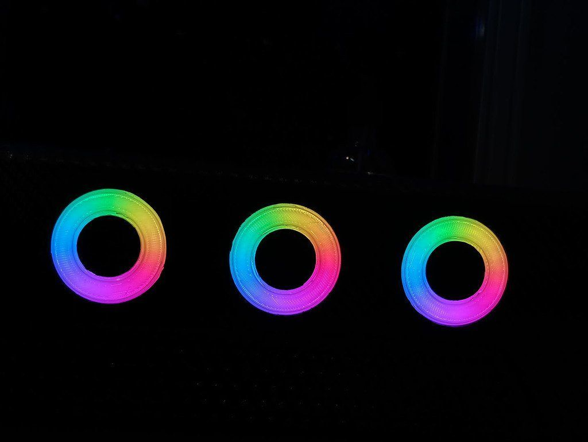

[← All updates](index.md){ .back-link }

# Static Neopixel animation

For those who are looking for a nice static animation without the board feedback,

i have found a really nice [**Neopixel generator tool**](https://adrianotiger.github.io/Neopixel-Effect-Generator/) that actually works with 3 neopixels rings:  
Just hit the "Add Led Strip" button, click on it and change the Arduino pin and led count to 16. then select and add loops and animations...

