[← All updates](index.md){ .back-link }

# The prototype metal parts are here

What a wonderful evening 🤩

After 2.5 years of waiting we finally got our new apartment. The plan was to assemble a new BLV mgn Cube 3d printer, using the new Metal parts in our new home.

Due to some issues with the contractor, we had a few awful weeks. Full of frustration 🥺. Then...a light shines out of the darkness - I came back home today and found a small box from my dear friend Peter. All the new prototype parts were inside, making me smile for the first time in the last two weeks ☺️.

although I am having pretty crazy days, preparing and packing all our stuff, I will make every effort to build the printer and test the parts.  
Now, more details about the parts: as was mentioned before, I designed it to be cheap to make, using CNC machined aluminum plates. lightweight design yet very strong. The anodized parts are gorgeous! amazing quality that I really liked. I found a small problem already (the factory drilled two oval shapes instead of hex shape as the original file was) but it will be fixed.  
In the meantime, here are few pictures of the parts ☺️

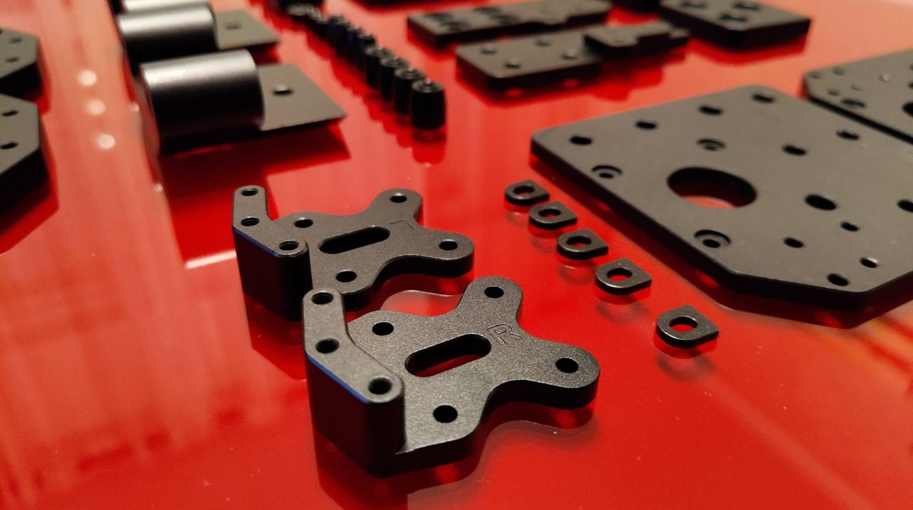
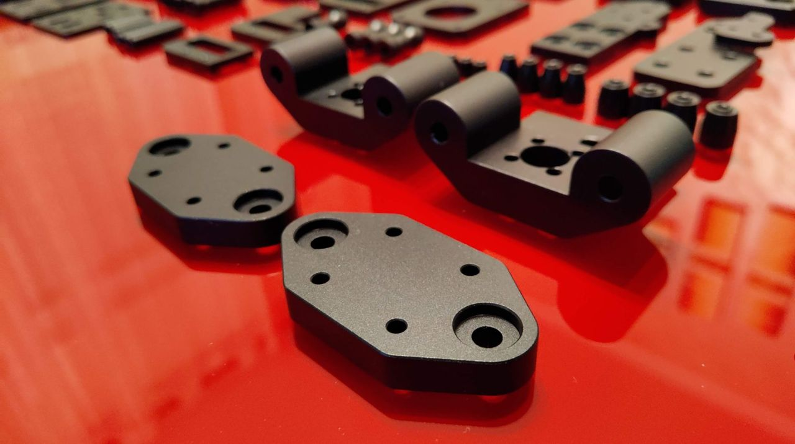
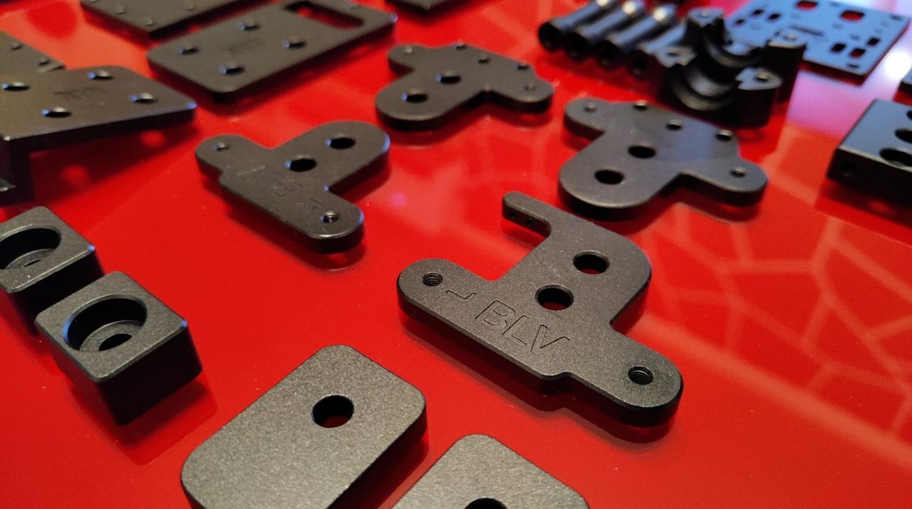
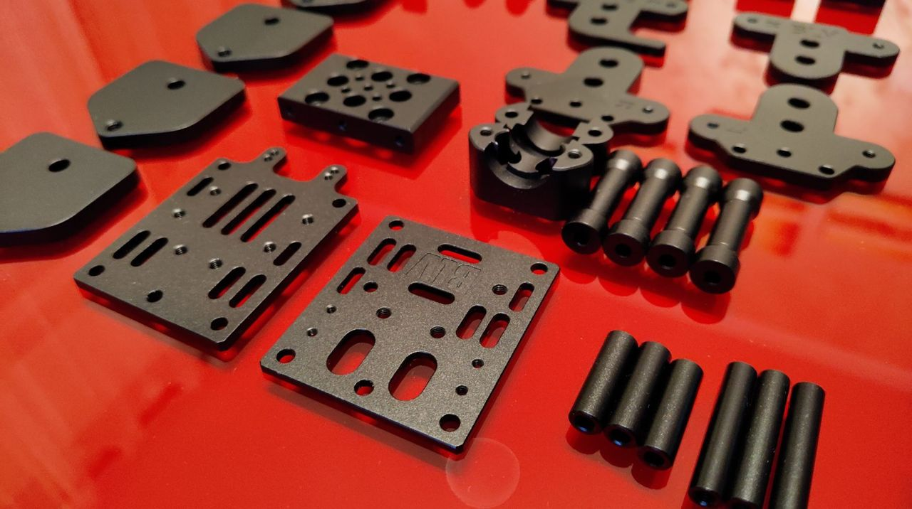

source: [my Facebook post](https://www.facebook.com/groups/BenLevi/permalink/620665691994304/)

### z

I couldn't resist and started putting all together. as expected, some minor changes must be done, I found a need to add side markers in order to make it easier to assemble, including adding an alignment shape of most of the parts. overall, it seems to be a good prototype and a good base for a final project.

The parts I have assembled:

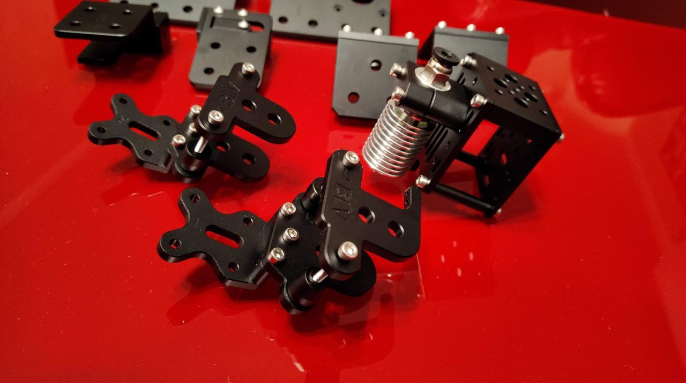
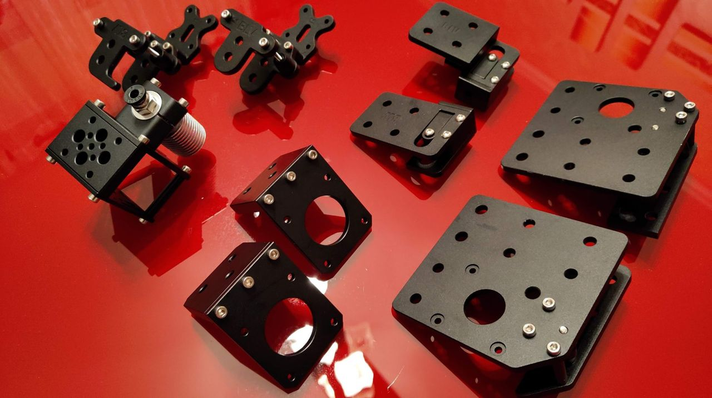

a long time ago I bought a second [kit from Blurolls store](http://s.click.aliexpress.com/e/cmcYPkdE) that lay in the storage. considering I already assembled the metal parts the best possible option was to install it on a brand new BLV mgn Cube printer. 4 hours later, the frame had almost completed and I immediately installed the metal parts. All parts went into place as planned, but a few mistakes in the production process required me to immediately fix the front tensioner parts - after all, it's a prototype and that's the reason I'm not letting anyone have it yet - only after it will be fully tested and optimized for you. The quality of the parts is amazing (Thank you Peter). parts are accurate and well anodize, yet some of the parts had to be manually tapped (they forgot tapping some of the holes) but it's ok. next, I'll have t install the bed /z-axis components and keep you updated. I am adding a few pictures of it. please mind that the look of the parts may be changed on the final project.

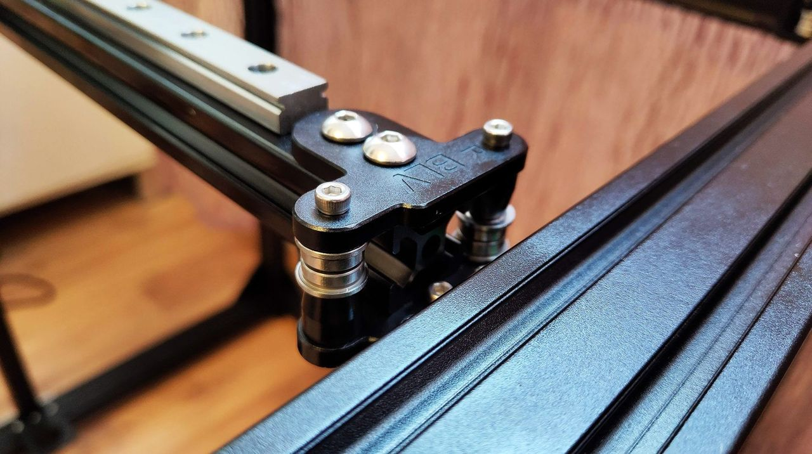
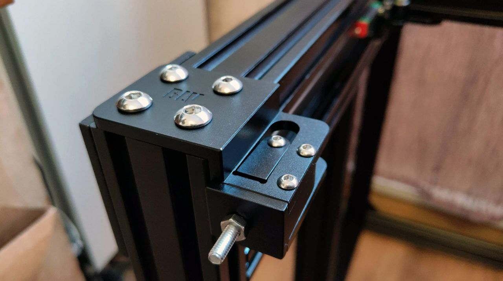
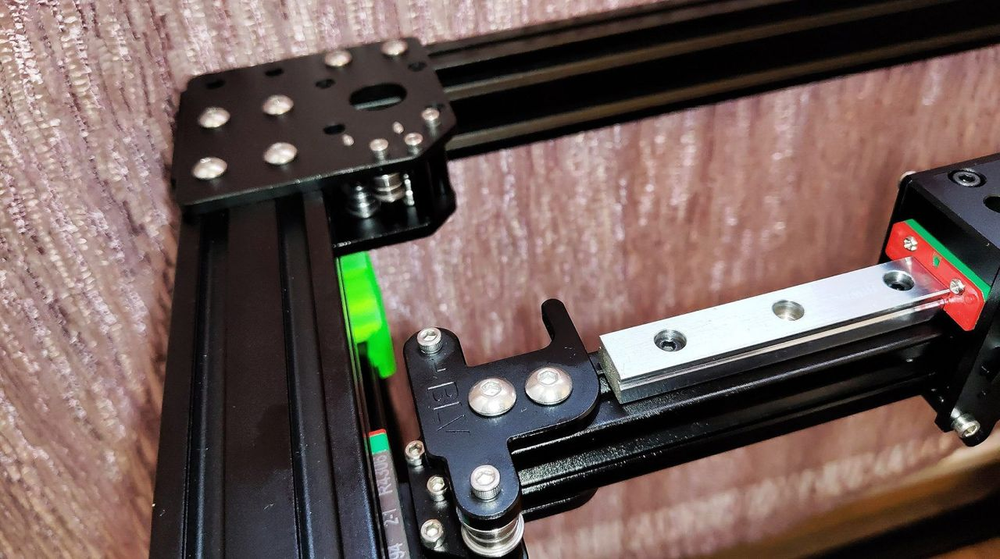
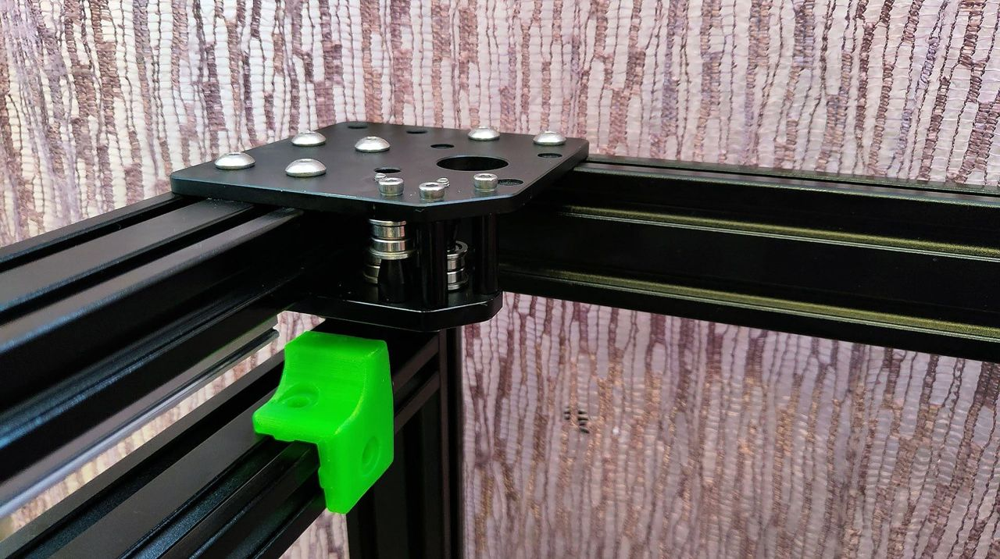
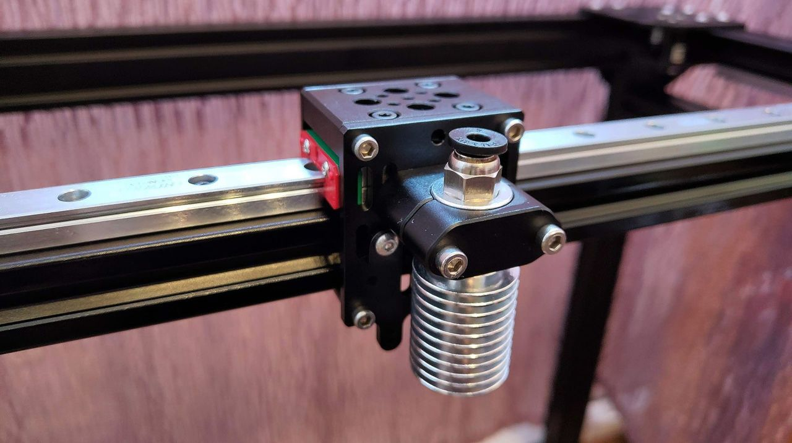
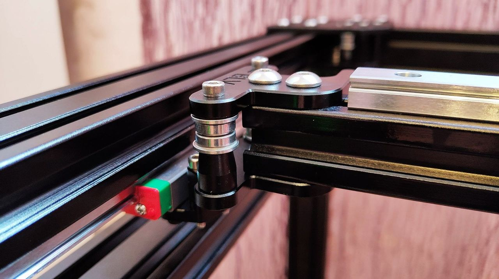
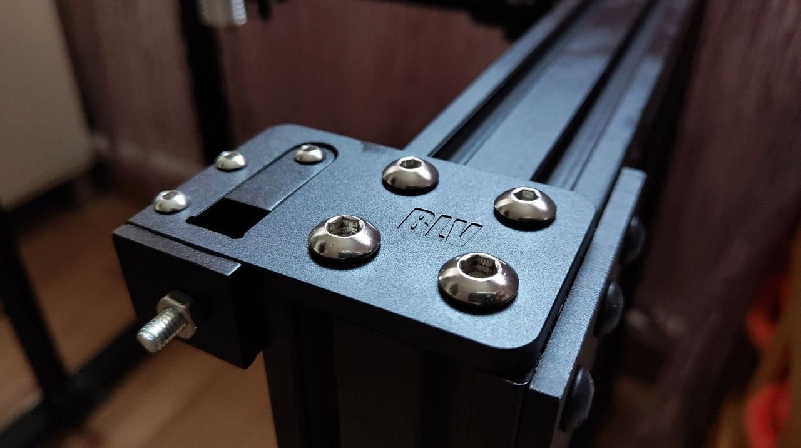

