[← All updates](index.md){ .back-link }

# The Singing Serpent print sample

!yt exeUR__tco8 | Printing with gold silk PLA

Today I printed the "Adalinda: The Singing Serpent"  
and i made a video + a few photos  
Printed with Gold Silk  
195C/60C  
60 mm/s  
without support.  
Model: Adalinda [The Singing Serpent](https://www.thingiverse.com/thing:246198)

Filament I used: NOULEI Gold Silk PLA: [**Link**](http://s.click.aliexpress.com/e/bgV8dvqu)

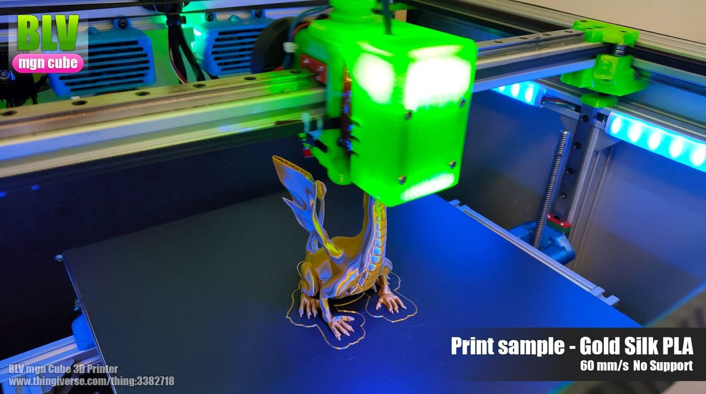
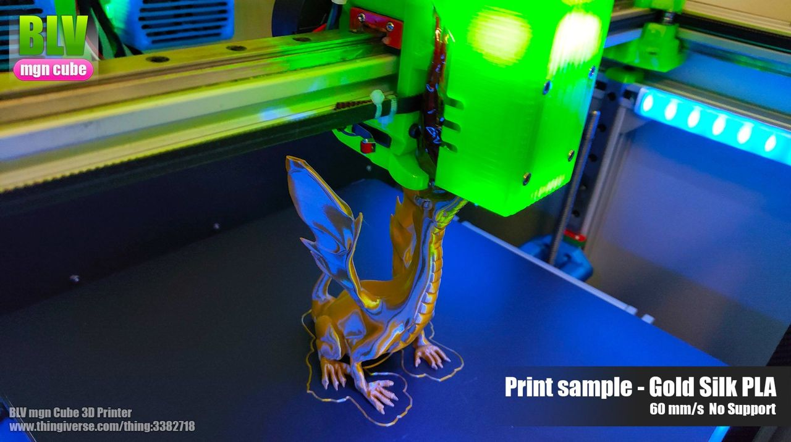
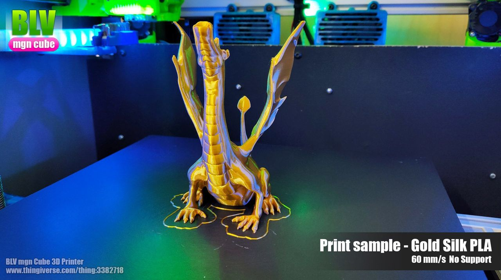
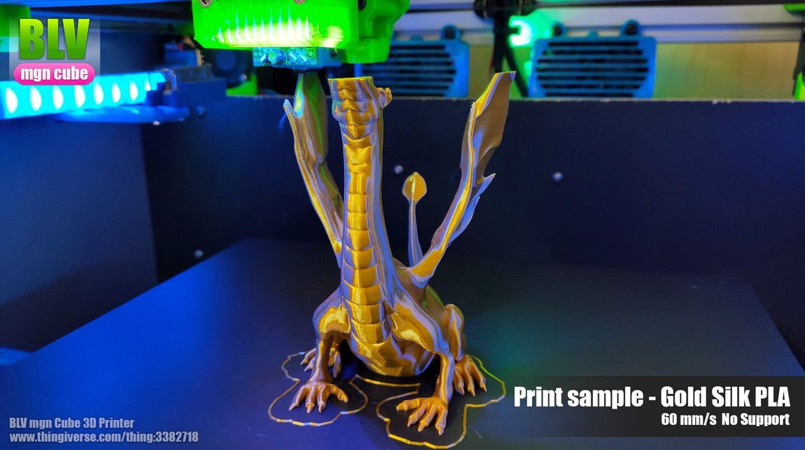
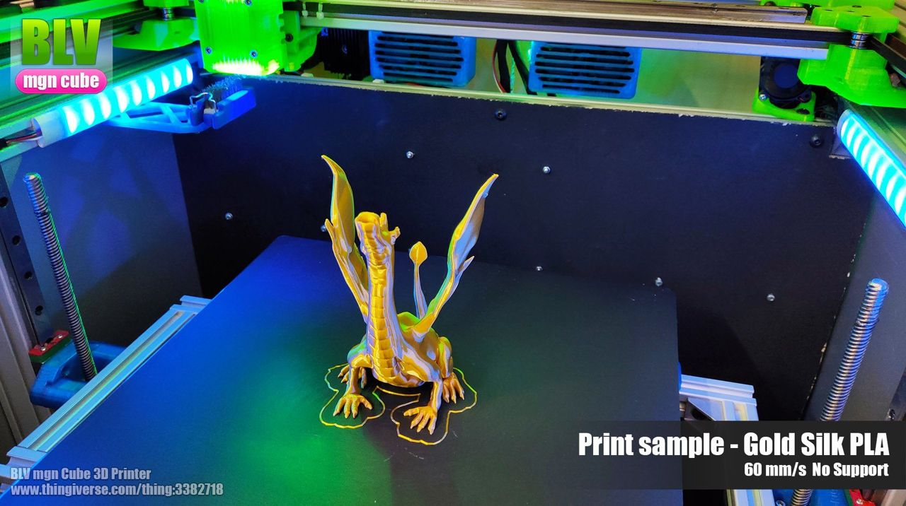
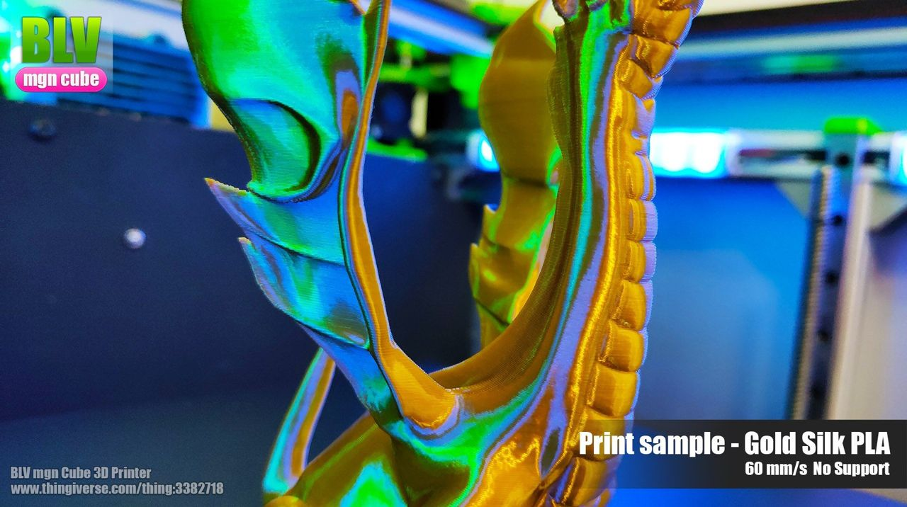
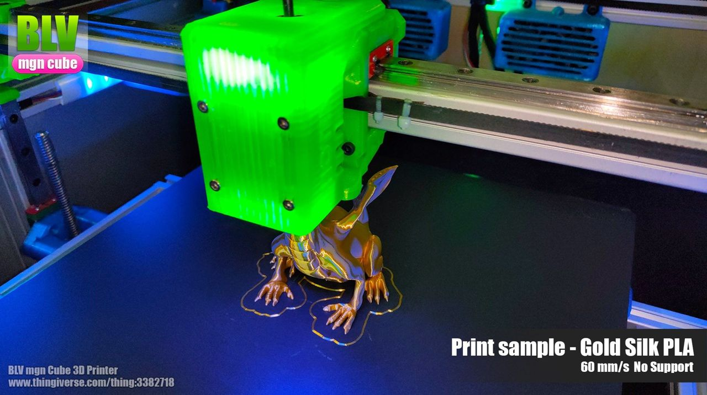
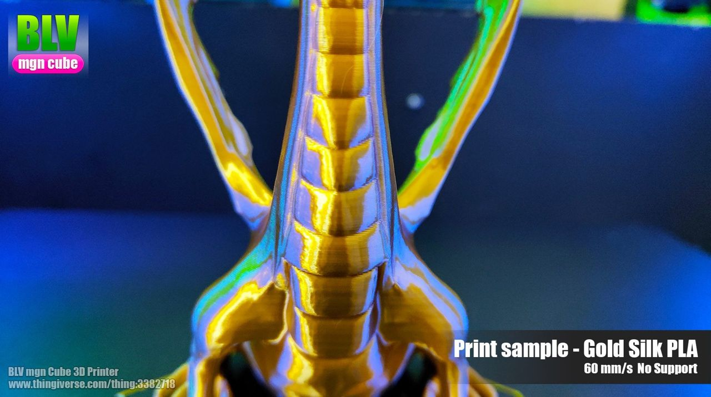
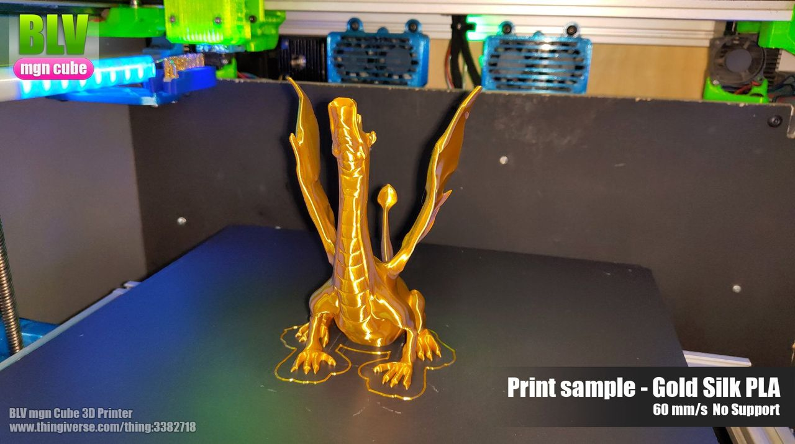
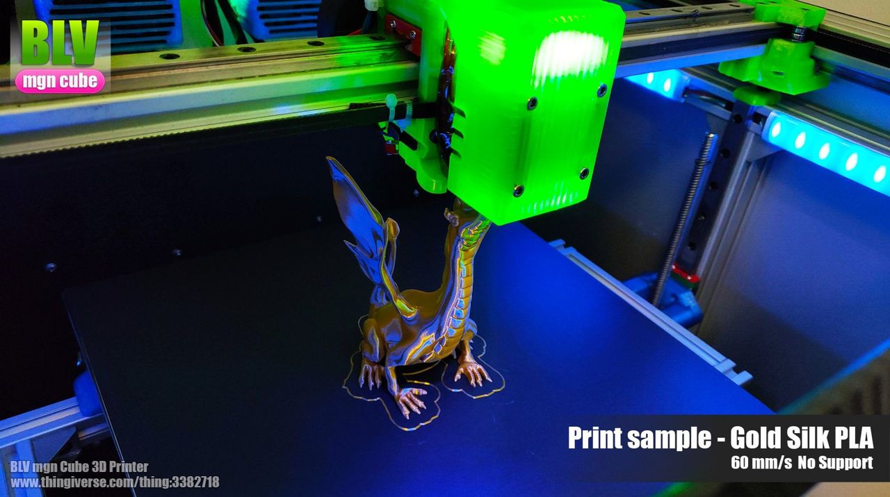
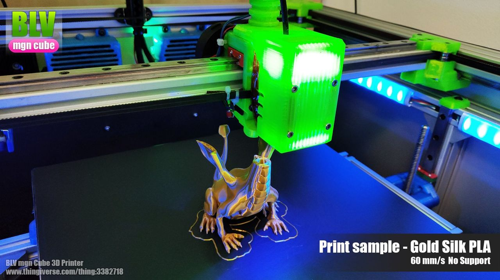
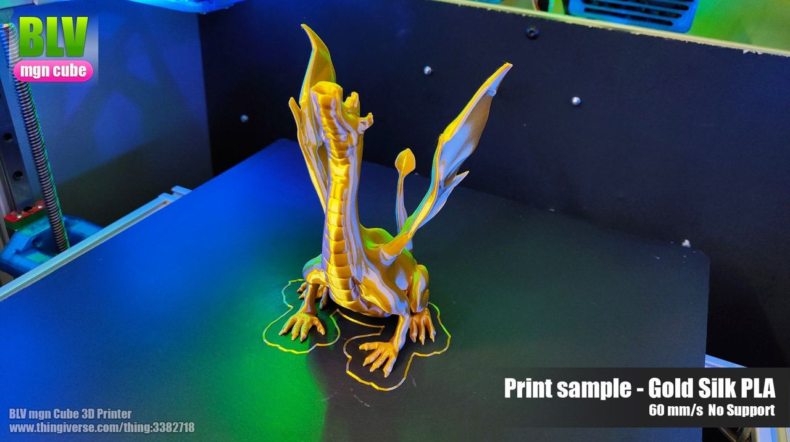

