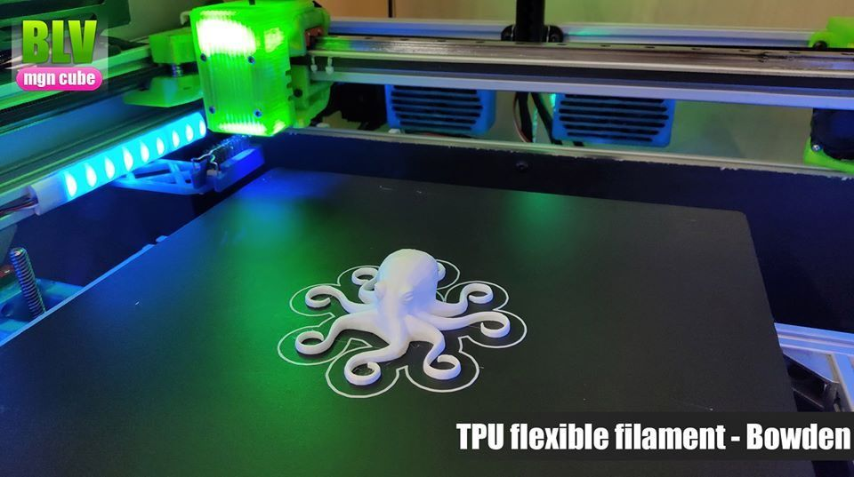
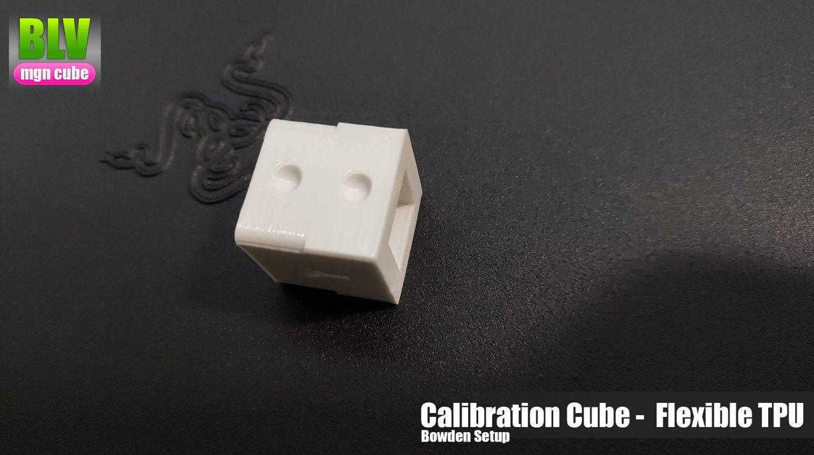
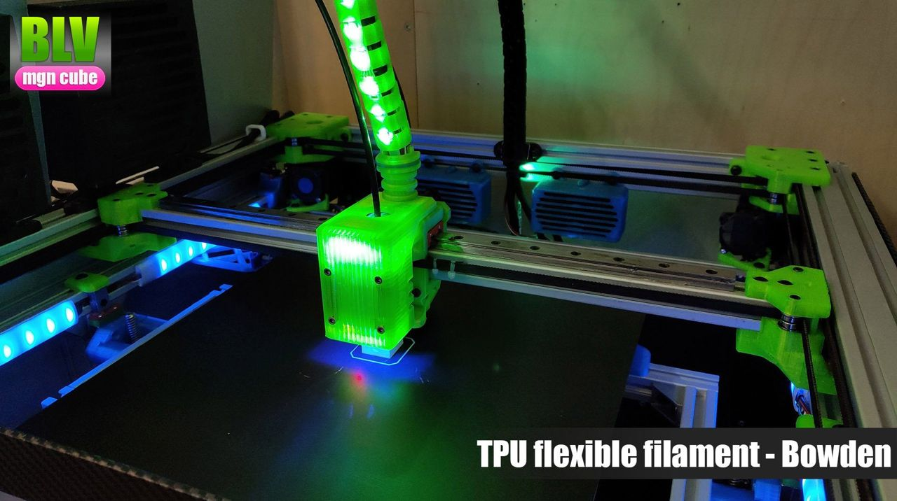
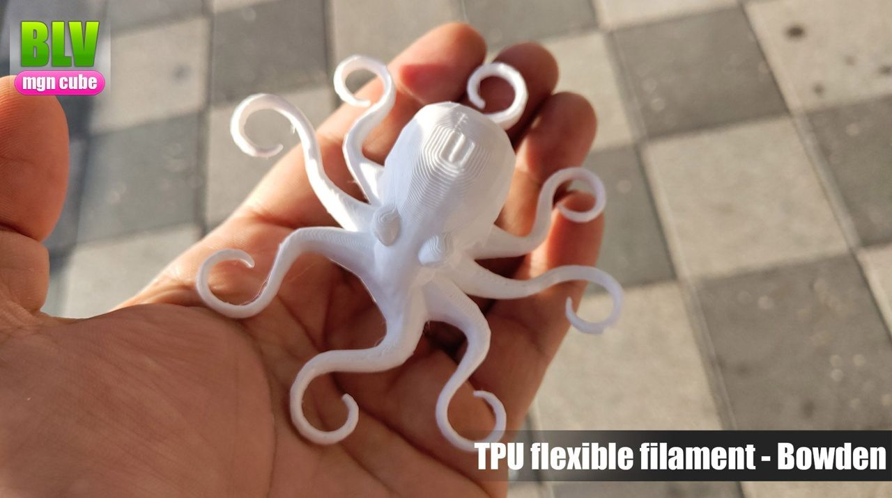
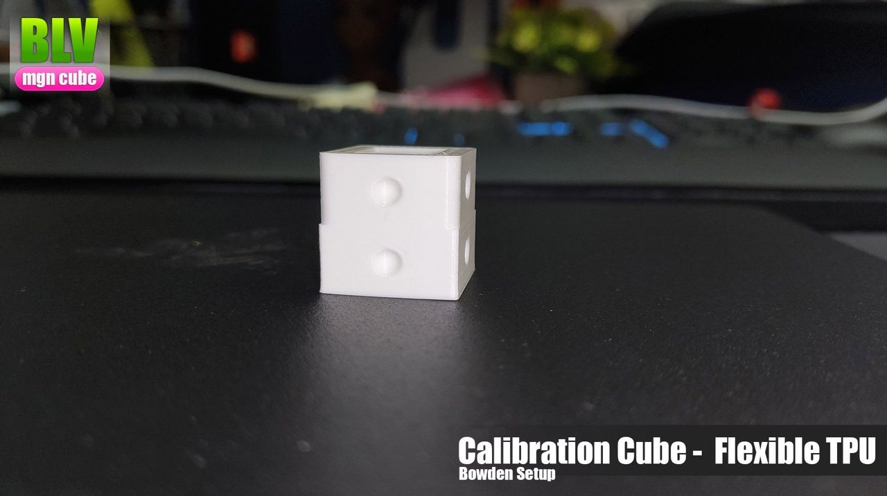
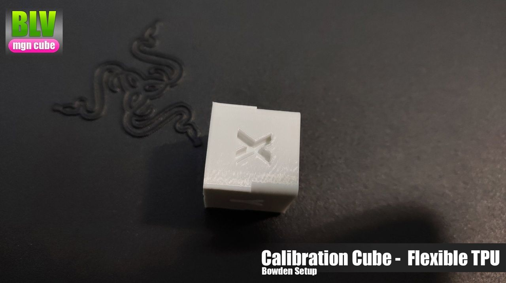
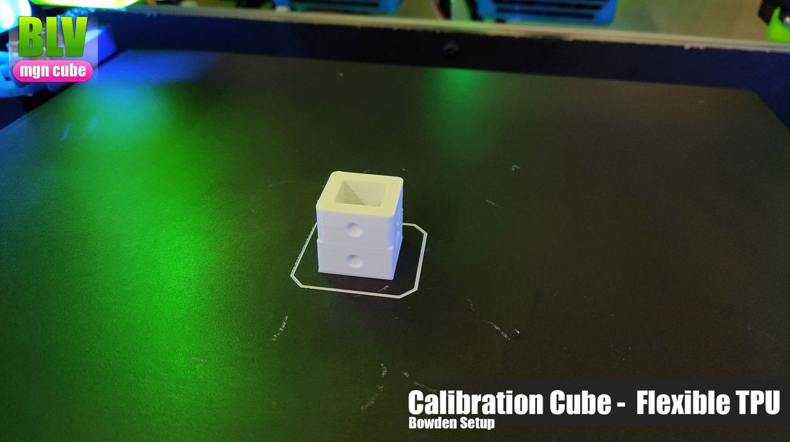
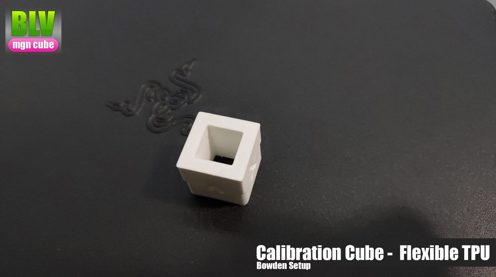

[← All updates](index.md){ .back-link }

# Printing TPU on the BLV mgn Cube

### Flexible material

!yt LhgKHLzi2Hk

I tried to print TPU (flexible) filament with my Bowden setup. It came out not bad, considering my Bowden tube is about 65cm long. I used an unbranded **TPU** that I bought locally and a BMG clone extruder. Most importantly, the hand isn't mine. I asked a friend to hold it :)

My settings:

- Hotend: 200°C
- Bed: 60°C
- Speed: 30 mm/s
- Retraction, wipe and coast: all disabled

