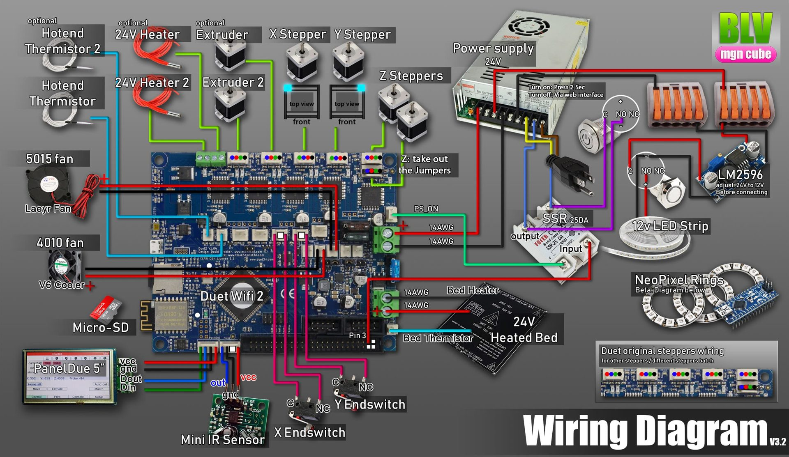
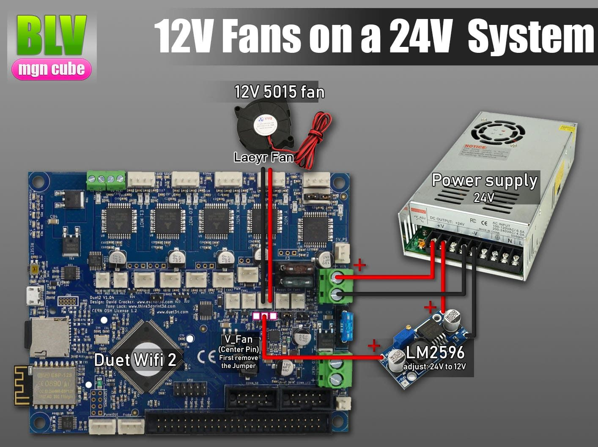
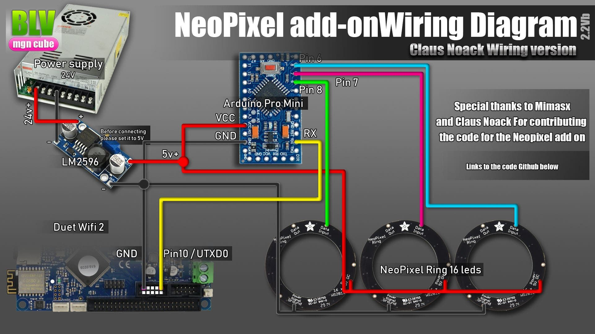
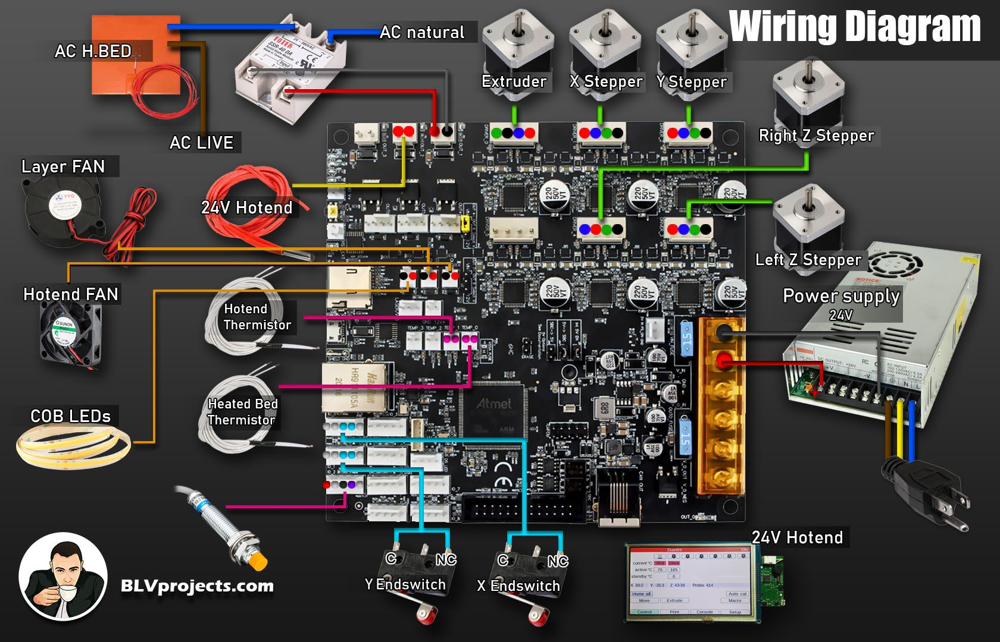
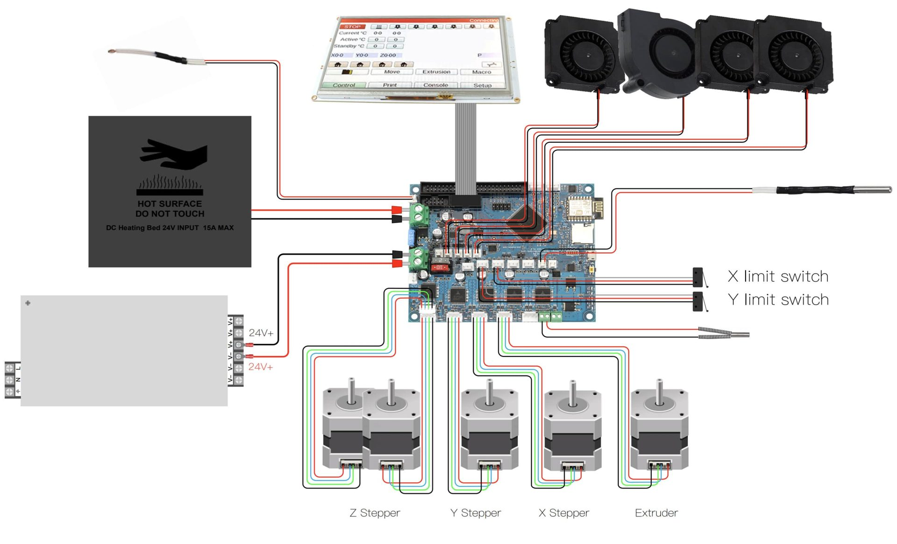
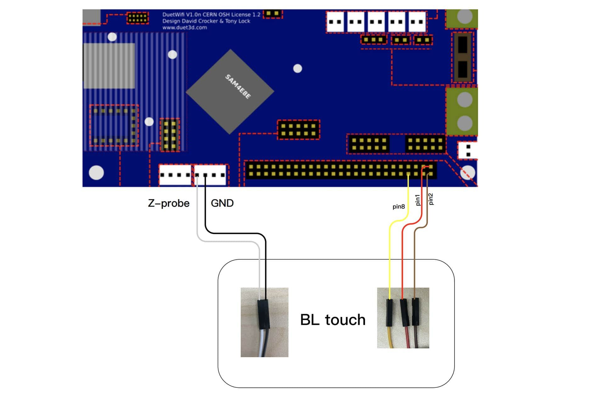
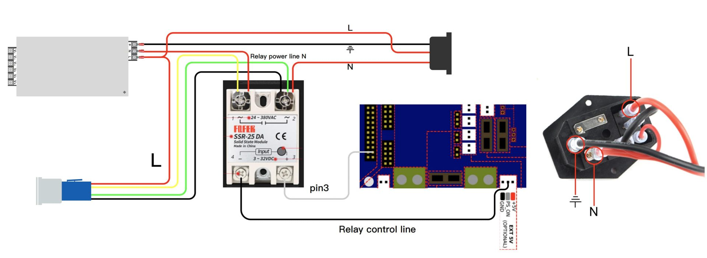
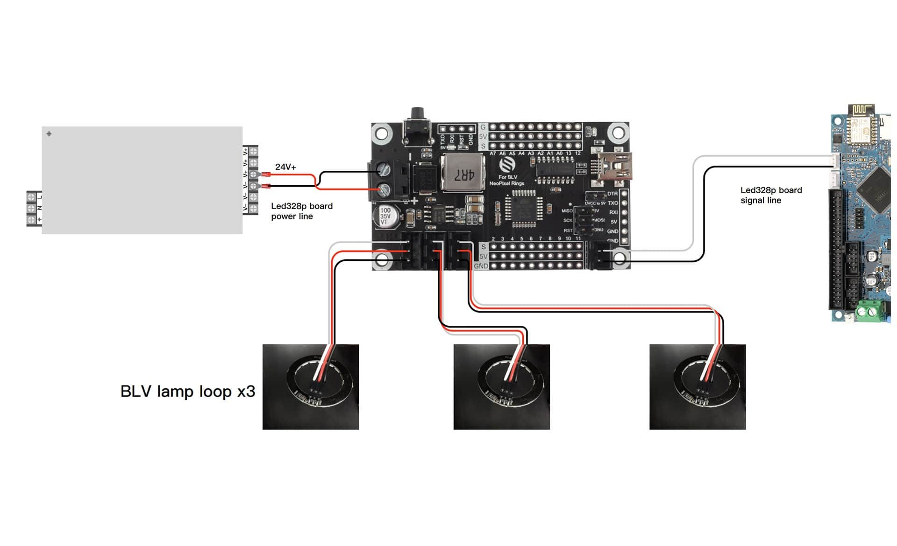

# Wiring

Wiring is a critical step, so double check every wire. It usually takes about 3 hours. With the FYSETC parts set it takes about an hour, since that set came with an optimized diagram, ready-made labeled cables with plugs, stepper wires in the correct order and a plug-and-play PCB for the Neopixel rings. **Follow the diagram that matches your setup.**

!!! warning "Before you start"
    - Wire the printer with the AC plug **disconnected**.
    - Crimp every cable that goes into the power supply.
    - Don't mix negative and positive wires.
    - Double check every wire.

Click a diagram to enlarge it.

=== "Duet 2 WiFi"

    

    **12V fans on a 24V system.** If your fans are rated for 12V, wire them like this to avoid damaging the board or the fans:

    { width="560" }

    **Neopixel rings.** The rings on the front panel show the printer status with animations.

    { width="560" }

    Arduino code for the rings:

    - [Latest code by Claus Noack](https://github.com/mule1972/NeoPixelBLVmgn), confirmed working
    - [First alpha version by Mimasx](https://github.com/mimasx/BLV_NeoPixelIntegration)

=== "Duet 3 6HC"

    Wiring diagram for the Duet 3 board:

    

=== "FYSETC parts set"

    **Optimized wiring for the FYSETC parts set:**

    

    **BLTouch.** The FYSETC set uses a BLTouch auto-leveling sensor:

    { width="560" }

    **Power button with relay module:**

    { width="560" }

    **FYSETC BLV Neopixel module.** A 5-minute install. The cables are ready, the rings come with soldered pins, and the 2-pin and 3-pin plugs only fit one way.

    { width="560" }

