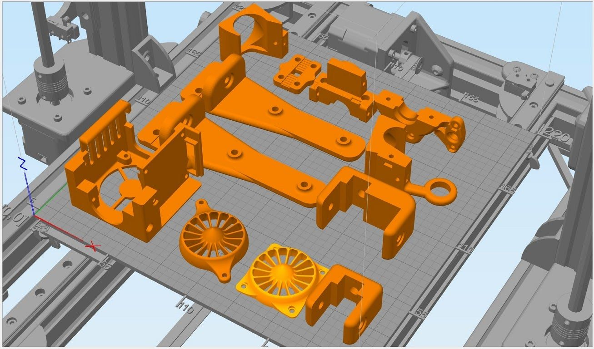
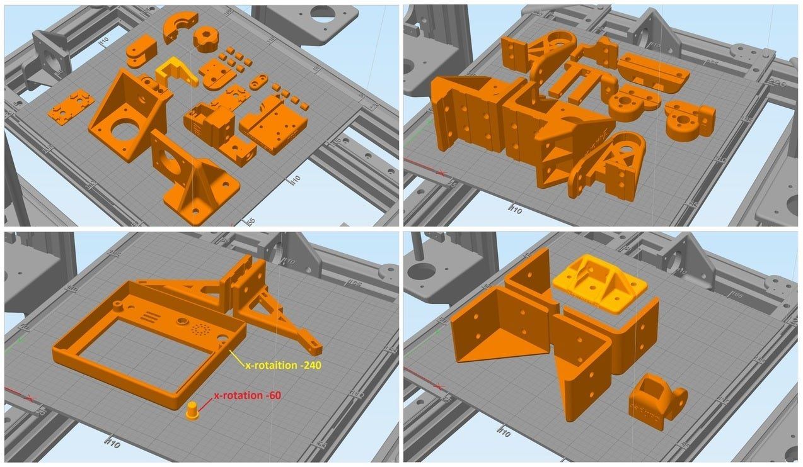
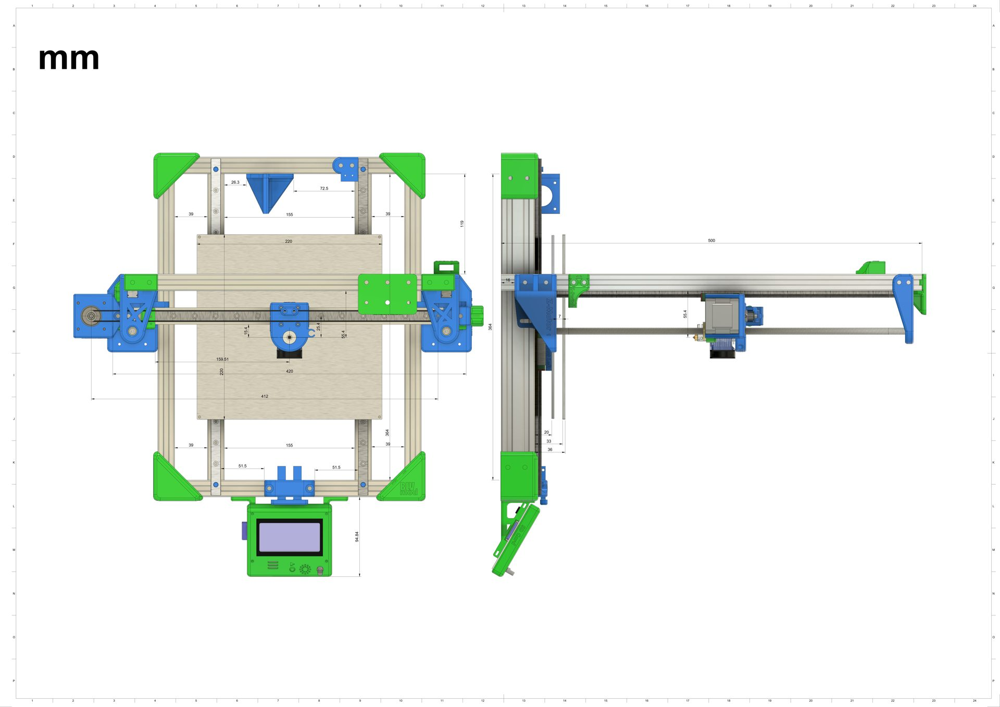
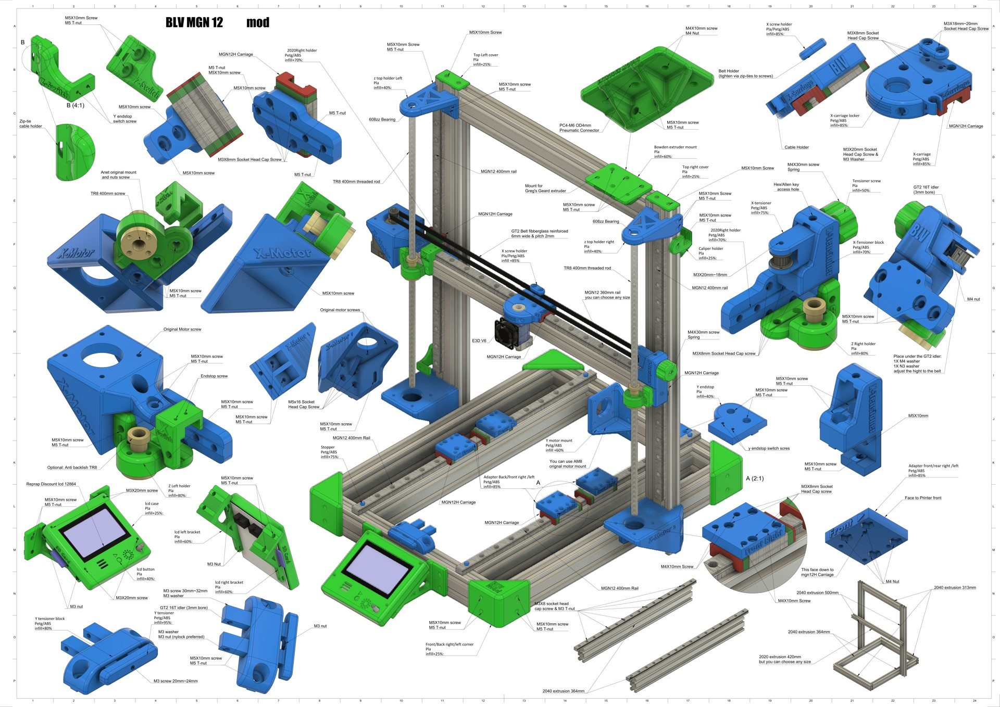
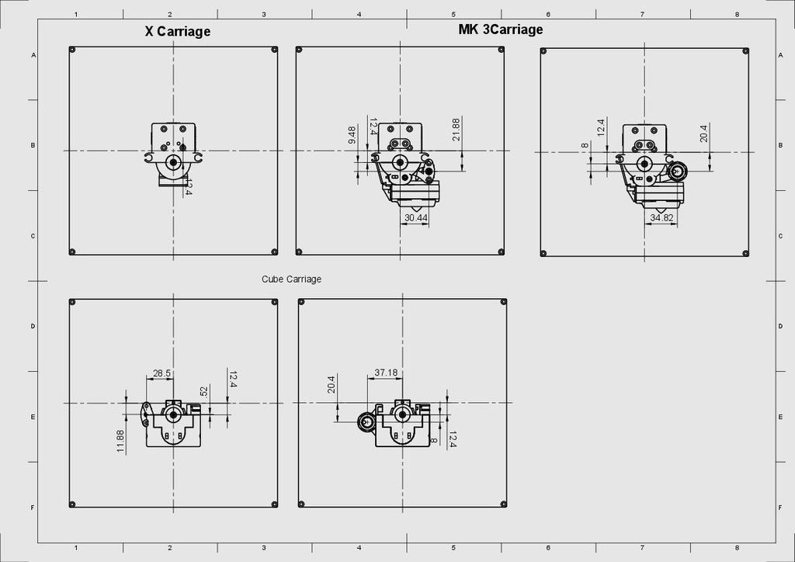

# Print & assemble

## What to print

**From the [BLV mgn12 mod](https://www.thingiverse.com/thing:2567757) project**, print everything except these optional parts:

- **Y motor mount**, only if you don't have the AM8 Y motor mount
- **Top Z holders** (anti Z-wobble). They may limit the Z height and are usually not needed.
- **Caliper holder**, only if you have a digital metal caliper
- **LCD case and brackets**, only with a RepRap Discount LCD 12864. Otherwise use the original AM8 LCD case and brackets.

**From the [AM8](https://www.thingiverse.com/thing:2263216):**

| Qty | Part | Note |
| ---: | --- | --- |
| 1 | 1_LCD_Base_Left | only with the original Anet A8 LCD |
| 1 | 1_LCD_Base_Right | only with the original Anet A8 LCD |
| 1 | 1_LCD_Case_Top | only with the original Anet A8 LCD |
| 1 | 1_PSU_Mount | for the original Anet PSU |
| 1 | 1_Wire_Holder | |
| 2 | 2_Bottom_Tee_Plate | |
| 2 | 2_Top_Corner_Plate | |
| 4 | 4_Bottom_Corner_Plate | |
| 1 | Anet_Board_Mount__With_Fan **or** Anet_Board_Mount_No_Fan | skip if you use the electronics box |

**Material and infill.** The PDF **BLV mgn12 mod.pdf** in the project ZIP lists the name, material and infill of every part.

**Orientation.** Print orientation has a large effect on the strength of the parts. The pictures show how to orient each part.

!!! warning
    Calibrate your printer before printing the parts. Dimensional accuracy is critical.

## Assembly

1. **Frame.** Assemble the frame extrusions according to Pheneeny's [AM8 mod files](https://www.thingiverse.com/thing:2263216), which include his detailed assembly guide.
2. **BLV mgn12 mod.** Follow the assembly instructions in the project ZIP. **BLV mgn12 mod.pdf** has a sketch with all the main parts.
3. **Video.** The [assembly video](https://youtu.be/inuvmbNgY5Y) shows the bed adapters, X axis parts, Cube carriage and V6 carriage. The video mentions a 5010 blower fan, but the correct fan is a **5015**.

!yt inuvmbNgY5Y | BLV mgn12 mod assembly

!!! note
    You may need to re-center the hotend and bed coordinates in the Marlin configuration.

## More info

- [Greg's geared extruder](https://www.thingiverse.com/thing:18379)
- [Simplify3D build plate for this project](https://www.thingiverse.com/thing:2598588)
- [Radial fan fang (including sensor adapters)](https://www.thingiverse.com/thing:2175956)
- [CPT_Spekkie AM8 electronics case](https://www.thingiverse.com/thing:2330654)
- [Devin's knob with a fine-tuning dial](https://www.myminifactory.com/object/44169)
- [PapaJohn88's mount for the Anet A6 LCD](https://www.thingiverse.com/thing:2382917) (recommended by artistebot)
- [Handle for AM8](https://www.thingiverse.com/thing:2409747)
- Green PVC electrical tube for the extruder wires, 13 mm (1/2"), also called "split wire loom". It is sold in electrical shops and [online here](https://www.aliexpress.com/wholesale?catId=0&initiative_id=SB_20180712230700&SearchText=Split+Wire+Loom) [or here](https://www.amazon.com/s/ref=nb_sb_noss?url=search-alias%3Dtools&field-keywords=Split+Wire+Loom&tag=tv-auto-20)

## Rail tips

I started with [affordable MGN12H rails from AliExpress](http://s.click.aliexpress.com/e/b4ZT5JAu) at about $18 each. After buying from four different sellers, I found the best value at the [CNA Mechanical Parts Store](http://s.click.aliexpress.com/e/b4ZT5JAu). Their carriages slide smoothly straight out of the box, with no cleaning needed. For higher quality at a reasonable price, the [HIWIN rail set](http://s.click.aliexpress.com/e/cTl59jr2) is excellent.

!!! danger "Sellers to avoid"
    Avoid **RDC Official Store** and **linkcnc Store** on AliExpress. linkcnc sent me a used, damaged rail that was shorter than ordered and stayed stuck even after cleaning. RDC started shipping carriages that don't match the MGN standard.

**Cleaning and lubrication.** New rails usually feel rough because they are coated with a protective oil at the factory. Clean it off (several YouTube videos show how to clean the carriage with WD-40), then lubricate the rails and carriages with sewing machine oil or a PTFE silicone grease. These are miniature rails, so avoid thick grease. The goal is a smooth carriage without free play.

The [video below](http://www.youtube.com/watch?v=c53sa46C1qQ) shows the cleaning process well. Work over a container so you don't lose any steel balls. After reassembly there is room for one more ball, which is normal.

!yt c53sa46C1qQ | Tuning up cheap Chinese linear bearings

Mounting the rails takes patience. They must be perfectly straight and aligned, and rushing this step causes problems later.

!!! warning "Don't rely on the gravity test"
    Tilting a rail and watching the carriage slide down says nothing about its quality. A rail with too much free play passes easily and then fails every print quality test. The tolerance grade of the rail sets the friction of the carriage.
