[← All updates](index.md){ .back-link }

# BLV 3D printer enclosure: progress

**The project beta has been released to the public.**

I know many of you have been waiting for an update, so I can finally share it with you.

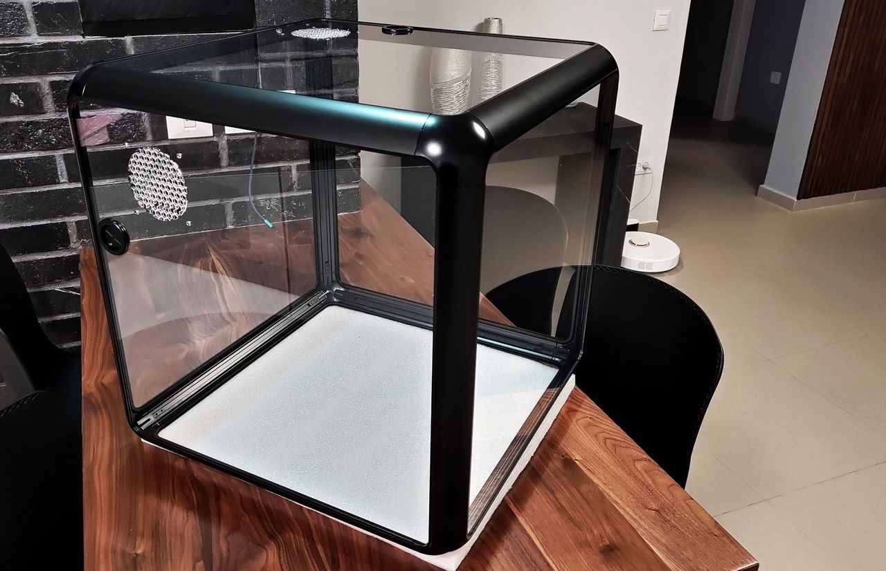

I [**announced on the BLV Facebook group**](https://www.facebook.com/groups/BenLevi/permalink/642793413114865/) that I had started developing a new universal extrusion system as part of the **affordable** BLV enclosure project, made for a wide range of 3D printers. The main reason I chose to develop the BLV enclosure is my dear wife. Our house is not that big, and as the number of printers grew, she thought they were really ugly and didn't suit the house. So I set out to create an enclosure with a modern, clean design, round lines and delicate contours. I have now received her official approval to place printers even in the living room 😍.

Designing a system like this requires experience in industrial design and production techniques, so the task was not easy. I wanted to create a reliable, modular system that is easy to assemble, affordable, and can be used with any 3D printer.

A small reminder of the original design concept sketch:

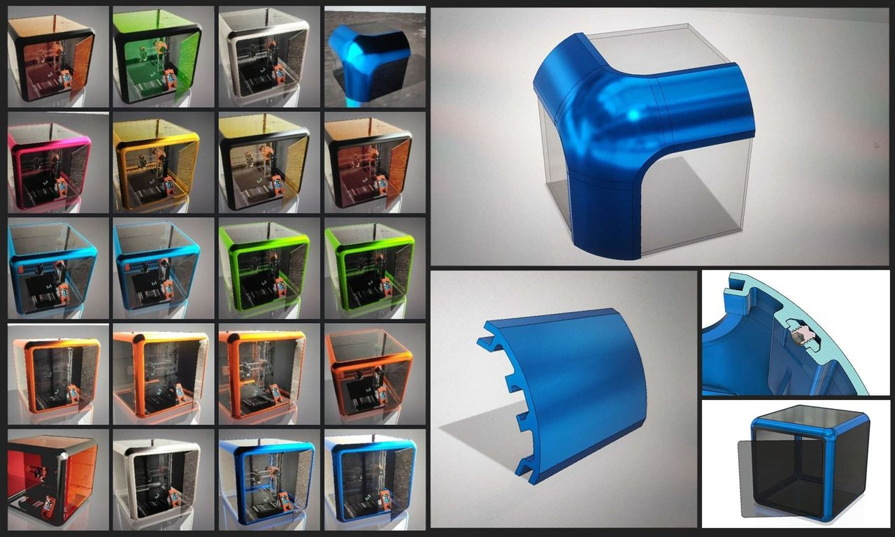

After hundreds of hours designing the new extrusion system and more than 12 different prototypes, I can finally reveal the progress of the BLV enclosure project. I received the latest version of the BLV enclosure prototype. The parts came in a heavy package, carefully wrapped in paper to protect them from damage during shipping. I was as excited as a little boy who had just received a birthday present.

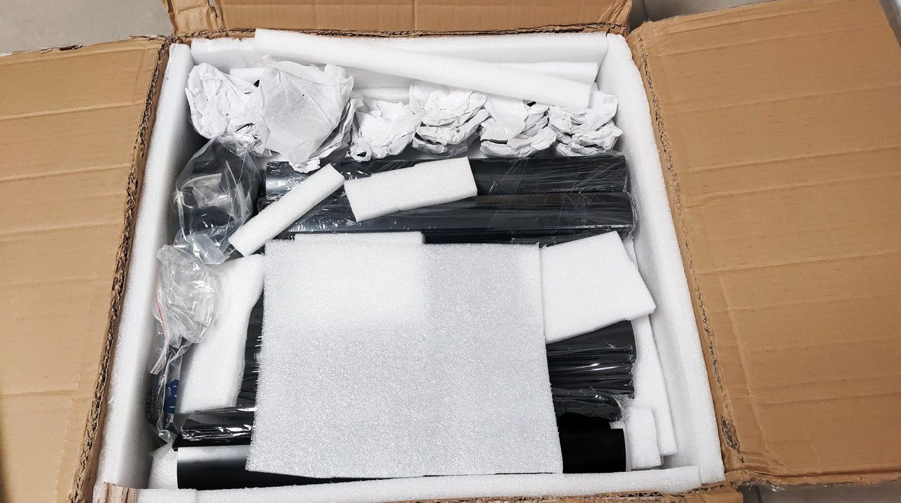
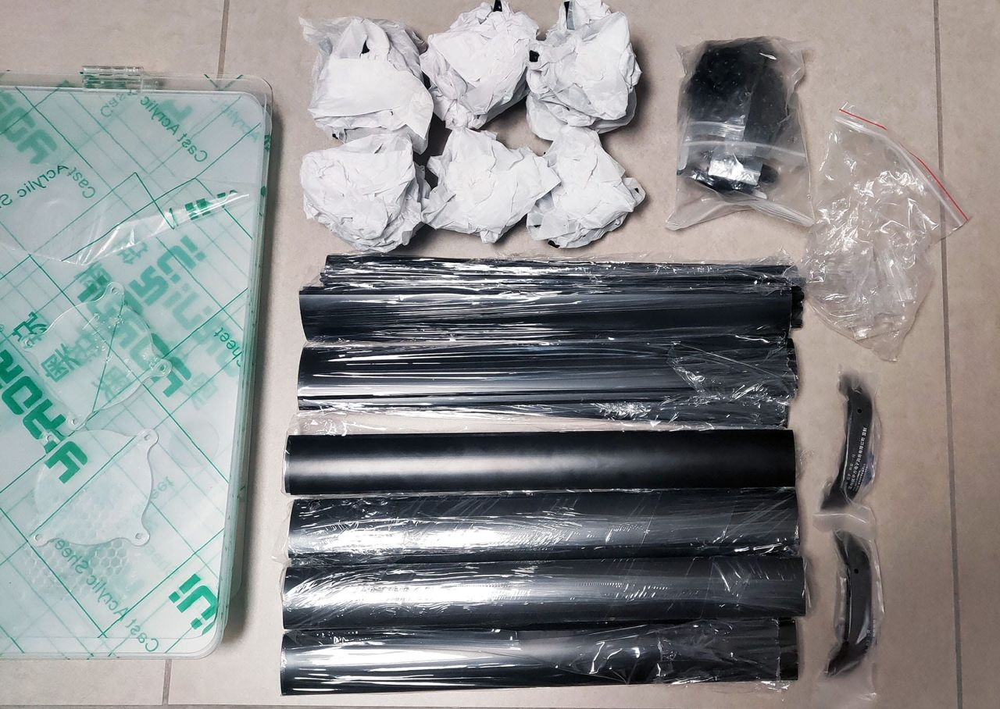
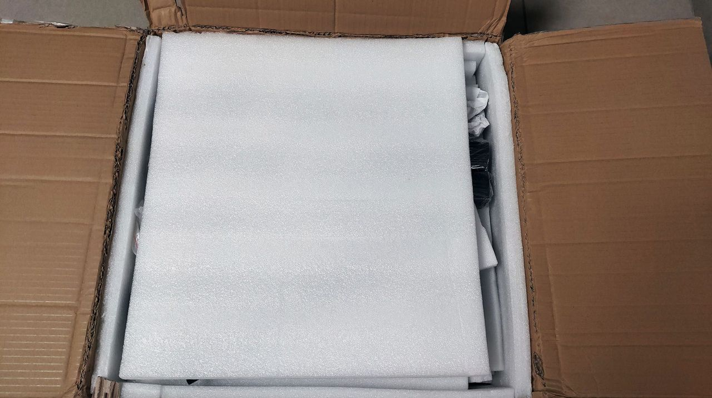

As you can see, the entire enclosure is made of aluminum extrusion profiles and cast aluminum corners. Remember I said it's universal? Well, the enclosure is meant to suit any type of 3D printer. The only things that change are the length of the extrusion profiles, the panels, and the location of the cable and ventilation holes. Right after I removed all the packaging, this is what I saw:

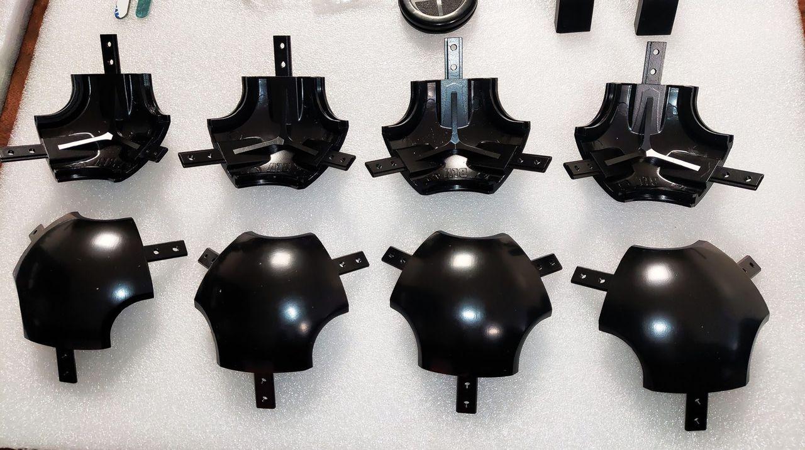
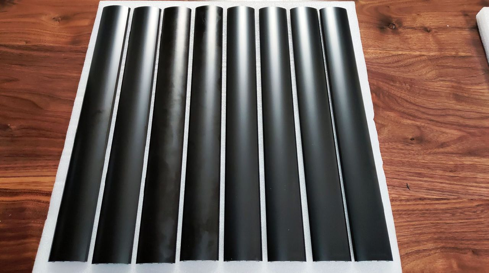

Designing the corner component alone took almost three full months, but I don't regret the time I invested in developing this extrusion system. The quality of the parts is just amazing. It is not easy to produce parts of such high quality. I had to make a number of changes before I came up with this version, which quickly turned out to be a good prototype.

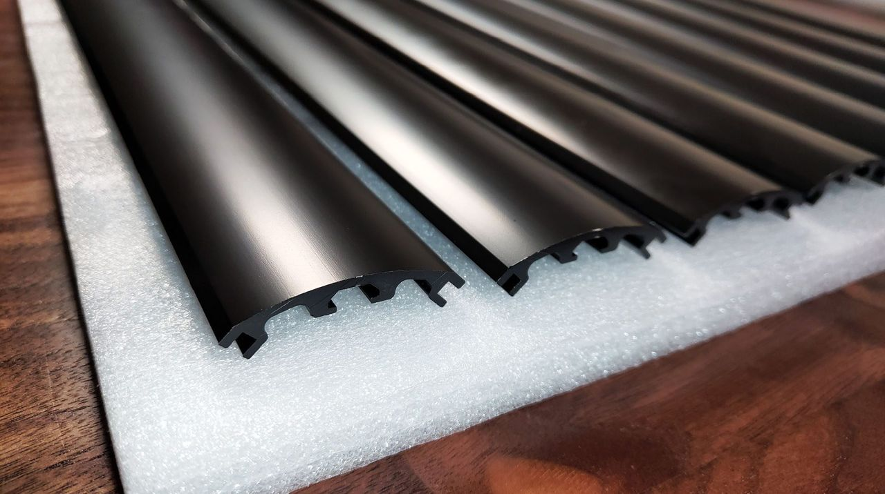
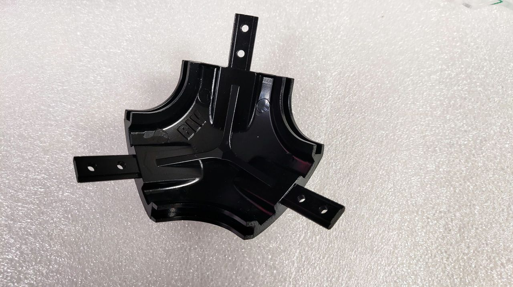

The profiles are very easy to assemble. Assembling the entire enclosure took no more than 15 minutes. Each extrusion profile fits snugly into the corner component and is locked with two set screws. Both the extrusion and the corner have a self-alignment feature that places them at the same height, creating a uniform and smooth look, so there is no need to waste time aligning the frame. Overall, the frame is extremely rigid, even though the whole structure consists of thin aluminum extrusions and plexiglass panels.

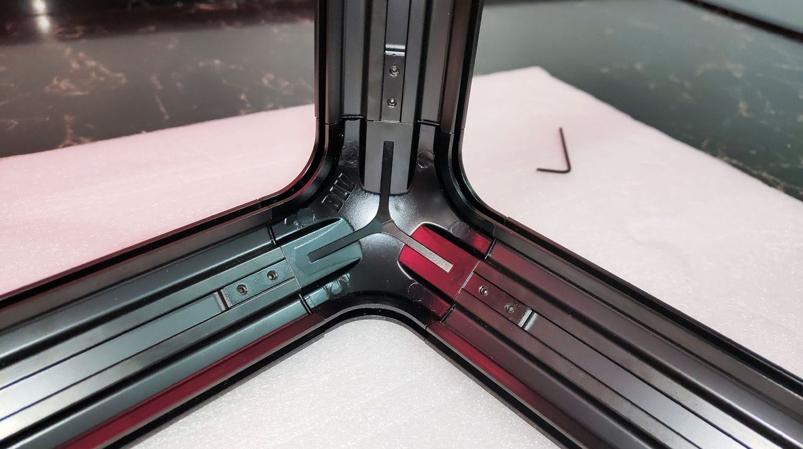

In the video below, you can see at 0:18 how the profiles connect:

!yt 7zX6puefC10

A uniform and smooth look. If only you could imagine how long a road it was and how many prototypes I made until all the parts fit and aligned perfectly with each other, as shown in the pictures.

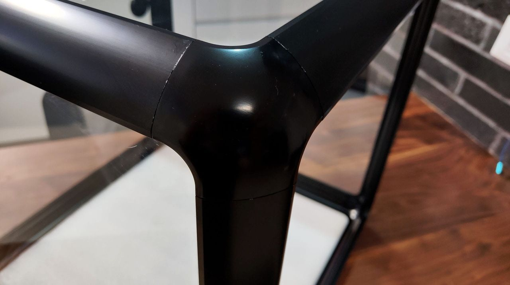
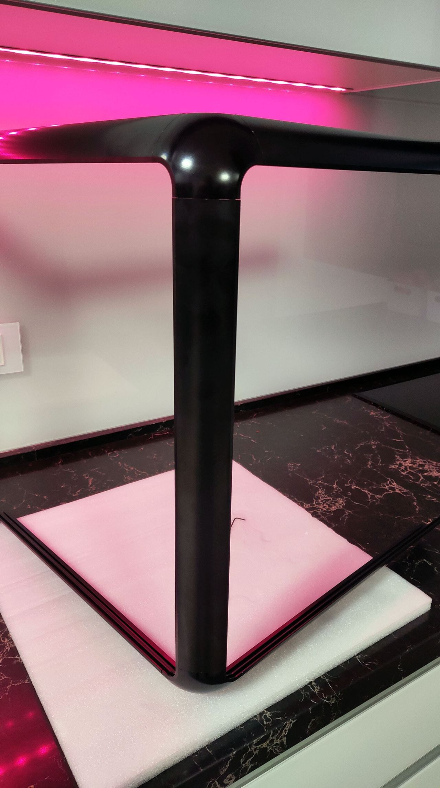

I am currently waiting for the door parts. I'm planning two doors, so it will be easy to use the printer, replace the filament and take out the printed object. The door is expected to have a magnetic lock mechanism and a clean look.

I made sure to use cast acrylic and not extruded acrylic. Cast acrylic is much clearer and has no defects compared to extruded acrylic, but it is more expensive. After the quick frame assembly, I realized that the panels were thinner than I planned: 2.7mm instead of 3mm, so they were a bit shaky. With the nylon protective film, the plexiglass is exactly 3mm thick, and it's more than perfect. Everything sits exactly as I planned. The structure is very strong, reliable and lightweight compared to other enclosures. I'm happy with the result.

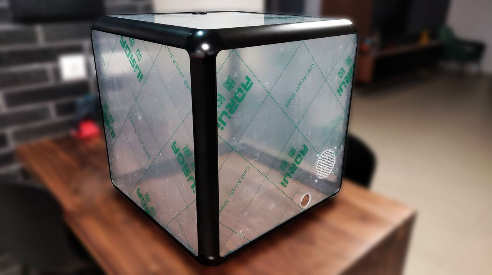

In this version, I designed a hole for a low-RPM fan (needed when printing flexible materials). There is a dedicated cover that closes the hole for those who don't want a fan. I also added a rubber grommet for external cables. I accidentally installed the panel upside down, since the cable hole was supposed to be at the bottom. Some of the hive walls broke during shipping, so the next design will have a thicker hive pattern.

You will also notice that I used the same [**COB LED lights**](../mgn-cube/updates/let-there-be-cob-led-light.md) from the mgn Cube project, and they slide smoothly inside the extrusion profile. It's worth mentioning that the extrusion channels also support T-nuts, so you can attach any camera mount, filament holder, filters, lights and more.

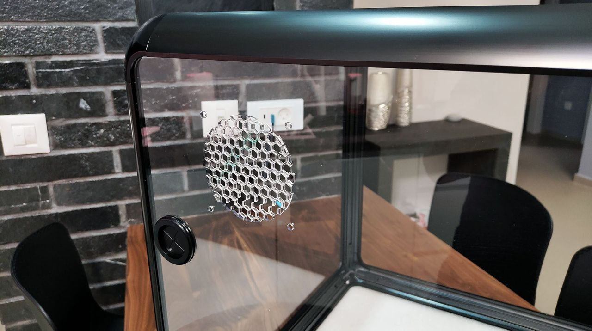
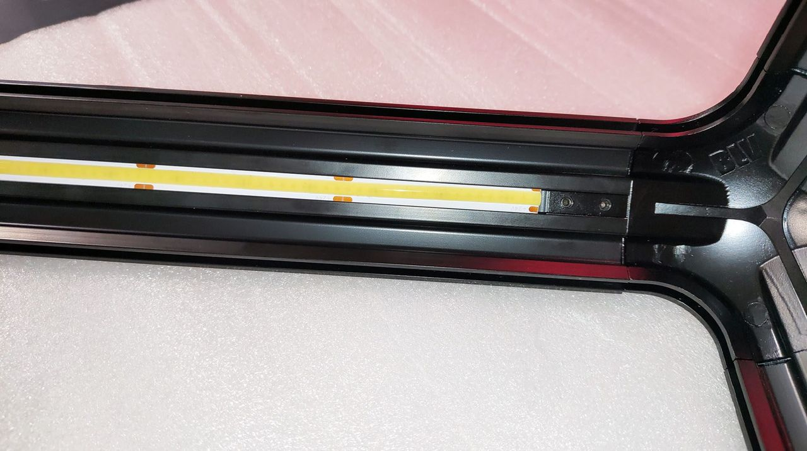

This prototype enclosure was made especially for the Prusa MINI+, so its size is 48x48x48 cm and it holds the Prusa MINI+ and its original spool holder. The bottom has no panel, and a silicone sealing strip is installed to protect the table and the aluminum extrusions from damage. Also, when your 3D printer has a serious malfunction, it's easier to remove the enclosure without a bottom panel, which gives you more room to deal with the problem. Please note that I plan to design this enclosure not only for the Prusa MINI+ but also for a large selection of popular printers like the Ender 3 series, CR-10, Prusa MK3S+, Artillery and more.

There are a few more things I need to complete, such as testing the door mechanism, sealing the panels and developing a fume extraction/filtration system. Although I have a lot of work ahead, I'm glad that at least the hard part is over. I will no doubt need help with the next steps, and I will probably open a beta testers group in the new forum I am setting up on the [**BLVprojects.com**](http://BLVprojects.com) site.

Feel free to check out the new [**BLV Discord**](https://discord.gg/X638EzVw) server.

Sincerely,

Ben Levi

