[← All updates](index.md){ .back-link }

# Trademarks and the 3D community

We are all part of an amazing community.

A community of makers, a community of developers, a community of people who come willing to learn, experience together, and most importantly share. Out of this 3D community came many businesses and developers from all over the world. Some of them have not forgotten where they came from and what they represent.

[Josef Průša](https://www.prusa3d.com) is only one example of many. I admire him not because he sells 3D printers, but because he represents the idea of sharing that has driven the 3D community all along. He doesn't seem to be bothered by the dozens of clones sold on AliExpress and in Europe, and he still shares almost everything with the community he came from. I guess he knows that he is not just selling a printer, but a complete 3D printer package with support.

[E3D](https://e3d-online.com) is another good example, and so are many other projects that came out of the community. They are all willing to share CAD files, ideas, code and everything else the community needs.

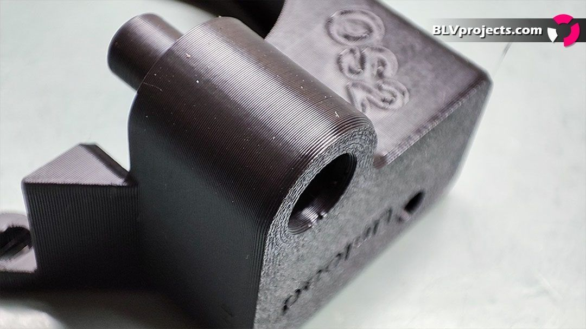
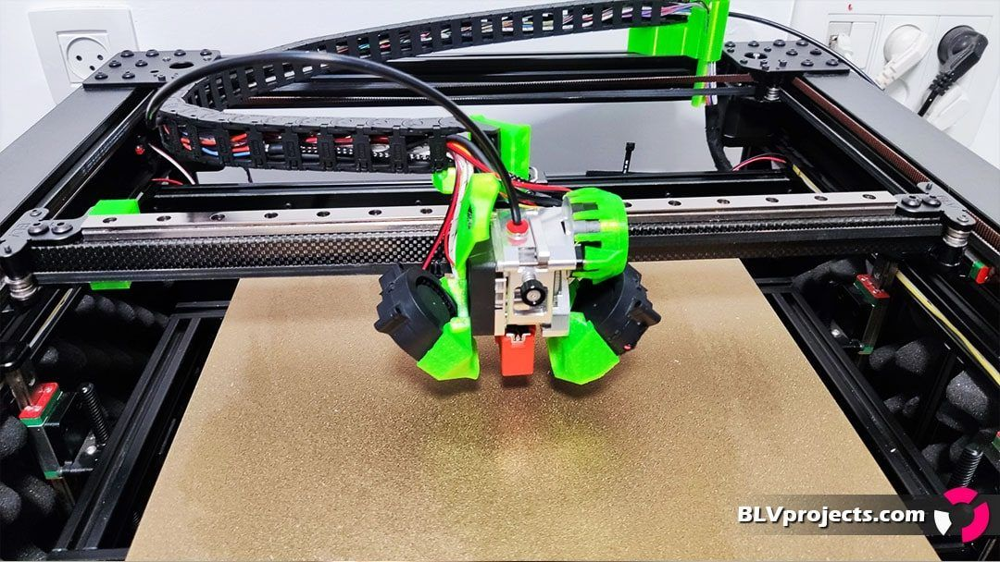
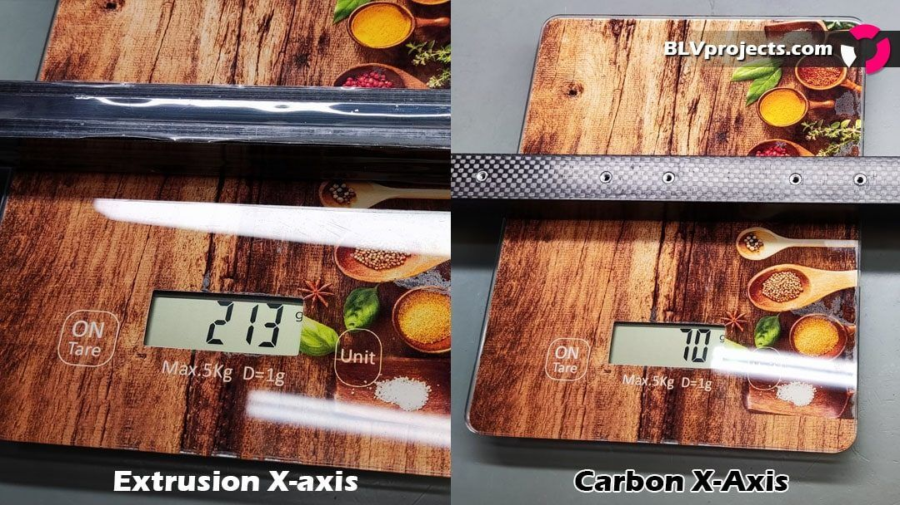

*I added a few random images so you don't get bored.*

I think there are three main components here: a cohesive community, developers, and affordable 3D printer parts. Together they created a good infrastructure for the community to grow, and each one is just as important as the others. The improvised parts that were once part of our first printers were replaced by shiny, much more efficient parts. Parts that can be trusted and are available and affordable to everyone. Or are they? Are they truly affordable?

Well, I hope that a developer who patents something will understand that it's not fair to set a ridiculously high price for it. After all, for most of us it's just a hobby. Make no mistake, I don't justify patent infringement, but I'm very frustrated to see a component whose development, production and marketing cost less than $17 being sold for a few hundred dollars.

Naturally, community members searched for alternatives and found them in the Chinese market, which hurried to grab the opportunity and offer similar products at a lower, more reasonable price. Very quickly, IPP/IPR claims began to get AliExpress stores banned from time to time, and it still happens today. I recently tested a couple of nice Chinese CHT clones. Even so, I then bothered to buy 4 pcs of the original [Bondtech CHT nozzle](https://www.bondtech.se/product/bondtech-cht-coated-brass-nozzle/). Why? Because Bondtech introduced a real innovation, had to pay patent licenses, and still offers it at a fair price. That is much less than others who offer zero innovation, throw names of exotic metals into the air and demand a fortune. Well done, Bondtech!

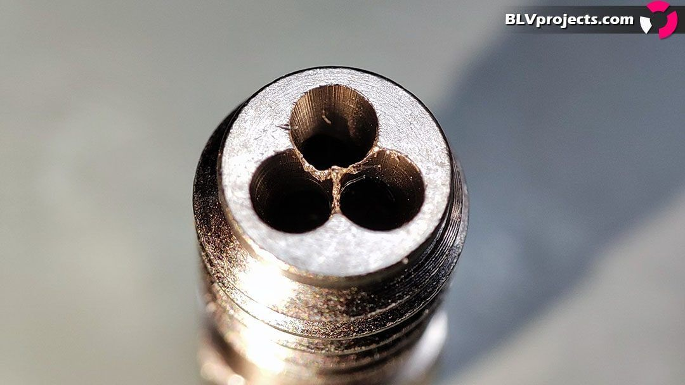
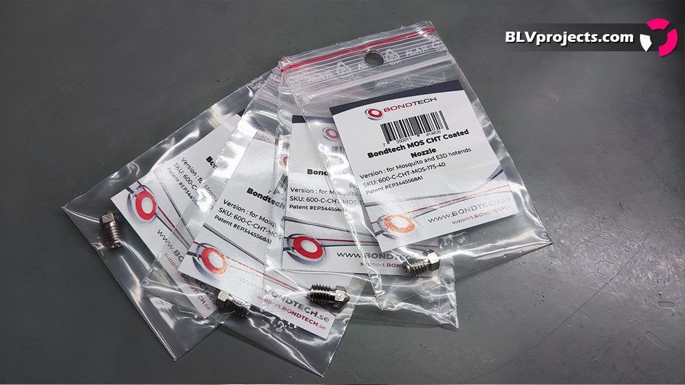
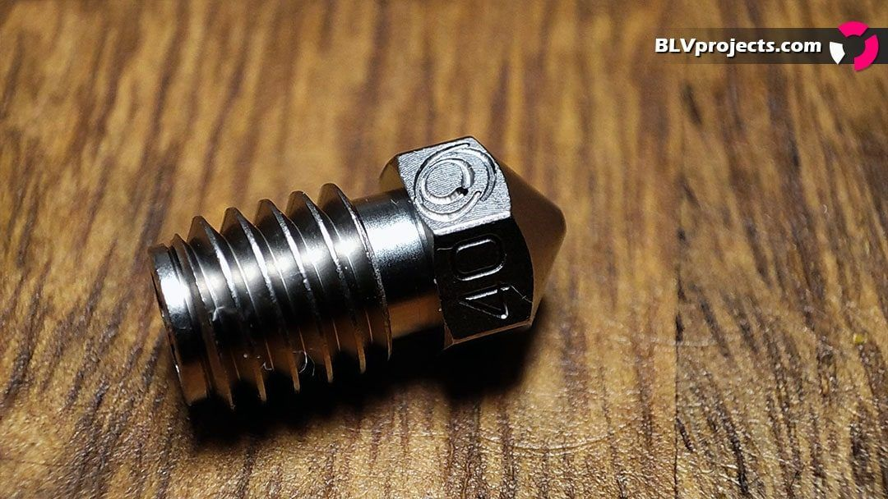

*The Bondtech CHT nozzles I bought for my own use - amazing results.*

Related to that, I woke up one morning and, to my surprise, found out that my project had been stolen. At least that's what I understood from the messages some of my friends sent me. It turned out that FYSETC had registered a trademark on my project without asking me first. They were not the only ones, and it's not just my project but many others too. After a few video calls and chats with close Chinese friends, the situation became clearer. A cold war had been going on beneath the surface for a long time. IPR/IPP claims had gotten a few stores banned for weeks and months, which raised concerns among Chinese stores and manufacturers. Gradually they began to register trademarks. Most of them wanted to make sure they wouldn't be banned if someone filed an IPP/IPR complaint. Soon enough, others were doing it too, maybe just out of panic. What is happening there now is complete chaos.

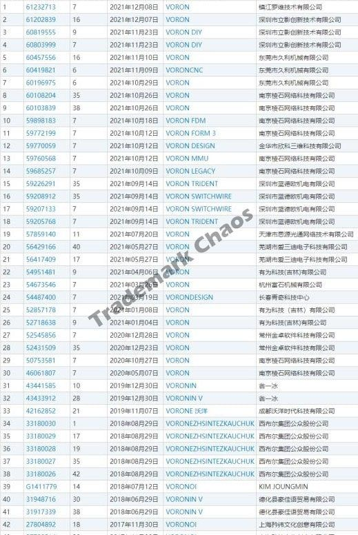
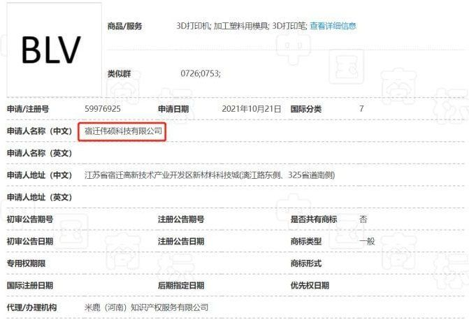
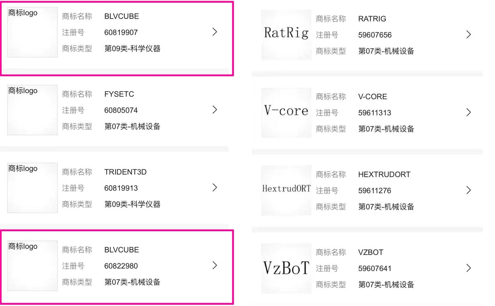

*A Chinese trademark registration I didn't even know about.*

You're probably asking what I did about it.

In the past, a decent CoreXY 3D printer would have cost over $2,800. The BLV project started as an idea for an accurate and reliable printer that is also affordable, with a BOM price of around $1,000. Inspired by the 3D community, I promised myself that if it turned out good enough, I would share everything with the community. I never expected it to become so popular. A large part of that is thanks to the knowledge I gained from the community and to the AliExpress stores that offered parts at an affordable price. You may be wondering why I keep saying "affordable" at every opportunity. So let me tell you something about myself.

I was born into a good family. When I was young, my father got cancer and later passed away, and very quickly we became poor. A computer, a game console and sometimes even food became a dream I could only enjoy when I visited friends. I worked hard every day after school to help my family, graduated high school successfully, saved money and went to university. That's why the concept of affordability has a special meaning for me. Now you can guess what my response was to the trademark issue with [FYSETC](https://s.click.aliexpress.com/e/_AbfDNc).

After many conversations, I told them how disappointed I was that they didn't share this decision with me. In the end, we came to a kind of understanding. I asked them not to prevent competition. As long as they don't ban anyone else without my permission and keep things affordable and fairly priced, I don't have a problem with it, at least for now. For the record, the only time I had to file an IPP/IPR complaint was against a factory that cloned the metal kit incorrectly, which led to dozens of complaints even though I didn't design their parts.

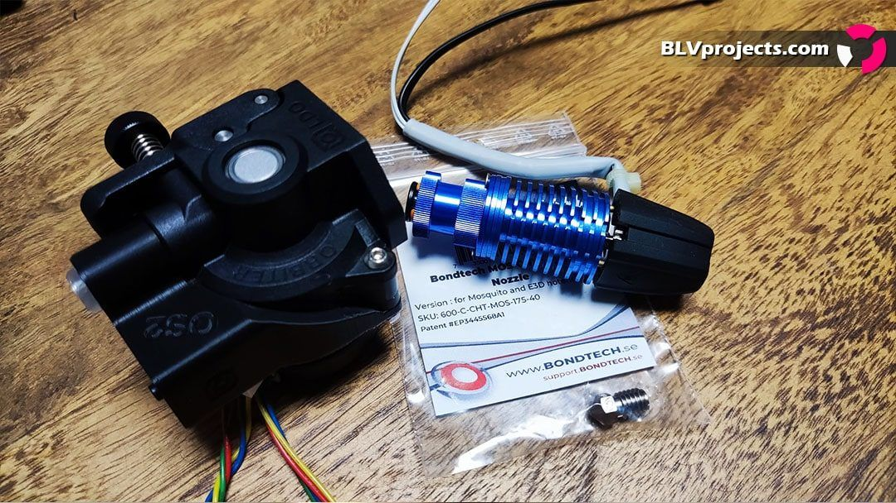
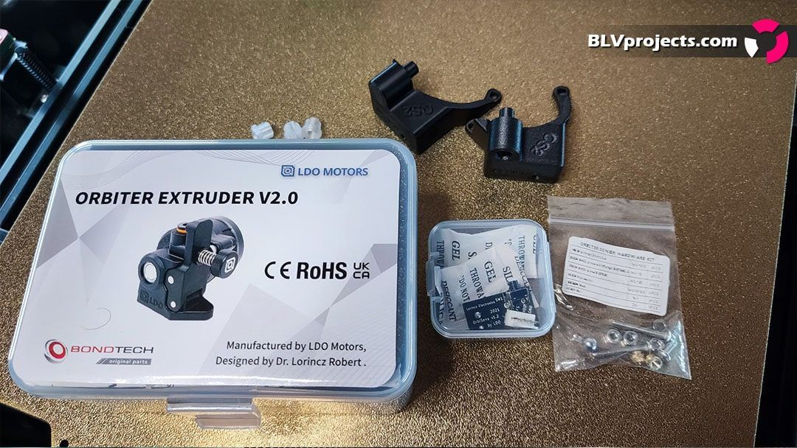
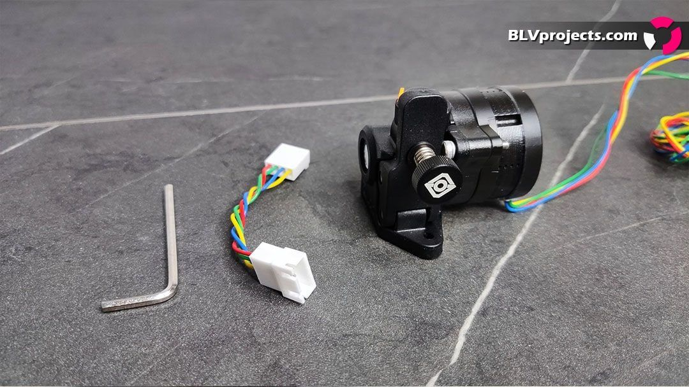

*The next BLV hotend setup? Testing it soon.*

I tried to map the manufacturers that provide parts for the BLV project:

- [**FYSETC**](https://s.click.aliexpress.com/e/_AbfDNc): currently the FYSETC store is a supplier of the BLV Cube kit, and I wrote an honest review of it. They manufacture many parts suitable for the BLV project, and they started selling the Spider V2.2 board, which I now use with a 48V system (absolutely crazy fast) and I am very happy with it. They also sell the BLV Ender 3 Pro metal kit (the files are free for everyone). Disclosure: they gave me a symbolic discount on the first kit, and that's it.
- [**Blurolls**](https://www.aliexpress.com/store/2808029): Peter was the first to support the BLV project and truly believed in it. He made the first kit and is still a supplier of the BLV Cube kit and the Lite kit, which costs under $500. He also provides many high-quality parts for the BLV project. Blurolls is the **only** manufacturer of the BLV metal kit, providing more than 65 CNC-machined aluminum parts at an unbelievable price of $110. Although the BLV project is open source, the [BLV metal kit](https://s.click.aliexpress.com/e/_dZWiHmO) that came later is not fully open source. Only the X-carriage CAD files were published. We have an agreement: I gave him my work for free, and in return he sells the parts at the lowest price he can afford. No one else could promise me a lower price than his, and many tried. Please note that the FYSETC kits contain the official [Blurolls BLV metal kit](https://s.click.aliexpress.com/e/_dZWiHmO).
- [**Mellow**](https://s.click.aliexpress.com/e/_999xga): you all know the Mellow store, and "high quality" is its middle name. Mellow will produce the new carbon X-axis for the BLV Cube, and I will include a few of their next products in the next update. I also made a whole new setup for the Mellow NF-Sunrise hotend/extruder. Their idlers and pulleys are the highest-quality yet affordable ones I have found for the BLV project. A well-known quality manufacturer that I respect.
- **LDO**: they started supporting a few community projects, and the Orbiter and BLV are just two examples. LDO offers an excellent set of stepper motors for the BLV project. I tested their new **LDO-42STH48-2504AC** 2.5A steppers with FYSETC HV5160 drivers, with insane results over 300 hours of testing. Highly recommended. I am going to test the new Orbiter V2.0 by LDO with the Rapido hotend. Many thanks to my friend [Róbert Lőrincz](https://orbiterprojects.com) for the effort he has put into the amazing Orbiter V2.0 extruder project.
- [**Trianglelab**](https://s.click.aliexpress.com/e/_99nh42): a well-known manufacturer producing high-quality parts for many projects. I adapted the Dragon hotend and the Matrix extruder/hotend as soon as they came out. I am going to test the new Rapido hotend with [Róbert Lőrincz](https://orbiterprojects.com)'s new Orbiter V2.0 extruder.
- [**Funssor**](https://s.click.aliexpress.com/e/_9jlaDC): provides frames and more for the BLV project at very affordable prices.
- [**Haldis**](https://s.click.aliexpress.com/e/_97Xdj0): I am testing new hotend setups for high-speed printing, but there are no approved parts yet.
- [**CNA Mechanical Parts Store**](http://s.click.aliexpress.com/e/b4ZT5JAu): offers a variety of linear rails and other affordable mechanical parts that I bought and tested myself. I lost a lot of money on cheap linear rails until I bought rails from CNA. Excellent linear rails at a reasonable price.
- **BOM links**: all the products and stores that are part of the BOM. I tested and approved most of them myself, and some were suggested by community members.

Please feel free to provide parts for the BLV project, including printed parts, as long as you don't take advantage of or manipulate the project's license terms. Please respect the 3D community and don't ban competition.

And a small piece of advice for our Chinese friends, who have become an integral part of the 3D community. My dear friends, please try to be as transparent as possible and share with us the decisions related to developers and projects. Please communicate with us, and don't hesitate to ask and share your thoughts.

And for our great community: I see each member who has started a shared project as a partner. For those of you who decide to start a company or just sell products, I'm begging you, please do not forget where you came from. You are part of the 3D community, so please don't see us only as something to be exploited for money.

**Please, don't take us back to a time when a 3D printer was just a dream.**

Sincerely,

Ben Levi - BLV project developer

